# System Design

This document provides the system-level design for CanvasNetLayout.

## Architecture

CanvasNetLayout is the shared graph layout of the CanvasNet diagram packages, delivered as its own NuGet package
(`DemaConsulting.CanvasNet.Layout`, root namespace `DemaConsulting.CanvasNet.Layout`). It positions the nodes of a
directed, possibly compound and cyclic graph in ranks and routes its edges with exactly the results of the dagre layered
layout of dagre-d3-es, the layout that Mermaid draws its flowcharts, class, state, and entity relationship diagrams
with. The layout is bounded by a work budget, observes cancellation, and is deterministic. It was part of the
CanvasNetMermaid system until it became a package of its own, so that every diagram package that needs a layered layout
can share one faithful, tested port instead of carrying a copy.

The system consists of two internal subsystems and no direct unit:

- **Graphlib** (subsystem; see *Graphlib Design*) - `Graph` (graphlib's directed or undirected, simple or multi, flat
  or compound graph whose collections keep the key order of a JavaScript object, with `GraphEdge` and `ObjectKeyMap`)
  and `GraphAlgorithms` (the depth-first `preorder` and `postorder` that dagre uses).
- **Dagre** (subsystem; see *Dagre Design*) - the layered layout: `DagreLayout` (the entry point `Run`, the pipeline
  of dagre's `layout.js`, its utilities, the input and layout labels, and the lodash and V8 semantics), `DagreAcyclic`,
  `DagreRanker`, `DagreNesting`, `DagreNormalizer`, `DagreOrdering`, `DagrePositioning`, `DagreCoordinateSystem`, and
  `LayoutWorkMeter` (the abstract work budget, cancellation check, and unique-id counter of the layout of one diagram).

The dependency direction is one way: `Dagre -> Graphlib`. Neither subsystem uses any other CanvasNet system.

**Consumers.** The system's consumers are the diagram systems that reference the package: today CanvasNetMermaid,
whose `ClusterLayout` (in its `Rendering` subsystem) builds the input graphs and calls `DagreLayout.Run`, and whose
renderers charge their own metered loops to the same meter. A consumer derives its own meter from `LayoutWorkMeter`
(Mermaid's is `MermaidLayoutWorkMeter` of its `MermaidDocument` unit), so a layout fails in the words of the package
that called it.

**API decision: internal types visible to friend assemblies.** Every type of the package is `internal`, and the
package grants `InternalsVisibleTo` to `DemaConsulting.CanvasNet.Layout.Tests`, `DemaConsulting.CanvasNet.Mermaid`,
and `DemaConsulting.CanvasNet.Mermaid.Tests` (a future diagram package that adopts the layout, such as the PlantUML
package, is added to the list with its tests). The package therefore has no public API. The reasons:

1. **The established pattern of the repository.** The core library grants internal access to the Pdf, Svg, Pptx,
   Viewer, and Vega-Lite packages, and Render3D to the Scad package; all packages are packed by one solution-wide
   `dotnet pack` and released together from one commit, so friend assemblies always ship in lockstep and never mix
   versions in practice.
2. **The surface is a faithful port of JavaScript semantics, not a contract.** graphlib's labels may be `undefined`
   (null), dagre's attributes are strings (`rankdir`, `ranker`, `labelpos`), NaN passes through, and the iteration order
   is JavaScript's own-key order. These are right for fidelity but a poor public API; publishing them would freeze those
   quirks under semantic versioning and require public API documentation for them.
3. **Every consumer is in this repository.** Nothing outside needs the layout today; a public facade can be added later
   without breaking anything.
4. **The accepted cost.** The package is an implementation dependency (installed automatically with
   `DemaConsulting.CanvasNet.Mermaid`) that a user cannot call; the README says so.

**The meter contract.** `LayoutWorkMeter` is abstract. Its base holds what every layout needs - the budget
(`MaxWork`), the work used (`Used`), the cancellation token checked by every `Charge`, and the lodash `_.uniqueId`
counter - and a consumer overrides three members: `Failure(description)` creates the consumer's located render
failure of a layout that dagre itself cannot complete, `LimitExceeded()` creates the consumer's located limit failure
(also used when the stack runs short), and `IsFailure(exception)` recognizes the consumer's own failures.
`DagreLayout.Run` maps an `InsufficientExecutionStackException` to `LimitExceeded()` and an
`InvalidOperationException` to `Failure(message)` only when `IsFailure` does not recognize it, so the consumer's own
failures (which derive from `InvalidOperationException`, as Mermaid's `MermaidRenderException` does) pass through
unchanged, as does an `OperationCanceledException`. For Mermaid this is exactly the behavior of the code before the
move, so its errors and pictures are unchanged.

## External Interfaces

All interfaces are internal and are used only by the friend assemblies:

- **Graph input** (`Graph<DagreGraph, TNode, TEdge>` of the `Graphlib` subsystem, with `TNode : DagreNode` and
  `TEdge : DagreEdge`): a simple or multi, flat or compound graph whose graph label sets the layout attributes
  (`RankDir` `TB`, `BT`, `LR`, or `RL`; `NodeSep`, `EdgeSep`, `RankSep`; `MarginX`, `MarginY`; `Ranker`; `Align`;
  `Acyclicer`), whose node labels give the node sizes, and whose edge labels give `MinLen`, `Weight`, the label size,
  `LabelPos` (`l`, `c`, or `r`), and `LabelOffset`; a null attribute takes dagre's default. A consumer derives its own
  node and edge label types to carry its own data.
- **Layout call** (`DagreLayout.Run(graph, meter)`): lays the graph out in place and returns the internal layout graph
  (ranks and orders) for checks. **Layout output** (written to the labels): every node center (`X`, `Y`), every
  cluster size (`Width`, `Height`), every edge route (`Points`, ending on the node borders) and label center (`X`, `Y`),
  and the drawing size (the graph label's `Width` and `Height`).
- **Work meter** (`LayoutWorkMeter`, abstract): the protected constructor `(long maxWork, CancellationToken)` (a limit
  below 1 throws `ArgumentOutOfRangeException`), `Charge`, `UniqueId`, `MaxWork`, `Used`, and the overridden `Failure`,
  `LimitExceeded`, and `IsFailure` (see *Architecture*). One meter serves one diagram on one thread.
- **Helpers**: `DagreLayout.Same` (JavaScript's `===` on numbers), `ObjectKeyMap` (the key order of a JavaScript
  object, also used by Mermaid's flowchart model and gantt renderer), and `GraphAlgorithms`.
- **Exceptions**: the consumer's own failures created by its meter, `OperationCanceledException` from `Charge`, and
  `ArgumentOutOfRangeException` from the meter's constructor.
- **Third-party notices** (output, the `licenses/` folder of the package): `LICENSE-dagre.txt` (dagre-d3-es, with the
  notices of dagre and graphlib) and `LICENSE-lodash.txt`; the provenance README ships in the tool package as
  `licenses/Layout-third-party-README.md`.

## Dependencies

- **.NET base class library** only - collections, `System.Math`, `System.Linq`, `System.Globalization`,
  `System.Threading.CancellationToken`, and `RuntimeHelpers.EnsureSufficientExecutionStack`.
- **No other CanvasNet system.** The package references no CanvasNet project, not even the core library; nothing of the
  layout draws, measures text, or uses a CanvasNet type.
- **No OTS runtime dependency.** dagre, graphlib, dagre-d3-es, and lodash are **not** dependencies: their behavior is
  ported into local source (see *Third-Party Provenance and Attribution*). The pinned `dagre-d3-es` npm package of the
  repository is used only by the developer script `tools/visual-diff/mermaid/gen-dagre-goldens.mjs` that records the
  stage goldens; CI never runs it.

## Risk Control Measures

N/A - CanvasNetLayout is not safety-classified and needs no segregation for risk control: it performs no I/O, holds no
state between calls, and runs only inside the call of a consumer. The availability controls it contributes to its
consumers are the work budget and the cancellation check of the meter and the stack checks of the recursive stages
(see *Untrusted Input and Limits*), and its determinism (see *Determinism*).

## Data Flow

```mermaid
flowchart LR
    G[Consumer's input graph and meter] --> B[DagreLayout: build the layout graph]
    B --> A[DagreAcyclic]
    A --> N[DagreNesting]
    N --> R[DagreRanker]
    R --> Z[DagreNormalizer]
    Z --> O[DagreOrdering]
    O --> C[DagreCoordinateSystem]
    C --> P[DagrePositioning]
    P --> U[Undo steps and routes]
    U --> W[Results written to the input labels]
```

1. The consumer builds a `Graph` with dagre's input labels (sizes, attributes, parents) and creates its meter.
2. `DagreLayout.Run` charges the input, copies the graph into the internal layout graph with dagre's defaults, and runs
   dagre's stages in dagre's order (see *Dagre Design*), each iterative stage charging the meter.
3. The results are written back to the consumer's labels; the consumer reads them to place and draw its diagram.
4. A failure is the consumer's exception from the meter; a cancellation is an `OperationCanceledException`.

## Design Constraints

### Platform Support

The package targets `net8.0`, `net9.0`, `net10.0`, and `net11.0` and runs on Windows, Linux, and macOS, like the
diagram packages that depend on it. It contains no platform-specific code and uses no native library; the platform
requirements are proven by running a system test on every platform and framework.

### Integration Patterns

- **Friend assemblies.** The internal surface is reached only through `InternalsVisibleTo`
  (`DemaConsulting.CanvasNet.Layout.Tests`, `DemaConsulting.CanvasNet.Mermaid`,
  `DemaConsulting.CanvasNet.Mermaid.Tests`). A consumer's node and edge labels may derive from `DagreNode` and
  `DagreEdge` across the assembly boundary (Mermaid's `ClusterLayoutNode` and `ClusterLayoutEdge` do).
- **Lockstep release.** The friend assemblies are packed and released together with the package from one commit, so a
  consumer always runs with the layout it was built and tested with; upgrading `DemaConsulting.CanvasNet.Layout` alone
  is not supported, as for the other friend packages of the repository.
- **No public API documentation.** The package has no public types; its API documentation (ApiMark) is empty.
- **The tool package.** The `canvasnet` tool bundles `DemaConsulting.CanvasNet.Layout.dll` transitively through the
  Mermaid library and ships the provenance README as `licenses/Layout-third-party-README.md`; the license texts of the
  layout are byte-identical to the `LICENSE-dagre.txt` and `LICENSE-lodash.txt` that the Mermaid library already places
  in the tool's `licenses/` folder, so they are not added twice.
- **Curve code stays with the consumer.** The edge curves of Mermaid (`EdgeBuilder.Curves.cs`, a port of d3-shape and
  d3-path under the ISC license, coupled to Mermaid's scene and number formatting) are not part of the layout: they
  exist to match Mermaid's SVG text, and another diagram language draws its edges its own way.

### Determinism

- **Order**: graphlib's own-key order (array-index keys first in ascending order, then the other keys in insertion
  order) and lodash's and V8's sorting steps are reproduced, so ties are broken as in dagre-d3-es and never by hash
  order.
- **Arithmetic**: the layout uses `double` arithmetic in dagre's order of operations; nothing depends on the culture,
  the system clock, or a random source.
- **No shared state**: the units hold no static state; lodash's `_.uniqueId` counter lives in the meter, so the dummy
  names of a diagram never depend on what was laid out before. One graph and one meter serve one call on one thread, so
  concurrent layouts do not interact.

### Third-Party Provenance and Attribution

CanvasNetLayout is **derived with attribution**, not clean-room. The ported projects are listed with their license,
copyright notice, and the unit that ports them in `src/DemaConsulting.CanvasNet.Layout/third-party/README.md`; every
source file with ported logic starts with `// Portions derived from <project> (<license>); see third-party/README.md`:

| Upstream project | License | Ported into |
| --- | --- | --- |
| dagre-d3-es (dagre, graphlib) | MIT | `Graph`, `GraphAlgorithms`, and every `Dagre` unit except the work budget |
| lodash | MIT | the `Lodash` helpers of `DagreLayout` (sorting, extremes) and the unique ids of `LayoutWorkMeter` |

The steps of V8's array sort are reimplemented from the published algorithm. The key order of `ObjectKeyMap` follows
the ECMAScript specification, and the work budget and the abstract meter are original. The package is not affiliated
with, and not endorsed by, the authors of dagre, graphlib, dagre-d3-es, or lodash. The dagre stage goldens are
generated from the pinned dagre-d3-es from original inputs by `tools/visual-diff/mermaid/gen-dagre-goldens.mjs`.

### Untrusted Input and Limits

Graphs come from untrusted diagram text. Every iterative stage charges the consumer's meter in proportion to its work,
and a charge that would pass the budget fails with the consumer's limit failure; the recursive stages call
`EnsureSufficientExecutionStack`, and a stack that runs short fails the same way. A graph that dagre itself cannot lay
out (a route that ends at its node's center, a graph to rank that is not connected, a broken cluster path) fails with
the consumer's render failure. The charges are deterministic (the complete acyclic graph on 30 nodes takes 2,955,593
steps), so the same graph always passes or fails the same budget.

### Requirement Identifiers

The `Graphlib` and `Dagre` requirements were moved from the CanvasNetMermaid system with the code. Their identifiers
were renamed one to one by prefix - `CanvasNetMermaid-Graphlib-*` to `CanvasNetLayout-Graphlib-*` and
`CanvasNetMermaid-Dagre-*` to `CanvasNetLayout-Dagre-*` - with no requirement split or merged; the wording names the
consumer's failures where it named Mermaid's. The Mermaid-specific failures of the meter are now the requirements
`CanvasNetMermaid-MermaidDocument-LayoutLimit` and `CanvasNetMermaid-MermaidDocument-LayoutFailure`, and the Mermaid
system requirements link to the renamed layout requirements as children.
