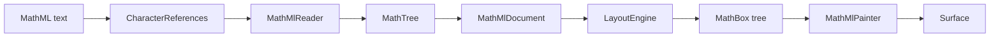

# System Design

This document provides the system-level design for CanvasNetMathMl.

## Architecture

CanvasNetMathMl is a static renderer of MathML Core equations, delivered as its own NuGet package
(`DemaConsulting.CanvasNet.MathMl`, root namespace `DemaConsulting.CanvasNet.MathMl`), independent of the other
document systems in this repository. It reads the text of one `math` element and **parses** it into a validated,
immutable document, **describes** the equation without drawing it (display mode, element count, text alternative, and
annotations), **measures** the size it renders at with the row of its baseline, and **renders** it onto a `Surface` (the
core `CanvasNet` pixel buffer) at its natural size multiplied by a scale or fitted inside an exact size. Rendering is
static, deterministic (pixel-identical surfaces on every run, thread, and platform, because only the bundled fonts are
used), and offline (no browser, no network, no file other than the one opened), and uses only the .NET base class
library, the public API of the core `CanvasNet` package, and the internal OpenType `MATH` table reader of the core
through friend access.

The goal is **fidelity to MathML Core as browsers implement it**: an equation must have the boxes that Chrome computes
for it with the same font. The layout is therefore implemented from the MathML Core specification and checked against
reference layouts that headless Chrome computes for original fixtures (see *Known Differences* for where CanvasNet
follows Chrome rather than a literal reading of the specification). Every element of MathML Core is drawn: the token
elements, the rows, the operator dictionary with its spacing, stretchy and large operators, fractions, radicals,
scripts, under- and overscripts, and tables. The MathML 3 table attributes that MathML Core dropped and Chrome ignores
(`columnalign`, `rowalign`, `columnspacing`, `rowspacing`, `framespacing`, `columnlines`, `rowlines`, `frame`) are
drawn as Firefox draws them, checked against reference layouts that headless Firefox computes. Every element outside
MathML Core is laid out as a row of its children, as MathML Core lays out an unknown element, and is **reported with a
stable `mathml-*` code and the exact location, never skipped silently**. A fraction, a root, or a scripted element
without the children MathML Core requires is laid out as a row too, stray children of a table are wrapped in anonymous
rows and cells, and both are reported as the `mathml-child-count` warning. The `MathMlImageSource` draws `.mml` files
that other documents link to.

The system is decomposed into two direct units and two internal subsystems:

- **MathMlDocument** (direct unit, public API) - the entry points `Parse`, `Open(path)`, and `Open(stream)`, the
  description properties, `Measure` and `Render`, the options, limits, records, codes, and exceptions, the internal
  report sink with the pending reports that reading keeps for every call, and the image source `MathMlImageSource`;
  see *MathMlDocument Unit Design*.
- **MathMlPainter** (direct unit) - the painter of a laid-out equation: backgrounds, glyph outlines, rules, and
  borders, bounded and cancelable; see *MathMlPainter Unit Design*.
- **Syntax** (subsystem) - the `CharacterReferences` unit (the named character references and the location map), the
  `MathMlReader` unit (the text into the equation tree), the `MathTree` unit (the equation model), and the
  `AttributeValues` unit (the parsers of attribute values and of the inline style); see *Syntax Subsystem Design*.
- **Layout** (subsystem) - the `LayoutEngine` unit (the walk and dispatch), the `StyleResolver` unit (the computed
  styles), the `MathFont` unit (the bundled math font and its `MATH` data), the `MathBox` unit (the box model), the
  `TokenLayout` unit (the token elements, the properties of operators, and the `mathvariant` tables), the `RowLayout`
  unit (rows, their stretchy operators, and grouping elements), the `FractionLayout` unit (`mfrac`), the
  `RadicalLayout` unit (`msqrt` and `mroot`), the `ScriptLayout` unit (`msub`, `msup`, `msubsup`, and
  `mmultiscripts`), the `UnderOverLayout` unit (`munder`, `mover`, and `munderover`), the `TableLayout` unit (`mtable`,
  `mtr`, and `mtd`), the `OperatorDictionary` unit
  (the operator dictionary of MathML Core), and the `StretchyGlyphs` unit (size variants, glyph assemblies, and their
  fallbacks); see *Layout Subsystem Design*.

The SysML2 model names the system `CanvasNetMathMlSystem` and prefixes the names of its subsystems and units with
`MathMl` (`MathMlDocument`, `MathMlPainter`, `MathMlSyntax`, `MathMlReader`, `MathMlCharacterReferences`,
`MathMlMathTree`, `MathMlAttributeValues`, `MathMlLayout`, `MathMlLayoutEngine`, `MathMlStyleResolver`,
`MathMlMathFont`, `MathMlMathBox`, `MathMlTokenLayout`, `MathMlRowLayout`, `MathMlFractionLayout`,
`MathMlRadicalLayout`, `MathMlScriptLayout`, `MathMlUnderOverLayout`, `MathMlTableLayout`, `MathMlOperatorDictionary`,
and `MathMlStretchyGlyphs`), because part def names stay unique
across the model and the other systems already use
`Syntax`, `Layout`, and similar short names.

The pipeline is:

## External Interfaces

- **`MathMlDocument.Parse(string, MathMlOpenOptions?)`** (in, MathML text) - at most `MaxTextSize` characters; one
  `math` element in the MathML namespace or in no namespace.
- **`MathMlDocument.Open(string path, ...)`** (in, UTF-8 file) - strict UTF-8, byte-order mark dropped, read in
  bounded chunks; the source name is the path unless the options name it.
- **`MathMlDocument.Open(Stream, ...)`** (in, UTF-8 stream) - as for a file; the stream is left open.
- **Description properties** (out) - `SourceName`, `Display` (`MathMlDisplay.Inline` or `Block`), `ElementCount`,
  `AltText`, and `Annotations` (`MathMlAnnotation(Encoding, Text)` in document order).
- **`MathMlDocument.Measure(MathMlRenderOptions?, CancellationToken)`** (out, `MathMlSize(Width, Height, Baseline)`) -
  the size a render gives and the row of the alphabetic baseline; the reports of the call are delivered.
- **`MathMlDocument.Render(...)`** (out, `Surface`) - at the natural size times the scale, or fitted and centered into
  an exact size of 1 to `Surface.MaxDimension` on each side; the caller owns the surface.
- **`MathMlRenderOptions`** (in) - `FontSize` (16 CSS pixels by default), `Scale`, `Display` (overrides the `display`
  attribute), `Color` (black), `Background` (transparent), `Limits`, the two report handlers, and
  `ThrowOnUnsupportedFeature`.
- **Report handlers** (out) - `MathMlDiagnostic` warnings and `MathMlUnsupportedFeature` reports, once, in order, on the
  calling thread; `MathMlUnsupportedFeatureException` in strict mode.
- **`MathMlSyntaxException`** (out, exception) - a stable `mathml-*` code, the location in the original text, and a
  hint.
- **`MathMlRenderException`** (out, exception) - a limit exceeded while laying out or painting, a picture larger than a
  surface can be, or a layout defect.
- **`InvalidDataException`** (out, exception) - a text over the size limit.
- **`MathMlImageSource`** (in, `ImageSourceRequest`; out, `ImageSourceResult`) - the `IImageSource` and
  `IFragmentImageSource` named `mathml` for `.mml` files (no scheme): the fragment `#display=block` or
  `#display=inline` sets the display mode (any other value is refused with `FolderImageResolver.FragmentInvalidCode`
  before the file is read); the equation is drawn on a transparent background at its natural size at 16 CSS pixels
  (which may exceed a surface) or fitted into the requested size within the pixel budget; warnings are returned as
  `mathml-warning` notes with the specific code in `Detail`, unsupported features under their own codes, both with
  their locations; strict mode and cancellation come from the request, and only the request's content is read.

## Dependencies

CanvasNetMathMl references the sibling `CanvasNet` system: its `Canvas` subsystem (`Surface`, `Rgba32`, `CssColor`),
`Geometry` (paths), `Drawing` (path filling), `Fonts` (the bundled Noto Sans Math through the shared cache of
`SystemFontCatalog`, its `MATH` table through `TrueTypeFont.TryGetMathTable`, the glyph outlines, and the bundled
`GlyphFallback`), `Packaging` (the hardened XML reader `SafeXml`), and `ImageSources` (the image-source contract that
`MathMlImageSource` implements). The `MATH` table reader and the bundled-font
cache are internal to the core and reached through friend access (`InternalsVisibleTo`), so that the SFNT data is parsed
once, by the core that owns SFNT parsing. It has no OTS runtime dependency and references no other format package of the
repository. See *CanvasNet System Design* for the referenced subsystems.

## Risk Control Measures

MathML text is untrusted input. The design segregates the risk as follows:

- **Bounded input** - the text is refused above `MathMlLimits.MaxTextSize` before any work (a stream is read in chunks
  and stops as soon as the limit is certainly exceeded); the reader bounds the elements (`MaxElements`), the nesting
  (`MaxNestingDepth`, at most 1,024), and the length of a token (`MaxTokenLength`).
- **No document types, no network, no files** - the named references are rewritten into numeric references by the
  package itself, so the XML reader runs with document types prohibited and no resolver (the vehicle of
  entity-expansion and external-entity attacks); links are reported and never followed; only the file the caller
  opens is read.
- **No recursion on input** - the reader is iterative, so deep nesting fails with a limit error, never a stack
  overflow; the layout recursion is bounded by the nesting limit, which the reader enforced.
- **Bounded layout and painting** - every element and character is charged to `MaxLayoutWork`, again when a stretchy
  operator is laid out a second time; a stretched operator or radical symbol is refused above `MaxAssemblyParts` glyphs
  before any glyph is placed; a table is refused above `MaxTableCells` grid slots (rows times columns after the spans,
  which are clamped to the HTML maximums) before its grid is allocated, and every slot is charged to `MaxLayoutWork`;
  lengths are clamped to a finite magnitude and the math depth to plus or minus 64; the
  picture is refused above `Surface.MaxDimension`; the painter counts the glyphs against `MaxPaintedGlyphs` before it
  paints; every call can be canceled.
- **Fail closed** - every refusal is a documented exception with a stable code; an unsupported construct is reported,
  never silently ignored, and strict mode turns it into an exception; an exception that the layout does not document
  becomes a located `mathml-render-failed` error. A seeded mutation fuzzer over every reference fixture checks that
  only the documented exceptions occur.

## Data Flow

The text is read (strict UTF-8 for streams and files) and checked against the size limit. The `CharacterReferences`
pre-pass rewrites the named references into numeric references and records where each line shifted; the `MathMlReader`
reads the rewritten text with the hardened XML reader, maps every position back to the original text, and builds the
equation tree, keeping what it finds to report (foreign elements, links, stray text) as pending reports and the
annotations as raw text. The document keeps the tree, the reports, and the description. A measure or render call creates
a report sink, replays the pending reports, resolves the style of the `math` element from the options, and has the
`LayoutEngine` lay the tree out into a tree of boxes over the bundled math font, reporting what it does not draw. Within
each row, the engine infers the form of every embellished operator from its position, the token layout gives the
operator the spacing and properties of the operator dictionary (overridden by its attributes), and the row lays its
stretchy operators out again to the height of their neighbors, stretched by the size variants and glyph assemblies of
the `MATH` table or their fallbacks. The children of a fraction and of a root get the user agent rules of their
positions (script level and math style) before their own attributes; the fraction layout places the numerator and the
denominator around a bar on the math axis, and the radical layout stretches the radical symbol over its base. The
scripts of a scripted element are postfix operators one script level smaller (an accent keeps the size of its base); the
script layout shifts subscripts and superscripts by the script constants, and the under- and overscript layout places
limits, accents, and other scripts around their base after the operators stretchy along the inline axis are laid out
again to the width of the widest other child; outside display style, the limits of an operator with `movablelimits` are
laid out as scripts. The cells of a table are laid out as rows of their children in compact math style; the table layout
places them on the grid of their spans, pads them, aligns them on the baselines of their rows, and centers the table on
the math axis. The picture is the content box of the `math` element united with the ink of every painted item grown by
an antialiasing allowance (one CSS pixel, and at least one device pixel), rounded out to whole pixels at the scale, with
the baseline on a whole row; `Measure` returns its size and `Render` has the painter draw the boxes onto a new surface.
The reports are delivered once, on the calling thread, after the work.

## Design Constraints

### Platform Support

The library targets net8.0, net9.0, net10.0, and net11.0 on Windows, Linux, and macOS, identical to the `CanvasNet`
system it depends on (see the platform requirements of the system).

### Determinism

Reading and rendering do not depend on the culture, the current directory, the installed fonts, or the machine: every
number is read with the invariant culture, the layout is a pure function of the tree, the options, and the bundled
font, and every glyph comes from the bundled fonts (Noto Sans Math, then the bundled fallback chain of the core). A
document holds no mutable state, so it can be measured and rendered from several threads at once.

### Untrusted Input and Limits

`MathMlLimits` bounds the text size (`MaxTextSize`, 1,048,576 characters), the elements (`MaxElements`, 100,000), the
nesting (`MaxNestingDepth`, 256, at most 1,024), the token length (`MaxTokenLength`, 10,000), the layout work
(`MaxLayoutWork`, 10,000,000), the painted glyphs (`MaxPaintedGlyphs`, 1,000,000), the reports of a call
(`MaxDiagnostics`, 1,000), the glyphs of one stretched operator (`MaxAssemblyParts`, 1,000), and the grid slots of one
table (`MaxTableCells`, 100,000).

### Third-Party Provenance and Attribution

The code of CanvasNetMathMl is original: the layout is implemented from the text of MathML Core in C#, and no source,
example, or test of a browser or of the specifications is copied. Five generated data tables are derived with
attribution: the 2125 named character references from the W3C *XML Entity Definitions for Characters* HTML+MathML set
(`Syntax/CharacterReferences.Table.cs`), the italic mapping of MathML Core Appendix C.1 and the `mathvariant` mappings
derived from the `` decompositions of the Unicode Character Database (`Layout/MathVariants.Data.cs`), the
operator dictionary of MathML Core Appendix B.1 (`Layout/OperatorDictionary.Data.cs`), and the Unicode-based glyph
assemblies of MathML Core Appendix B.4 (`Layout/StretchyGlyphs.Fallback.cs`). They are
generated by the developer tool `tools/mathml-data/update-mathml-tables.ps1` from pinned sources (never at build or run
time), each starts with a `// Generated by ...` and a `// Portions derived from ...` header, and the license texts
(`LICENSE-w3c.txt`, `LICENSE-unicode.txt`) and the provenance table ship in
`src/DemaConsulting.CanvasNet.MathMl/third-party/` and in the package's `licenses\` folder. The package is not
affiliated with the W3C or Unicode, Inc. The bundled Noto Sans Math font and its license belong to the core package.

### Known Differences

- **Picture box** - the picture is the content box united with the ink grown by an antialiasing allowance of one CSS
  pixel (at least one device pixel), so ink that overhangs its box (an italic *f*, a stretched fence, the tail of a
  radical, the limits of an integral) is never clipped and never reaches the outermost pixel rows and columns; a
  browser's `math` box is the content box only, so the picture can be a pixel or so larger on a side where ink reaches
  the content box (the quadratic formula is 138 by 44 pixels where its content box rounds out to 137 by 44). The
  baseline stays on the row of the origin of the `math` box, so `Measure` places the picture in a line of text as
  before. The reference tests compare element boxes, not picture sizes.
- **Token metrics** - a token has the ink ascent and descent of its glyphs rounded out to whole CSS pixels, also when
  its text has a space, as Chrome lays tokens out; MathML Core lays a text with a soft wrap opportunity out as a line of
  text.
- **Italic correction in rows** - MathML Core 3.3.1.2 adds the italic correction of a slanted child before the next
  child that is not slanted, and Chrome never adds it, which lets the hook of an italic *f* run into a closing brace
  (`{f}`) or the parenthesis of `f(x)`. CanvasNet adds it only where the ink of a slanted token would otherwise overlap
  the ink of what follows (by the overlap when that is larger), and moves a child whose ink starts before its origin
  clear of the token before it, so glyphs never collide; wherever the inks stay apart, a row is laid out as Chrome lays
  it out. A row keeps the italic correction of its last child when that child is not an embellished operator.
- **Row extents** - the ascent and the descent of a row, a scripted element, and an under- and overscript element are
  at least zero, as Chrome lays them out (a row of a minus sign reaches down to its baseline).
- **`ms`** - drawn without quotes, as MathML Core and Chrome draw it; the legacy `lquote` and `rquote` are reported as
  unsupported attributes.
- **`mathvariant`** - every MathML 3 value is drawn by mapping the characters to the Mathematical Alphanumeric
  Symbols, as Firefox does; MathML Core and Chrome only implement `normal`, so only `normal` is compared with Chrome.
- **Percentages** - percentages of `mpadded` and `mspace` are ignored and reported, as MathML Core specifies; the
  percentages of `lspace` and `rspace` of `mo` are of the dictionary value, and those of `minsize` and `maxsize` of the
  unstretched height of the operator.
- **Text in layout elements** - text written directly inside a row is drawn like an `mtext` and reported as
  `mathml-element-unsupported`.
- **Annotations** - `annotation` and `annotation-xml` are never drawn, wherever they are. MathML Core 3.7 lays out
  `annotation` like `mtext` and `annotation-xml` like `mrow`, and only its user agent rule
  `semantics > :not(:first-child) { display: none }` hides them inside `semantics`. Chrome draws no text of an
  `annotation` (its box is empty) but draws the content of an `annotation-xml` outside `semantics` or as its first
  child. Annotations carry other encodings of an equation (TeX, content MathML) that are not meant to be seen, so
  CanvasNet leaves them out everywhere.
- **Ink metrics** - every formula of MathML Core that uses the "ink" ascent and descent of a child (the shifts and gaps
  of fractions, radicals, scripts, and limits, and the block stretch target of a row in 3.3.1.1) uses the ascent and
  descent of its box, as Chrome does. A token box is its ink, but the box of a fraction (with its padding), of a radical
  (with RadicalExtraAscender), of an `mpadded` with a requested height, or of a table (with its padding) is larger than
  its ink, so, for example, a fence around such a child grows taller than MathML Core gives it.
- **Glyphs** - glyphs are placed by their advances, without GPOS kerning, `ssty` script variants, or other glyph
  substitution; the ink of an automatic italic `mi` is measured on the glyph that is drawn (Chrome measures the
  untransformed character, the one documented exception of the reference fixtures).
- **Stretched operators** - as Chrome draws them, a stretched operator is centered in a box as wide as its widest
  construction (its preferred inline size), and a stretchy operator that nothing can stretch keeps its glyph centered on
  the target (MathML Core lays it out as an `mtext`) and is reported as `mathml-stretch-unavailable` when the glyph is
  shorter than the target. A large operator in display style is centered on the math axis, as Chrome does (MathML Core
  leaves its position to the glyph). An assembly connector shorter than `MinConnectorOverlap` lowers the minimum overlap
  where MathML Core would reject the assembly, so the arrows of Noto Sans Math still stretch. The longest overlap that
  the connectors allow leaves out the connectors at the outer ends of the assembly (the start of the first part and the
  end of the last, unless they are extenders), which join nothing; the literal text of MathML Core 5.3.1 leaves out the
  other two ends, most likely an erratum. Chrome rounds the overlap to its layout unit, so an assembly may differ from
  Chrome's by a fraction of a pixel.
- **Stretch fallbacks** - when the math font has no construction for a character, CanvasNet uses the Unicode-based
  glyph assemblies of MathML Core Appendix B.4 (which the specification allows) and a rule for the line characters
  (low line, macron, combining low line, horizontal bar, overline); Chrome uses neither, so these are not compared with
  it.
- **Style** - only the inline `style` attribute styles an equation (there are no style sheets), and only its
  supported subset; `dir="rtl"` is reported and the equation is laid out left to right.
- **Fractions** - the legacy `bevelled`, `numalign`, and `denomalign` attributes of MathML 3 are reported as
  unsupported attributes and the fraction is drawn as MathML Core draws it; the MathML 3 names `thin`, `medium`, and
  `thick` of `linethickness` are invalid values (MathML Core and Chrome define no names), reported, and the default
  thickness is used; a negative thickness draws no bar, as Chrome draws it.
- **Radicals** - as Chrome lays them out, a radical is as wide as its base plus the widest construction of the radical
  symbol while the base follows the symbol drawn; the inline size of an assembled symbol is its ink width rounded out
  to whole pixels (Chrome measures the ink of an assembly and its glyph bounds are pixel-snapped, which may differ by a
  pixel); the bottom of the index of a root is raised by RadicalDegreeBottomRaisePercent of the height of the radical
  symbol taken at Chrome's 1/64 precision (MathML Core takes the percentage of the block size of the square root B),
  and the ascent and the descent of a root use Chrome's formulas. With A(B) and D(B) the line-ascent and line-descent
  of B, R the raise of the index, and A(I) and D(I) the line-ascent and line-descent of the index, MathML Core 3.3.3.3
  gives the ascent max(A(B), −D(B) + R + A(I)) and the descent max(D(B), D(B) − R + A(I)), while Chrome and CanvasNet
  use max(A(B), −D(B) + R + D(I) + A(I)) and max(D(B), D(B) − R + A(I) + D(I)), the bottom of the index (its descent
  included) standing R above the bottom of the square root. The descents agree whenever the raise is at least the
  height of the index (as it is for an ordinary index); for an index with a depth the ascent includes it, and for a tall
  index the descent adds the depth of the index, so the picture has empty space below the root. Chrome draws an index
  taller than R lower than its raise (its top at most R above the raised bottom), while its ascent keeps the formula
  above; CanvasNet keeps the bottom of every index R above the bottom of the square root (the reference fixtures use
  indexes no taller than R, `mroot-deep-index`).
- **Subscripts of characters** - the subscript of a single character (a token that is not an operator and draws one
  glyph) is shifted by SubscriptShiftDown (or by its own ascent less SubscriptTopMax), whatever the descender of the
  character, as TeX sets the subscript of a character; MathML Core 3.4.1.2 and Chrome also keep it
  SubscriptBaselineDropMin below the ink descent of the base, which sets the subscript n of γ, y, or ψ almost twice
  as low as the subscript n of x. Other bases (rows, fractions, operators) keep the rule of
  MathML Core. The reference fixtures use letters without descenders as the bases of subscripts.
- **Spacing as Chrome, not TeX** - CanvasNet follows MathML Core and Chrome where TeX spaces differently: operators
  keep the dictionary spacing at every script level (scaled with the font size of the script, so "n = 1" under a sum
  and "s − 1" in an exponent are spaced like the operators of the line, where TeX drops the spacing of relations and
  binary operators in scripts); a word operator such as lim, max, or sup has no entry in the operator dictionary of
  MathML Core and gets the default 0.2778em on both sides, so the markup should set `lspace="0"` and
  `rspace="0.1667em"` to space it as TeX does; a large operator with limits is as wide as its widest limit, so the
  space between `=` and a display summation, and between the summation and what follows it, comes from that width and
  the operator spacing (about 0.375em before `=` and 0.5em from it to the column of the summation, 0.39em from the
  summation to a following fraction, where TeX gives about 0.29em); the lower limit of a large integral is pulled back
  by its LargeOpItalicCorrection and hangs below the integral by SubscriptBaselineDropMin; and the space inside a
  stretched fence differs on its two sides when a script ends the row (SpaceAfterScript follows the script, and the
  fence is centered in the width of its widest construction). The stress equations of the review match Chrome in each
  of these points.
- **Scripts** - as Chrome lays them out, the italic correction of an operator drawn with a size variant or an assembly
  moves a script, and the italic correction of a token glyph (MathML Core 3.2.1.1, which 3.4.1.3 always adds before a
  superscript) does not, except where the ink of the superscript would overlap the ink of a slanted token base: the
  superscript of ζ then follows the italic correction of ζ (Chrome lets the 2 of ζ² collide with the hook of the ζ), and
  the element is wider by it. The width of a scripted element is that of its base and its wider script with
  SpaceAfterScript, without the italic corrections MathML Core adds. A scripted element whose base is a stretchy
  operator is an embellished operator that its row stretches (MathML Core 3.2.4.1 and 3.3.1.1); Chrome stretches only
  operators that are not scripted, so this case is verified by the unit tests and not compared with Chrome. The form of
  the operator at the base of a scripted element is the form of the scripted element in its row (MathML Core 3.2.4.2);
  Chrome infers it from the position of the operator inside the scripted element, so the reference fixtures use
  operators without a prefix form there. Chrome computes the width of an `mmultiscripts` with both prescripts and
  postscripts from its postscript pairs only (its box is wider than its content), so the reference fixture uses script
  pairs of one width. Two visible consequences match Chrome: a large operator with a subscript wider than its
  superscript (the lower limit of an integral) ends LargeOpItalicCorrection plus SpaceAfterScript after its subscript,
  because the subscript starts LargeOpItalicCorrection before the end of the base while the width counts the whole base
  (`scripts-largeop-wide-limit`); and the superscript of a letter that is clear of its ink (b²) starts at the advance of
  the letter, with its bottom SuperscriptShiftUp (or the cramped shift, or the ascent of the letter less
  SuperscriptBaselineDropMax) above the baseline, beside the ascender (`msup-italic-letter`). The reference fixtures
  keep the letters whose ink the clearance moves (an italic *f* or ζ before a superscript, a brace, or a parenthesis)
  out of the comparison with Chrome; the unit and subsystem tests verify the clearance.
- **Under- and overscripts** - as Chrome lays them out, an overscript is centered on its base (MathML Core places it
  by its top accent attachment) and the gaps of an accent and of a script that is neither a limit nor on a stretchy
  base are measured between the boxes (MathML Core measures them from the baseline of the script). Accents come from
  the `accent` and `accentunder` attributes of the under- and overscript element only, as MathML Core and Chrome
  define them (the MathML 3 `accent` property of `mo`, which Firefox uses, is accepted silently and has no effect), and
  the combining equivalents of MathML Core B.3 are not applied, as in Chrome.
- **Horizontal stretching** - as Chrome lays them out, an operator stretched along the inline axis keeps the inline size
  of its unstretched glyph, its stretched glyph centered on it; the glyph is chosen as MathML Core 5.3.2 chooses it (the
  first size variant at least as wide as the target), which may be one variant wider than Chrome's. Chrome does not
  stretch the right and left arrows of Noto Sans Math (their assembly connectors are shorter than
  `MinConnectorOverlap`), which CanvasNet stretches as it does vertically. When an under- or overscript element is
  itself an embellished operator stretched by its parent, its base (laid out with the constraint of the parent) still
  counts toward the width its other stretchy operators stretch to; MathML Core 3.4.2.2 takes that width from the other
  children only (for example, an overline over an arrow that a row stretches covers the stretched arrow, where MathML
  Core leaves the overline at its unstretched width). Chrome stretches no scripted operator, so this case is verified by
  the unit tests. The bundled font has no horizontal construction for `^` and `~`; they keep their glyphs, as in Chrome,
  and are reported as `mathml-stretch-unavailable` only when the author wrote `stretchy="true"` (reporting every accent
  would be noise).
- **Tables** - a cell spanning several columns or rows spreads the room it lacks over them in proportion to their sizes,
  and a row-spanning cell is aligned on the baseline of its first row, as Chrome does (CSS leaves both to the browser);
  a rowspan past the last row ends there, as browsers end it. The spans are read with the HTML rules for parsing
  non-negative integers, as browsers read them (`2px` and `+2` are 2); the characters after the digits, which browsers
  ignore silently, are also reported as `mathml-attribute-invalid`. Stray children of `mtable` and `mtr` are wrapped in
  anonymous rows and cells, as CSS wraps them, and an `mtr` or `mtd` outside a table is laid out as a row of its
  children, which browsers wrap in an anonymous table; both are reported as `mathml-child-count`, which browsers do not
  report. The legacy `mtable` attributes other than the D2 set (`align`, `equalrows`, `equalcolumns`, `width`,
  `columnwidth`, `side`, `minlabelspacing`, `groupalign`, `alignmentscope`, and `decimalpoint` alignment) and
  `mlabeledtr` are reported as unsupported.
- **Table extensions (D2)** - `columnalign`, `rowalign`, `columnspacing`, `rowspacing`, `framespacing`, `columnlines`,
  `rowlines`, and `frame` are drawn as Firefox draws them (Chrome ignores them): the spacing attributes put their gaps
  between the cells instead of the inner padding, a frame adds the frame spacing, and lines are one CSS pixel wide in
  the middle of their gaps. CanvasNet keeps the outer padding of MathML Core in every table, while Firefox drops it from
  a table without a frame; Firefox counts the pixel of a line in the cell after it and resolves `ex` in these
  attributes with its default font; and Firefox puts a line box (with the strut of the font) in every cell, which
  CanvasNet does not, as Chrome does not. The Firefox reference fixtures therefore have frames, `em` lengths, and
  `mspace` contents taller than a line, and compare only the boxes of the tables, rows, cells, and contents relative to
  their table.
- **Rounding** - Chrome rounds to its layout unit (1/64 pixel; it floors the `MATH` constants to it) and glyph bounds
  to whole pixels; the reference tests allow 1 CSS pixel plus one layout unit. Chrome's glyph bounds also follow the
  hinting of the font (the digits are a pixel shorter at 50 px than their outlines rounded out, some letters at 60 px,
  the arrows and the under brace at 100 px), so the reference fixtures use letters or `mspace` where that would add up
  beyond the tolerance, and the four values where it cannot be avoided are documented exceptions of the test.

## Phase Plan

- **Stage A** - the package, the public API, the Syntax subsystem with the full named-reference set,
  the token elements with every `mathvariant`, rows and the grouping elements (`mstyle`, `mpadded`, `mphantom`,
  `merror`, `semantics`, `maction`), the painter, the Chrome reference layouts, the operator dictionary of MathML Core
  (form inference, spacing, and properties with their attribute overrides), and stretchy operators (vertical stretching
  in rows with the `MATH` variants and glyph assemblies, the B.4 and rule fallbacks, `symmetric`, `minsize`, `maxsize`,
  and large operators in display style, with the `mathml-stretch-unavailable` report and the `MaxAssemblyParts`
  limit).
- **Stage B, done** - fractions (`mfrac` with `linethickness`), radicals (`msqrt`, `mroot`), scripts (`msub`, `msup`,
  `msubsup`, `mmultiscripts` with `mprescripts` and `none`), under and over scripts (`munder`, `mover`, `munderover`
  with accents, limits, `movablelimits`, and the horizontal stretching of their operators), the user agent rules of
  their children, the `mathml-child-count` report, tables (`mtable`, `mtr`, `mtd` with spans and the D2 attributes,
  with the `MaxTableCells` limit and the Firefox reference layouts), the image source of `.mml` files
  (`MathMlImageSource`), and the hardening tests with a seeded fuzzer. Every element of MathML Core is drawn.
- **Stage C, done** - the Viewer opens, probes, renders, and composes `.mml` files (the `equation` kind and the
  `#display=` fragment) with help cards that teach how to write good equations; the `canvasnet` tool reports the facts
  of an equation, draws it at its natural size, and checks it in its self-validation; the Pandoc filter draws `.mml`
  pictures and `mathml` code blocks at their natural width; and the README gallery, the user guide gallery, and their
  strict-mode tests (`MathMlGalleryTests`) show the major constructs. A LaTeX front end is planned separately (issue
  #198).
