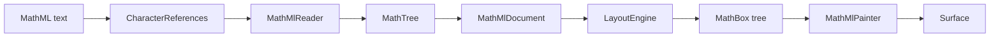

# System Design

This document provides the system-level design for CanvasNetMathMl.

## Architecture

CanvasNetMathMl is a static renderer of MathML Core equations, delivered as its own NuGet package
(`DemaConsulting.CanvasNet.MathMl`, root namespace `DemaConsulting.CanvasNet.MathMl`), independent of the other
document systems in this repository. It reads the text of one `math` element and **parses** it into a validated,
immutable document, **describes** the equation without drawing it (display mode, element count, text alternative, and
annotations), **measures** the size it renders at with the row of its baseline, and **renders** it onto a `Surface` (the
core `CanvasNet` pixel buffer) at its natural size multiplied by a scale or fitted inside an exact size. Rendering is
static, deterministic (pixel-identical surfaces on every run, thread, and platform, because only the bundled fonts are
used), and offline (no browser, no network, no file other than the one opened), and uses only the .NET base class
library, the public API of the core `CanvasNet` package, and the internal OpenType `MATH` table reader of the core
through friend access.

The goal is **fidelity to MathML Core as browsers implement it**: an equation must have the boxes that Chrome computes
for it with the same font. The layout is therefore implemented from the MathML Core specification and checked against
reference layouts that headless Chrome computes for original fixtures (see *Known Differences* for where CanvasNet
follows Chrome rather than a literal reading of the specification). This version draws the token elements and the
rows; every other element is laid out as a row of its children, as MathML Core lays out an unknown element, and is
**reported with a stable `mathml-*` code and the exact location, never skipped silently** (see *Phase Plan*).

The system is decomposed into two direct units and two internal subsystems:

- **MathMlDocument** (direct unit, public API) - the entry points `Parse`, `Open(path)`, and `Open(stream)`, the
  description properties, `Measure` and `Render`, the options, limits, records, codes, and exceptions, and the internal
  report sink with the pending reports that reading keeps for every call; see *MathMlDocument Unit Design*.
- **MathMlPainter** (direct unit) - the painter of a laid-out equation: backgrounds, glyph outlines, rules, and
  borders, bounded and cancelable; see *MathMlPainter Unit Design*.
- **Syntax** (subsystem) - the `CharacterReferences` unit (the named character references and the location map), the
  `MathMlReader` unit (the text into the equation tree), the `MathTree` unit (the equation model), and the
  `AttributeValues` unit (the parsers of attribute values and of the inline style); see *Syntax Subsystem Design*.
- **Layout** (subsystem) - the `LayoutEngine` unit (the walk and dispatch), the `StyleResolver` unit (the computed
  styles), the `MathFont` unit (the bundled math font and its `MATH` data), the `MathBox` unit (the box model), the
  `TokenLayout` unit (the token elements and the `mathvariant` tables), and the `RowLayout` unit (rows and grouping
  elements); see *Layout Subsystem Design*.

The SysML2 model names the system `CanvasNetMathMlSystem` and prefixes the names of its subsystems and units with
`MathMl` (`MathMlDocument`, `MathMlPainter`, `MathMlSyntax`, `MathMlReader`, `MathMlCharacterReferences`,
`MathMlMathTree`, `MathMlAttributeValues`, `MathMlLayout`, `MathMlLayoutEngine`, `MathMlStyleResolver`,
`MathMlMathFont`, `MathMlMathBox`, `MathMlTokenLayout`, and `MathMlRowLayout`), because part def names stay unique
across the model and the other systems already use `Syntax`, `Layout`, and similar short names.

The pipeline is:

## External Interfaces

- **`MathMlDocument.Parse(string, MathMlOpenOptions?)`** (in, MathML text) - at most `MaxTextSize` characters; one
  `math` element in the MathML namespace or in no namespace.
- **`MathMlDocument.Open(string path, ...)`** (in, UTF-8 file) - strict UTF-8, byte-order mark dropped, read in
  bounded chunks; the source name is the path unless the options name it.
- **`MathMlDocument.Open(Stream, ...)`** (in, UTF-8 stream) - as for a file; the stream is left open.
- **Description properties** (out) - `SourceName`, `Display` (`MathMlDisplay.Inline` or `Block`), `ElementCount`,
  `AltText`, and `Annotations` (`MathMlAnnotation(Encoding, Text)` in document order).
- **`MathMlDocument.Measure(MathMlRenderOptions?, CancellationToken)`** (out, `MathMlSize(Width, Height, Baseline)`) -
  the size a render gives and the row of the alphabetic baseline; the reports of the call are delivered.
- **`MathMlDocument.Render(...)`** (out, `Surface`) - at the natural size times the scale, or fitted and centered into
  an exact size of 1 to `Surface.MaxDimension` on each side; the caller owns the surface.
- **`MathMlRenderOptions`** (in) - `FontSize` (16 CSS pixels by default), `Scale`, `Display` (overrides the `display`
  attribute), `Color` (black), `Background` (transparent), `Limits`, the two report handlers, and
  `ThrowOnUnsupportedFeature`.
- **Report handlers** (out) - `MathMlDiagnostic` warnings and `MathMlUnsupportedFeature` reports, once, in order, on the
  calling thread; `MathMlUnsupportedFeatureException` in strict mode.
- **`MathMlSyntaxException`** (out, exception) - a stable `mathml-*` code, the location in the original text, and a
  hint.
- **`MathMlRenderException`** (out, exception) - a limit exceeded while laying out or painting, a picture larger than a
  surface can be, or a layout defect.
- **`InvalidDataException`** (out, exception) - a text over the size limit.

## Dependencies

CanvasNetMathMl references the sibling `CanvasNet` system: its `Canvas` subsystem (`Surface`, `Rgba32`, `CssColor`),
`Geometry` (paths), `Drawing` (path filling), `Fonts` (the bundled Noto Sans Math through the shared cache of
`SystemFontCatalog`, its `MATH` table through `TrueTypeFont.TryGetMathTable`, the glyph outlines, and the bundled
`GlyphFallback`), and `Packaging` (the hardened XML reader `SafeXml`). The `MATH` table reader and the bundled-font
cache are internal to the core and reached through friend access (`InternalsVisibleTo`), so that the SFNT data is parsed
once, by the core that owns SFNT parsing. It has no OTS runtime dependency and references no other format package of the
repository. See *CanvasNet System Design* for the referenced subsystems.

## Risk Control Measures

MathML text is untrusted input. The design segregates the risk as follows:

- **Bounded input** - the text is refused above `MathMlLimits.MaxTextSize` before any work (a stream is read in chunks
  and stops as soon as the limit is certainly exceeded); the reader bounds the elements (`MaxElements`), the nesting
  (`MaxNestingDepth`, at most 1,024), and the length of a token (`MaxTokenLength`).
- **No document types, no network, no files** - the named references are rewritten into numeric references by the
  package itself, so the XML reader runs with document types prohibited and no resolver (the vehicle of
  entity-expansion and external-entity attacks); links are reported and never followed; only the file the caller
  opens is read.
- **No recursion on input** - the reader is iterative, so deep nesting fails with a limit error, never a stack
  overflow; the layout recursion is bounded by the nesting limit, which the reader enforced.
- **Bounded layout and painting** - every element and character is charged to `MaxLayoutWork`; lengths are clamped to
  a finite magnitude and the math depth to plus or minus 64; the picture is refused above `Surface.MaxDimension`; the
  painter counts the glyphs against `MaxPaintedGlyphs` before it paints; every call can be canceled.
- **Fail closed** - every refusal is a documented exception with a stable code; an unsupported construct is reported,
  never silently ignored, and strict mode turns it into an exception; an exception that the layout does not document
  becomes a located `mathml-render-failed` error.

## Data Flow

The text is read (strict UTF-8 for streams and files) and checked against the size limit. The `CharacterReferences`
pre-pass rewrites the named references into numeric references and records where each line shifted; the `MathMlReader`
reads the rewritten text with the hardened XML reader, maps every position back to the original text, and builds the
equation tree, keeping what it finds to report (foreign elements, links, stray text) as pending reports and the
annotations as raw text. The document keeps the tree, the reports, and the description. A measure or render call
creates a report sink, replays the pending reports, resolves the style of the `math` element from the options, and has
the `LayoutEngine` lay the tree out into a tree of boxes over the bundled math font, reporting what it does not draw.
The picture is the content box of the `math` element united with the ink of every painted item, rounded out to whole
pixels at the scale, with the baseline on a whole row; `Measure` returns its size and `Render` has the painter draw the
boxes onto a new surface. The reports are delivered once, on the calling thread, after the work.

## Design Constraints

### Platform Support

The library targets net8.0, net9.0, net10.0, and net11.0 on Windows, Linux, and macOS, identical to the `CanvasNet`
system it depends on (see the platform requirements of the system).

### Determinism

Reading and rendering do not depend on the culture, the current directory, the installed fonts, or the machine: every
number is read with the invariant culture, the layout is a pure function of the tree, the options, and the bundled
font, and every glyph comes from the bundled fonts (Noto Sans Math, then the bundled fallback chain of the core). A
document holds no mutable state, so it can be measured and rendered from several threads at once.

### Untrusted Input and Limits

`MathMlLimits` bounds the text size (`MaxTextSize`, 1,048,576 characters), the elements (`MaxElements`, 100,000), the
nesting (`MaxNestingDepth`, 256, at most 1,024), the token length (`MaxTokenLength`, 10,000), the layout work
(`MaxLayoutWork`, 10,000,000), the painted glyphs (`MaxPaintedGlyphs`, 1,000,000), and the reports of a call
(`MaxDiagnostics`, 1,000).

### Third-Party Provenance and Attribution

The code of CanvasNetMathMl is original: the layout is implemented from the text of MathML Core in C#, and no source,
example, or test of a browser or of the specifications is copied. Three generated data tables are derived with
attribution: the 2125 named character references from the W3C *XML Entity Definitions for Characters* HTML+MathML set
(`Syntax/CharacterReferences.Table.cs`), the italic mapping of MathML Core Appendix C.1, and the `mathvariant` mappings
derived from the `` decompositions of the Unicode Character Database (`Layout/MathVariants.Data.cs`). They are
generated by the developer tool `tools/mathml-data/update-mathml-tables.ps1` from pinned sources (never at build or run
time), each starts with a `// Generated by ...` and a `// Portions derived from ...` header, and the license texts
(`LICENSE-w3c.txt`, `LICENSE-unicode.txt`) and the provenance table ship in
`src/DemaConsulting.CanvasNet.MathMl/third-party/` and in the package's `licenses\` folder. The package is not
affiliated with the W3C or Unicode, Inc. The bundled Noto Sans Math font and its license belong to the core package.

### Known Differences

- **Picture box** - the picture is the content box united with the ink, so an overhanging glyph (an italic *f*) is
  never clipped; a browser's `math` box is the content box only. The reference tests compare element boxes, not picture
  sizes.
- **Token metrics** - a token has the ink ascent and descent of its glyphs rounded out to whole CSS pixels, also when
  its text has a space, as Chrome lays tokens out; MathML Core lays a text with a soft wrap opportunity out as a line of
  text.
- **Italic correction in rows** - the italic correction of a slanted child is not added before the next child, as
  Chrome lays rows out; MathML Core 3.3.1.2 adds it. A row keeps the italic correction of its last child for the
  scripts of a later version.
- **`ms`** - drawn without quotes, as MathML Core and Chrome draw it; the legacy `lquote` and `rquote` are reported as
  unsupported attributes.
- **`mathvariant`** - every MathML 3 value is drawn by mapping the characters to the Mathematical Alphanumeric
  Symbols, as Firefox does; MathML Core and Chrome only implement `normal`, so only `normal` is compared with Chrome.
- **Percentages** - percentages of `mpadded` and `mspace` are ignored and reported, as MathML Core specifies; the
  percentages of `lspace` and `rspace` of `mo` are of the default spacing.
- **Text in layout elements** - text written directly inside a row is drawn like an `mtext` and reported as
  `mathml-element-unsupported`.
- **Glyphs** - glyphs are placed by their advances, without GPOS kerning, `ssty` script variants, or other glyph
  substitution; the ink of an automatic italic `mi` is measured on the glyph that is drawn (Chrome measures the
  untransformed character, the one documented exception of the reference fixtures).
- **Operators** - every `mo` has the spacing of the `Default` category of the operator dictionary (5/18 em on each
  side) unless `lspace` or `rspace` set it, and no operator stretches, until the operator dictionary arrives.
- **Style** - only the inline `style` attribute styles an equation (there are no style sheets), and only its
  supported subset; `dir="rtl"` is reported and the equation is laid out left to right.
- **Rounding** - Chrome rounds to its layout unit (1/64 pixel) and glyph bounds to whole pixels; the reference tests
  allow 1 CSS pixel plus one layout unit.

## Phase Plan

- **Stage A, this version** - the package, the public API, the Syntax subsystem with the full named-reference set,
  the token elements with every `mathvariant`, rows and the grouping elements (`mstyle`, `mpadded`, `mphantom`,
  `merror`, `semantics`, `maction`), the painter, and the Chrome reference layouts. The next commit of stage A adds the
  operator dictionary of MathML Core (form inference, spacing, and properties) and stretchy operators (the `MATH`
  variants and glyph assemblies, with a `mathml-stretch-unavailable` report and the `MaxAssemblyParts` limit).
- **Stage B** - fractions (`mfrac`), radicals (`msqrt`, `mroot`), scripts (`msub`, `msup`, `msubsup`,
  `mmultiscripts`), under and over scripts (`munder`, `mover`, `munderover`), and tables (`mtable`, `mtr`, `mtd`, with
  the `MaxTableCells` limit and the `mathml-child-count` report), the image source of `.mml` files for the other
  formats, and a hardening fuzzer. Until then these elements are laid out as rows and reported as
  `mathml-element-unsupported`.
- **Stage C** - the Viewer, the `canvasnet` tool, the Pandoc filter, and the user guide open `.mml` files.
