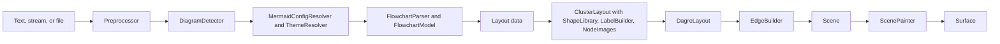

# System Design

This document provides the system-level design for CanvasNetMermaid.


## Architecture

CanvasNetMermaid is a static renderer for the Mermaid diagram language, delivered as its own NuGet package
(`DemaConsulting.CanvasNet.Mermaid`, root namespace `DemaConsulting.CanvasNet.Mermaid`), independent of the other
document systems in this repository. It reads Mermaid text and **parses** it into a validated, immutable document,
**describes** the diagram without drawing it (diagram type, whether this version draws it, title, accessible title,
direction, node, edge, and subgraph counts), **measures** the size the diagram renders at, and **renders** it onto a
`Surface` (the core `CanvasNet` pixel buffer) at its natural size multiplied by a scale or fitted inside an exact
size. Rendering is static (no interaction, no animation), deterministic (pixel-identical surfaces on every run,
thread, and platform), offline (no network, no browser, no JavaScript runtime), and uses only the .NET base class
library and the public API of the core `CanvasNet` package.

The goal is **fidelity to Mermaid**: a diagram must look like the picture the pinned Mermaid release draws in a
browser. The package is therefore a port, derived with attribution, of the parts of Mermaid that decide the picture:
its preprocessing and diagram detection, the jison grammar and database of the flowchart, its configuration
defaults and precedence, its five themes and the khroma color functions they use, its unified renderer (shapes,
labels, edges, markers, clusters), and the dagre layered layout and graphlib graph that Mermaid bundles. Every
construct that is recognized but not drawn is **reported with a stable `mermaid-*` code and the exact location,
never skipped silently** (see _Fidelity and Known Differences_).

This version (Phase 1a, see _Phase Plan_) draws **flowcharts** (the `flowchart` and `graph` keywords). Every other
Mermaid diagram type is detected (the 40 detectors of Mermaid, in Mermaid's order) and handled the same way: opening
succeeds, `IsSupported` is false, and measuring or rendering reports `mermaid-diagram-unsupported` once and gives an
empty, transparent 16 by 16 pixel picture (an exception in strict mode).

The system consists of one direct unit and seven internal subsystems:

- **MermaidDocument** (unit, root namespace; see _MermaidDocument Unit Design_) - the public API: `MermaidDocument`
  with `Parse`, `Open(path)`, `Open(stream)`, the metadata properties, `Measure`, `Render`, and
  `Render(width, height)`; the validated `MermaidOpenOptions`, `MermaidRenderOptions`, and `MermaidLimits`; the
  `MermaidLocation`, `MermaidDiagnostic`, `MermaidUnsupportedFeature`, and `MermaidSize` records; the
  `MermaidDiagnosticCodes` constants; the `MermaidSyntaxException`, `MermaidRenderException`, and
  `MermaidUnsupportedFeatureException` types; the internal `MermaidReportSink` (ordered, de-duplicated, capped report
  delivery); the internal pipeline seam (`IMermaidDiagram`, `DiagramRenderContext`, `DiagramRegistry`); and the
  `MermaidImageSource` that plugs the package into the CanvasNet image-source contract.
- **Syntax** (subsystem; see _Syntax Design_) - text to a clean diagram body: `Preprocessor` (line endings,
  frontmatter, directives, comments, entity encoding, size limits, and the location map back to the original text),
  `DiagramDetector` (Mermaid's detectors and their order), `YamlSubsetParser` (the js-yaml subset of the frontmatter
  and the shape data), `SourceScanner` (the jison lexer semantics shared by the parsers), and `HtmlSanitizer` (the
  DOMPurify behavior that Mermaid applies to labels, with the `HtmlEntities` table).
- **Configuration** (subsystem; see _Configuration Design_) - the effective configuration and paint:
  `MermaidConfigResolver` (defaults, precedence, secure keys, directive parsing, typed `MermaidConfig` view),
  `ThemeResolver` (the five themes and the flowchart style sheet), `ColorMath` (the khroma subset), and
  `StyleDeclarations` (the CSS declaration subset of `style`, `classDef`, `linkStyle`, and `themeCSS`).
- **Graphlib** (subsystem; see _Graphlib Design_) - `Graph` (graphlib's directed, multi, and compound graph with
  JavaScript key order) and `GraphAlgorithms` (the traversals dagre uses).
- **Dagre** (subsystem; see _Dagre Design_) - the layered layout: `DagreLayout` (the pipeline and its utilities),
  `DagreAcyclic`, `DagreRanker`, `DagreNesting`, `DagreNormalizer`, `DagreOrdering`, `DagrePositioning`,
  `DagreCoordinateSystem`, and `LayoutWorkMeter` (the work budget, cancellation, and the shared unique-id counter).
- **Rendering** (subsystem; see _Rendering Design_) - Mermaid's unified renderer for any layout data:
  `ClusterLayout` (subgraph extraction, recursive layout, and placement), `ShapeLibrary` (the 53 documented shapes,
  their aliases, the bracket shapes, subgraph rectangles, and their intersections), `EdgeBuilder` (edge routes,
  curves, strokes, markers, and edge labels), `LabelBuilder` (HTML, markdown, and SVG labels measured with the
  bundled fonts), and `NodeImages` (pictures through the caller's resolver).
- **Scenegraph** (subsystem; see _Scenegraph Design_) - `SceneModel` (the immutable scene: groups, paths, text,
  images, and their bounds, which is the assertion surface of the tests and goldens) and `ScenePainter` (scene to
  pixels).
- **Flowchart** (subsystem; see _Flowchart Design_) - `FlowchartParser` (the `flow.jison` lexer and grammar) and
  `FlowchartModel` (the `flowDb` semantics, the mapping to layout data, and the flowchart's own drawing steps).

The dependency direction is one way:

```text
MermaidDocument -> Syntax -> Configuration -> Flowchart -> Rendering -> Dagre -> Graphlib
                                                        -> Scenegraph
```

Only `ScenePainter` and `LabelBuilder` use the core `Fonts`, `Rendering`, and `Drawing` APIs, and only
`NodeImages` and `MermaidImageSource` use the core `ImageSources` API. The internal subsystems are visible to the
test assembly through `InternalsVisibleTo` and to nothing else.

## External Interfaces

- **Text input** (`MermaidDocument.Parse(string, MermaidOpenOptions?)`): Mermaid text of at most `MaxTextSize` UTF-16
  characters after frontmatter, directives, and comments are removed, and at most four times that before.
- **Byte input** (`MermaidDocument.Open(string path, ...)` and `Open(Stream, ...)`): strict UTF-8 with an optional
  byte-order mark; the read is bounded, a stream is left open, and a path names the document.
- **Metadata output** (`SourceName`, `DiagramType`, `IsSupported`, `Title`, `AccTitle`, `Direction`, `NodeCount`,
  `EdgeCount`, `SubgraphCount`): .NET values available after open, without rendering.
- **Picture output** (`Measure`, `Render`, `Render(width, height)` with `MermaidRenderOptions`): a `MermaidSize` or a
  `Surface` (RGBA, straight alpha) whose sides lie within 1 and `Surface.MaxDimension`; a `CancellationToken` is
  observed.
- **Site configuration input** (`MermaidRenderOptions.Config`): a JSON object, Mermaid's site configuration,
  validated as a JSON object when set; its keys are checked when it is used.
- **Theme input** (`MermaidRenderOptions.Theme`): `default`, `base`, `dark`, `forest`, or `neutral`, applied at site
  level like `mmdc -t`, so the text still wins.
- **Picture input** (`MermaidRenderOptions.ImageResolver`): a core `IImageResolver`, the only way a picture is
  loaded, called at most `MaxImages` times per call.
- **Report output** (`WarningHandler`, `UnsupportedFeatureHandler`): `MermaidDiagnostic` and
  `MermaidUnsupportedFeature` values, each delivered once, in order, on the calling thread, after the work.
- **Exception output**: `MermaidSyntaxException` (a `FormatException`), `MermaidRenderException` (an
  `InvalidOperationException`), `MermaidUnsupportedFeatureException` (an `IOException`), `InvalidDataException`,
  argument exceptions, and `OperationCanceledException`; the Mermaid exceptions carry `Code` or `Feature`,
  `Location`, and `Hint`, and their message reads `file:line:column: code: description`.
- **Image source** (`MermaidImageSource`, both directions): the core `IImageSource` and `IFragmentImageSource`
  contract for the extensions `.mmd` and `.mermaid` with the fragment parameter `theme` and a transparent background.
- **Third-party notices** (output, the `licenses/` folder of the package): `LICENSE-mermaid.txt`,
  `LICENSE-dagre.txt`, `LICENSE-d3.txt`, `LICENSE-js-yaml.txt`, `LICENSE-khroma.txt`, `LICENSE-lodash.txt`,
  `LICENSE-marked.txt`, and the provenance README.
The report and error codes are the `MermaidDiagnosticCodes` constants: `mermaid-syntax-error`,
`mermaid-unknown-diagram`, `mermaid-diagram-unsupported`, `mermaid-yaml-invalid`, `mermaid-yaml-unsupported`,
`mermaid-limit-exceeded`, `mermaid-render-failed`, `mermaid-diagnostics-suppressed`, `mermaid-config-secure-key`,
`mermaid-config-unknown-key`, `mermaid-config-invalid`, `mermaid-shape-unknown`, `mermaid-icon-unsupported`,
`mermaid-image-unresolved`, `mermaid-text-missing-glyph`, `mermaid-look-unsupported`, `mermaid-layout-unsupported`,
`mermaid-style-ignored`, `mermaid-theme-css-unsupported`, and `mermaid-html-tag-ignored`. They are part of the public
contract and do not change between releases. A `class` statement or `:::` that names a class no `classDef` defines
is not reported: the pinned Mermaid's flowchart database records the name and the class simply adds no style.

## Dependencies

- **CanvasNet (sibling system, same repository)** - `Canvas` (`Surface`, `Rgba32`, `CssColor`), `Geometry` (`Path`
  and its builder for scene paths), `Drawing` (`PathFiller`, `PathStroker`), `Fonts` (`FontResolver` with
  `MapCommonAliasesToBundled` and no system fonts, `GenericFontFamilies`), `Rendering` (`TextRenderer` for measuring
  and drawing text, `WordWrap` for HTML label wrapping), and `ImageSources` (`IImageSource`, `IFragmentImageSource`,
  `IImageResolver`, `ImageFragment`). Only the public API is used.
- **.NET base class library** - `System.Text.Json` (validation of the site configuration and the JSON of init
  directives), `System.Text` (strict UTF-8), collections, and `System.Math`.
- **No OTS runtime dependency.** Mermaid, dagre-d3-es, graphlib, d3-shape, d3-path, khroma, js-yaml, lodash, and
  marked are **not** dependencies: their behavior is ported into local source (see _Third-Party Provenance and
  Attribution_). The pinned `mermaid`, `@mermaid-js/mermaid-cli`, `dagre-d3-es`, and `puppeteer` npm packages of the
  repository are used only by the developer scripts in `benchmarks/visual-diff/` that generate the test vectors and
  layout goldens; CI never runs them.

## Risk Control Measures

CanvasNetMermaid is not safety-classified, but it processes untrusted text and is used inside documentation builds
and services, so its risk controls are about availability, integrity of the picture, and confidentiality of the host:

- **Segregation from the host's files and network.** The package opens no file other than the path given to `Open`
  and performs no network access. Pictures are loaded only through the caller's `IImageResolver`; without one, a
  picture link is reported (`mermaid-image-unresolved`) and the diagram is still drawn. The Viewer library supplies
  a sandboxed folder resolver.
- **Bounded work and memory.** Every input-controlled loop and recursion is bounded by a `MermaidLimits` value (see
  _Untrusted Input and Limits_); the parsers are scanner based with no regular-expression backtracking; YAML aliases,
  anchors, and tags are refused.
- **Fail closed.** Invalid text never yields a guessed picture: it is a located `MermaidSyntaxException`.
  Unsupported constructs are reported, and strict mode turns the first one into an exception, so a build can refuse an
  approximate picture.
- **No secure-key escalation.** Text cannot change a key the site marks as secure (`mermaid-config-secure-key`);
  `securityLevel` values have no effect because nothing is executed.
- **Determinism.** Only bundled fonts are used, the layout reproduces JavaScript iteration order, and nothing reads
  the clock, a random source, or the culture, so the output can be cached and reviewed.

## Data Flow



1. **Open** (once per document): the text is decoded (strict UTF-8, byte-order mark dropped) and checked against the
   raw size limit; `Preprocessor` normalizes line endings, reads the frontmatter (title, `displayMode`, `config`
   through `YamlSubsetParser`), extracts the `%%{...}%%` directives, removes `%%` comments, encodes entities as
   Mermaid does, checks `MaxTextSize`, and keeps a location map back to the original text. `DiagramDetector` picks
   the diagram with Mermaid's detectors (using the renderer settings of the text configuration). For a flowchart,
   `FlowchartParser` lexes and parses the body and `FlowchartModel` applies the `flowDb` rules; syntax errors and the
   open-time limits (edges, nodes, label length, nesting, YAML depth) fail here. Other known types are kept as
   unsupported diagrams.
2. **Measure and Render** (per call, because the options can change sizes): `MermaidConfigResolver` merges the
   defaults, the caller's `Config` and `Theme`, the frontmatter configuration, and the init directives, and
   `ThemeResolver` derives the theme variables and the flowchart style sheet. `FlowchartModel` reports the unsupported
   constructs (look, layout, icons) and maps the model to layout data. `ClusterLayout` measures every label
   (`LabelBuilder`) and node (`ShapeLibrary`, picture sizes from `NodeImages`), lays out every graph and isolated
   subgraph with `DagreLayout`, and places nodes, subgraphs, and edges (`EdgeBuilder`). The flowchart adds its title;
   the view box is the drawing bounds grown by `diagramPadding`. `Measure` stops here and returns the view box rounded
   up and multiplied by the scale. `Render` paints the scene with `ScenePainter` (uniformly scaled, or fitted and
   centered for an exact size) over the background, loading pictures through the same `NodeImages`.
3. **Reports** recorded by any stage go to the call's `MermaidReportSink` and are delivered to the handlers after the
   work, in order, on the calling thread.

## Design Constraints

### Platform Support

The package targets `net8.0`, `net9.0`, and `net10.0` and runs on Windows, Linux, and macOS, like the core
`CanvasNet` system it depends on. It contains no platform-specific code and uses no native library; the platform
requirements are proven by running the representative pixel test on every platform and framework.

### Integration Patterns

The `MermaidImageSource` is the integration point for hosts: the Viewer library registers it as its eighth built-in
source (so SVG documents can embed `.mmd` files and the `canvasnet` tool can render, describe, and validate them),
and the Pandoc filter of the documentation build renders `mermaid` code blocks through the tool. A library caller can
instead use `MermaidDocument` directly with `MermaidRenderOptions`.

### Determinism

- **Fonts**: every font family (Mermaid's default `"trebuchet ms", verdana, arial, sans-serif` and any `fontFamily`)
  resolves to the bundled Liberation Sans, and system fonts are never consulted. A glyph that Liberation Sans lacks is
  drawn from the core library's bundled Noto fallback fonts without a report; a character that no bundled font has is
  drawn as the font's missing-glyph box and reported (`mermaid-text-missing-glyph`).
- **Order**: graphlib's object-key order (array-index keys first, then insertion order) and lodash's and V8's sorting
  steps are reproduced, so ties are broken as in Mermaid and never by hash order.
- **Arithmetic**: layout uses `double` arithmetic in Mermaid's order of operations; nothing depends on the culture,
  the clock, or a random source. lodash's `uniqueId` counter lives in the per-render `LayoutWorkMeter`, so names
  never depend on earlier renders.
- **Immutability**: a `MermaidDocument` is immutable and thread-safe; each call has its own configuration, sink,
  meter, and font resolver. Tests render sequentially and in parallel and compare pixels.

### Third-Party Provenance and Attribution

CanvasNetMermaid is **derived with attribution**, not clean-room. The ported projects are listed with their license,
copyright notice, and the CanvasNet unit that ports them in `src/DemaConsulting.CanvasNet.Mermaid/third-party/README.md`;
every source file with ported logic starts with `// Portions derived from <project> (<license>); see
third-party/README.md`:

| Upstream project | License | Ported into |
| --- | --- | --- |
| mermaid | MIT | the Syntax units except `HtmlSanitizer`, the configuration and themes, the flowchart, the renderer |
| dagre-d3-es (dagre, graphlib, dagre-d3) | MIT | `Graph`, `GraphAlgorithms`, the `Dagre` units, intersections |
| d3-shape and d3-path | ISC | `EdgeBuilder` curves and path number formatting |
| khroma | MIT | `ColorMath` |
| js-yaml | MIT | `YamlSubsetParser` |
| lodash | MIT | `Lodash` helpers of `DagreLayout` (sorting, extremes, unique ids) |
| marked | MIT | the markdown subset of `LabelBuilder` |

The license texts ship in the package's `licenses/` folder (and in the tool package, where the d3 notice is renamed
`Mermaid-LICENSE-d3.txt` because the Vega-Lite package ships a different `LICENSE-d3.txt`). The public API, the scene
model and painter, `NodeImages`, `HtmlEntities`, `HtmlSanitizer` (which reproduces DOMPurify's results for label HTML
without porting its code), `StyleDeclarations`, `ObjectKeyMap`, `LayoutWorkMeter`, the limits other than
`maxTextSize` and `maxEdges`, the diagnostics, and all tests and fixtures are original work. The package is not
affiliated with, and not endorsed by, the Mermaid project or the authors of the other projects. The upstream test
vectors are generated from the pinned packages from original inputs by the developer scripts in
`benchmarks/visual-diff/mermaid/`.

### Untrusted Input and Limits

All Mermaid text is untrusted. The limits are caller-adjustable through `MermaidLimits` (validated when set):

- `MaxTextSize`, 50,000 (Mermaid's `maxTextSize`): checked at open on the code after the frontmatter, directives,
  and comments are removed; the raw text may be at most four times larger. Failure: `InvalidDataException`.
- `MaxEdges`, 500 (Mermaid's `maxEdges`); `MaxNodes`, 2,000 (subgraphs included); `MaxLabelLength`, 4,096 (also
  the accessible title and description); `MaxNestingDepth`, 32 (subgraphs; at most 256); `MaxYamlDepth`, 32 (at
  most 256; YAML aliases, anchors, and tags are refused): checked at open. Failure: `MermaidSyntaxException` with
  `mermaid-limit-exceeded` (or `mermaid-yaml-unsupported` for a refused YAML construct).
- `MaxLayoutWork`, 50,000,000 metered layout steps; `MaxImages`, 256 resolver calls; `MaxPaintedPixels`,
  250,000,000 (charged before each item is painted): checked per call. Failure: `MermaidRenderException` with
  `mermaid-limit-exceeded`.
- `MaxDiagnostics`, 1,000 reports per call: further reports become one `mermaid-diagnostics-suppressed` notice and
  rendering continues.

A site configuration's `maxTextSize` and `maxEdges` are resolved but not consulted: the limits come from
`MermaidLimits` only. A natural size beyond `Surface.MaxDimension` (8,192) at the requested scale is an
`ArgumentOutOfRangeException` from `Measure` or `Render`; a host can then render at a smaller scale or an exact size.
Deep recursion is guarded by `EnsureSufficientExecutionStack` and mapped to `mermaid-limit-exceeded`. The hardening
tests feed seeded mutations of every fixture and assert that only the documented exceptions occur.

### Fidelity and Known Differences

**Reference.** The target is the pinned Mermaid release (the version recorded in `package-lock.json` and in the
third-party README; the `mmdc` used to create the references bundles that release). Later Mermaid releases are not
tracked automatically.

**How fidelity is measured.** Algorithmic parts are compared exactly against upstream vectors generated by the
pinned packages: 207 flowchart parser and database vectors, 53 configuration cases and 622 khroma calls, 224 dagre
stage goldens (ranks and orders exact, coordinates within 1e-9), 286 shape vectors, and 144 d3 curve vectors. The
whole layout is compared against reference layouts extracted from mermaid-cli renders of the 42 original flowchart
fixtures with the bundled Liberation Sans (`benchmarks/visual-diff/render-mermaid.mjs` with `liberation.css`): the
view box, node centers and sizes, subgraph rectangles, 21 arc-length samples of every edge, and edge label centers.
The tolerance is 0.01 pixel, and 0.1 pixel for the fixtures `12-new-shapes-flow` and `14-new-shapes-symbols` (the
rough.js circles, item 1 below); in practice 39 fixtures agree to within 0.001 pixel. The fixture `38-unicode` is
**excluded** from the goldens: Chrome draws its CJK text with a system font that the bundled fonts do not have, so
the reference would depend on the machine (its node is 12 pixels wider in Chrome); no bundled font has those
characters, so CanvasNet draws them as the missing-glyph box and reports `mermaid-text-missing-glyph`.

**Known and accepted differences from Mermaid:**

1. **Fonts.** Every font family resolves to the bundled Liberation Sans. Chrome shapes with OpenType kerning and subpixel
   advances while CanvasNet applies the `kern` table; label widths differ by well under a pixel. Pictures differ
   from a stock `mmdc` render on a machine that has Trebuchet MS.
2. **HTML labels** are emulated with Mermaid's DOM-derived constants (line box 1.5 em, `max-width` the wrapping
   width, the no-wrap then break retry, run widths rounded up to 1/64 pixel). Only `b`, `strong`, `i`, `em`, `br`,
   `img`, `p`, and `span` with a style are honored; other elements keep their text and are reported
   (`mermaid-html-tag-ignored`) and their size effect is not modeled. Mixed font sizes on one line use the tallest
   line box.
3. **SVG labels** (`htmlLabels: false`) emulate `getBBox` with the rounded hhea metrics and outline bounds (typically
   0.1 pixel, at most 1.6 pixel different).
4. **Markdown** is the subset of marked that labels use (paragraphs, strong and emphasis, escapes, inline HTML, code
   spans kept raw); links, tables, strikethrough, and hard breaks stay plain text.
5. **Named character references** are the HTML 4 set and `apos`, `equals`, `num`, `semi`, and `colon`; other HTML 5
   names stay literal. `HtmlSanitizer` uses a simplified tree builder (no paragraph or table fixing) and removes SVG
   and MathML content.
6. **Icons** (`fa:` classes and `@{ icon }`) are not drawn (`mermaid-icon-unsupported`); the text without the icon is
   drawn, and icon shapes keep their frame and size.
7. **Looks and layouts.** `look: handDrawn`, `look: neo`, and any other look but `classic` are drawn classic
   (`mermaid-look-unsupported`); `layout: elk`, the `flowchart-elk` keyword, and any other layout fall back to dagre
   (`mermaid-layout-unsupported`). The rough.js circles of some shapes are drawn as true circles (at most 0.06 pixel
   different).
8. **Interaction and animation.** `click`, `href`, `call`, callbacks, tooltips, and links are parsed and ignored
   (only the `clickable` class is kept); an animated edge is drawn as its first frame (dash `9,5`, offset 900);
   `accTitle` and `accDescr` are metadata only.
9. **CSS.** `style`, `classDef`, `linkStyle`, and `themeCSS` honor only the declarations that change pixels (fill,
   stroke, stroke width and dash, opacity, color, and font properties); others are reported (`mermaid-style-ignored`),
   a user `background-color` included. `themeCSS` rules with other selectors are reported
   (`mermaid-theme-css-unsupported`). Mermaid's `classDef` CSS rules beyond the inline node styles are not modeled; a
   subgraph title's `font-*` styles are not applied after measuring.
10. **Themes and configuration.** The `neo`, `neo-dark`, and `redux` themes are not ported (`mermaid-config-invalid`,
    no effect). A value of the wrong type is reported and dropped, so the lower layer wins (Mermaid would use it); a
    directive theme variable with characters outside Mermaid's allowed set is removed; a theme variable that is not a
    color is dropped and the theme recomputed (at most 16 times; Mermaid fails); khroma's limit loops are capped at
    64 iterations; a non-object init argument is reported and ignored.
11. **Security keys.** A secure key cannot be raised from the text (`mermaid-config-secure-key`); `securityLevel`
    `sandbox` and `loose` change nothing because no script or frame is produced.
12. **YAML.** Anchors, aliases, tags, explicit keys, and `%` directives are refused (`mermaid-yaml-unsupported`)
    although js-yaml accepts some of them; `<<` is an ordinary key; several documents are `mermaid-yaml-invalid`. A
    YAML depth beyond `MaxYamlDepth` is an open-time `MermaidSyntaxException`.
13. **Errors.** Mermaid draws an error picture for bad text; CanvasNet throws a located `MermaidSyntaxException` with a
    hint. Errors that Mermaid's database raises as JavaScript type errors (an anonymous subgraph, a bad `linkStyle`
    index, an unknown shape) are located syntax errors with CanvasNet messages; failures that crash Mermaid at render
    time (a subgraph cycle, a link to a subgraph without an anchor) are `mermaid-render-failed`.
14. **Shapes Mermaid cannot draw.** The legacy `A(-text-)` ellipse, which the pinned Mermaid fails to render, is drawn
    as an ellipse. A picture node whose picture cannot be loaded (Mermaid's render fails) is drawn as its frame and
    reported (`mermaid-image-unresolved`).
15. **Pictures** are loaded only through the caller's resolver, so remote and absolute links are never fetched. The
    natural size of a picture is the size the resolver returns for a 256 by 256 request (a raster comes back at its
    own size); a picture is stretched to its box as Mermaid's `preserveAspectRatio="none"` does. An `` beside text
    is as wide as the label's content; alone it is five times the font size, as in Mermaid.
16. **Only what flowcharts reach is ported** from the unified renderer: the `rect` subgraph, the `point`, `circle`,
    and `cross` markers (the circle's ring is not clipped to its marker box, at most 0.55 pixel), no terminal labels.
17. **Diagram types.** Only `flowchart` and `graph` are drawn in this version; every other type is
    `mermaid-diagram-unsupported` with a 16 by 16 transparent picture, and the documentation filter leaves such blocks
    to another filter.
18. **Size and background.** The background is transparent by default (as Mermaid's SVG); the natural size is the SVG
    view box rounded up at scale 1; `useMaxWidth` has no meaning for a raster and is ignored. Very large diagrams can
    exceed `Surface.MaxDimension` at scale 1 and need a smaller scale.
19. **Limits** `MaxNodes`, `MaxNestingDepth`, `MaxLabelLength`, `MaxLayoutWork`, `MaxImages`, and `MaxPaintedPixels`
    are CanvasNet additions; a very large diagram that Mermaid draws can fail with `mermaid-limit-exceeded`.
20. **JavaScript corner cases.** V8's galloping merges are replaced by plain stable merges (different only for an
    inconsistent comparator on 64 or more entries); JavaScript prototype keys (`constructor`, `__proto__`) are
    ordinary names (a `shape: constructor` is refused); negative or fractional edge weights are not supported; a
    broken cluster path throws instead of looping; .NET's `Math.Sin` and `Math.Acos` can differ from V8 in the last
    bit (no visible effect). Non-string shape-data values are converted as JavaScript's `String()` does.
21. **Detection.** All 40 detectors of the pinned release are known, with their quirks kept (`c4` keywords match
    anywhere; keyword prefixes such as `graphs` detect a flowchart); detection at open uses only the text's own
    configuration, and a site `flowchart.defaultRenderer: elk` is honored at render.

## Phase Plan

- **Phase 1a (delivered by this version)**: the foundation (public API, syntax, configuration and the five themes,
  scenegraph), graphlib and dagre, the subset of the unified renderer that flowcharts use, flowcharts, the image
  source, the Viewer, tool, and documentation filter integration, and the reference harness and goldens.
- **Phase 1b (planned)**: sequence diagrams (parser, model, layout, and renderer).
- **Phase 2 (planned)**: class, state, and entity-relationship diagrams on the same renderer.
- **Phase 3 (planned)**: pie, Gantt, and mindmap diagrams (mindmap with a port of Mermaid's force-directed layout).
Each phase adds only its own subsystems and units and extends the supported list of `DiagramDetector`; the public API,
the report codes, and the limits stay compatible.
