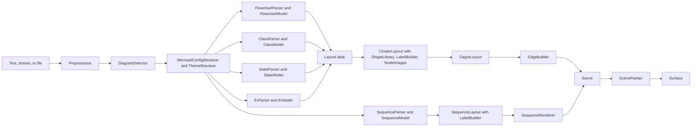

# System Design

This document provides the system-level design for CanvasNetMermaid.


## Architecture

CanvasNetMermaid is a static renderer for the Mermaid diagram language, delivered as its own NuGet package
(`DemaConsulting.CanvasNet.Mermaid`, root namespace `DemaConsulting.CanvasNet.Mermaid`), independent of the other
document systems in this repository. It reads Mermaid text and **parses** it into a validated, immutable document,
**describes** the diagram without drawing it (diagram type, whether this version draws it, title, accessible title,
direction, node, edge, and subgraph counts), **measures** the size the diagram renders at, and **renders** it onto a
`Surface` (the core `CanvasNet` pixel buffer) at its natural size multiplied by a scale or fitted inside an exact
size. Rendering is static (no interaction, no animation), deterministic (pixel-identical surfaces on every run,
thread, and platform), offline (no network, no browser, no JavaScript runtime), and uses only the .NET base class
library and the public API of the core `CanvasNet` package.

The goal is **fidelity to Mermaid**: a diagram must look like the picture the pinned Mermaid release draws in a
browser. The package is therefore a port, derived with attribution, of the parts of Mermaid that decide the picture:
its preprocessing and diagram detection, the jison grammars and databases of the flowchart, the sequence diagram, the
class diagram, the state diagram, and the entity relationship diagram (with the URL check of sanitize-url that Mermaid
applies to the links a diagram keeps),
its configuration defaults and precedence, its five themes and the khroma color functions they use, its unified
renderer (shapes, labels, edges, markers, clusters), the dagre layered layout and graphlib graph that Mermaid bundles,
and its sequence renderer with the drawing functions of the sequence diagram. Every
construct that is recognized but not drawn is **reported with a stable `mermaid-*` code and the exact location,
never skipped silently** (see _Fidelity and Known Differences_).

This version (Phases 1a, 1b, 2a, and 2b, see _Phase Plan_) draws **flowcharts** (the `flowchart` and `graph`
keywords), **sequence diagrams** (the `sequenceDiagram` keyword), **class diagrams** (the `classDiagram` and
`classDiagram-v2` keywords, and the legacy `class` id of `class.defaultRenderer: dagre-d3`), **state diagrams** (the
`stateDiagram` and `stateDiagram-v2` keywords, and the legacy `state` id that a `state.defaultRenderer` other than
`dagre-wrapper` selects for a `stateDiagram` text), and **entity relationship diagrams** (the `erDiagram` keyword).
Every other
Mermaid diagram type is detected (the 40 detectors of Mermaid, in Mermaid's order) and handled the same way: opening
succeeds, `IsSupported` is false, and measuring or rendering reports `mermaid-diagram-unsupported` once and gives an
empty, transparent 16 by 16 pixel picture (an exception in strict mode).

The system consists of one direct unit and eleven internal subsystems:

- **MermaidDocument** (unit, root namespace; see _MermaidDocument Unit Design_) - the public API: `MermaidDocument`
  with `Parse`, `Open(path)`, `Open(stream)`, the metadata properties, `Measure`, `Render`, and
  `Render(width, height)`; the validated `MermaidOpenOptions`, `MermaidRenderOptions`, and `MermaidLimits`; the
  `MermaidLocation`, `MermaidDiagnostic`, `MermaidUnsupportedFeature`, and `MermaidSize` records; the
  `MermaidDiagnosticCodes` constants; the `MermaidSyntaxException`, `MermaidRenderException`, and
  `MermaidUnsupportedFeatureException` types; the internal `MermaidReportSink` (ordered, de-duplicated, capped report
  delivery); the internal pipeline seam (`IMermaidDiagram`, `DiagramRenderContext`, `DiagramRegistry`); and the
  `MermaidImageSource` that plugs the package into the CanvasNet image-source contract.
- **Syntax** (subsystem; see _Syntax Design_) - text to a clean diagram body: `Preprocessor` (line endings,
  frontmatter, directives, comments, entity encoding, size limits, and the location map back to the original text),
  `DiagramDetector` (Mermaid's detectors and their order), `YamlSubsetParser` (the js-yaml subset of the frontmatter
  and the shape data), `SourceScanner` (the jison lexer semantics shared by the parsers), and `HtmlSanitizer` (the
  DOMPurify behavior that Mermaid applies to labels, with the `HtmlEntities` table).
- **Configuration** (subsystem; see _Configuration Design_) - the effective configuration and paint:
  `MermaidConfigResolver` (defaults, precedence, secure keys, directive parsing, typed `MermaidConfig` view),
  `ThemeResolver` (the five themes and the flowchart, sequence, class, state, and entity relationship style sheets),
  `ColorMath` (the khroma subset), and
  `StyleDeclarations` (the CSS declaration subset of `style`, `classDef`, `linkStyle`, and `themeCSS`).
- **Graphlib** (subsystem; see _Graphlib Design_) - `Graph` (graphlib's directed, multi, and compound graph with
  JavaScript key order) and `GraphAlgorithms` (the traversals dagre uses).
- **Dagre** (subsystem; see _Dagre Design_) - the layered layout: `DagreLayout` (the pipeline and its utilities),
  `DagreAcyclic`, `DagreRanker`, `DagreNesting`, `DagreNormalizer`, `DagreOrdering`, `DagrePositioning`,
  `DagreCoordinateSystem`, and `LayoutWorkMeter` (the work budget, cancellation, and the shared unique-id counter).
- **Rendering** (subsystem; see _Rendering Design_) - Mermaid's unified renderer for any layout data:
  `ClusterLayout` (subgraph extraction, recursive layout, placement, the check of the edge ends, and the frame of a
  class, state, or entity relationship diagram), `ShapeLibrary` (the 53 documented shapes, their aliases, the bracket
  shapes, the class box, the state shapes and the clusters of composite states, concurrent regions, and notes, the
  entity box, subgraph rectangles, and their intersections), `EdgeBuilder` (edge routes, curves, strokes, markers
  including the class markers, the `barb` of a state transition, and the four cardinality markers, edge labels, and
  the terminal labels of class relations), `LabelBuilder` (HTML, markdown, and SVG labels measured with the
  bundled fonts, and the text utilities that measure and wrap the texts of sequence diagrams), and `NodeImages`
  (pictures through the caller's resolver).
- **Scenegraph** (subsystem; see _Scenegraph Design_) - `SceneModel` (the immutable scene: groups, paths with their
  drop shadows, text, images, and their bounds, which is the assertion surface of the tests and goldens) and
  `ScenePainter` (scene to pixels).
- **Flowchart** (subsystem; see _Flowchart Design_) - `FlowchartParser` (the `flow.jison` lexer and grammar) and
  `FlowchartModel` (the `flowDb` semantics, the mapping to layout data, and the flowchart's own drawing steps).
- **Sequence** (subsystem; see _Sequence Design_) - `SequenceParser` (the `sequenceDiagram.jison` lexer and grammar),
  `SequenceModel` (the `sequenceDb` semantics, the metadata, and the reports), `SequenceLayout` (Mermaid's sequence
  renderer: the bounds model, the placement of every element, and the view box), and `SequenceRenderer` (Mermaid's
  sequence drawing functions as scene items).
- **Class** (subsystem; see _Class Design_) - `ClassParser` (the `classDiagram.jison` lexer and grammar) and
  `ClassModel` (the `classDb` semantics with Mermaid's `ClassMember`, the links checked by the shared check, the
  metadata, the reports, and the mapping to layout data for the shared renderer).
- **State** (subsystem; see _State Design_) - `StateParser` (the `stateDiagram.jison` lexer and grammar, and the
  statement tree its actions build) and `StateModel` (the `stateDb` semantics with the translation of the statement
  tree, the data fetcher with its note groups and DOM ids, the metadata, the reports, and the mapping to layout data
  for the shared renderer).
- **Er** (subsystem; see _Er Design_) - `ErParser` (the `erDiagram.jison` lexer and grammar) and `ErModel` (the `erDb`
  semantics with its entities, relationships, subgraphs, and compiled styles, the metadata, the reports, and the
  mapping to layout data for the shared renderer).

The dependency direction is one way:

```text
MermaidDocument -> Syntax -> Configuration -> Flowchart -> Rendering -> Dagre -> Graphlib
                                                        -> Scenegraph
                                           -> Sequence  -> Rendering (LabelBuilder), Dagre (LayoutWorkMeter)
                                                        -> Scenegraph
                                           -> Class     -> Rendering -> Dagre -> Graphlib
                                                        -> Scenegraph
                                           -> State     -> Rendering -> Dagre -> Graphlib
                                                        -> Scenegraph
                                           -> Er        -> Rendering -> Dagre -> Graphlib
                                                        -> Scenegraph
```

The one call against that direction is the entity box of `ShapeLibrary`, which draws a `~T~` attribute type with
the static `ClassModel.ParseGenericTypes`, the port of Mermaid's `parseGenericTypes` that the class and ER drawings
share; it is a pure text function and holds no state.

Only `ScenePainter` and `LabelBuilder` use the core `Fonts`, `Rendering`, and `Drawing` APIs, and only
`NodeImages` and `MermaidImageSource` use the core `ImageSources` API. The internal subsystems are visible to the
test assembly through `InternalsVisibleTo` and to nothing else.

## External Interfaces

- **Text input** (`MermaidDocument.Parse(string, MermaidOpenOptions?)`): Mermaid text of at most `MaxTextSize` UTF-16
  characters after frontmatter, directives, and comments are removed, and at most four times that before.
- **Byte input** (`MermaidDocument.Open(string path, ...)` and `Open(Stream, ...)`): strict UTF-8 with an optional
  byte-order mark; the read is bounded, a stream is left open, and a path names the document.
- **Metadata output** (`SourceName`, `DiagramType`, `IsSupported`, `Title`, `AccTitle`, `Direction`, `NodeCount`,
  `EdgeCount`, `SubgraphCount`): .NET values available after open, without rendering. For a sequence diagram the
  counts are its participants, its messages drawn as arrows, and its boxes, and `Direction` is null. For a class
  diagram they are its classes, its relations, and the namespaces drawn under the text's own configuration (every
  namespace, implicit dotted parents included, or only the declared ones when the text sets
  `class.hierarchicalNamespaces: false`); a site configuration changes the drawing but not the counts. For a state
  diagram they are its states (the start, end, fork, join, and choice states included; notes, note groups, and
  concurrent regions not counted), its transitions (the links of notes not counted), and its composite states, and
  `Direction` is the last top-level `direction` statement, the one that is drawn. For an entity relationship diagram
  they are its drawn entities (an entity named only after a subgraph is not drawn and not counted), its
  relationships, and its subgraphs, and `Direction` is the last top-level `direction` statement.
- **Picture output** (`Measure`, `Render`, `Render(width, height)` with `MermaidRenderOptions`): a `MermaidSize` or a
  `Surface` (RGBA, straight alpha) whose sides lie within 1 and `Surface.MaxDimension`; a `CancellationToken` is
  observed.
- **Site configuration input** (`MermaidRenderOptions.Config`): a JSON object, Mermaid's site configuration,
  validated as a JSON object when set; its keys are checked when it is used.
- **Theme input** (`MermaidRenderOptions.Theme`): `default`, `base`, `dark`, `forest`, or `neutral`, applied at site
  level like `mmdc -t`, so the text still wins.
- **Picture input** (`MermaidRenderOptions.ImageResolver`): a core `IImageResolver`, the only way a picture is
  loaded, called at most `MaxImages` times per call.
- **Report output** (`WarningHandler`, `UnsupportedFeatureHandler`): `MermaidDiagnostic` and
  `MermaidUnsupportedFeature` values, each delivered once, in order, on the calling thread, after the work.
- **Exception output**: `MermaidSyntaxException` (a `FormatException`), `MermaidRenderException` (an
  `InvalidOperationException`), `MermaidUnsupportedFeatureException` (an `IOException`), `InvalidDataException`,
  argument exceptions, and `OperationCanceledException`; the Mermaid exceptions carry `Code` or `Feature`,
  `Location`, and `Hint`, and their message reads `file:line:column: code: description`.
- **Image source** (`MermaidImageSource`, both directions): the core `IImageSource` and `IFragmentImageSource`
  contract for the extensions `.mmd` and `.mermaid` with the fragment parameter `theme` and a transparent background.
- **Third-party notices** (output, the `licenses/` folder of the package): `LICENSE-mermaid.txt`,
  `LICENSE-dagre.txt`, `LICENSE-d3.txt`, `LICENSE-js-yaml.txt`, `LICENSE-khroma.txt`, `LICENSE-lodash.txt`,
  `LICENSE-marked.txt`, `LICENSE-sanitize-url.txt`, and the provenance README.
The report and error codes are the `MermaidDiagnosticCodes` constants: `mermaid-syntax-error`,
`mermaid-unknown-diagram`, `mermaid-diagram-unsupported`, `mermaid-yaml-invalid`, `mermaid-yaml-unsupported`,
`mermaid-limit-exceeded`, `mermaid-render-failed`, `mermaid-diagnostics-suppressed`, `mermaid-config-secure-key`,
`mermaid-config-unknown-key`, `mermaid-config-invalid`, `mermaid-shape-unknown`, `mermaid-participant-type-unknown`,
`mermaid-math-unsupported`, `mermaid-icon-unsupported`,
`mermaid-image-unresolved`, `mermaid-text-missing-glyph`, `mermaid-look-unsupported`, `mermaid-layout-unsupported`,
`mermaid-style-ignored`, `mermaid-theme-css-unsupported`, and `mermaid-html-tag-ignored`. They are part of the public
contract and do not change between releases. A `class` statement or `:::` that names a class no `classDef` defines
is not reported: the pinned Mermaid's flowchart database records the name and the class simply adds no style.

## Dependencies

- **CanvasNet (sibling system, same repository)** - `Canvas` (`Surface`, `Rgba32`, `CssColor`), `Geometry` (`Path`
  and its builder for scene paths), `Drawing` (`PathFiller`, `PathStroker`), `Fonts` (`FontResolver` with
  `MapCommonAliasesToBundled` and no system fonts, `GenericFontFamilies`), `Rendering` (`TextRenderer` for measuring
  and drawing text, `WordWrap` for HTML label wrapping), and `ImageSources` (`IImageSource`, `IFragmentImageSource`,
  `IImageResolver`, `ImageFragment`). Only the public API is used.
- **.NET base class library** - `System.Text.Json` (validation of the site configuration and the JSON of init
  directives), `System.Text` (strict UTF-8), collections, and `System.Math`.
- **No OTS runtime dependency.** Mermaid, dagre-d3-es, graphlib, d3-shape, d3-path, khroma, js-yaml, lodash, marked,
  and sanitize-url are **not** dependencies: their behavior is ported into local source (see _Third-Party Provenance and
  Attribution_). The pinned `mermaid`, `@mermaid-js/mermaid-cli`, `dagre-d3-es`, and `puppeteer` npm packages of the
  repository are used only by the developer scripts in `benchmarks/visual-diff/` that generate the test vectors and
  layout goldens; CI never runs them.

## Risk Control Measures

CanvasNetMermaid is not safety-classified, but it processes untrusted text and is used inside documentation builds
and services, so its risk controls are about availability, integrity of the picture, and confidentiality of the host:

- **Segregation from the host's files and network.** The package opens no file other than the path given to `Open`
  and performs no network access. Pictures are loaded only through the caller's `IImageResolver`; without one, a
  picture link is reported (`mermaid-image-unresolved`) and the diagram is still drawn. The Viewer library supplies
  a sandboxed folder resolver.
- **Bounded work and memory.** Every input-controlled loop and recursion is bounded by a `MermaidLimits` value (see
  _Untrusted Input and Limits_); the parsers are scanner based with no regular-expression backtracking; YAML aliases,
  anchors, and tags are refused.
- **Fail closed.** Invalid text never yields a guessed picture: it is a located `MermaidSyntaxException`.
  Unsupported constructs are reported, and strict mode turns the first one into an exception, so a build can refuse an
  approximate picture.
- **No secure-key escalation.** Text cannot change a key the site marks as secure (`mermaid-config-secure-key`);
  `securityLevel` values have no effect because nothing is executed.
- **Determinism.** Only bundled fonts are used, the layout reproduces JavaScript iteration order, and nothing reads
  the clock, a random source, or the culture, so the output can be cached and reviewed.

## Data Flow



1. **Open** (once per document): the text is decoded (strict UTF-8, byte-order mark dropped) and checked against the
   raw size limit; `Preprocessor` normalizes line endings, reads the frontmatter (title, `displayMode`, `config`
   through `YamlSubsetParser`), extracts the `%%{...}%%` directives, removes `%%` comments, encodes entities as
   Mermaid does, checks `MaxTextSize`, and keeps a location map back to the original text. `DiagramDetector` picks
   the diagram with Mermaid's detectors (using the renderer settings of the text configuration). For a flowchart,
   `FlowchartParser` lexes and parses the body and `FlowchartModel` applies the `flowDb` rules; for a sequence
   diagram, `SequenceParser` lexes and parses the body and `SequenceModel` applies the collected statements with the
   `sequenceDb` rules; for a class diagram, `ClassParser` lexes and parses the body and runs each `classDb` action of
   `ClassModel` where Mermaid's grammar reduces, with the text's own `class.hierarchicalNamespaces` (resolved from the
   frontmatter and the directives, and passed on by the registry) choosing the namespaces it counts; for a state
   diagram (the `stateDiagram` and `stateDiagram-v2` texts and the legacy `state` id), `StateParser` lexes and parses
   the body into Mermaid's statement tree and `StateModel` translates it and applies it with the `stateDb` rules (the
   legacy id applies the statements before it translates them, as Mermaid's legacy database does); for an entity
   relationship diagram, `ErParser` lexes and parses the body and runs each `erDb` action of `ErModel` where Mermaid's
   grammar reduces. Syntax errors,
   database errors, and the
   open-time limits (edges, nodes, label length, nesting, YAML depth) fail here. Other known types are kept as
   unsupported diagrams.
2. **Measure and Render** (per call, because the options can change sizes): `MermaidConfigResolver` merges the
   defaults, the caller's `Config` and `Theme`, the frontmatter configuration, and the init directives, and
   `ThemeResolver` derives the theme variables and the style sheet of the diagram. For a flowchart, `FlowchartModel`
   reports the unsupported
   constructs (look, layout, icons) and maps the model to layout data. `ClusterLayout` measures every label
   (`LabelBuilder`) and node (`ShapeLibrary`, picture sizes from `NodeImages`), lays out every graph and isolated
   subgraph with `DagreLayout`, and places nodes, subgraphs, and edges (`EdgeBuilder`). The flowchart adds its title;
   the view box is the drawing bounds grown by `diagramPadding`. For a sequence diagram, `SequenceModel` reports the
   unsupported constructs (look, participant icons, math, unknown participant types), and `SequenceLayout` sizes the
   participants from the texts it measures and wraps with `LabelBuilder`, places every message, note, activation,
   block, box, and menu from top to bottom, and has `SequenceRenderer` draw them in Mermaid's paint order; the view box
   is the extent grown by the diagram margins, with room for the title. For a class diagram, `ClassModel` reports the
   unsupported constructs (look, layout) and maps the model to layout data (namespaces as clusters, class boxes,
   notes, hidden lollipop interfaces, relations with their markers and cardinalities); `ClusterLayout` lays it out as
   for a flowchart, draws the class boxes (`ShapeLibrary`) and the terminal labels (`EdgeBuilder`), and
   `ClusterLayout.RenderDiagram` adds the title and grows the view box by the class renderer's padding of 8. A state
   diagram and an entity relationship diagram go the same way: `StateModel` reports the unsupported constructs (look,
   layout, and the legacy renderer) and maps the model to layout data (states with their shapes, composite states,
   concurrent regions, and note groups as clusters, notes, and transitions with the `barb` marker), and `ErModel`
   reports the look and layout and maps the model to layout data (entity boxes with their attribute tables,
   subgraphs as clusters, and relationships with their cardinality markers); `ClusterLayout` checks that every edge
   end is drawn, lays the data out, and `RenderDiagram` adds the title and the padding of 8 of their renderers.
   `Measure` stops here and returns the view box
   rounded up and multiplied by the scale. `Render` paints the scene with `ScenePainter` (uniformly scaled, or fitted
   and centered for an exact size) over the background, loading pictures through the same `NodeImages`.
3. **Reports** recorded by any stage go to the call's `MermaidReportSink` and are delivered to the handlers after the
   work, in order, on the calling thread.

## Design Constraints

### Platform Support

The package targets `net8.0`, `net9.0`, and `net10.0` and runs on Windows, Linux, and macOS, like the core
`CanvasNet` system it depends on. It contains no platform-specific code and uses no native library; the platform
requirements are proven by running the representative pixel test on every platform and framework.

### Integration Patterns

The `MermaidImageSource` is the integration point for hosts: the Viewer library registers it as its eighth built-in
source (so SVG documents can embed `.mmd` files and the `canvasnet` tool can render, describe, and validate them),
and the Pandoc filter of the documentation build renders `mermaid` code blocks through the tool. A library caller can
instead use `MermaidDocument` directly with `MermaidRenderOptions`.

### Determinism

- **Fonts**: every font family (Mermaid's default `"trebuchet ms", verdana, arial, sans-serif` and any `fontFamily`)
  resolves to the bundled Liberation Sans, and system fonts are never consulted. A glyph that Liberation Sans lacks is
  drawn from the core library's bundled Noto fallback fonts without a report; a character that no bundled font has is
  drawn as the font's missing-glyph box and reported (`mermaid-text-missing-glyph`).
- **Order**: graphlib's object-key order (array-index keys first, then insertion order) and lodash's and V8's sorting
  steps are reproduced, so ties are broken as in Mermaid and never by hash order.
- **Arithmetic**: layout uses `double` arithmetic in Mermaid's order of operations; nothing depends on the culture,
  the clock, or a random source. lodash's `uniqueId` counter lives in the per-render `LayoutWorkMeter`, so names
  never depend on earlier renders.
- **Immutability**: a `MermaidDocument` is immutable and thread-safe; each call has its own configuration, sink,
  meter, and font resolver. Tests render sequentially and in parallel and compare pixels.

### Third-Party Provenance and Attribution

CanvasNetMermaid is **derived with attribution**, not clean-room. The ported projects are listed with their license,
copyright notice, and the CanvasNet unit that ports them in `src/DemaConsulting.CanvasNet.Mermaid/third-party/README.md`;
every source file with ported logic starts with `// Portions derived from <project> (<license>); see
third-party/README.md`:

| Upstream project | License | Ported into |
| --- | --- | --- |
| mermaid | MIT | the Syntax units except `HtmlSanitizer`, configuration, themes, renderer, every drawn diagram type |
| dagre-d3-es (dagre, graphlib, dagre-d3) | MIT | `Graph`, `GraphAlgorithms`, the `Dagre` units, intersections |
| d3-shape and d3-path | ISC | `EdgeBuilder` curves and path number formatting |
| khroma | MIT | `ColorMath` |
| js-yaml | MIT | `YamlSubsetParser` |
| lodash | MIT | `Lodash` helpers of `DagreLayout` (sorting, extremes, unique ids) |
| marked | MIT | the markdown subset of `LabelBuilder` |
| sanitize-url (a dependency of mermaid) | MIT | the link check `UrlSanitizer` (class, sequence, and state links) |

The license texts ship in the package's `licenses/` folder (and in the tool package, where the d3 notice is renamed
`Mermaid-LICENSE-d3.txt` because the Vega-Lite package ships a different `LICENSE-d3.txt`). The public API, the scene
model and painter, `NodeImages`, `HtmlEntities`, `HtmlSanitizer` (which reproduces DOMPurify's results for label HTML
without porting its code), `StyleDeclarations`, `ObjectKeyMap`, `LayoutWorkMeter`, the limits other than
`maxTextSize` and `maxEdges`, the diagnostics, and all tests and fixtures are original work. The package is not
affiliated with, and not endorsed by, the Mermaid project or the authors of the other projects. The upstream test
vectors are generated from the pinned packages from original inputs by the developer scripts in
`benchmarks/visual-diff/mermaid/`.

### Untrusted Input and Limits

All Mermaid text is untrusted. The limits are caller-adjustable through `MermaidLimits` (validated when set):

- `MaxTextSize`, 50,000 (Mermaid's `maxTextSize`): checked at open on the code after the frontmatter, directives,
  and comments are removed; the raw text may be at most four times larger. Failure: `InvalidDataException`.
- `MaxEdges`, 500 (Mermaid's `maxEdges`; also the relations of a class diagram, the transitions of a state diagram,
  not the links of its notes, and the relationships of an entity relationship diagram); `MaxNodes`, 2,000 (subgraphs
  included; the participants and boxes of a sequence diagram; the classes, notes, lollipop interfaces, and namespaces,
  implicit dotted parents included, of a class diagram; the states of a state diagram, a state that only a `class` or
  `style` statement names included, and, counted apart, its laid-out nodes with every kind of cluster: states,
  composite states, concurrent regions with the generated last region, notes, and note groups; the entities of an
  entity relationship diagram, those named only after a subgraph included, and its subgraphs together);
  `MaxLabelLength`, 4,096 (also the accessible title and description, the type and alias of sequence participant
  metadata, and the texts a diagram joins or derives from texts checked apart: the label of a generic class with its
  type, the qualified id of a nested namespace, and the CSS classes and styles of a class or style class as
  they grow; the descriptions of a state joined with line breaks as its box
  draws them, the `_start` and `_end` ids of the start and end states of a composite state, a text style once
  `fill` is renamed, and the CSS classes, style class styles, and compiled styles of a state as they grow; the styles,
  the bracketed subgraph titles, the attribute types with `?`, the CSS classes, the inline and style class styles as
  they grow, and the compiled styles of an entity relationship diagram); `MaxNestingDepth`, 32 (subgraphs, namespaces,
  the dotted parts of a namespace name counted as levels, composite states with each concurrent region counted as a
  level, the subgraphs of an entity relationship diagram, and the blocks and boxes of a sequence diagram; at most 256;
  namespaces nested through class names, composite states nested through their names, and entity relationship
  subgraphs nested through their names are checked when the diagram is laid out, as a `MermaidRenderException`);
  `MaxYamlDepth`, 32 (at
  most 256; YAML aliases, anchors, and tags are refused): checked at open. Failure: `MermaidSyntaxException` with
  `mermaid-limit-exceeded` (or `mermaid-yaml-unsupported` for a refused YAML construct).
- `MaxLayoutWork`, 50,000,000 metered layout steps (the dagre stages, the text measurement of a class box, and the
  measuring, wrapping, and placing of a sequence diagram); `MaxImages`, 256 resolver calls; `MaxPaintedPixels`,
  250,000,000 (charged before each item and drop shadow is painted): checked per call. Failure:
  `MermaidRenderException` with `mermaid-limit-exceeded`.
- `MaxDiagnostics`, 1,000 reports per call: further reports become one `mermaid-diagnostics-suppressed` notice and
  rendering continues.

A site configuration's `maxTextSize` and `maxEdges` are resolved but not consulted: the limits come from
`MermaidLimits` only. A natural size beyond `Surface.MaxDimension` (8,192) at the requested scale is an
`ArgumentOutOfRangeException` from `Measure` or `Render`; a host can then render at a smaller scale or an exact size.
Deep recursion is guarded by `EnsureSufficientExecutionStack` and mapped to `mermaid-limit-exceeded`. The hardening
tests feed seeded mutations of every fixture and assert that only the documented exceptions occur.

### Fidelity and Known Differences

**Reference.** The target is the pinned Mermaid release (the version recorded in `package-lock.json` and in the
third-party README; the `mmdc` used to create the references bundles that release). Later Mermaid releases are not
tracked automatically.

**How fidelity is measured.** Algorithmic parts are compared exactly against upstream vectors generated by the
pinned packages: 207 flowchart parser and database vectors, 242 sequence parser and database vectors, 179 class
parser and database vectors, 157 state parser and database vectors, 246 entity relationship parser and database
vectors, 53
configuration cases and 622 khroma calls, 224 dagre
stage goldens (ranks and orders exact, coordinates within 1e-9), 286 shape vectors, and 144 d3 curve vectors. The
whole layout is compared against reference layouts extracted from mermaid-cli renders of the 42 original flowchart
fixtures with the bundled Liberation Sans (`benchmarks/visual-diff/render-mermaid.mjs` with `liberation.css`): the
view box, node centers and sizes, subgraph rectangles, 21 arc-length samples of every edge, and edge label centers.
The tolerance is 0.01 pixel, and 0.1 pixel for the fixtures `12-new-shapes-flow` and `14-new-shapes-symbols` (the
rough.js circles, item 1 below); in practice 39 fixtures agree to within 0.001 pixel. The fixture `38-unicode` is
**excluded** from the goldens: Chrome draws its CJK text with a system font that the bundled fonts do not have, so
the reference would depend on the machine (its node is 12 pixels wider in Chrome); no bundled font has those
characters, so CanvasNet draws them as the missing-glyph box and reports `mermaid-text-missing-glyph`. The 24
original sequence fixtures are compared the same way (`Fixtures/reference/sequence/`): the view box, the title, every
participant drawing with its parts, paint, and labels, the lifelines, every message line or self loop with its
markers, texts, sequence number, and central-connection circles, the notes, activations, block frames, `rect`
backgrounds, boxes with their shadows, menus, and the paint order, at 0.01 pixel (0.02 pixel for text boxes, which
Chrome snaps to 1/64 pixel, and for the cylinder arcs of `queue` and `database`); no sequence fixture is excluded.
The 16 original class fixtures are compared the same way (`Fixtures/reference/class/`): the view box, every node's
position and box and each part of each class box (annotation, name, members, methods, and dividers), the namespace
rectangles and titles, every edge (its length and 21 sampled points), the edge label centers, the terminal label
positions, and the title box, at 0.01 pixel; only `16-config-title-links`, the one fixture with SVG class texts, is
compared at 0.23 pixel (item 27 below), and no class fixture is excluded. The 14 original state fixtures
(`Fixtures/reference/state/`) and the 12 original entity relationship fixtures (`Fixtures/reference/er/`) are
compared the same way: the view box, every node's position and box and its drawn parts (the label box of the title
and descriptions and the divider of a state with descriptions; the outline, rows, text cells, and dividers of an
entity table), every cluster's rectangle, inner rectangle, and title (composite states, concurrent regions, note
groups, and subgraphs), every edge (its length and 21 sampled points), the edge label centers, and the title box, at
0.01 pixel with no exception; in practice every state fixture agrees to within 0.003 pixel (the largest at
`08-notes`) and every entity relationship fixture to within 0.002 pixel, the fixtures with SVG text
(`13-config-title` and `12-config-title`) included, and no state or entity relationship fixture is excluded.

**Known and accepted differences from Mermaid:**

1. **Fonts.** Every font family resolves to the bundled Liberation Sans. Chrome shapes with OpenType kerning and subpixel
   advances while CanvasNet applies the `kern` table; label widths differ by well under a pixel. Pictures differ
   from a stock `mmdc` render on a machine that has Trebuchet MS.
2. **HTML labels** are emulated with Mermaid's DOM-derived constants (line box 1.5 em, `max-width` the wrapping
   width, the no-wrap then break retry, run widths rounded up to 1/64 pixel). Only `b`, `strong`, `i`, `em`, `br`,
   `img`, `p`, and `span` with a style are honored; other elements keep their text and are reported
   (`mermaid-html-tag-ignored`) and their size effect is not modeled. Mixed font sizes on one line use the tallest
   line box.
3. **SVG labels** (`htmlLabels: false`) emulate `getBBox` with the rounded hhea metrics and outline bounds (typically
   0.1 pixel, at most 1.6 pixel different).
4. **Markdown** is the subset of marked that labels use (paragraphs, strong and emphasis, escapes, inline HTML, code
   spans kept raw); links, tables, strikethrough, and hard breaks stay plain text.
5. **Named character references** are the HTML 4 set and `apos`, `equals`, `num`, `semi`, and `colon`; other HTML 5
   names stay literal. `HtmlSanitizer` uses a simplified tree builder (no paragraph or table fixing) and removes SVG
   and MathML content.
6. **Icons** (`fa:` classes and `@{ icon }`) are not drawn (`mermaid-icon-unsupported`); the text without the icon is
   drawn, and icon shapes keep their frame and size.
7. **Looks and layouts.** `look: handDrawn`, `look: neo`, and any other look but `classic` are drawn classic
   (`mermaid-look-unsupported`); `layout: elk`, the `flowchart-elk` keyword, and any other layout fall back to dagre
   (`mermaid-layout-unsupported`). The rough.js circles of some flowchart shapes are drawn as true circles (at most
   0.06 pixel different); the end state of a state diagram is the exact rough.js outline, as Mermaid draws it.
8. **Interaction and animation.** `click`, `href`, `call`, callbacks, tooltips, and links are parsed and ignored
   (only the `clickable` class is kept; the links of a class diagram are checked as Mermaid's `strict` security level
   checks them, the only level modeled, and kept as data, and the `click` statements of a state diagram are kept as
   data, with their URLs checked by the same link check, and never drawn); an animated edge is drawn as its first
   frame (dash `9,5`, offset 900);
   `accTitle` and `accDescr` are metadata only.
9. **CSS.** `style`, `classDef`, `linkStyle`, and `themeCSS` honor only the declarations that change pixels (fill,
   stroke, stroke width and dash, opacity, color, and font properties); others are reported (`mermaid-style-ignored`),
   a user `background-color` included. `themeCSS` rules with other selectors are reported
   (`mermaid-theme-css-unsupported`). Mermaid's `classDef` CSS rules beyond the inline node styles are not modeled; a
   subgraph title's `font-*` styles are not applied after measuring.
10. **Themes and configuration.** The `neo`, `neo-dark`, and `redux` themes are not ported (`mermaid-config-invalid`,
    no effect). A value of the wrong type is reported and dropped, so the lower layer wins (Mermaid would use it); a
    directive theme variable with characters outside Mermaid's allowed set is removed; a theme variable that is not a
    color is dropped and the theme recomputed (at most 16 times; Mermaid fails); khroma's limit loops are capped at
    64 iterations; a non-object init argument is reported and ignored.
11. **Security keys.** A secure key cannot be raised from the text (`mermaid-config-secure-key`); `securityLevel`
    `sandbox` and `loose` change nothing because no script or frame is produced.
12. **YAML.** Anchors, aliases, tags, explicit keys, and `%` directives are refused (`mermaid-yaml-unsupported`)
    although js-yaml accepts some of them; `<<` is an ordinary key; several documents are `mermaid-yaml-invalid`. A
    YAML depth beyond `MaxYamlDepth` is an open-time `MermaidSyntaxException`.
13. **Errors.** Mermaid draws an error picture for bad text; CanvasNet throws a located `MermaidSyntaxException` with a
    hint. Errors that Mermaid's database raises as JavaScript type errors (an anonymous subgraph, a bad `linkStyle`
    index, an unknown shape) are located syntax errors with CanvasNet messages; failures that crash Mermaid at render
    time (a subgraph cycle, a link to a subgraph without an anchor, a state that is its own ancestor, a note on a state
    that appears nowhere before it, a relationship to an entity hidden by a subgraph of the same name, and a subgraph
    that holds itself) are `mermaid-render-failed`, located at the statement.
14. **Shapes Mermaid cannot draw.** The legacy `A(-text-)` ellipse, which the pinned Mermaid fails to render, is drawn
    as an ellipse. A picture node whose picture cannot be loaded (Mermaid's render fails) is drawn as its frame and
    reported (`mermaid-image-unresolved`).
15. **Pictures** are loaded only through the caller's resolver, so remote and absolute links are never fetched. The
    natural size of a picture is the size the resolver returns for a 256 by 256 request (a raster comes back at its
    own size); a picture is stretched to its box as Mermaid's `preserveAspectRatio="none"` does. An `` beside text
    is as wide as the label's content; alone it is five times the font size, as in Mermaid.
16. **Only what flowcharts, sequence diagrams, class diagrams, state diagrams, and entity relationship diagrams reach
    is ported** from the unified renderer: the `rect` subgraph, the class box, the state shapes (`stateStart`,
    `stateEnd`, `fork`, `join`, `choice`, `note`, and `rectWithTitle`), the clusters of a state diagram
    (`roundedWithTitle`, `divider`, and `noteGroup`), the entity box, the `point`, `circle`, and `cross` markers (the
    circle's ring is not clipped to its marker box, at most 0.55 pixel), the five class markers, the `barb` of a state
    transition, the four cardinality markers, and the terminal labels of class relations.
17. **Diagram types.** Only `flowchart`, `graph`, `sequenceDiagram`, `classDiagram`, and `classDiagram-v2` (with the
    legacy `class` id), `stateDiagram` and `stateDiagram-v2` (with the legacy `state` id), and `erDiagram` are drawn in
    this version; every other type is
    `mermaid-diagram-unsupported` with a 16 by 16 transparent picture, and the documentation filter leaves such blocks
    to another filter.
18. **Size and background.** The background is transparent by default (as Mermaid's SVG); the natural size is the SVG
    view box rounded up at scale 1; `useMaxWidth` has no meaning for a raster and is ignored. Very large diagrams can
    exceed `Surface.MaxDimension` at scale 1 and need a smaller scale.
19. **Limits** `MaxNodes`, `MaxNestingDepth`, `MaxLabelLength`, `MaxLayoutWork`, `MaxImages`, and `MaxPaintedPixels`
    are CanvasNet additions; a very large diagram that Mermaid draws can fail with `mermaid-limit-exceeded`.
20. **JavaScript corner cases.** V8's galloping merges are replaced by plain stable merges (different only for an
    inconsistent comparator on 64 or more entries); JavaScript prototype keys (`constructor`, `__proto__`) are
    ordinary names (a `shape: constructor` is refused); negative or fractional edge weights are not supported; a
    broken cluster path throws instead of looping; .NET's `Math.Sin` and `Math.Acos` can differ from V8 in the last
    bit (no visible effect). Non-string shape-data values are converted as JavaScript's `String()` does.
21. **Detection.** All 40 detectors of the pinned release are known, with their quirks kept (`c4` keywords match
    anywhere; keyword prefixes such as `graphs` detect a flowchart); detection at open uses only the text's own
    configuration, and a site `flowchart.defaultRenderer: elk` is honored at render.
22. **Sequence text measuring.** Mermaid measures sequence texts with the browser's `getBBox`. The port takes the
    advance of a line grown to the rasterizer's boxes of its first and last glyphs (matching every text of the
    goldens); for other glyphs or sizes a rounded width can differ by 1 pixel, which moves margins and self-loop
    extents by up to 1 pixel. Chrome's snapping of text baselines to 1/64 pixel is not modeled (text boxes 17 pixels
    high where Chrome gives 17.016).
23. **Sequence markers.** Filled markers are clipped to their viewport as SVG clips them; the open stroked markers
    (the crosshead and the stick heads) are not clipped, a sub-pixel difference.
24. **Sequence failures that Mermaid draws wrongly or crashes on.** A block with nothing inside (Mermaid gives it no
    size and draws the whole diagram at coordinates that are not numbers), links on a participant type without a box
    (`actor`, `boundary`, `control`, `entity`; Mermaid crashes in `drawPopup`), a `properties` icon that is not text
    (Mermaid's `trim` throws), and a line of only spaces between `<br>` tags (Mermaid's "svg element not in render
    tree") fail with a located `mermaid-render-failed`.
25. **Sequence reports.** A participant of a type that Mermaid does not define is a warning
    (`mermaid-participant-type-unknown`, naming the nearest type) and is not drawn, as in Mermaid; `$$...$$` math is
    reported (`mermaid-math-unsupported`) and drawn and measured as written, where Mermaid draws KaTeX; a `properties`
    icon that names an image is reported (`mermaid-icon-unsupported`) and not drawn; `textPlacement: fo` (HTML labels)
    is a `mermaid-config-invalid` warning and drawn as the default placement, while `old` is drawn as Mermaid draws it.
26. **Sequence colors and menus.** Color keywords and system colors of boxes and `rect` blocks take the values of
    headless Chrome's light scheme (system colors are platform dependent in browsers); an invalid color, `inherit`,
    `unset`, and `revert` take the root fill. Menus are not interactive: a menu is an empty group, as Mermaid's hidden
    menu draws nothing, but its size still grows the diagram; `forceMenus` draws it. Links and `details` are kept as
    data only.
27. **Class SVG text measuring.** With `htmlLabels: false` (fixture `16-config-title-links`), the port measures a
    class text as Chrome's `getBBox` does, with the rule of the sequence texts: the advance, grown to the boxes the
    font rasterizer gives the first and last glyphs. The rule takes those boxes from the glyph outlines, and Chrome's
    rasterizer gives a few glyphs a box one pixel wider: the bold `d` that ends `Backend` reaches 10 pixels in Chrome
    and 9 by the rule, so that class box is 0.219 pixel narrower and the nodes and edges beside it move by up to 0.06
    pixel; the HTML labels of the default configuration are not affected.
28. **Class reports.** A `style` or `classDef` declaration of a class that is ignored (`mermaid-style-ignored`) is
    located at the class's first mention, not at the statement, because the layout data carries no style locations.
    The links, tooltips, and callbacks of `link`, `click`, and `callback` are not reported: they are kept as data,
    and no link is drawn and no function is bound.
29. **Class texts.** Mermaid's SVG fix-up of a generic text (rewriting the first `tspan` when the text contains
    `&gt`) is not ported: the port decodes the entities, so a one-line text gives the same characters. KaTeX math in
    class texts is not detected and is drawn as written, the same as in a flowchart.
30. **Class markers and terminal labels.** The viewport of a class marker is not modeled as a clip; every shape of
    the markers lies inside it except the miter tip of the stroke of the `extensionStart` marker, so up to half a
    pixel of that tip shows where Mermaid clips it. The `foreignObject` of an HTML terminal label (9 pixels per
    character by 12 pixels) is its box but does not clip its text, where the browser clips it.
31. **Underline.** The bar of a static member (`$`, CSS `text-decoration: underline`) is placed with the underline
    position and thickness of the bundled face's `post` table; Chrome's own placement, which may adjust to the glyphs
    and the pixel grid, is not reproduced, so the bar can sit a little higher or lower. No measured box changes.
32. **State region ids.** The concurrent regions of a composite state get the ids `id-random-1`, `id-random-2`, and
    so on from a counter of the document, where Mermaid draws random numbers; the ids are never drawn, so only their
    order in the layout (which follows the counter in both) matters, and every render is the same.
33. **State links and sanitizing.** The `click` statements of a state diagram are read and kept as data, never drawn
    or bound, and nothing is reported for them. Mermaid keeps their URLs as written and leaves an unsafe one to the
    clean-up of its finished picture; the library, which draws no link, keeps only the URL that sanitize-url gives
    for the link the picture would carry (the quotes removed, the entity placeholders decoded), so an unsafe URL in
    any encoding is kept only as `about:blank`. The labels and notes are always sanitized as Mermaid's `strict`
    security level sanitizes them, the only level modeled, whatever `securityLevel` the configuration gives.
34. **The legacy state renderer.** A `stateDiagram` text whose `state.defaultRenderer` selects the legacy `state` id
    is read with the legacy database order and drawn by the unified renderer, with the same pixels as the
    `stateDiagram-v2` text; the legacy renderer is reported once as `mermaid-layout-unsupported`, located at the
    top-level `state` key of the configuration that selects it (only the top-level keys carry locations).
35. **State direction metadata.** `Direction` is the last top-level `direction` statement, the one the layout uses;
    Mermaid's `getDirection` of the state database gives the first one, which Mermaid itself does not draw.
36. **User radii.** The corner radii of a state diagram come from the state style sheet (5 pixels on a state, 5 on
    the outer and 0 on the inner rectangle of a composite state); an `rx` or `ry` declaration in a `style` statement
    or in `themeCSS` is reported as `mermaid-style-ignored` (located at the first mention of the styled state or
    entity, or at the `themeCSS` key) and has no effect.
37. **Marker clipping.** The cardinality markers of an entity relationship diagram are not clipped to the view port
    of their marker elements; the curves of the markers touch its edges, so half a stroke shows at those tips where
    Mermaid clips it (a difference in pixels only, no measured box changes).
38. **Entity relationship looks and themes.** The `data-color-id` of the `redux-color` themes, the background node of
    the hand-drawn look, and the markers of the `neo` look are not modeled (the themes are not ported, and the looks
    are reported and drawn classic, item 7). The text of an SVG cell of an entity table takes the color of the
    sheet's `.label` rule (`nodeTextColor`, else `textColor`), where Chrome gives an SVG text the root `fill`
    (`textColor`); the two are the same in every built-in theme.

## Phase Plan

- **Phase 1a (delivered)**: the foundation (public API, syntax, configuration and the five themes,
  scenegraph), graphlib and dagre, the subset of the unified renderer that flowcharts use, flowcharts, the image
  source, the Viewer, tool, and documentation filter integration, and the reference harness and goldens.
- **Phase 1b (delivered)**: sequence diagrams (parser, model, layout, and renderer), with the sequence configuration
  and style sheet, the text utilities of Mermaid, and drop shadows in the scene.
- **Phase 2a (delivered)**: class diagrams (parser and model) on the shared renderer, with the class
  box, the class markers, the terminal labels, the class configuration and style sheet, underlined text in the scene,
  and the URL check of sanitize-url, shared by every diagram type that keeps links.
- **Phase 2b (delivered by this version)**: state and entity relationship diagrams (parsers and models) on the same
  renderer, with the state shapes, the clusters of composite states, concurrent regions, and notes, the entity box,
  the `barb` and cardinality markers, the state and entity relationship configuration sections and style sheets, the
  check of the edge ends, and the 1/64 pixel advance grid of SVG text runs.
- **Phase 3 (planned)**: pie, Gantt, and mindmap diagrams (mindmap with a port of Mermaid's force-directed layout).
Each phase adds only its own subsystems and units and extends the supported list of `DiagramDetector`; the public API,
the report codes, and the limits stay compatible.
