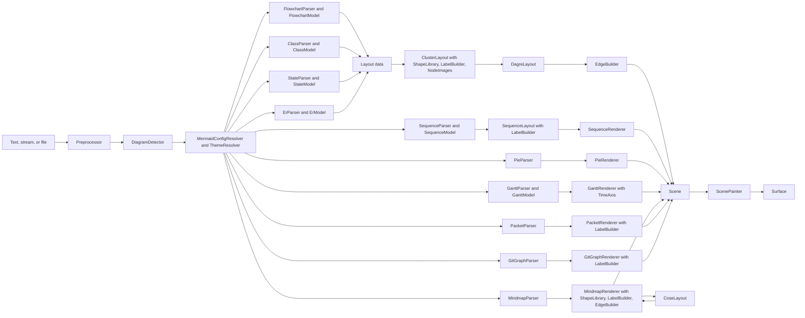

# System Design

This document provides the system-level design for CanvasNetMermaid.


## Architecture

CanvasNetMermaid is a static renderer for the Mermaid diagram language, delivered as its own NuGet package
(`DemaConsulting.CanvasNet.Mermaid`, root namespace `DemaConsulting.CanvasNet.Mermaid`), independent of the other
document systems in this repository. It reads Mermaid text and **parses** it into a validated, immutable document,
**describes** the diagram without drawing it (diagram type, whether this version draws it, title, accessible title,
direction, node, edge, and subgraph counts), **measures** the size the diagram renders at, and **renders** it onto a
`Surface` (the core `CanvasNet` pixel buffer) at its natural size multiplied by a scale or fitted inside an exact
size. Rendering is static (no interaction, no animation), deterministic (pixel-identical surfaces on every run,
thread, and platform), offline (no network, no browser, no JavaScript runtime), and uses only the .NET base class
library and the public API of the core `CanvasNet` package.

The goal is **fidelity to Mermaid**: a diagram must look like the picture the pinned Mermaid release draws in a
browser. The package is therefore a port, derived with attribution, of the parts of Mermaid that decide the picture:
its preprocessing and diagram detection, the jison grammars and databases of the flowchart, the sequence diagram, the
class diagram, the state diagram, the entity relationship diagram, the gantt chart, and the mindmap, and the Langium
grammars and databases of the pie chart, the packet diagram, and the git graph (with the URL check of sanitize-url that
Mermaid applies to the links a diagram keeps), its configuration defaults and precedence, its five themes and the khroma
color functions they use, its unified renderer (shapes, labels, edges, markers, clusters), the dagre layered layout and
graphlib graph that Mermaid bundles, its sequence renderer with the drawing functions of the sequence diagram, its pie
and gantt renderers with the d3 time scale, intervals, format, and axis and the dayjs date functions they use, and its
mindmap renderer with the cose-bilkent force-directed layout (cytoscape-cose-bilkent over cose-base and layout-base) and
the cytoscape edge points it reads back, its packet renderer, and its git graph renderer. Every
construct that is recognized but not drawn is **reported with a stable `mermaid-*` code and the exact location,
never skipped silently** (see _Fidelity and Known Differences_).

This version (Phases 1a, 1b, 2a, 2b, 3a, 3b, 4a, and 4b, see _Phase Plan_) draws **flowcharts** (the `flowchart` and
`graph`
keywords), **sequence diagrams** (the `sequenceDiagram` keyword), **class diagrams** (the `classDiagram` and
`classDiagram-v2` keywords, and the legacy `class` id of `class.defaultRenderer: dagre-d3`), **state diagrams** (the
`stateDiagram` and `stateDiagram-v2` keywords, and the legacy `state` id that a `state.defaultRenderer` other than
`dagre-wrapper` selects for a `stateDiagram` text), **entity relationship diagrams** (the `erDiagram` keyword),
**pie charts** (the `pie` keyword), **gantt charts** (the `gantt` keyword), **mindmaps** (the `mindmap` keyword),
**packet diagrams** (the `packet` and `packet-beta` keywords), and **git graphs** (the `gitGraph` keyword). Every other
Mermaid diagram type is detected (the 40 detectors of Mermaid, in Mermaid's order) and handled the same way: opening
succeeds, `IsSupported` is false, and measuring or rendering reports `mermaid-diagram-unsupported` once and gives an
empty, transparent 16 by 16 pixel picture (an exception in strict mode).

The system consists of one direct unit and seventeen internal subsystems:

- **MermaidDocument** (unit, root namespace; see _MermaidDocument Unit Design_) - the public API: `MermaidDocument`
  with `Parse`, `Open(path)`, `Open(stream)`, the metadata properties, `Measure`, `Render`, and
  `Render(width, height)`; the validated `MermaidOpenOptions`, `MermaidRenderOptions`, and `MermaidLimits`; the
  `MermaidLocation`, `MermaidDiagnostic`, `MermaidUnsupportedFeature`, and `MermaidSize` records; the
  `MermaidDiagnosticCodes` constants; the `MermaidSyntaxException`, `MermaidRenderException`, and
  `MermaidUnsupportedFeatureException` types; the internal `MermaidReportSink` (ordered, de-duplicated, capped report
  delivery); the internal pipeline seam (`IMermaidDiagram`, `DiagramRenderContext`, `DiagramRegistry`); and the
  `MermaidImageSource` that plugs the package into the CanvasNet image-source contract.
- **Syntax** (subsystem; see _Syntax Design_) - text to a clean diagram body: `Preprocessor` (line endings,
  frontmatter, directives, comments, entity encoding, size limits, and the location map back to the original text),
  `DiagramDetector` (Mermaid's detectors and their order), `YamlSubsetParser` (the js-yaml subset of the frontmatter
  and the shape data), `SourceScanner` (the jison lexer semantics shared by the parsers), and `HtmlSanitizer` (the
  DOMPurify behavior that Mermaid applies to labels, with the `HtmlEntities` table).
- **Configuration** (subsystem; see _Configuration Design_) - the effective configuration and paint:
  `MermaidConfigResolver` (defaults, precedence, secure keys, directive parsing, typed `MermaidConfig` view),
  `ThemeResolver` (the five themes and the flowchart, sequence, class, state, entity relationship, pie, gantt,
  mindmap, packet, and git graph style sheets, the gantt and git graph ones with a class-set cascade and the mindmap one
  painting each node by its classes), `ColorMath` (the khroma subset), and
  `StyleDeclarations` (the CSS declaration subset of `style`, `classDef`, `linkStyle`, and `themeCSS`).
- **Graphlib** (subsystem; see _Graphlib Design_) - `Graph` (graphlib's directed, multi, and compound graph with
  JavaScript key order) and `GraphAlgorithms` (the traversals dagre uses).
- **Dagre** (subsystem; see _Dagre Design_) - the layered layout: `DagreLayout` (the pipeline and its utilities),
  `DagreAcyclic`, `DagreRanker`, `DagreNesting`, `DagreNormalizer`, `DagreOrdering`, `DagrePositioning`,
  `DagreCoordinateSystem`, and `LayoutWorkMeter` (the work budget, cancellation, and the shared unique-id counter).
- **Rendering** (subsystem; see _Rendering Design_) - Mermaid's unified renderer for any layout data:
  `ClusterLayout` (subgraph extraction, recursive layout, placement, the check of the edge ends, and the frame of a
  class, state, or entity relationship diagram), `ShapeLibrary` (the 53 documented shapes, their aliases, the bracket
  shapes, the two mindmap shapes, the class box, the state shapes and the clusters of composite states, concurrent
  regions, and notes, the entity box, subgraph rectangles, and their intersections), `EdgeBuilder` (edge routes,
  curves, strokes, markers
  including the class markers, the `barb` of a state transition, and the four cardinality markers, edge labels, and
  the terminal labels of class relations), `LabelBuilder` (HTML, markdown, and SVG labels measured with the
  bundled fonts, and the text utilities that measure and wrap the texts of sequence diagrams), and `NodeImages`
  (pictures through the caller's resolver).
- **Scenegraph** (subsystem; see _Scenegraph Design_) - `SceneModel` (the immutable scene: groups, paths with their
  drop shadows, text that may be turned about a point, images, and their bounds, which is the assertion surface of the
  tests and goldens) and
  `ScenePainter` (scene to pixels).
- **Flowchart** (subsystem; see _Flowchart Design_) - `FlowchartParser` (the `flow.jison` lexer and grammar) and
  `FlowchartModel` (the `flowDb` semantics, the mapping to layout data, and the flowchart's own drawing steps).
- **Sequence** (subsystem; see _Sequence Design_) - `SequenceParser` (the `sequenceDiagram.jison` lexer and grammar),
  `SequenceModel` (the `sequenceDb` semantics, the metadata, and the reports), `SequenceLayout` (Mermaid's sequence
  renderer: the bounds model, the placement of every element, and the view box), and `SequenceRenderer` (Mermaid's
  sequence drawing functions as scene items).
- **Class** (subsystem; see _Class Design_) - `ClassParser` (the `classDiagram.jison` lexer and grammar) and
  `ClassModel` (the `classDb` semantics with Mermaid's `ClassMember`, the links checked by the shared check, the
  metadata, the reports, and the mapping to layout data for the shared renderer).
- **State** (subsystem; see _State Design_) - `StateParser` (the `stateDiagram.jison` lexer and grammar, and the
  statement tree its actions build) and `StateModel` (the `stateDb` semantics with the translation of the statement
  tree, the data fetcher with its note groups and DOM ids, the metadata, the reports, and the mapping to layout data
  for the shared renderer).
- **Er** (subsystem; see _Er Design_) - `ErParser` (the `erDiagram.jison` lexer and grammar) and `ErModel` (the `erDb`
  semantics with its entities, relationships, subgraphs, and compiled styles, the metadata, the reports, and the
  mapping to layout data for the shared renderer).
- **Pie** (subsystem; see _Pie Design_) - `PieParser` (the Langium pie grammar of the Mermaid parser package, its value
  converters, and the `pieDb` semantics, with the `PieDiagram` that gives the metadata) and `PieRenderer` (Mermaid's
  pie renderer with d3's `pie` and `arc`: the slices, percentage labels, title, legend, and view box).
- **Gantt** (subsystem; see _Gantt Design_) - `GanttParser` (the `gantt.jison` lexer and grammar), `GanttModel` (the
  `ganttDb` semantics, the metadata, and the compilation of the task dates of each render with the dayjs subset and
  the clock of the render options), `GanttRenderer` (Mermaid's gantt renderer with d3-axis: rows, bars, milestones,
  vertical markers, texts, section titles, excluded days, axes, today line, and title), and `TimeAxis` (JavaScript
  dates in UTC and the d3 time intervals, ticks, time scale, and time format).
- **Mindmap** (subsystem; see _Mindmap Design_) - `MindmapParser` (the `mindmap.jison` lexer and grammar and the
  `mindmapDb` semantics, with the `MindmapDiagram` that gives the metadata and the sections, classes, and edges of
  `getData`) and `MindmapRenderer` (Mermaid's mindmap renderer: the node data and the changes per shape, the nodes drawn
  by the shared shapes, their sizes in single precision, the edges through the layout's points, the reports, and the
  view box).
- **Cose** (subsystem; see _Cose Design_) - `CoseLayout` (the cose-bilkent layout of layout-base, cose-base, and
  cytoscape-cose-bilkent as Mermaid runs it for one tree, cytoscape's straight-edge points, and the correctly rounded
  sine, cosine, logarithm, and power that make it equal to the browser's layout).
- **Packet** (subsystem; see _Packet Design_) - `PacketParser` (the Langium packet grammar of the Mermaid parser
  package, its value converters, and the packet database semantics, with the `PacketDiagram` that gives the metadata
  and splits the blocks into rows as Mermaid's `populate` does) and `PacketRenderer` (Mermaid's packet renderer: the
  block rectangles, labels, and bit numbers of each row, the title, and the view box).
- **GitGraph** (subsystem; see _GitGraph Design_) - `GitGraphParser` (the Langium git graph grammar of the Mermaid
  parser package, its value converters, and the `GitGraphDatabase` port of Mermaid's git graph database with its
  generated commit ids, with the `GitGraphDiagram` that gives the metadata and runs the statements again for a render
  that names another main branch) and `GitGraphRenderer` (Mermaid's git graph renderer: the branch lines and labels,
  the commit places of both passes, the arrows with their rerouting lanes, the commit bullets, the rotated commit labels,
  the tags, the title, and the view box of the browser's bounding box).

The dependency direction is one way:

```text
MermaidDocument -> Syntax -> Configuration -> Flowchart -> Rendering -> Dagre -> Graphlib
                                                        -> Scenegraph
                                           -> Sequence  -> Rendering (LabelBuilder), Dagre (LayoutWorkMeter)
                                                        -> Scenegraph
                                           -> Class     -> Rendering -> Dagre -> Graphlib
                                                        -> Scenegraph
                                           -> State     -> Rendering -> Dagre -> Graphlib
                                                        -> Scenegraph
                                           -> Er        -> Rendering -> Dagre -> Graphlib
                                                        -> Scenegraph
                                           -> Pie       -> Rendering (LabelBuilder), Dagre (LayoutWorkMeter)
                                                        -> Scenegraph
                                           -> Gantt     -> Rendering (LabelBuilder), Dagre (LayoutWorkMeter)
                                                        -> Graphlib (ObjectKeyMap)
                                                        -> Scenegraph
                                           -> Mindmap   -> Rendering (ShapeLibrary, EdgeBuilder, LabelBuilder)
                                                        -> Cose -> Dagre (LayoutWorkMeter)
                                                        -> Dagre (LayoutWorkMeter)
                                                        -> Scenegraph
                                           -> Packet    -> Rendering (LabelBuilder), Dagre (LayoutWorkMeter)
                                                        -> Scenegraph
                                           -> GitGraph  -> Rendering (LabelBuilder), Dagre (LayoutWorkMeter)
                                                        -> Scenegraph
```

The one call against that direction is the entity box of `ShapeLibrary`, which draws a `~T~` attribute type with
the static `ClassModel.ParseGenericTypes`, the port of Mermaid's `parseGenericTypes` that the class and ER drawings
share; it is a pure text function and holds no state.

Only `ScenePainter` and `LabelBuilder` use the core `Fonts`, `Rendering`, and `Drawing` APIs, and only
`NodeImages` and `MermaidImageSource` use the core `ImageSources` API. The internal subsystems are visible to the
test assembly through `InternalsVisibleTo` and to nothing else.

## External Interfaces

- **Text input** (`MermaidDocument.Parse(string, MermaidOpenOptions?)`): Mermaid text of at most `MaxTextSize` UTF-16
  characters after frontmatter, directives, and comments are removed, and at most four times that before.
- **Byte input** (`MermaidDocument.Open(string path, ...)` and `Open(Stream, ...)`): strict UTF-8 with an optional
  byte-order mark; the read is bounded, a stream is left open, and a path names the document.
- **Metadata output** (`SourceName`, `DiagramType`, `IsSupported`, `Title`, `AccTitle`, `Direction`, `NodeCount`,
  `EdgeCount`, `SubgraphCount`): .NET values available after open, without rendering. For a sequence diagram the
  counts are its participants, its messages drawn as arrows, and its boxes, and `Direction` is null. For a class
  diagram they are its classes, its relations, and the namespaces drawn under the text's own configuration (every
  namespace, implicit dotted parents included, or only the declared ones when the text sets
  `class.hierarchicalNamespaces: false`); a site configuration changes the drawing but not the counts. For a state
  diagram they are its states (the start, end, fork, join, and choice states included; notes, note groups, and
  concurrent regions not counted), its transitions (the links of notes not counted), and its composite states, and
  `Direction` is the last top-level `direction` statement, the one that is drawn. For an entity relationship diagram
  they are its drawn entities (an entity named only after a subgraph is not drawn and not counted), its
  relationships, and its subgraphs, and `Direction` is the last top-level `direction` statement. For a pie chart they
  are its sections (each label once; the legend entries) with no edges or subgraphs, and `Direction` is null. For a
  gantt chart they are its tasks (vertical markers included) and the sections whose titles are drawn (those of the
  tasks that are not vertical markers), with no edges, and `Direction` is null. For a mindmap they are its nodes, one
  edge for each node but the root, and no subgraphs; `Direction` is null and the title is only the frontmatter title.
  For a packet diagram they are its block statements (a block split across two rows counted once), with no edges or
  subgraphs, and `Direction` is null; the counts do not depend on the row size of a render. For a git graph they are
  its commits (merges and cherry-picks included; a commit whose id is used again counted once), the links to their
  parents (the arrows), and no subgraphs, counted with the main branch of the text's own configuration, and `Direction`
  is `LR`, `TB`, or `BT`.
- **Picture output** (`Measure`, `Render`, `Render(width, height)` with `MermaidRenderOptions`): a `MermaidSize` or a
  `Surface` (RGBA, straight alpha) whose sides lie within 1 and `Surface.MaxDimension`; a `CancellationToken` is
  observed.
- **Site configuration input** (`MermaidRenderOptions.Config`): a JSON object, Mermaid's site configuration,
  validated as a JSON object when set; its keys are checked when it is used.
- **Theme input** (`MermaidRenderOptions.Theme`): `default`, `base`, `dark`, `forest`, or `neutral`, applied at site
  level like `mmdc -t`, so the text still wins.
- **Picture input** (`MermaidRenderOptions.ImageResolver`): a core `IImageResolver`, the only way a picture is
  loaded, called at most `MaxImages` times per call.
- **Clock input** (`MermaidRenderOptions.Now`): a `DateTimeOffset`, null by default, the only clock of the library,
  read only by a gantt chart, converted to UTC: it gives the today line and the dates that Mermaid takes from today.
  Without it no today line is drawn, 1970-01-01 is taken as today, and what needs today is reported
  (`mermaid-gantt-today-unavailable`). The Viewer library, the tool, and the documentation filter do not set it.
- **Report output** (`WarningHandler`, `UnsupportedFeatureHandler`): `MermaidDiagnostic` and
  `MermaidUnsupportedFeature` values, each delivered once, in order, on the calling thread, after the work.
- **Exception output**: `MermaidSyntaxException` (a `FormatException`), `MermaidRenderException` (an
  `InvalidOperationException`), `MermaidUnsupportedFeatureException` (an `IOException`), `InvalidDataException`,
  argument exceptions, and `OperationCanceledException`; the Mermaid exceptions carry `Code` or `Feature`,
  `Location`, and `Hint`, and their message reads `file:line:column: code: description`.
- **Image source** (`MermaidImageSource`, both directions): the core `IImageSource` and `IFragmentImageSource`
  contract for the extensions `.mmd` and `.mermaid` with the fragment parameter `theme` and a transparent background.
- **Third-party notices** (output, the `licenses/` folder of the package): `LICENSE-mermaid.txt`,
  `LICENSE-mermaid-parser.txt`, `LICENSE-langium.txt`, `LICENSE-dagre.txt`, `LICENSE-d3.txt`, `LICENSE-dayjs.txt`,
  `LICENSE-cose-base.txt` (layout-base and cose-base), `LICENSE-cytoscape.txt` (cytoscape and cytoscape-cose-bilkent),
  `LICENSE-js-yaml.txt`, `LICENSE-khroma.txt`, `LICENSE-lodash.txt`, `LICENSE-marked.txt`,
  `LICENSE-sanitize-url.txt`, and the provenance README.
The report and error codes are the `MermaidDiagnosticCodes` constants: `mermaid-syntax-error`,
`mermaid-unknown-diagram`, `mermaid-diagram-unsupported`, `mermaid-yaml-invalid`, `mermaid-yaml-unsupported`,
`mermaid-limit-exceeded`, `mermaid-render-failed`, `mermaid-diagnostics-suppressed`, `mermaid-config-secure-key`,
`mermaid-config-unknown-key`, `mermaid-config-invalid`, `mermaid-shape-unknown`, `mermaid-participant-type-unknown`,
`mermaid-math-unsupported`, `mermaid-icon-unsupported`, `mermaid-image-unresolved`, `mermaid-text-missing-glyph`,
`mermaid-look-unsupported`, `mermaid-layout-unsupported`, `mermaid-style-ignored`, `mermaid-theme-css-unsupported`,
`mermaid-html-tag-ignored`, `mermaid-gantt-today-unavailable`, `mermaid-gantt-ticks-skipped`, and
`mermaid-gantt-excludes-skipped`. They are part of the public contract and do not change between releases. A `class`
statement or `:::` that names a class no `classDef` defines is not reported: the pinned Mermaid's flowchart database
records the name and the class simply adds no style.

## Dependencies

- **CanvasNet (sibling system, same repository)** - `Canvas` (`Surface`, `Rgba32`, `CssColor`), `Geometry` (`Path`
  and its builder for scene paths), `Drawing` (`PathFiller`, `PathStroker`), `Fonts` (`FontResolver` with
  `MapCommonAliasesToBundled` and no system fonts, `GenericFontFamilies`), `Rendering` (`TextRenderer` for measuring
  and drawing text, `WordWrap` for HTML label wrapping), and `ImageSources` (`IImageSource`, `IFragmentImageSource`,
  `IImageResolver`, `ImageFragment`). Only the public API is used.
- **.NET base class library** - `System.Text.Json` (validation of the site configuration and the JSON of init
  directives), `System.Text` (strict UTF-8), collections, `System.Math`, and `System.Numerics.BigInteger` (the
  correctly rounded math of the cose layout).
- **No OTS runtime dependency.** Mermaid, the Mermaid parser package (`@mermaid-js/parser`) and Langium, dagre-d3-es,
  graphlib, the d3 modules (shape, path, scale, time, time format, array, axis, and interpolate), dayjs, cytoscape,
  cytoscape-cose-bilkent, cose-base, layout-base, khroma, js-yaml, lodash, marked, and sanitize-url are **not**
  dependencies: their behavior is ported into local source (see
  _Third-Party Provenance and Attribution_). The pinned `mermaid`, `@mermaid-js/mermaid-cli`, `dagre-d3-es`, and
  `puppeteer` npm packages of the repository are used only by the developer scripts in `tools/visual-diff/` that
  generate the test vectors and layout goldens; CI never runs them.

## Risk Control Measures

CanvasNetMermaid is not safety-classified, but it processes untrusted text and is used inside documentation builds
and services, so its risk controls are about availability, integrity of the picture, and confidentiality of the host:

- **Segregation from the host's files and network.** The package opens no file other than the path given to `Open`
  and performs no network access. Pictures are loaded only through the caller's `IImageResolver`; without one, a
  picture link is reported (`mermaid-image-unresolved`) and the diagram is still drawn. The Viewer library supplies
  a sandboxed folder resolver.
- **Bounded work and memory.** Every input-controlled loop and recursion is bounded by a `MermaidLimits` value (see
  _Untrusted Input and Limits_); the parsers are scanner based with no regular-expression backtracking; YAML aliases,
  anchors, and tags are refused.
- **Fail closed.** Invalid text never yields a guessed picture: it is a located `MermaidSyntaxException`.
  Unsupported constructs are reported, and strict mode turns the first one into an exception, so a build can refuse an
  approximate picture.
- **No secure-key escalation.** Text cannot change a key the site marks as secure (`mermaid-config-secure-key`);
  `securityLevel` values have no effect because nothing is executed.
- **Determinism.** Only bundled fonts are used, the layout reproduces JavaScript iteration order, dates are computed
  in UTC, the cose layout of a mindmap computes its sines, cosines, logarithms, and powers correctly rounded rather than
  with the host's math library, and nothing reads the system clock, a random source, or the culture (a gantt chart takes
  today only from `MermaidRenderOptions.Now`, and the generated commit ids of a git graph come from a fixed pseudo-random
  sequence restarted for every run of its database), so the output can be cached and reviewed.

## Data Flow



1. **Open** (once per document): the text is decoded (strict UTF-8, byte-order mark dropped) and checked against the
   raw size limit; `Preprocessor` normalizes line endings, reads the frontmatter (title, `displayMode`, `config`
   through `YamlSubsetParser`), extracts the `%%{...}%%` directives, removes `%%` comments, encodes entities as
   Mermaid does, checks `MaxTextSize`, and keeps a location map back to the original text. `DiagramDetector` picks
   the diagram with Mermaid's detectors (using the renderer settings of the text configuration). For a flowchart,
   `FlowchartParser` lexes and parses the body and `FlowchartModel` applies the `flowDb` rules; for a sequence
   diagram, `SequenceParser` lexes and parses the body and `SequenceModel` applies the collected statements with the
   `sequenceDb` rules; for a class diagram, `ClassParser` lexes and parses the body and runs each `classDb` action of
   `ClassModel` where Mermaid's grammar reduces, with the text's own `class.hierarchicalNamespaces` (resolved from the
   frontmatter and the directives, and passed on by the registry) choosing the namespaces it counts; for a state
   diagram (the `stateDiagram` and `stateDiagram-v2` texts and the legacy `state` id), `StateParser` lexes and parses
   the body into Mermaid's statement tree and `StateModel` translates it and applies it with the `stateDb` rules (the
   legacy id applies the statements before it translates them, as Mermaid's legacy database does); for an entity
   relationship diagram, `ErParser` lexes and parses the body and runs each `erDb` action of `ErModel` where Mermaid's
   grammar reduces; for a pie chart, `PieParser` lexes and parses the body with the Langium grammar and fills the
   `PieDiagram` with the `pieDb` rules; for a gantt chart, `GanttParser` lexes and parses the body and runs each
   `ganttDb` action of `GanttModel` where Mermaid's grammar reduces (the task dates are not compiled yet, because they
   depend on the clock of a render); for a mindmap, `MindmapParser` lexes and parses the body, makes each `mindmapDb`
   call where Mermaid's grammar reduces, and its `MindmapDiagram` derives the sections, classes, and edges of `getData`;
   for a packet diagram, `PacketParser` lexes and parses the body with the Langium grammar and fills and checks the
   blocks of the `PacketDiagram` with the rules of Mermaid's packet database (the rows are not split yet, because they
   depend on the configuration of a render); for a git graph, `GitGraphParser` lexes and parses the body with the
   Langium grammar and runs the statements against a `GitGraphDatabase` with the rules of Mermaid's git graph database
   and the main branch name and order of the text's own configuration (resolved from the frontmatter and the
   directives, and passed on by the registry), which gives the commits, branches, and generated ids of the
   `GitGraphDiagram`. Syntax errors,
   database errors, and the
   open-time limits (edges, nodes, label length, nesting, YAML depth) fail here. Other known types are kept as
   unsupported diagrams.
2. **Measure and Render** (per call, because the options can change sizes): `MermaidConfigResolver` merges the
   defaults, the caller's `Config` and `Theme`, the frontmatter configuration, and the init directives, and
   `ThemeResolver` derives the theme variables and the style sheet of the diagram. For a flowchart, `FlowchartModel`
   reports the unsupported
   constructs (look, layout, icons) and maps the model to layout data. `ClusterLayout` measures every label
   (`LabelBuilder`) and node (`ShapeLibrary`, picture sizes from `NodeImages`), lays out every graph and isolated
   subgraph with `DagreLayout`, and places nodes, subgraphs, and edges (`EdgeBuilder`). The flowchart adds its title;
   the view box is the drawing bounds grown by `diagramPadding`. For a sequence diagram, `SequenceModel` reports the
   unsupported constructs (look, participant icons, math, unknown participant types), and `SequenceLayout` sizes the
   participants from the texts it measures and wraps with `LabelBuilder`, places every message, note, activation,
   block, box, and menu from top to bottom, and has `SequenceRenderer` draw them in Mermaid's paint order; the view box
   is the extent grown by the diagram margins, with room for the title. For a class diagram, `ClassModel` reports the
   unsupported constructs (look, layout) and maps the model to layout data (namespaces as clusters, class boxes,
   notes, hidden lollipop interfaces, relations with their markers and cardinalities); `ClusterLayout` lays it out as
   for a flowchart, draws the class boxes (`ShapeLibrary`) and the terminal labels (`EdgeBuilder`), and
   `ClusterLayout.RenderDiagram` adds the title and grows the view box by the class renderer's padding of 8. A state
   diagram and an entity relationship diagram go the same way: `StateModel` reports the unsupported constructs (look,
   layout, and the legacy renderer) and maps the model to layout data (states with their shapes, composite states,
   concurrent regions, and note groups as clusters, notes, and transitions with the `barb` marker), and `ErModel`
   reports the look and layout and maps the model to layout data (entity boxes with their attribute tables,
   subgraphs as clusters, and relationships with their cardinality markers); `ClusterLayout` checks that every edge
   end is drawn, lays the data out, and `RenderDiagram` adds the title and the padding of 8 of their renderers.
   A pie chart is drawn by `PieRenderer` alone: the slices from d3's `pie` and `arc`, the percentage labels, the
   title, and the legend measured with `LabelBuilder`, with the view box of Mermaid's pie renderer. For a gantt chart,
   `GanttRenderer` has `GanttModel` compile the task dates with the clock of the render (`MermaidRenderOptions.Now`,
   in UTC) and the dayjs subset, reporting what needs an unknown today, then lays out the rows, the time scale, and
   the axes with `TimeAxis` and draws the bars, texts, section titles, excluded days, today line, and title, with
   the view box of the page width and the rows. For a mindmap, `MindmapRenderer` reports the unsupported constructs
   (look, layout, icons), draws every node with `ShapeLibrary` and `LabelBuilder` in the paint of the mindmap style
   sheet, gives `CoseLayout` the node sizes in single precision and the edges of the tree, places the nodes at the
   centers it returns, draws the edges with `EdgeBuilder` through the points it returns, and grows the box of the
   drawing by `mindmap.padding` for the view box. A packet diagram is drawn by `PacketRenderer` alone: the blocks are
   split into rows of the render's `packet.bitsPerRow` as Mermaid's `populate` splits them, and each row's rectangles,
   labels, and bit numbers and the title are drawn with the texts measured by `LabelBuilder`, with the view box of
   Mermaid's packet renderer. A git graph is drawn by `GitGraphRenderer` alone: it takes the database of the text, or
   runs the statements again when the render's configuration names another main branch or main branch order, places the
   branches and the commits (twice, as Mermaid does), and draws the branch lines and labels, the arrows with their
   rerouting lanes, the commit bullets, the commit labels and tags (rotated by 45 degrees where Mermaid rotates them),
   and the title with the texts measured by `LabelBuilder`, with the view box of the browser's bounding box grown by
   `gitGraph.diagramPadding`. `Measure` stops here and returns the view box
   rounded up and multiplied by the scale. `Render` paints the scene with `ScenePainter` (uniformly scaled, or fitted
   and centered for an exact size) over the background, loading pictures through the same `NodeImages`.
3. **Reports** recorded by any stage go to the call's `MermaidReportSink` and are delivered to the handlers after the
   work, in order, on the calling thread.

## Design Constraints

### Platform Support

The package targets `net8.0`, `net9.0`, and `net10.0` and runs on Windows, Linux, and macOS, like the core
`CanvasNet` system it depends on. It contains no platform-specific code and uses no native library; the platform
requirements are proven by running the representative pixel test on every platform and framework.

### Integration Patterns

The `MermaidImageSource` is the integration point for hosts: the Viewer library registers it as its eighth built-in
source (so SVG documents can embed `.mmd` files and the `canvasnet` tool can render, describe, and validate them),
and the Pandoc filter of the documentation build renders `mermaid` code blocks through the tool. A library caller can
instead use `MermaidDocument` directly with `MermaidRenderOptions`.

### Determinism

- **Fonts**: every font family (Mermaid's default `"trebuchet ms", verdana, arial, sans-serif` and any `fontFamily`)
  resolves to the bundled Liberation Sans, and system fonts are never consulted. A glyph that Liberation Sans lacks is
  drawn from the core library's bundled Noto fallback fonts without a report; a character that no bundled font has is
  drawn as the font's missing-glyph box and reported (`mermaid-text-missing-glyph`).
- **Order**: graphlib's object-key order (array-index keys first, then insertion order) and lodash's and V8's sorting
  steps are reproduced, so ties are broken as in Mermaid and never by hash order.
- **Arithmetic**: layout uses `double` arithmetic in Mermaid's order of operations; nothing depends on the culture,
  the system clock, or a random source. lodash's `uniqueId` counter lives in the per-render `LayoutWorkMeter`, so names
  never depend on earlier renders. The cose layout of a mindmap draws no random number (a tree never reaches the random
  code of cose-base) and computes its sines, cosines, logarithms, and powers correctly rounded, without the host's math
  library, so its chaotic layout is the same on every platform and equal to the browser's. The commit ids a git graph
  generates take their digits from the mulberry32 sequence with a fixed seed, restarted for every run of its database,
  in place of Mermaid's `Math.random`, so they are the same in every render (item 59 below).
- **Clock and time zone**: the library never reads the system clock. A gantt chart takes today only from
  `MermaidRenderOptions.Now` (else 1970-01-01, reported), and every date is computed as JavaScript computes it in a
  browser whose time zone is UTC, so a chart is the same on every machine; the reference harness renders the goldens
  with the browser's time zone set to UTC and its clock fixed at the instant the tests pass as `Now`.
- **Immutability**: a `MermaidDocument` is immutable and thread-safe; each call has its own configuration, sink,
  meter, and font resolver. Tests render sequentially and in parallel and compare pixels.

### Third-Party Provenance and Attribution

CanvasNetMermaid is **derived with attribution**, not clean-room. The ported projects are listed with their license,
copyright notice, and the CanvasNet unit that ports them in
`src/DemaConsulting.CanvasNet.Mermaid/third-party/README.md`; every source file with ported logic starts with `//
Portions derived from <project> (<license>); see third-party/README.md`:

| Upstream project | License | Ported into |
| --- | --- | --- |
| mermaid | MIT | the Syntax units except `HtmlSanitizer`, configuration, themes, renderer, every drawn diagram type |
| `@mermaid-js/parser` | MIT | the grammars, tokens, and converters of `PieParser`, `PacketParser`, `GitGraphParser` |
| Langium | MIT | `convertString` and `convertInt` of `PieParser`, `PacketParser`, and `GitGraphParser` |
| dagre-d3-es (dagre, graphlib, dagre-d3) | MIT | `Graph`, `GraphAlgorithms`, the `Dagre` units, intersections |
| d3-shape and d3-path | ISC | `EdgeBuilder` curves and path numbers, the `pie` and `arc` of `PieRenderer` |
| d3-scale, d3-time, d3-time-format, d3-array, d3-axis, d3-interpolate | ISC | `TimeAxis`, the axes of `GanttRenderer` |
| dayjs (with the plugins Mermaid loads) | MIT | `Dayjs` of `GanttModel` |
| layout-base and cose-base | MIT | the graph model, radial placement, and spring embedder of `CoseLayout` |
| cytoscape-cose-bilkent and cytoscape | MIT | the layout glue and the straight-edge points of `CoseLayout` |
| khroma | MIT | `ColorMath` |
| js-yaml | MIT | `YamlSubsetParser` |
| lodash | MIT | `Lodash` helpers of `DagreLayout` (sorting, extremes, unique ids) |
| marked | MIT | the markdown subset of `LabelBuilder` |
| sanitize-url (a dependency of mermaid) | MIT | the link check `UrlSanitizer` (class, sequence, state, gantt links) |

The license texts ship in the package's `licenses/` folder (and in the tool package, where the d3 notice is renamed
`Mermaid-LICENSE-d3.txt` because the Vega-Lite package ships a different `LICENSE-d3.txt`). The public API, the scene
model and painter, `NodeImages`, `HtmlEntities`, `HtmlSanitizer` (which reproduces DOMPurify's results for label HTML
without porting its code), `StyleDeclarations`, `ObjectKeyMap`, `LayoutWorkMeter`, the correctly rounded math of
`CoseLayout`, the limits other than
`maxTextSize` and `maxEdges`, the diagnostics, and all tests and fixtures are original work. The package is not
affiliated with, and not endorsed by, the Mermaid project, the Cytoscape Consortium, iVis@Bilkent, or the authors of
the other projects. The upstream test
vectors are generated from the pinned packages from original inputs by the developer scripts in
`tools/visual-diff/mermaid/`.

### Untrusted Input and Limits

All Mermaid text is untrusted. The limits are caller-adjustable through `MermaidLimits` (validated when set):

- `MaxTextSize`, 50,000 (Mermaid's `maxTextSize`): checked at open on the code after the frontmatter, directives,
  and comments are removed; the raw text may be at most four times larger. Failure: `InvalidDataException`.
- `MaxEdges`, 500 (Mermaid's `maxEdges`; also the relations of a class diagram, the transitions of a state diagram, not
  the links of its notes, and the relationships of an entity relationship diagram); `MaxNodes`, 2,000 (subgraphs
  included; the participants and boxes of a sequence diagram; the classes, notes, lollipop interfaces, and namespaces,
  implicit dotted parents included, of a class diagram; the states of a state diagram, a state that only a `class` or
  `style` statement names included, and, counted apart, its laid-out nodes with every kind of cluster: states, composite
  states, concurrent regions with the generated last region, notes, and note groups; the entities of an entity
  relationship diagram, those named only after a subgraph included, and its subgraphs together; the section statements
  of a pie chart; the task and section statements of a gantt chart; the nodes of a mindmap; the block statements of a
  packet diagram; the main branch, the branches, and the commits of a git graph); `MaxLabelLength`, 4,096
  (also the accessible title
  and description, the type and alias of sequence participant metadata, and the texts a diagram joins or derives from
  texts checked apart: the label of a generic class with its type, the qualified id of a nested namespace, and the CSS
  classes and styles of a class or style class as they grow; the descriptions of a state joined with line breaks as its
  box draws them, the `_start` and `_end` ids of the start and end states of a composite state, a text style once `fill`
  is renamed, and the CSS classes, style class styles, and compiled styles of a state as they grow; the styles, the
  bracketed subgraph titles, the attribute types with `?`, the CSS classes, the inline and style class styles as they
  grow, and the compiled styles of an entity relationship diagram; the legend text `label [value]` of a pie chart with
  `showData`; the class list a gantt task gathers from `click` statements and its checked link; every id, text, icon,
  and class of a mindmap, sanitized, and the class list of each node; every label, title, and accessibility text of a
  packet diagram, sanitized, and the frontmatter title it draws, located at the frontmatter; every id, message, branch
  name, tag, and parent of a git graph, sanitized, the messages and default tags it composes for merges and
  cherry-picks, its title and accessibility texts, and the frontmatter title it draws); `MaxNestingDepth`, 32
  (subgraphs, namespaces, the dotted parts of a namespace name counted as levels, composite states with each concurrent
  region counted as a level, the subgraphs of an entity relationship diagram, the blocks and boxes of a sequence
  diagram, and the depth of a node in a mindmap's tree; at most 256; namespaces nested through class names, composite
  states nested through their names, and entity
  relationship subgraphs nested through their names are checked when the diagram is laid out, as a
  `MermaidRenderException`); `MaxYamlDepth`, 32 (at most 256; YAML aliases, anchors, and tags are refused): checked at
  open. Failure: `MermaidSyntaxException` with `mermaid-limit-exceeded` (or `mermaid-yaml-unsupported` for a refused
  YAML construct).
- `MaxLayoutWork`, 50,000,000 metered layout steps (the dagre stages, the text measurement of a class box, the
  measuring, wrapping, and placing of a sequence diagram, the measured texts of a pie chart, and for a gantt chart
  every compile pass, reference, and day of the date loops, each tick and tick label, the compact rows, and the
  sorts, and for a mindmap the node data, every measured label, every drawn edge, and every step of the cose layout:
  the tree and its placement, each iteration, each repulsion pair, the cells of each grid before it is built, and each
  transcendental function, with weights pinned by tests; a mindmap of about 1,000 nodes or more can reach the default
  limit; for a packet diagram each block and each part of the row split, 1 each, and each measured text, 1 and its
  length; and for a git graph each branch, each commit of each placing pass, and each parent looked at, 1 each, each
  arrow, 1 and the commits its rerouting test scans, each lane try, 1 and the lanes it compares, and each measured text,
  1 and its length); `MaxImages`, 256 resolver calls; `MaxPaintedPixels`,
  250,000,000 (charged before each item and drop shadow is painted): checked per call. Failure:
  `MermaidRenderException` with `mermaid-limit-exceeded`. The formatted tick labels of a gantt chart and the labels of a
  mindmap, as they are built for drawing, are also checked against `MaxLabelLength` when they are made, and the parts
  that the rows of a packet diagram split its blocks into are counted against `MaxNodes` as they are made, so a range
  that Mermaid splits into thousands of rows fails after at most `MaxNodes` parts (Mermaid's own cap of 10,000 rows is
  kept above it). When a render runs the statements of a git graph again for another main branch, that run checks
  `MaxNodes` and `MaxLabelLength` again, as a `MermaidRenderException`.
- `MaxDiagnostics`, 1,000 reports per call: further reports become one `mermaid-diagnostics-suppressed` notice and
  rendering continues.

A site configuration's `maxTextSize` and `maxEdges` are resolved but not consulted: the limits come from
`MermaidLimits` only. A natural size beyond `Surface.MaxDimension` (8,192) at the requested scale is an
`ArgumentOutOfRangeException` from `Measure` or `Render`; a host can then render at a smaller scale or an exact size.
Deep recursion is guarded by `EnsureSufficientExecutionStack` and mapped to `mermaid-limit-exceeded`. The hardening
tests feed seeded mutations of every fixture and assert that only the documented exceptions occur.

### Fidelity and Known Differences

**Reference.** The target is the pinned Mermaid release (the version recorded in `package-lock.json` and in the
third-party README; the `mmdc` used to create the references bundles that release). Later Mermaid releases are not
tracked automatically.

**How fidelity is measured.** Algorithmic parts are compared exactly against upstream vectors generated by the
pinned packages: 207 flowchart parser and database vectors, 242 sequence parser and database vectors, 179 class
parser and database vectors, 157 state parser and database vectors, 246 entity relationship parser and database
vectors, 133 pie parser and database vectors, 291 gantt parser and database vectors (the compiled task dates
included), 246 mindmap parser and database vectors (the nodes and edges of `getData` included), 162 packet parser and
database vectors (the effective packet configuration and the rows of the split included), 297 git graph parser and
database vectors (the commits, branches, and branch order of the database with the generated ids of the seeded
reference included), 1,166 time vectors of
the d3 time functions, 36 cose layouts and the sines, cosines, logarithms, and powers of 29,332 math vectors recorded in
Chrome (compared bit for bit), 53
configuration cases and 622 khroma calls, 224 dagre
stage goldens (ranks and orders exact, coordinates within 1e-9), 296 shape vectors, and 144 d3 curve vectors. The
whole layout is compared against reference layouts extracted from mermaid-cli renders of the 42 original flowchart
fixtures with the bundled Liberation Sans (`tools/visual-diff/render-mermaid.mjs` with `liberation.css`): the
view box, node centers and sizes, subgraph rectangles, 21 arc-length samples of every edge, and edge label centers.
The tolerance is 0.01 pixel, and 0.1 pixel for the fixtures `12-new-shapes-flow` and `14-new-shapes-symbols` (the
rough.js circles, item 1 below); in practice 39 fixtures agree to within 0.001 pixel. The fixture `38-unicode` is
**excluded** from the goldens: Chrome draws its CJK text with a system font that the bundled fonts do not have, so
the reference would depend on the machine (its node is 12 pixels wider in Chrome); no bundled font has those
characters, so CanvasNet draws them as the missing-glyph box and reports `mermaid-text-missing-glyph`. The 24
original sequence fixtures are compared the same way (`Fixtures/reference/sequence/`): the view box, the title, every
participant drawing with its parts, paint, and labels, the lifelines, every message line or self loop with its
markers, texts, sequence number, and central-connection circles, the notes, activations, block frames, `rect`
backgrounds, boxes with their shadows, menus, and the paint order, at 0.01 pixel (0.02 pixel for text boxes, which
Chrome snaps to 1/64 pixel, and for the cylinder arcs of `queue` and `database`); no sequence fixture is excluded.
The 16 original class fixtures are compared the same way (`Fixtures/reference/class/`): the view box, every node's
position and box and each part of each class box (annotation, name, members, methods, and dividers), the namespace
rectangles and titles, every edge (its length and 21 sampled points), the edge label centers, the terminal label
positions, and the title box, at 0.01 pixel; only `16-config-title-links`, the one fixture with SVG class texts, is
compared at 0.23 pixel (item 27 below), and no class fixture is excluded. The 14 original state fixtures
(`Fixtures/reference/state/`) and the 12 original entity relationship fixtures (`Fixtures/reference/er/`) are
compared the same way: the view box, every node's position and box and its drawn parts (the label box of the title
and descriptions and the divider of a state with descriptions; the outline, rows, text cells, and dividers of an
entity table), every cluster's rectangle, inner rectangle, and title (composite states, concurrent regions, note
groups, and subgraphs), every edge (its length and 21 sampled points), the edge label centers, and the title box, at
0.01 pixel with no exception; in practice every state fixture agrees to within 0.003 pixel (the largest at
`08-notes`) and every entity relationship fixture to within 0.002 pixel, the fixtures with SVG text
(`13-config-title` and `12-config-title`) included, and no state or entity relationship fixture is excluded. The 8
original pie fixtures (`Fixtures/reference/pie/`) are compared the same way: the view box, the outer circle, every
slice's path and paint, the percentage labels, the title, and every legend entry with its square and text, at 0.01
pixel (0.02 pixel for text boxes and the boxes of the slice arcs); every pie fixture agrees to within 0.001 pixel.
The 14 original gantt fixtures (`Fixtures/reference/gantt/`) are rendered by the harness with the browser's time zone
set to UTC and its clock fixed at 2024-06-12T10:30:00Z, the `Now` the tests pass, and compared the same way: the view
box, the excluded days, both axes with every tick line and label, the section rows, every task bar and text with
its paint, the section titles, the today line, and the title, at 0.01 pixel (0.02 pixel for text boxes); every
gantt fixture agrees to within 0.0005 pixel, and no pie or gantt fixture is excluded. The 14 original mindmap fixtures
(`Fixtures/reference/mindmap/`) are rendered twice by the harness, which fails if the two layouts differ or if the
layout ever draws a random number, and compared in three tiers, because the cose-bilkent layout is chaotic: the node
sizes the layout is given, at 0.02 pixel (152 of the 155 sizes are bit-identical to Chrome's `getBBox`); the layout
alone, given each golden's own sizes, bit for bit (all 14 fixtures are bit-identical, the 56 nodes of `13-large`
included); and the whole drawing (the view box, every node's center, box, and paint, and every edge sampled at 21 points
with its paint) at 0.01 pixel. In the whole drawing, 11 of the 14 fixtures have exactly Mermaid's node centers;
`03-root-shapes`, whose cloud root is 1.5e-5 pixel off in Chrome's single-precision arc bounds, has its centers within
0.0001 pixel (5.7e-5), and `09-htmllabels-false`, whose three-line SVG label differs from Chrome's by 3.8e-6 pixel,
within 0.0004 pixel; `02-shapes` is excluded from the whole-drawing tier (item 49 below). The 13 original packet
fixtures (`Fixtures/reference/packet/`) are compared the same way: the view box, every block rectangle with its paint,
and every label, bit number, and title with its content, anchor, font size, color, and box, at 0.01 pixel (0.02 pixel
for text boxes, which Chrome snaps to 1/64 pixel); every packet fixture agrees to within 0.001 pixel but
`10-theme-variables`, a text box of which is 0.016 pixel off, and no packet fixture is excluded. The 18 original git
graph fixtures (`Fixtures/reference/gitgraph/`) are rendered by the harness with the page's `Math.random` replaced by
the same seeded sequence that CanvasNet uses for the generated commit ids, and compared the same way: the view box,
every branch line, label rectangle, and label row, every arrow, every commit bullet, every commit label and tag with
its shapes and text, and the title, with their paint compared exactly, at 0.01 pixel (0.02 pixel for text boxes);
every git graph fixture agrees to within 0.0001 pixel in its geometry and 0.0006 pixel in its text boxes, and no git
graph fixture is excluded. The git graph fixtures avoid the few glyphs and sizes whose boxes the shared glyph-box rule
misses (item 62 below).

**Known and accepted differences from Mermaid:**

1. **Fonts.** Every font family resolves to the bundled Liberation Sans. Chrome shapes with OpenType kerning and
   subpixel advances while CanvasNet applies the `kern` table; label widths differ by well under a pixel. Pictures
   differ from a stock `mmdc` render on a machine that has Trebuchet MS.
2. **HTML labels** are emulated with Mermaid's DOM-derived constants (line box 1.5 em, `max-width` the wrapping
   width, the no-wrap then break retry, run widths rounded up to 1/64 pixel). Only `b`, `strong`, `i`, `em`, `u`,
   `ins`, `br`, `img`, `p`, and `span` with a style are honored (`u` and `ins` underline, as in Chrome); other elements
   keep their text and are reported (`mermaid-html-tag-ignored`) and their size effect is not modeled. Mixed font sizes
   on one line use the tallest line box.
3. **SVG labels** (`htmlLabels: false`) emulate `getBBox` with the rounded hhea metrics and outline bounds (typically
   0.1 pixel, at most 1.6 pixel different).
4. **Markdown** is the subset of marked that labels use (paragraphs, strong and emphasis, escapes, inline HTML, code
   spans kept raw); links, tables, strikethrough, and hard breaks stay plain text.
5. **Named character references** are the HTML 4 set and `apos`, `equals`, `num`, `semi`, and `colon`; other HTML 5
   names stay literal. `HtmlSanitizer` uses a simplified tree builder (no paragraph or table fixing) and removes SVG
   and MathML content.
6. **Icons** (`fa:` classes and `@{ icon }`) are not drawn (`mermaid-icon-unsupported`); the text without the icon is
   drawn, and icon shapes keep their frame and size.
7. **Looks and layouts.** `look: handDrawn`, `look: neo`, and any other look but `classic` are drawn classic
   (`mermaid-look-unsupported`); `layout: elk`, the `flowchart-elk` keyword, and any other layout fall back to dagre
   (`mermaid-layout-unsupported`), and for a mindmap any layout but `cose-bilkent` falls back to cose-bilkent (item 51).
   The rough.js circles of some flowchart shapes are drawn as true circles (at most
   0.06 pixel different); the end state of a state diagram is the exact rough.js outline, as Mermaid draws it.
8. **Interaction and animation.** `click`, `href`, `call`, callbacks, tooltips, and links are parsed and ignored
   (only the `clickable` class is kept; the links of a class diagram are checked as Mermaid's `strict` security level
   checks them, the only level modeled, and kept as data, and the `click` statements of a state diagram are kept as
   data, with their URLs checked by the same link check, and never drawn; the `click` statements of a gantt chart
   are kept the same way, item 46); an animated edge is drawn as its first
   frame (dash `9,5`, offset 900);
   `accTitle` and `accDescr` are metadata only.
9. **CSS.** `style`, `classDef`, `linkStyle`, and `themeCSS` honor only the declarations that change pixels (fill,
   stroke, stroke width and dash, opacity, color, and font properties); others are reported (`mermaid-style-ignored`),
   a user `background-color` included. `themeCSS` rules with other selectors are reported
   (`mermaid-theme-css-unsupported`). Mermaid's `classDef` CSS rules beyond the inline node styles are not modeled; a
   subgraph title's `font-*` styles are not applied after measuring.
10. **Themes and configuration.** The `neo`, `neo-dark`, and `redux` themes are not ported (`mermaid-config-invalid`,
    no effect), so the mindmap shapes of the `redux` themes and the mindmap rules of the neo look are not drawn either.
    A value of the wrong type is reported and dropped, so the lower layer wins (Mermaid would use it); a
    directive theme variable with characters outside Mermaid's allowed set is removed; a theme variable that is not a
    color is dropped and the theme recomputed (at most 16 times; Mermaid fails); khroma's limit loops are capped at
    64 iterations; a non-object init argument is reported and ignored.
11. **Security keys.** A secure key cannot be raised from the text (`mermaid-config-secure-key`); `securityLevel`
    `sandbox` and `loose` change nothing because no script or frame is produced.
12. **YAML.** Anchors, aliases, tags, explicit keys, and `%` directives are refused (`mermaid-yaml-unsupported`)
    although js-yaml accepts some of them; `<<` is an ordinary key; several documents are `mermaid-yaml-invalid`. A
    YAML depth beyond `MaxYamlDepth` is an open-time `MermaidSyntaxException`.
13. **Errors.** Mermaid draws an error picture for bad text; CanvasNet throws a located `MermaidSyntaxException` with a
    hint. Errors that Mermaid's database raises as JavaScript type errors (an anonymous subgraph, a bad `linkStyle`
    index, an unknown shape) are located syntax errors with CanvasNet messages; failures that crash Mermaid at render
    time (a subgraph cycle, a link to a subgraph without an anchor, a state that is its own ancestor, a note on a state
    that appears nowhere before it, a relationship to an entity hidden by a subgraph of the same name, and a subgraph
    that holds itself) are `mermaid-render-failed`, located at the statement.
14. **Shapes Mermaid cannot draw.** The legacy `A(-text-)` ellipse, which the pinned Mermaid fails to render, is drawn
    as an ellipse. A picture node whose picture cannot be loaded (Mermaid's render fails) is drawn as its frame and
    reported (`mermaid-image-unresolved`).
15. **Pictures** are loaded only through the caller's resolver, so remote and absolute links are never fetched. The
    natural size of a picture is the size the resolver returns for a 256 by 256 request (a raster comes back at its
    own size); a picture is stretched to its box as Mermaid's `preserveAspectRatio="none"` does. An `` beside text
    is as wide as the label's content; alone it is five times the font size, as in Mermaid.
16. **Only what flowcharts, sequence diagrams, class diagrams, state diagrams, entity relationship diagrams, and
    mindmaps reach is ported** from the unified renderer: the `rect` subgraph, the class box, the state shapes
    (`stateStart`, `stateEnd`, `fork`, `join`, `choice`, `note`, and `rectWithTitle`), the mindmap shapes
    (`defaultMindmapNode` and `mindmapCircle`, classic look), the clusters of a state diagram
    (`roundedWithTitle`, `divider`, and `noteGroup`), the entity box, the `point`, `circle`, and `cross` markers (the
    circle's ring is not clipped to its marker box, at most 0.55 pixel), the five class markers, the `barb` of a state
    transition, the four cardinality markers, and the terminal labels of class relations.
17. **Diagram types.** Only `flowchart`, `graph`, `sequenceDiagram`, `classDiagram`, and `classDiagram-v2` (with the
    legacy `class` id), `stateDiagram` and `stateDiagram-v2` (with the legacy `state` id), `erDiagram`, `pie`,
    `gantt`, `mindmap`, `packet` (with `packet-beta`), and `gitGraph` are drawn in this version; every other type is
    `mermaid-diagram-unsupported` with a 16 by 16 transparent picture, and the documentation filter leaves such a block
    as written, with a warning.
18. **Size and background.** The background is transparent by default (as Mermaid's SVG); the natural size is the SVG
    view box rounded up at scale 1; `useMaxWidth` has no meaning for a raster and is ignored. Very large diagrams can
    exceed `Surface.MaxDimension` at scale 1 and need a smaller scale.
19. **Limits** `MaxNodes`, `MaxNestingDepth`, `MaxLabelLength`, `MaxLayoutWork`, `MaxImages`, and `MaxPaintedPixels`
    are CanvasNet additions; a very large diagram that Mermaid draws can fail with `mermaid-limit-exceeded`.
20. **JavaScript corner cases.** V8's galloping merges are replaced by plain stable merges (different only for an
    inconsistent comparator on 64 or more entries); JavaScript prototype keys (`constructor`, `__proto__`) are
    ordinary names (a `shape: constructor` is refused); negative or fractional edge weights are not supported; a
    broken cluster path throws instead of looping; .NET's `Math.Sin` and `Math.Acos` can differ from V8 in the last
    bit (no visible effect; the cose layout of a mindmap, where the last bit matters, uses its own correctly rounded
    functions). Non-string shape-data values are converted as JavaScript's `String()` does.
21. **Detection.** All 40 detectors of the pinned release are known, with their quirks kept (`c4` keywords match
    anywhere; keyword prefixes such as `graphs` detect a flowchart); detection at open uses only the text's own
    configuration, and a site `flowchart.defaultRenderer: elk` is honored at render.
22. **Sequence text measuring.** Mermaid measures sequence texts with the browser's `getBBox`. The port takes the
    advance of a line grown to the rasterizer's boxes of its first and last glyphs (matching every text of the
    goldens); for other glyphs or sizes a rounded width can differ by 1 pixel, which moves margins and self-loop
    extents by up to 1 pixel. Chrome's snapping of text baselines to 1/64 pixel is not modeled (text boxes 17 pixels
    high where Chrome gives 17.016).
23. **Sequence markers.** Filled markers are clipped to their viewport as SVG clips them; the open stroked markers
    (the crosshead and the stick heads) are not clipped, a sub-pixel difference.
24. **Sequence failures that Mermaid draws wrongly or crashes on.** A block with nothing inside (Mermaid gives it no
    size and draws the whole diagram at coordinates that are not numbers), links on a participant type without a box
    (`actor`, `boundary`, `control`, `entity`; Mermaid crashes in `drawPopup`), a `properties` icon that is not text
    (Mermaid's `trim` throws), and a line of only spaces between `<br>` tags (Mermaid's "svg element not in render
    tree") fail with a located `mermaid-render-failed`.
25. **Sequence reports.** A participant of a type that Mermaid does not define is a warning
    (`mermaid-participant-type-unknown`, naming the nearest type) and is not drawn, as in Mermaid; `$$...$$` math is
    reported (`mermaid-math-unsupported`) and drawn and measured as written, where Mermaid draws KaTeX; a `properties`
    icon that names an image is reported (`mermaid-icon-unsupported`) and not drawn; `textPlacement: fo` (HTML labels)
    is a `mermaid-config-invalid` warning and drawn as the default placement, while `old` is drawn as Mermaid draws it.
26. **Sequence colors and menus.** Color keywords and system colors of boxes and `rect` blocks take the values of
    headless Chrome's light scheme (system colors are platform dependent in browsers); an invalid color, `inherit`,
    `unset`, and `revert` take the root fill. Menus are not interactive: a menu is an empty group, as Mermaid's hidden
    menu draws nothing, but its size still grows the diagram; `forceMenus` draws it. Links and `details` are kept as
    data only.
27. **Class SVG text measuring.** With `htmlLabels: false` (fixture `16-config-title-links`), the port measures a
    class text as Chrome's `getBBox` does, with the rule of the sequence texts: the advance, grown to the boxes the
    font rasterizer gives the first and last glyphs. The rule takes those boxes from the glyph outlines, and Chrome's
    rasterizer gives a few glyphs a box one pixel wider: the bold `d` that ends `Backend` reaches 10 pixels in Chrome
    and 9 by the rule, so that class box is 0.219 pixel narrower and the nodes and edges beside it move by up to 0.06
    pixel; the HTML labels of the default configuration are not affected.
28. **Class reports.** A `style` or `classDef` declaration of a class that is ignored (`mermaid-style-ignored`) is
    located at the class's first mention, not at the statement, because the layout data carries no style locations.
    The links, tooltips, and callbacks of `link`, `click`, and `callback` are not reported: they are kept as data,
    and no link is drawn and no function is bound.
29. **Class texts.** Mermaid's SVG fix-up of a generic text (rewriting the first `tspan` when the text contains
    `&gt`) is not ported: the port decodes the entities, so a one-line text gives the same characters. KaTeX math in
    class texts is not detected and is drawn as written, the same as in a flowchart.
30. **Class markers and terminal labels.** The viewport of a class marker is not modeled as a clip; every shape of
    the markers lies inside it except the miter tip of the stroke of the `extensionStart` marker, so up to half a
    pixel of that tip shows where Mermaid clips it. The `foreignObject` of an HTML terminal label (9 pixels per
    character by 12 pixels) is its box but does not clip its text, where the browser clips it.
31. **Underline.** The bar of a static member (`$`, CSS `text-decoration: underline`) is placed with the underline
    position and thickness of the bundled face's `post` table; Chrome's own placement, which may adjust to the glyphs
    and the pixel grid, is not reproduced, so the bar can sit a little higher or lower. No measured box changes.
32. **State region ids.** The concurrent regions of a composite state get the ids `id-random-1`, `id-random-2`, and
    so on from a counter of the document, where Mermaid draws random numbers; the ids are never drawn, so only their
    order in the layout (which follows the counter in both) matters, and every render is the same.
33. **State links and sanitizing.** The `click` statements of a state diagram are read and kept as data, never drawn
    or bound, and nothing is reported for them. Mermaid keeps their URLs as written and leaves an unsafe one to the
    clean-up of its finished picture; the library, which draws no link, keeps only the URL that sanitize-url gives
    for the link the picture would carry (the quotes removed, the entity placeholders decoded), so an unsafe URL in
    any encoding is kept only as `about:blank`. The labels and notes are always sanitized as Mermaid's `strict`
    security level sanitizes them, the only level modeled, whatever `securityLevel` the configuration gives.
34. **The legacy state renderer.** A `stateDiagram` text whose `state.defaultRenderer` selects the legacy `state` id
    is read with the legacy database order and drawn by the unified renderer, with the same pixels as the
    `stateDiagram-v2` text; the legacy renderer is reported once as `mermaid-layout-unsupported`, located at the
    top-level `state` key of the configuration that selects it (only the top-level keys carry locations).
35. **State direction metadata.** `Direction` is the last top-level `direction` statement, the one the layout uses;
    Mermaid's `getDirection` of the state database gives the first one, which Mermaid itself does not draw.
36. **User radii.** The corner radii of a state diagram come from the state style sheet (5 pixels on a state, 5 on
    the outer and 0 on the inner rectangle of a composite state); an `rx` or `ry` declaration in a `style` statement
    or in `themeCSS` is reported as `mermaid-style-ignored` (located at the first mention of the styled state or
    entity, or at the `themeCSS` key) and has no effect.
37. **Marker clipping.** The cardinality markers of an entity relationship diagram are not clipped to the view port
    of their marker elements; the curves of the markers touch its edges, so half a stroke shows at those tips where
    Mermaid clips it (a difference in pixels only, no measured box changes).
38. **Entity relationship looks and themes.** The `data-color-id` of the `redux-color` themes, the background node of
    the hand-drawn look, and the markers of the `neo` look are not modeled (the themes are not ported, and the looks
    are reported and drawn classic, item 7). The text of an SVG cell of an entity table takes the color of the
    sheet's `.label` rule (`nodeTextColor`, else `textColor`), where Chrome gives an SVG text the root `fill`
    (`textColor`); the two are the same in every built-in theme.
39. **The gantt clock.** Mermaid draws the today line at the browser's current time and takes today for a date that
    lacks parts and for an `after` or `until` reference to no task. The library never reads the system clock: it takes
    today from `MermaidRenderOptions.Now`, and without it draws no today line, takes 1970-01-01 (a visibly wrong but
    deterministic date), and reports what needed today as `mermaid-gantt-today-unavailable` (a `todayMarker` style at
    its statement, a date or reference at its task). The Viewer library, the tool, and the documentation filter set no
    clock, so they never draw the today line.
40. **The gantt time zone.** Mermaid computes dates in the viewer's local time zone; the library computes them as a
    browser whose time zone is UTC does (no daylight saving time), so a chart drawn for another zone can differ by the
    zone's offset where dates are taken from times or from today.
41. **The gantt width.** Mermaid takes the chart's width from the page that holds it; the library takes the 784 pixels
    of mermaid-cli's default page (800 pixels less the 8-pixel body margins), or `gantt.useWidth`, as Mermaid does.
42. **The gantt axis offset.** d3-axis moves the ticks by half a pixel only at a device pixel ratio of 1; the library
    always uses the half pixel, as at that ratio, whatever the render scale.
43. **Gantt date texts.** Mermaid's fallback `new Date(text)` reads, besides the ECMAScript date-time format, the
    browser's own legacy formats (`2024-1-5`, `Jan 5 2024`); the library reads only the ECMAScript format (a date-only
    form in UTC, a date-time form without an offset in local time, which is UTC), and fails another text as an invalid
    date at its task with a hint to match the `dateFormat`.
44. **Gantt failures.** Where Mermaid's gantt database throws when it draws (an invalid date, the first task without a
    start, a task with more than three fields, excluded days that never end, a compact section named like an
    inherited JavaScript member) or draws geometry that is not a number (references that never resolve), the render
    fails with a located `mermaid-render-failed`; where Mermaid's parser throws (the `topAxis` statement, a task of
    tags only), the open fails with a located syntax error. dayjs format tokens of plugins that Mermaid does not
    load fail as in Mermaid.
45. **Gantt reports.** A `tickInterval` whose span is more than 10,000 intervals and excluded days over more than five
    years are reported (`mermaid-gantt-ticks-skipped`, `mermaid-gantt-excludes-skipped`) where Mermaid only writes to
    the browser console; the picture is Mermaid's (the default ticks, no shading).
46. **Gantt links and callbacks.** The `click` statements of a gantt chart are kept as data: a link is checked as
    Mermaid's `strict` security level checks it and never drawn as a link, a callback is never bound, and nothing is
    reported; the `clickable` class still makes the task text bold in `taskTextClickableColor`, as in Mermaid.
47. **Chart paint.** The opacity of an element (a pie slice, a gantt section row, the grid ticks) is folded into its
    fill and stroke colors, so where elements overlap the blend differs slightly; `shape-rendering: crispEdges` is not
    modeled; the CSS transforms of a milestone (turned and scaled) and of a highlighted slice (scaled) are applied to
    the geometry and the stroke width.
48. **Pie texts.** The texts of a pie chart are not checked for glyphs that no bundled font has (no
    `mermaid-text-missing-glyph` report), as for the direct texts of a sequence diagram; a negative value, which
    Mermaid reports as an error picture, is a located syntax error at its section.
49. **Mindmap layout exactness.** A mindmap is laid out by a port of Mermaid's cose-bilkent layout, which is chaotic: a
    node size that differs in its last bit can move every node by hundreds of pixels.
    - **No random number generator.** The request for this phase asked for a seeded, deterministic generator in place
      of `Math.random`, matching Mermaid except in tie cases. The pinned Mermaid's mindmap layout provably never calls
      `Math.random`: a mindmap is one tree, a flat forest, so the layout always takes the radial path, and the only
      random code (cose-base's `findPlaceforPrunedNode`, and layout-base's `RandomSeed` through `positionNodesRandomly`
      and `LNode.scatter`) is unreachable. So no generator is ported, there is no tie case, and the layout is equal to
      Mermaid's bit for bit whenever the node sizes are bit-identical (see _Cose Design_).
    - **Measured fidelity.** Given the browser's own node sizes, the layout of all 14 mindmap fixtures and of all 36
      recorded cose layouts is bit-identical to Chrome's. With the library's own sizes, 152 of the 155 fixture node
      sizes are bit-identical, and 11 of the 14 fixtures have exactly Mermaid's node centers; `03-root-shapes` is
      within 0.0001 pixel and `09-htmllabels-false` within 0.0004 pixel. `02-shapes` diverges: Chrome bounds the arcs
      of its cloud node in single precision, which makes the node 7.6e-6 pixel taller, and the chaotic layout moves its
      nodes by up to 292 pixels.
    - **Remaining sources of difference.** The arc bounds of cloud and bang nodes, which Chrome computes in single
      precision, and the height of a multi-line SVG label, which Chrome gives as the single-precision number just below
      it (for example 52.19999695 for 52.2), can differ in the last bit from the library's sizes. From 1,017 nodes,
      Chrome's `Math.pow` is not correctly rounded for some node counts, and the cooling of such a layout may differ.
      The layout is the same on every machine.
50. **Mindmap icons.** The icon of a node (`::icon(...)`) and Font Awesome icons in a label (`fa:fa-...`) are not drawn
    and are reported (`mermaid-icon-unsupported`); Mermaid's current renderer does not draw mindmap icons either. An
    icon still gives an SVG label its background, as in Mermaid.
51. **Other mindmap layouts.** A `layout` of `dagre`, `elk`, `tidy-tree`, or any other value, which mermaid-cli can
    load as an extra layout, is reported (`mermaid-layout-unsupported`) and the mindmap is laid out with cose-bilkent.
    `mindmap.layoutAlgorithm` is accepted and has no effect, as in Mermaid.
52. **The empty mindmap.** A mindmap of the keyword alone has no view box in Mermaid; the library gives the empty box
    grown by `mindmap.padding` (20 by 20 pixels at the default padding), transparent.
53. **Mindmap failures.** An icon or class decoration before the first node, where Mermaid fails with a JavaScript
    `TypeError`, is a located syntax error; a layout that Mermaid's cose-bilkent cannot complete (a JavaScript
    `RangeError` or `TypeError` for huge node sizes) is a located `mermaid-render-failed`.
54. **Mindmap limits.** The depth of a mindmap's tree is bounded by `MaxNestingDepth`, where Mermaid has no limit, and
    the work of its layout by `MaxLayoutWork`: a mindmap of about 1,000 nodes or more can reach the default limit (a
    root with 40 children of 48 children each, 1,961 nodes, does), while one of 301 nodes is far within it.
55. **Packet limits.** `MaxNodes` bounds the block statements of a packet diagram when it is opened and the parts that
    its rows split them into when it is drawn, so a range that Mermaid splits into up to 10,000 rows (`0-99999999`)
    fails with a located `mermaid-limit-exceeded` at the default limits; with a raised limit, Mermaid's own cap of 10,000
    rows is kept, and a natural size beyond `Surface.MaxDimension` is the documented `ArgumentOutOfRangeException`.
56. **Packet configuration and errors.** A packet setting of the wrong type is `mermaid-config-invalid` and ignored,
    where Mermaid computes with it (a string `paddingY` is joined as text). A fractional, zero, or negative
    `bitsPerRow` is split exactly as Mermaid splits it, and Mermaid's `Block start ... is greater than block end ...`
    failure is a located `mermaid-render-failed`. Mermaid checks each block just before it splits it, so with such a
    `bitsPerRow` it can fail at an earlier split before it reaches an invalid block; the library checks every block
    when the text is opened, so the invalid block is always the `mermaid-syntax-error`. Mermaid's database errors are
    located syntax errors with hints, as for every diagram.
57. **Packet texts and shapes.** The texts of a packet diagram are not checked for glyphs that no bundled font has (no
    `mermaid-text-missing-glyph` report), as for a pie chart (item 48); a block that is not wider than `paddingX` is
    drawn with its texts and without a rectangle, as SVG draws no rectangle without area.
58. **Packet and git graph font sizes without a unit.** The browser drops a `font-size` declaration of a bare number
    other than zero (`labelFontSize: 20`) in an SVG document, so the text takes the font size it inherits; the packet
    and git graph style sheets drop it the same way. Only these two style sheets drop it; the other style sheets read
    their declarations as `StyleDeclarations` reads them.
59. **Generated commit ids.** A git graph commit without an id gets an id of Mermaid's form, its sequence number, a
    dash, and seven hex digits. Mermaid draws the digits from `Math.random`, so its ids and the widths of their labels
    change with every render; the library draws them from the mulberry32 sequence with a fixed seed, restarted for every
    run of the database, so a diagram's ids are the same in every render, and the reference harness gives Mermaid the
    same sequence, so the goldens have the same ids.
60. **Git graph limits.** `MaxNodes` counts the main branch, each branch, and each commit (merges and cherry-picks
    included) of a git graph, where Mermaid has no limit. `MaxLabelLength` also bounds the sanitized texts (the escapes
    of the sanitizer make `=` eight characters long) and the messages and default tags that Mermaid composes for merges
    and cherry-picks, so a chain of cherry-picks of cherry-picks, whose messages grow with each pick, ends at the
    limit. `MaxLayoutWork` bounds the rerouting test of each arrow, which scans every commit, and the lane searches. A
    natural size beyond `Surface.MaxDimension` (a git graph of about 650 or more commits in one direction) is the
    documented `ArgumentOutOfRangeException` of a render at the natural size.
61. **Git graph configuration and failures.** A git graph setting of the wrong type is `mermaid-config-invalid` and
    ignored. The statements run against the database when the text is opened, with the main branch name and order of
    the text's own configuration (its frontmatter and directives); a render whose site configuration names another
    main branch or main branch order runs them again, and an operation the database then rejects is a located
    `mermaid-render-failed` with Mermaid's message. So a text that relies on a main branch name that only the site
    configuration gives (`checkout trunk` without the setting in the text) fails when it is opened, with Mermaid's
    message for a branch that does not exist. Mermaid's renderer failure `Closest parent not found for commit ...`
    (bottom to top with `parallelCommits`, after a commit id is used again) is a located `mermaid-render-failed`.
62. **Git graph texts.** The texts of a git graph are not checked for glyphs that no bundled font has (no
    `mermaid-text-missing-glyph` report), as for a pie chart and a packet diagram (items 48 and 57). A branch label's
    rows keep their spaces, and an empty row adds no line, as in Chrome. The widths of the commit labels and tags follow
    the glyph-box rule of `LabelBuilder`, which misses Chrome's box by up to a pixel for a few glyphs at a few sizes
    (a 10 pixel label or tag that ends in `D` is up to 0.8 pixel narrower, for example); the git graph fixtures avoid
    these glyphs.
63. **Duplicate commit ids.** A commit whose id is already used replaces the earlier commit in its place, as in
    Mermaid, which only logs a warning; nothing is reported.

## Phase Plan

- **Phase 1a (delivered)**: the foundation (public API, syntax, configuration and the five themes,
  scenegraph), graphlib and dagre, the subset of the unified renderer that flowcharts use, flowcharts, the image
  source, the Viewer, tool, and documentation filter integration, and the reference harness and goldens.
- **Phase 1b (delivered)**: sequence diagrams (parser, model, layout, and renderer), with the sequence configuration
  and style sheet, the text utilities of Mermaid, and drop shadows in the scene.
- **Phase 2a (delivered)**: class diagrams (parser and model) on the shared renderer, with the class
  box, the class markers, the terminal labels, the class configuration and style sheet, underlined text in the scene,
  and the URL check of sanitize-url, shared by every diagram type that keeps links.
- **Phase 2b (delivered)**: state and entity relationship diagrams (parsers and models) on the same
  renderer, with the state shapes, the clusters of composite states, concurrent regions, and notes, the entity box,
  the `barb` and cardinality markers, the state and entity relationship configuration sections and style sheets, the
  check of the edge ends, and the 1/64 pixel advance grid of SVG text runs.
- **Phase 3a (delivered)**: pie and gantt charts (the `Pie` and `Gantt` subsystems) with their own
  renderers, the pie and gantt configuration sections and style sheets (the gantt one with a class-set cascade), the
  d3 time functions and the dayjs date functions they use, the clock option `MermaidRenderOptions.Now`, and the three
  gantt report codes.
- **Phase 3b (delivered)**: mindmaps (the `Mindmap` subsystem) laid out by a port of Mermaid's
  cose-bilkent force-directed layout (the `Cose` subsystem) with correctly rounded math, the two mindmap shapes, the
  mindmap configuration section and style sheet, and the mindmap reference goldens. With every diagram type of the plan
  drawn, the documentation build no longer runs a second, browser-based Mermaid filter: a block of a type this version
  does not draw is left as
  written, with a warning.
- **Phase 4a (delivered)**: packet diagrams (the `Packet` subsystem) with their own renderer and the
  row split of Mermaid's packet parser, the packet configuration section and style sheet, the packet upstream vectors,
  and the packet reference goldens.
- **Phase 4b (delivered by this version)**: git graphs (the `GitGraph` subsystem) with their own renderer, the git
  graph configuration section and style sheet, rotated text in the scene, the git graph upstream vectors with seeded
  ids, and the git graph reference goldens.

Each phase adds only its own subsystems and units and extends the supported list of `DiagramDetector`; the public API,
the report codes, and the limits stay compatible.
