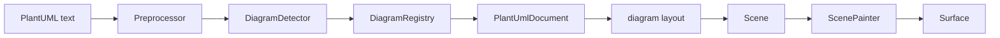

# System Design

This document provides the system-level design for CanvasNetPlantUml.

## Architecture

CanvasNetPlantUml is a static renderer for the PlantUML diagram language, delivered as its own NuGet package
(`DemaConsulting.CanvasNet.PlantUml`, root namespace `DemaConsulting.CanvasNet.PlantUml`), independent of the other
document systems in this repository. It reads PlantUML text and **parses** it into a validated, immutable document,
**describes** the diagram without drawing it (diagram type, whether this version draws it, title, node, edge, and
subgraph counts), **measures** the size it renders at, and **renders** it onto a `Surface` (the core `CanvasNet` pixel
buffer) at its natural size multiplied by a scale or fitted inside an exact size. Rendering is static, deterministic
(pixel-identical surfaces on every run, thread, and platform, because only the bundled fonts are used), and offline (no
network, no Java runtime, no Graphviz), and uses only the .NET base class library, the public API of the core
`CanvasNet` package, and the internal graph layout of the `CanvasNetLayout` package.

The goal is **fidelity to PlantUML**: a diagram must look like the picture that PlantUML draws with its default look.
The package is therefore derived, with attribution, from the MIT-licensed distribution of PlantUML (see *Third-Party
Provenance and Attribution*). Every PlantUML diagram type is recognized; the types this version does not draw are
**reported with a stable `plantuml-*` code and the exact location, never skipped silently**.

The system is decomposed into one direct unit and internal subsystems:

- **PlantUmlDocument** (direct unit, public API) - the entry points `Parse`, `Open(path)`, and `Open(stream)`, the
  metadata properties, the options, limits, records, codes, and exceptions, the internal report sink with the pending
  reports that reading keeps for every call, and the pipeline seam (`IPlantUmlDiagram`, `DiagramRegistry`) that
  hands each supported type to its parser; see *PlantUmlDocument Unit Design*.
- **Syntax** (subsystem) - the `Preprocessor` unit (framing, comments, continued lines, and the supported subset of
  the preprocessor, with the location of every character) and the `DiagramDetector` unit (the diagram type from the
  tag or from the statements, in the order PlantUML tries them); see *Syntax Subsystem Design*.
- **Styling** (subsystem) - the `SkinTheme` unit (PlantUML's default look) and the `SkinParams` unit (the `skinparam`
  statements and PlantUML's colors); see *Styling Subsystem Design*.
- **Scenegraph** (subsystem) - the `SceneModel` unit (the scene a layout produces and the page texts around it), the
  `TextLayout` unit (text measured as PlantUML measures it, with the bundled fonts and the creole subset), and the
  `ScenePainter` unit (the pixels); see *Scenegraph Subsystem Design*.
- **Sequence** (subsystem) - the `SequenceParser` unit (the sequence statements), the `SequenceModel` unit (the parsed
  diagram), the `SequenceLayout` unit (the columns and rows of PlantUML's sequence engine), and the `SequenceRenderer`
  unit (PlantUML's shapes); see *Sequence Subsystem Design*.
- **Activity** (subsystem) - the `ActivityParser` unit (the activity statements of the new syntax), the
  `ActivityModel` unit (the tree of instructions), the `ActivityLayout` unit (the tile composition and compression of
  PlantUML's activity engine), and the `ActivityRenderer` unit (the scene items); see *Activity Subsystem Design*.
- **Svek** (subsystem) - the shared engine of the diagrams that PlantUML lays out with Graphviz: the `SvekModel` unit
  (the diagram lowered to entities with their images, clusters, notes, and links), the `SvekSyntax` unit (the
  statements those diagrams share), the `SvekLayout` unit (the layout over the dagre layered layout of
  `CanvasNetLayout`), the `SvekGeometry` unit (curves, clipping, and the link decorations), and the `SvekRenderer`
  unit (links, container symbols, and notes); no diagram type uses it yet; see *Svek Subsystem Design*.

The SysML2 model names the system `CanvasNetPlantUmlSystem` and prefixes the names of its subsystems and units with
`PlantUml` (`PlantUmlSyntax`, `PlantUmlPreprocessor`, `PlantUmlDiagramDetector`, `PlantUmlStyling`, `PlantUmlSkinTheme`,
`PlantUmlSkinParams`, `PlantUmlScenegraph`, `PlantUmlSceneModel`, `PlantUmlTextLayout`, `PlantUmlScenePainter`,
`PlantUmlSequence`, `PlantUmlSequenceParser`, `PlantUmlSequenceModel`, `PlantUmlSequenceLayout`,
`PlantUmlSequenceRenderer`, `PlantUmlActivity`, `PlantUmlActivityParser`, `PlantUmlActivityModel`,
`PlantUmlActivityLayout`, `PlantUmlActivityRenderer`, `PlantUmlSvek`, `PlantUmlSvekModel`, `PlantUmlSvekSyntax`,
`PlantUmlSvekLayout`, `PlantUmlSvekGeometry`, `PlantUmlSvekRenderer`), because
the `CanvasNet` package of the model already holds the units of the Mermaid system with the same short names. The test
methods of the units use the same prefix (`PlantUmlPreprocessor_...`), so that the requirements trace never mixes the
evidence of two systems.

The reading pipeline is:

## External Interfaces

- **`PlantUmlDocument.Parse(string, PlantUmlOpenOptions?)`** (in, PlantUML text) - at most four times `MaxTextSize`
  characters; the first `@start` block is the diagram.
- **`PlantUmlDocument.Open(string path, ...)`** (in, UTF-8 file) - strict UTF-8, byte-order mark dropped, read in
  bounded chunks.
- **`PlantUmlDocument.Open(Stream, ...)`** (in, UTF-8 stream) - as for a file; the stream is left open.
- **Include files** (in, local UTF-8 files) - read for `!include`, `!include_once`, and `!include_many` from the folder
  of the including file and `PlantUmlOpenOptions.BaseDirectory` (the folder of an opened file by default), under
  `PlantUmlOpenOptions.FileAccess`; never a URL.
- **`PlantUmlImageSource`** (in, an `ImageSourceRequest` of a linked `.puml`, `.plantuml`, or `.pu` file; out, an
  `ImageSourceResult`) - the composition hook through which the image resolvers of the other formats draw a linked
  diagram.
- **Metadata properties** (out) - `DiagramType`, `IsSupported`, `Title`, `NodeCount`, `EdgeCount`, and
  `SubgraphCount`.
- **`PlantUmlDocument.Measure(PlantUmlRenderOptions?, CancellationToken)`** (out, `PlantUmlSize`) - the size a render
  gives; the reports of the call are delivered.
- **`PlantUmlDocument.Render(...)`** (out, `Surface`) - at the natural size times the scale, or fitted into an exact
  size of 1 to `Surface.MaxDimension` on each side; the caller owns the surface.
- **Report handlers** (out) - `PlantUmlDiagnostic` warnings and `PlantUmlUnsupportedFeature` reports, once, in order, on
  the calling thread; `PlantUmlUnsupportedFeatureException` in strict mode.
- **`PlantUmlRenderException`** (out, exception) - a limit exceeded while laying out or painting, or a layout defect.
- **`PlantUmlSyntaxException`** (out, exception) - a stable `plantuml-*` code, the location, a hint, and the expected
  constructs.
- **`InvalidDataException`** (out, exception) - a text over the size limit.

## Dependencies

CanvasNetPlantUml references the sibling `CanvasNetLayout` system (the graph library and the dagre layered layout,
through internal friend access: `Graph`, `DagreLayout.Run`, and the abstract `LayoutWorkMeter`, whose PlantUML failures
`PlantUmlLayoutWorkMeter` creates) for the diagrams that PlantUML lays out with Graphviz, and the sibling `CanvasNet`
system through its public API: its `Canvas` subsystem
(`Surface`, `Rgba32`, `CssColor`), `Geometry` (paths), `Drawing` (path filling and stroking), `Fonts` (the bundled fonts
through a font resolver with no system fonts), `Rendering` (text measuring and text paths), `Files` (the file reference
resolver and the file-access policy of the include files), and `ImageSources` (the image source interface). It has no
OTS runtime dependency and references no other format package of the repository (not the Mermaid package, whose scene
graph it does not share). See *CanvasNet System Design* and *CanvasNetLayout System Design* for the referenced
subsystems.

## Risk Control Measures

PlantUML text is untrusted input. The design segregates the risk as follows:

- **Bounded input** - the original text is refused above four times `PlantUmlLimits.MaxTextSize` before any work, the
  statements are refused above `MaxTextSize` after preprocessing (so a macro cannot grow the text without bound), and
  dropped directive blocks nest at most `MaxNestingDepth` deep.
- **No network, files only under the policy** - no directive reads a URL or the standard library; a local include
  file is found, checked, and read by the core `FileReferenceResolver` under the caller's `FileAccessPolicy` (network
  and device paths and anything that is not a regular file are refused under every policy), bounded in size, depth
  (`MaxIncludeDepth`), and count (`MaxIncludes`), and every failure is located at its directive.
- **No regular expressions on input** - the preprocessor and the detector are hand-written scanners, linear in the
  text.
- **Bounded rendering** - the painter skips coordinates that are not finite or too large and charges every item to
  `MaxPaintedPixels` before it paints it; every call can be canceled.
- **Fail closed** - every refusal is a documented exception with a stable code; an unsupported construct is reported,
  never silently ignored, and strict mode turns it into an exception; an exception that the layout does not document
  becomes a located `plantuml-render-failed` error.

## Data Flow

The text is read (strict UTF-8 for streams and files), framed and preprocessed into statements that keep the original
location of every character (the statements of an included file are located in that file), and classified into a
diagram type. A supported type is parsed into its diagram model by
the parser registered in `DiagramRegistry` (a sequence diagram by the Sequence subsystem); the reports found while
reading (ignored directives, a second diagram, statements and skin parameters that are not drawn) are kept by the
document and the diagram model as pending reports, in text order, so that every later call can deliver them. A measure
or render call creates a report sink and a text layout, replays the pending reports, lays the diagram out into a scene
(a type that is not drawn reports `plantuml-diagram-unsupported` and gets an empty, transparent scene of 20 by 20, twice
PlantUML's document margin), and paints the scene over the background of the call or of the diagram (white by default).
The reports are delivered once, on the calling thread, after the work.

## Design Constraints

### Platform Support

The library targets net8.0, net9.0, net10.0, and net11.0 on Windows, Linux, and macOS, identical to the `CanvasNet`
system it depends on (see the platform requirements of the system).

### Determinism

Reading and rendering do not depend on the culture, the current directory, the installed fonts, or the machine: every
number is read with the invariant culture, every type and count is a pure function of the text and the limits, and text
is measured and drawn with the fonts bundled with CanvasNet only (`SansSerif` is Liberation Sans, which has the metrics
of Arial, Java's `SansSerif` on Windows), as PlantUML measures it with Java's logical fonts.

### Third-Party Provenance and Attribution

CanvasNetPlantUml is derived with attribution, not clean-room. Its framing of a text, the meaning of the supported
preprocessor directives, the order in which the diagram types are tried, the values of its default look
(`plantuml.skin`), the way it measures text, the geometry of the sequence engine ("teoz": the column constraints, row
heights, and shapes), and the tile composition of the activity engine ("ftile": the tiles, their assembly and
connections, the swimlanes, and the compression of the drawing), and the shapes, decorations, and spacing of the
diagrams that PlantUML lays out with Graphviz (the "svek" engine: the link grammar, the link decorations, the container
symbols, the notes and their pointers, and the cluster margins of the Smetana pipeline) follow the MIT-licensed
distribution of PlantUML (`plantuml-mit`, whose files carry the MIT header "(C) Copyright 2009-2024, Arnaud Roques").
Only the MIT-licensed distribution was read; no source text, comment, test, example, or image of PlantUML is copied: the
ported items are values and rules, reimplemented in C#. The license text and the provenance table (which upstream file
informed which unit) ship in `src/DemaConsulting.CanvasNet.PlantUml/third-party/`, the license text is packed in the
package's `licenses\` folder, and every source file with ported logic starts with the header
`// Portions derived from PlantUML (MIT); see third-party/README.md`. The package is not affiliated with the PlantUML
project. No code of the GPL-licensed distributions is used.

### Untrusted Input and Limits

`PlantUmlLimits` bounds the text size (`MaxTextSize`, with the original text at most four times it), the nesting of
blocks (`MaxNestingDepth`), the includes (`MaxIncludeDepth`, `MaxIncludes`), the nodes, edges, and label lengths of a
diagram (`MaxNodes`, `MaxEdges`, `MaxLabelLength`), the layout work (`MaxLayoutWork`), the painted pixels
(`MaxPaintedPixels`), and the reports of a call (`MaxDiagnostics`). The default values are those of the Mermaid package
of this repository, so the two diagram languages are bounded alike.

### Known Differences

- **Framing** - a text without any `@start` tag is read as one diagram, as PlantUML reads a piped text (PlantUML
  refuses such a file); only the first block of a text with several blocks is read, and the others are reported as
  `plantuml-multiple-diagrams`.
- **Preprocessor** - only comments, continued lines, `!define` without parameters, `!undef`, and `!$variable`
  assignments of a quoted text, a number, or another variable are applied; a substituted value is not expanded again.
  Every other directive (`!if`, `!function`, `!procedure`, `!foreach`, built-in `%functions`, ...) is reported as
  `plantuml-preprocessor-unsupported` and dropped with the block it opens; `!theme` is reported as
  `plantuml-theme-unsupported`; `!pragma` has no effect and is reported as the warning `plantuml-pragma-ignored`.
  `!include`, `!include_once`, and `!include_many` read local files only; a URL, the standard library (`<name>`), a part
  of a file (`file!part`), `!includeurl`, `!includesub`, `!includedef`, and `!import` are reported as
  `plantuml-include-unsupported`. A missing include file is an error (PlantUML ignores it), and the diagram's own file
  counts as already included (PlantUML includes it once more).
- **Look** - only the default look and the supported skin parameters are drawn; themes, `<style>` blocks, shadows,
  gradients (the first color is used), and hand-written mode are not. Text is drawn with Liberation fonts, whose glyphs
  differ slightly from Arial's although their advances are the same; a run is drawn with kerning while it is measured
  without, as Java measures it, so a glyph can move by a fraction of a pixel.
- **Creole** - only the subset of bold, italic, monospace, underline, strike, color, size, font, and Unicode characters
  is drawn; images, sprites, icons, tables, lists, headings, rules, and backgrounds are drawn as text and reported.
- **Detection** - statements are recognized by their leading keywords and arrows, so a text that PlantUML reads as a
  diagram of a type that is not drawn can, in rare ambiguous cases, be named differently; the type of such a diagram
  never changes whether it is drawn.
- **Sequence engine** - PlantUML 1.2026.10 lays every sequence diagram out with its "teoz" engine (the older "puma"
  engine is gone), so CanvasNet follows teoz and `!pragma teoz` is only reported as ignored. The size, texts,
  participants, life lines, and message lines of the reference fixtures agree with PlantUML's SVG within 1.5 pixels;
  PlantUML's PNG export is one pixel narrower and lower than its SVG, and CanvasNet's natural size is the SVG's.
- **Sequence statements** - `ref over`, `newpage`, `create` and the `**` shorthand (the participant is drawn at the
  top), `mainframe`, `autoactivate`, messages to or from the border (`[->`, `->]`, `?->`), parallel messages (`&`),
  stereotypes and links of participants, `hide` and `show` other than the foot box, `scale` forms other than a number
  or a fraction, and `autonumber` options other than a start, a step, and a format are reported as
  `plantuml-statement-unsupported` and not drawn. The header color glued to a group keyword (`alt#Gold`), the line
  style of a color (`#red;line:blue`), and the colors of activation outlines are not drawn; nested boxes are refused.
  The arrow thickness skin parameter widens the lines but not the heads.
- **Activity engine** - PlantUML 1.2026.10 lays activity diagrams of the new syntax out with its "ftile" composition
  and needs no Graphviz for them; CanvasNet ports that composition, so the size, texts, action boxes, circles, and
  diamonds of the reference fixtures agree with PlantUML's SVG within 1.5 pixels (the swimlane pictures are up to 3
  pixels narrower than PlantUML's, within the 3 % size tolerance).
- **Activity statements** - `switch` blocks (skipped up to `endswitch`), `goto` and `label`, `break`, `hide`, `show`,
  `skin`, `mainframe`, the box styles of the specification and description language (`:text|`, `:text<`, `:text>`,
  `:text/`, `:text]`, `:text}`) and the stereotypes of actions (drawn as plain boxes), the frames of `package`,
  `rectangle`, and `card` groups (their instructions are drawn without a frame), and arrow options other than a color
  and a style are reported as `plantuml-statement-unsupported`. An arrow with several colors is drawn with its first
  color; a repeat loop whose back arrow crosses swimlanes is drawn with the simple back arrow; the legacy activity
  syntax (`(*)`) is a type that is not drawn.
- **Graph engine** - PlantUML lays class, object, state, use case, component, and deployment diagrams out with Graphviz
  (or its Smetana port); the shared Svek engine places them with the dagre layered layout of `CanvasNetLayout` and
  draws their links as cubic B-splines through dagre's routes, so the shapes, texts, and decorations follow PlantUML
  while the positions of the elements and the curves of the links differ. Links of length 1 are kept in one rank as
  rows (dagre's ranking cannot), a cluster with a title band is made tight around its members, and the crow's foot
  decorations, the redefinition triangles, roles, qualifiers, the middle decorations, and `norank` are read but not
  drawn. No diagram type uses the engine yet.

## Phase Plan

- **Phase 1** (this version, delivered in steps) - the package, the public API, and the syntax subsystem; sequence
  diagrams and activity diagrams of the new syntax with PlantUML's default look; local includes under the file-access
  policy; the image source; the Viewer, tool, and Pandoc filter integration.
- **Phase 2** - the diagram types that PlantUML lays out with Graphviz (class, component, use case, state, object, and
  deployment diagrams) are laid out by the shared Svek engine over the dagre layered layout of the `CanvasNetLayout`
  package, which the Mermaid package shares (the engine is in place; the diagram types follow in steps). Themes,
  `<style>` blocks, feature positions, and the conditional and function directives of the preprocessor are candidates as
  well.
