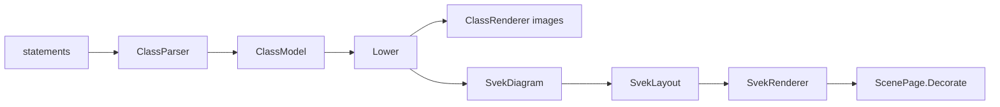

## Class

### Overview

The `Class` subsystem (namespace `DemaConsulting.CanvasNet.PlantUml.Class`, folder
`src/DemaConsulting.CanvasNet.PlantUml/Class/`) draws PlantUML class and object diagrams. PlantUML reads both with its
class diagram factory (an object diagram is a class diagram whose first element is an object or a map), so one
subsystem draws both. It is **internal** and contains three units:

- **ClassParser** - the internal class `ClassParser` (`ClassParser.cs`, `ClassParser.Members.cs`): the reader of the
  statements; see *ClassParser Unit Design*
- **ClassModel** - the internal class `ClassModel` with its elements `ClassEntity`, `ClassPackage`, `ClassNote`,
  `ClassLink`, `ClassHideRule`, `ClassPortions`, `ClassMember`, `ClassBody`, and their enumerations (`ClassModel.cs`,
  `ClassModel.Elements.cs`): the diagram, its rules, its facts, and its lowering to the Svek engine; see *ClassModel
  Unit Design*
- **ClassRenderer** - the internal static class `ClassRenderer` and the internal class `ClassImage`
  (`ClassRenderer.cs`, `ClassRenderer.Header.cs`, `ClassRenderer.Members.cs`, `ClassRenderer.Objects.cs`): the class,
  object, and map boxes; see *ClassRenderer Unit Design*

The subsystem's namespace documentation is in `Class/NamespaceDoc.cs`. Its behavior is specified by the
`CanvasNetPlantUml-Class-*` requirements in `docs/reqstream/canvas-net-plant-uml/class.yaml`. The SysML2 model names
the subsystem `PlantUmlClass`.

### Interfaces

**Exposed** (internal only): `ClassParser.Parse(source, detected, limits)`, which the document's diagram registry calls
for the detected types `class` and `object` and which returns a `ClassModel`; the model implements the root namespace's
`IPlantUmlDiagram` (title, facts, reports, and `Layout(context)`); `ClassRenderer.Image(entity, portions, theme, text,
sink)`, which returns the Svek entity image of an entity.

**Consumed**: the Svek subsystem (`SvekSyntax` for names, links, notes, page texts, the direction, the scale, hide and
show, and the layout settings; `SvekDiagram`, `SvekEntity`, `SvekCluster`, `SvekNote`, `SvekLink`, `ISvekEntityImage`;
`SvekLayout.Run`; `SvekRenderer.Render` and `SvekRenderer.ClusterImage`); the Syntax subsystem (`PreprocessedSource`,
`SourceStatement`, `DetectedDiagram`, the block closers of `DiagramDetector`); the Styling subsystem (`SkinTheme`,
`SkinParams` with the graph prefixes); the Scenegraph subsystem (`Scene`, `ScenePath`, `SceneText`, `SceneShapes`,
`TextLayout`, `TextBlock`, `PageTexts`, `ScenePage` with `PageMetrics.Svek`); and the root namespace's
`PlantUmlLimits`, `PlantUmlLocation`, `PlantUmlDiagnosticCodes`, `PlantUmlPendingReport`, `PlantUmlSyntaxException`,
and `DiagramRenderContext`.

**Consumers**: `PlantUmlDocument` (through its diagram registry); the tests.

### Design

`ClassParser` reads the statements once, when the document is opened, into an immutable `ClassModel` with the reports
of what it reads but does not draw. For every measure or render call, `ClassModel.Layout` lowers the diagram: a Svek
cluster with the container symbol of `SvekRenderer.ClusterImage` per package, a Svek entity per entity whose image
`ClassRenderer` measures with the text layout of the call once the hide and show rules are applied, the notes, and the
links. The Svek engine lays it out and draws the packages, notes, and links around the entity images;
`ScenePage.Decorate` adds the page texts with the spacing of PlantUML's graph diagrams (`PageMetrics.Svek`).

The subsystem ports values and rules of the MIT-licensed PlantUML 1.2026.10 (`classdiagram/ClassDiagramFactory`,
`classdiagram/command/CommandCreateClass*`, `CommandLinkClass`, `CommandAddMethod`, `CommandHideShow*`,
`CommandNamespace*`, `CommandPackage*`, `objectdiagram/command/CommandCreateEntityObject*`, `CommandCreateMap`,
`svek/image/EntityImageClass`, `EntityImageClassHeader`, `EntityImageObject`, `EntityImageMap`,
`cucadiagram/BodyEnhanced*`, `MethodsOrFieldsArea`, `skin/VisibilityModifier`, `CircledCharacter`, and the default
skin); the reader and the drawing code are written for this subsystem. The boxes, texts, icons, and separators follow
PlantUML; the positions follow the dagre layout of the Svek engine (see *Known Differences* of the system design).
