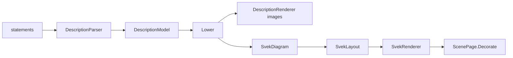

## Description

### Overview

The `Description` subsystem (namespace `DemaConsulting.CanvasNet.PlantUml.Description`, folder
`src/DemaConsulting.CanvasNet.PlantUml/Description/`) draws PlantUML description diagrams: the use case, component, and
deployment diagrams, which PlantUML reads with one factory and draws with one set of symbols. This version draws the
three types. It is **internal** and contains three units:

- **DescriptionParser** - the internal class `DescriptionParser` (`DescriptionParser.cs`,
  `DescriptionParser.Statements.cs`): the reader of the statements; see *DescriptionParser Unit Design*
- **DescriptionModel** - the internal class `DescriptionModel` with its elements `DescriptionNode`,
  `DescriptionElement`, `DescriptionNote`, `DescriptionLink`, and the enumeration `DescriptionSymbol`
  (`DescriptionModel.cs`, `DescriptionModel.Elements.cs`): the diagram, its facts, and its lowering to the Svek engine;
  see *DescriptionModel Unit Design*
- **DescriptionRenderer** - the internal static class `DescriptionRenderer` with the internal classes
  `DescriptionImage` and `DescriptionContainerImage` (`DescriptionRenderer.cs`, `DescriptionRenderer.Symbols.cs`,
  `DescriptionRenderer.UseCase.cs`, `DescriptionRenderer.Deployment.cs`): the elements and the containers; see
  *DescriptionRenderer Unit Design*

The subsystem's namespace documentation is in `Description/NamespaceDoc.cs`. Its behavior is specified by the
`CanvasNetPlantUml-Description-*` requirements in `docs/reqstream/canvas-net-plant-uml/description.yaml`. The SysML2
model names the subsystem `PlantUmlDescription`.

### Interfaces

**Exposed** (internal only): `DescriptionParser.Parse(source, detected, limits)`, which the document's diagram registry
calls for the detected types `usecase`, `component`, and `deployment` (all three supported types) and which returns a
`DescriptionModel`; the model implements the root namespace's `IPlantUmlDiagram` (title, facts, reports, and
`Layout(context)`); `DescriptionRenderer.Image(element, theme, text, sink)`, which returns the Svek entity image of a
leaf element, and `DescriptionRenderer.ContainerImage(element, theme, text, sink)`, which returns the Svek cluster image
of a container.

**Consumed**: the Svek subsystem (`SvekSyntax` for names, links, notes, page texts, the direction, the scale, and the
layout settings; `SvekGeometry.IsDrawn`; `SvekDiagram`, `SvekEntity`, `SvekCluster`, `SvekNote`, `SvekLink`,
`ISvekEntityImage`, `ISvekClusterImage`, `SvekClusterImage`; `SvekLayout.Run`; `SvekRenderer.Render`,
`SvekRenderer.ClusterImage`, and the outlines `FolderOutline`, `CloudOutline`, and `DatabaseOutline`); the Syntax
subsystem (`PreprocessedSource`, `SourceStatement`, `DetectedDiagram`); the Styling subsystem (`SkinTheme` with its
description theme and elements, `SkinParams` with the graph and description prefixes); the Scenegraph subsystem
(`Scene`, `ScenePath`, `SceneText`, `SceneShapes`, `TextLayout`, `TextBlock`, `PageTexts`, `ScenePage` with
`PageMetrics.Svek`); and the root namespace's `PlantUmlLimits`, `PlantUmlLocation`, `PlantUmlDiagnosticCodes`,
`PlantUmlPendingReport`, `PlantUmlSyntaxException`, and `DiagramRenderContext`; the Sequence subsystem's
`SequenceRenderer.StickFigure`, `SequenceRenderer.Symbol`, and `SequenceRenderer.Queue` (the actor's stick figure, the
boundary, control, and entity symbols, and the queue, shared with sequence diagrams).

**Consumers**: `PlantUmlDocument` (through its diagram registry); the tests.

### Design

`DescriptionParser` reads the statements once, when the document is opened, into an immutable `DescriptionModel` with
the reports of what it reads but does not draw. For every measure or render call, `DescriptionModel.Lower` lowers the
diagram: a Svek cluster per container with the image of `DescriptionRenderer.ContainerImage`, a Svek entity per leaf
element whose image `DescriptionRenderer.Image` measures with the text layout of the call, the notes, and the links.
The Svek engine lays it out and draws the containers, notes, and links around the images; `ScenePage.Decorate` adds
the page texts with the spacing of PlantUML's graph diagrams (`PageMetrics.Svek`).

The subsystem ports values and rules of the MIT-licensed PlantUML 1.2026.10 (`descdiagram/DescriptionDiagram`,
`descdiagram/command/CommandCreateElementFull`, `CommandCreateElementMultilines`, `CommandPackageWithUSymbol`,
`CommandLinkElement`, `svek/image/EntityImageDescription`, `decoration/symbol/USymbolComponent2`, `USymbolInterface`,
`USymbolNode`, `USymbolRectangle`, `USymbolFolder`, `USymbolFrame`, `USymbolCloud`, `USymbolDatabase`, `USymbolCard`,
`USymbolActor`, `USymbolActorBusiness`, `USymbolUsecase`, `USymbolArtifact`, `USymbolStorage`, `USymbolFile`,
`USymbolQueue`, `USymbolStack`, `USymbolHexagon`, `USymbolPerson`, `USymbolSimpleAbstract` with `svek/Boundary`,
`Control`, and `EntityDomain`, `USymbolCollections`, `USymbolLabel`, `USymbols`, `skin/ActorStickMan`,
`klimt/shape/TextBlockInEllipse`, `svek/image/Footprint`, `ContainingEllipse`, `RotatedEllipse`,
`svek/CircleInterface2`, and the `componentDiagram` and `usecase` styles of the default skin); the reader and the
drawing code are written for this subsystem. The ids of the elements are the qualified names PlantUML gives them
(`Server.DB`), so that a drawing can be compared with PlantUML's picture element by element. The shapes follow PlantUML;
the positions follow the dagre layout of the Svek engine (see *Known Differences* of the system design). The action, the
process, and archimate elements, which have no drawing of their own, are drawn as rectangles and reported.
