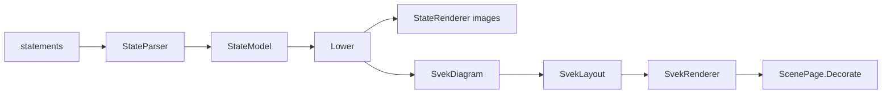

## State

### Overview

The `State` subsystem (namespace `DemaConsulting.CanvasNet.PlantUml.State`, folder
`src/DemaConsulting.CanvasNet.PlantUml/State/`) draws PlantUML state diagrams. It is **internal** and contains three
units:

- **StateParser** - the internal class `StateParser` (`StateParser.cs`, `StateParser.Statements.cs`): the reader of the
  statements; see *StateParser Unit Design*
- **StateModel** - the internal class `StateModel` with its elements `StateNode`, `StateElement`, `StateRegion`,
  `StateNote`, `StateTransition`, and the enumeration `StateKind` (`StateModel.cs`, `StateModel.Elements.cs`): the
  diagram, its facts, and its lowering to the Svek engine; see *StateModel Unit Design*
- **StateRenderer** - the internal static class `StateRenderer` with the internal classes `StateImage`,
  `StateCompositeImage`, and `StateDescription` (`StateRenderer.cs`): the state boxes, the pseudo-states, and the
  composite states; see *StateRenderer Unit Design*

The subsystem's namespace documentation is in `State/NamespaceDoc.cs`. Its behavior is specified by the
`CanvasNetPlantUml-State-*` requirements in `docs/reqstream/canvas-net-plant-uml/state.yaml`. The SysML2 model names
the subsystem `PlantUmlState`.

### Interfaces

**Exposed** (internal only): `StateParser.Parse(source, detected, limits)`, which the document's diagram registry calls
for the detected type `state` and which returns a `StateModel`; the model implements the root namespace's
`IPlantUmlDiagram` (title, facts, reports, and `Layout(context)`); `StateRenderer.Image(element, hideEmptyDescription,
rankDir, theme, text, sink)`, which returns the Svek entity image of a state or a pseudo-state, and
`StateRenderer.CompositeImage(element, theme, text, sink)`, which returns the Svek cluster image of a composite state.

**Consumed**: the Svek subsystem (`SvekSyntax` for names, links, page texts, the direction, the scale, hide and show,
and the layout settings; `SvekDiagram`, `SvekEntity`, `SvekCluster`, `SvekNote`, `SvekLink`, `ISvekEntityImage`,
`ISvekClusterImage`, `ClusterConcurrency`; `SvekLayout.Run`; `SvekRenderer.Render`); the Syntax subsystem
(`PreprocessedSource`, `SourceStatement`, `DetectedDiagram`); the Styling subsystem (`SkinTheme`, `SkinParams` with the
graph prefixes); the Scenegraph subsystem (`Scene`, `ScenePath`, `SceneText`, `SceneShapes`, `TextLayout`,
`TextBlock`, `PageTexts`, `ScenePage` with `PageMetrics.Svek`); and the root namespace's `PlantUmlLimits`,
`PlantUmlLocation`, `PlantUmlDiagnosticCodes`, `PlantUmlPendingReport`, `PlantUmlSyntaxException`, and
`DiagramRenderContext`.

**Consumers**: `PlantUmlDocument` (through its diagram registry); the tests.

### Design

`StateParser` reads the statements once, when the document is opened, into an immutable `StateModel` with the reports
of what it reads but does not draw. For every measure or render call, `StateModel.Lower` lowers the diagram: a Svek
cluster per composite state with the image of `StateRenderer.CompositeImage` (and, when it has concurrent regions, a
cluster without image per region, stacked or side by side as its first separator says), a Svek entity per state and
pseudo-state whose image `StateRenderer` measures with the text layout of the call, the notes, and the transitions.
The Svek engine lays it out and draws the composite states, notes, region separators, and transitions around the
images; `ScenePage.Decorate` adds the page texts with the spacing of PlantUML's graph diagrams (`PageMetrics.Svek`).

The subsystem ports values and rules of the MIT-licensed PlantUML 1.2026.10 (`statediagram/StateDiagram`,
`statediagram/command/CommandCreateState`, `CommandLinkState*`, `CommandAddField`, `CommandConcurrentState`,
`CommandCreatePackageState`, `CommandEndState`, `svek/image/EntityImageState`, `EntityImageState2`,
`EntityImageStateEmptyDescription`, `EntityImageCircleStart`, `EntityImageCircleEnd`, `EntityImageBranch`,
`EntityImageSynchroBar`, `EntityImagePseudoState`, `EntityImageDeepHistory`, `svek/Cluster` with `RoundedContainer`,
and the default skin); the reader and the drawing code are written for this subsystem. The ids of the elements are the
qualified names PlantUML gives them (`.start.`, `Active.Online`, `Active..start.Active`, `Running.CONC1`), so that a
drawing can be compared with PlantUML's picture element by element. The shapes follow PlantUML; the positions follow the
dagre layout of the Svek engine, and a composite state is always drawn with the header of PlantUML's autonomous
composite (see *Known Differences* of the system design).
