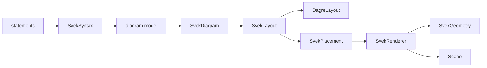

## Svek

### Overview

The `Svek` subsystem (namespace `DemaConsulting.CanvasNet.PlantUml.Svek`, folder
`src/DemaConsulting.CanvasNet.PlantUml/Svek/`) is the shared engine of the diagrams that PlantUML lays out with
Graphviz: class, object, state, use case, component, and deployment diagrams. PlantUML calls this engine "svek"; the
subsystem keeps the name, as the Sequence and Activity designs keep the names "teoz" and "ftile", and because it avoids
the names `Graph` (a type of the graph library) and `Layout` (the namespace of the CanvasNetLayout system). It is
**internal**. It contains five units:

- **SvekModel** - the internal classes `SvekDiagram`, `SvekEntity`, `SvekCluster`, `SvekNote`, `SvekLink`, the
  interfaces `ISvekEntityImage` and `ISvekClusterImage`, and their enumerations (`SvekModel.cs`,
  `SvekModel.Elements.cs`): the lowered diagram; see *SvekModel Unit Design*
- **SvekSyntax** - the internal static class `SvekSyntax` with `SvekArrow`, `SvekLinkStatement`, and
  `SvekNoteStatement` (`SvekSyntax.cs`, `SvekSyntax.Links.cs`, `SvekSyntax.Notes.cs`): the statement readers that the
  graph diagrams share; see *SvekSyntax Unit Design*
- **SvekLayout** - the internal class `SvekLayout` with its placement records and the internal class
  `PlantUmlLayoutWorkMeter` (`SvekLayout.cs`, `SvekLayout.Clusters.cs`, `SvekLayout.Edges.cs`,
  `PlantUmlLayoutWorkMeter.cs`): the layout over the dagre layered layout; see *SvekLayout Unit Design*
- **SvekGeometry** - the internal static class `SvekGeometry` with `SvekExtremity` (`SvekGeometry.cs`,
  `SvekGeometry.Extremities.cs`): the curves, the clipping, and the link decorations; see *SvekGeometry Unit Design*
- **SvekRenderer** - the internal static class `SvekRenderer` and the internal class `SvekClusterImage`
  (`SvekRenderer.cs`, `SvekRenderer.Clusters.cs`, `SvekRenderer.Notes.cs`): the drawing of links, clusters, and notes;
  see *SvekRenderer Unit Design*

The subsystem's namespace documentation is in `Svek/NamespaceDoc.cs`. Its behavior is specified by the
`CanvasNetPlantUml-Svek-*` requirements in `docs/reqstream/canvas-net-plant-uml/svek.yaml`. The SysML2 model names the
subsystem `PlantUmlSvek`. The Class subsystem lowers its class and object diagrams to it, and the State subsystem its
state diagrams; the description subsystem is planned for the next step of phase 2. The subsystem changes no picture of
the sequence and activity diagrams.

### Interfaces

**Exposed** (internal only): the model types that a diagram subsystem builds for every call (`SvekDiagram` with its
entities, clusters, notes, and links, and the images it implements: `ISvekEntityImage` for its entities, optionally
`ISvekClusterImage` for clusters it draws itself); the readers `SvekSyntax.TryReadLink`, `TryReadArrow`,
`TryReadNote`, `TryReadPageText`, `TryReadName`, `TryReadAlias`, `ReadStereotypes`, `ReadColor`, `TryReadDirection`,
`ReadScale`, `TryReadHideShow`, `TakeLayoutSettings`, `CheckLabel`, `Error`, and `Unsupported`;
`SvekLayout.Run(diagram, context)`, which returns a `SvekPlacement`; `SvekRenderer.Render(diagram, placement)`,
which returns the scene of the body, and `SvekRenderer.ClusterImage(...)`, which builds the image of a standard
container symbol; and the geometry helpers of `SvekGeometry` for the entity images that need them.

**Consumed**: the CanvasNetLayout system's `Graph`, `DagreGraph`, `DagreNode`, `DagreEdge`, `DagreLayout.Run`, and the
abstract `LayoutWorkMeter` (through internal friend access); the Syntax subsystem (`SourceStatement`, the block closers
of `DiagramDetector`); the Styling subsystem (`SkinTheme`, `SkinParams`); the Scenegraph subsystem (`Scene`,
`ScenePath`, `SceneText`, `SceneShapes`, `TextLayout`, `TextBlock`, `PageTexts`); and the root namespace's
`PlantUmlLimits`, `PlantUmlLocation`, `PlantUmlDiagnosticCodes`, `PlantUmlPendingReport`, `PlantUmlSyntaxException`,
`PlantUmlRenderException`, and `DiagramRenderContext`.

**Consumers**: the diagram subsystems of the graph diagrams (the Class and State subsystems in this step); the tests.

### Design

A diagram subsystem reads its statements with `SvekSyntax` and its own readers when the document is opened. For
every measure or render call it measures its entities with the text layout of the call, builds their images, and lowers
its model to a `SvekDiagram`. `SvekLayout.Run` validates the diagram, lays out every scope (the top and every cluster
laid out on its own) as a compound dagre graph of the CanvasNetLayout system under one `PlantUmlLayoutWorkMeter`,
post-processes the boxes and routes (tight clusters with header bands, rows of units in one rank, arcs, cuts at cluster
borders, clipping to the outlines, label and note places), and returns a `SvekPlacement`. `SvekRenderer.Render` draws
it with PlantUML's margins: the cluster images, the entity images, the notes, and the links with the curves and
decorations of `SvekGeometry`. The diagram subsystem then adds the page texts with `ScenePage.Decorate`.

The engine ports values and rules of the MIT-licensed PlantUML 1.2026.10 (`svek/`, `svek/extremity/`,
`decoration/LinkDecor`, `decoration/LinkStyle`, `decoration/symbol/USymbol*`, `svek/image/EntityImageNote`,
`svek/image/Opale`, `classdiagram/command/CommandLinkClass`, `descdiagram/command/CommandLinkElement`, and the Smetana
pipeline's `CucaDiagramFileMakerSmetana` for the cluster margins and label sizes); the curve helper and the layout
post-processing are written for this engine. The jar draws the graph diagrams with Graphviz or its Smetana port; this
engine places them with dagre, so the shapes, texts, and decorations of the elements follow PlantUML while their
positions differ (see *Known Differences* of the system design).
