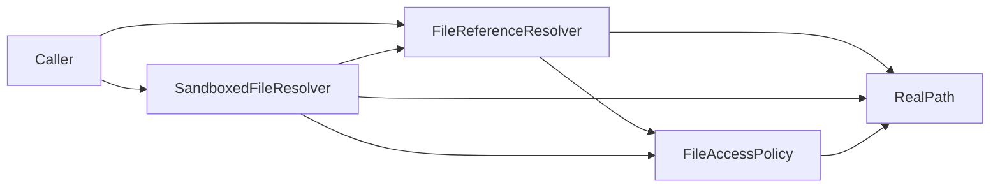

## Files

The `Files` subsystem is the seventh software subsystem in CanvasNet. It reads the files that documents reference
(an SVG image link, an OpenSCAD include, a Vega-Lite data URL): it finds the file, refuses what is never safe,
lets the host decide which files may be read, and reads a bounded number of bytes. It consists of four units:
`FileReferenceResolver` and `FileAccessPolicy` (the public referenced-file engine and its policy hook), the internal
`RealPath` unit (the operating-system facts of an open file), and `SandboxedFileResolver` (the public folder sandbox
that predates the policy model, now obsolete and kept unchanged for one release).

### Overview

The `Files` subsystem exists so that the rules for files named by documents are implemented, tested, and reviewed
once, instead of in every format package. It is public core API, not an internal helper: a library user that reads
files named by documents can apply exactly the rules the CanvasNet packages use.

Two models live side by side. The **policy model** (`FileReferenceResolver` with a `FileAccessPolicy`) follows
references the way Pandoc does - relative, dot-dot and absolute paths and symbolic links - and lets the host restrict
them with a policy that is asked about the **real path of the opened file**, so a decision cannot be raced by
another process that changes the directory tree. The policy model is what the `ImageSources` subsystem and the
`CanvasNetVegaLite` and `CanvasNetScad` systems use, each under the policy its caller chose (`AllowAll` by default,
so the folder of a document is the base of its relative references, not a boundary). The **sandbox model**
(`SandboxedFileResolver`) confines untrusted relative paths to caller-chosen folders and refuses links; it is marked
`[Obsolete]` (a warning whose message names the migration to `FileReferenceResolver` with
`FileAccessPolicy.Combine(FileAccessPolicy.UnderRoots(...), FileAccessPolicy.NoSymlinks)`), keeps its unchanged,
race-free behavior for one release, and is used by no part of the library any longer.

Whatever the model or policy, the subsystem refuses network paths (UNC and `//host`), device paths (on Windows also a
path with a reserved device name such as `NUL`, `CON`, `COM1` or `NUL.txt` in any component), alternate data
streams, control characters, and anything that is not a regular file (a directory, a device, a named pipe, opened
without blocking on Linux and macOS), and it keeps every resource limit: the byte limit of one file
(`MaxFileBytes`, 16 MiB by default) and an optional limit on the number of distinct files one resolver opens
(`MaxFiles`). Any other limit (include depth, cycles, text length) belongs to the caller.

On Windows, `FileReferenceResolver` also refuses, under every policy, a referenced file whose path as written is local but
whose opened file lies on a network share (a symbolic link to a UNC target); a path the host itself placed on a
mapped network drive or share is not affected. Opening the file is what follows the link, so the open itself may
already contact the share (and offer the user's credentials) before the check refuses the file; Windows evaluates
local-to-remote symbolic links according to `fsutil behavior set SymlinkEvaluation` (local-to-remote is enabled by
default). Hosts that let untrusted parties create symbolic links in folders documents are read from should disable
it (`L2R:0`). Junctions cannot target a share, and creating a symbolic link needs a privilege or Developer Mode.

Known limit: paths are compared case-insensitively on Windows and macOS (their default file systems). On a
case-sensitive volume or directory of those systems, a sibling folder whose name differs from a root only in letter
case counts as inside that root; hosts should not configure roots next to such folders.

### Units

- **FileReferenceResolver** - the public engine (`FileReferenceResolver`) with its options (`FileReferenceOptions`),
  result (`FileReference`), and failure reporting (`FileReferenceException`, `FileReferenceFailureKind`): validates
  the reference text, finds the candidates, opens the file, has the open handle inspected and the policy asked, and
  reads from the same handle; supports a caller-supplied callback instead of the file system; see
  _FileReferenceResolver Unit Design_ (`files/file-reference-resolver.md`)
- **FileAccessPolicy** - the public hook (`FileAccessPolicy`) with its request (`FileAccessRequest`) and decision
  (`FileAccessDecision`) and the built-in policies `AllowAll`, `UnderRoots`, `NoSymlinks`, `Combine`, and
  `FromDelegate`; see _FileAccessPolicy Unit Design_ (`files/file-access-policy.md`)
- **RealPath** - the internal unit that opens a file per operating system and reports whether an open handle is a
  regular file and what its real path is, the real location of a folder, and the path comparison rules; the only
  place in the library that calls the operating system directly (`NativeMethods`); see _RealPath Unit Design_
  (`files/real-path.md`)
- **SandboxedFileResolver** - the public, obsolete folder sandbox (`SandboxedFileResolver`) with its options
  (`SandboxOptions`), result (`SandboxedFile`), and failure reporting (`SandboxException`, `SandboxFailureKind`):
  validates the path text,
  confines each candidate to its root, refuses symbolic links and junctions before the open and verifies the open
  file after it, reads with a byte bound, supports a caller-supplied callback, and caches per instance; see
  _SandboxedFileResolver Unit Design_ (`files/sandboxed-file-resolver.md`)

### Interfaces

The subsystem exposes the public types listed above in the `DemaConsulting.CanvasNet.Files` namespace. It consumes
only the .NET base class library and, through the `RealPath` unit alone, the operating system: `kernel32.dll` on
Windows, the C library and `/proc/self/fd` on Linux, and the C library (`proc_pidfdinfo` and `realpath`) on macOS.

### Design

The units collaborate in one direction:

`FileReferenceResolver` validates the text, builds the candidates, lets the policy refuse a path as written before
the open, opens the candidate through `RealPath`, asks `RealPath` for the facts of the open handle, asks the policy,
and reads from the handle. The policy's base directory is the host-chosen directory the chain of references started
from, never a referring document's folder: a source that reads its own files for a linked document receives the
policy anchored at the origin of the outer chain (the internal `FileAccessPolicy.AnchoredAt`). The internal
`FileReferenceResolver.ResolveTopLevel` reads the top-level file a host named (the document being rendered) without
judging it by the policy; its references are judged from its own folder. `SandboxedFileResolver` keeps its own
search, link walk, and cache, and
delegates the open, the handle facts, and the post-open link check (the link match of the `NoSymlinks` policy,
`MatchesWithoutLinks`, anchored at the root) to the same code, plus the bounded read of `FileReferenceResolver`
(`ReadBounded`). The built-in policies use `RealPath` to compare paths and to find the real location of a root or
anchor folder.

### Dependencies

The `Files` subsystem depends only on the .NET base class library (`System.IO`, `System.Runtime.InteropServices`, and
`System.Collections.Generic`), available on every CanvasNet target framework, and on the operating-system calls of
the `RealPath` unit; it has no runtime NuGet dependency. It has no dependency on the `Canvas`, `Codecs`, `Geometry`,
`Drawing`, `Fonts`, or `Rendering` subsystems. Its only core consumer is the `ImageSources` subsystem (its
`FolderImageResolver` unit resolves every link of a document with `FileReferenceResolver` under the caller's
policy); its other
consumers are outside the core package: the `CanvasNetVegaLite` and `CanvasNetScad` systems depend on it through its
public API (see _Callers_).

### Callers

`FileReferenceResolver`, `FileAccessPolicy`, and `SandboxedFileResolver` are public API entry points, invoked
directly by consumers of the CanvasNet package. `FileReferenceResolver` is also used internally by the
`ImageSources` subsystem (the `FolderImageResolver` unit resolves every file link of a document relative to its
folder, reads the top-level file of a render by path with `ResolveTopLevel`, and maps a denial to the warning
`image-access-denied` and every other `FileReferenceException` to an unresolved-link warning) and by two satellite
packages: `CanvasNetVegaLite`'s `DataFileResolver` unit (every local data file of a chart) and `CanvasNetScad`'s
`ScadFileResolver` unit (every `include` and `use`). Each of those units keeps its own exception types, message
wording, locations, limits, and text decoding and translates every `FileReferenceException` it receives, keeping it
as the inner exception. No part of the library calls `SandboxedFileResolver` any longer.
