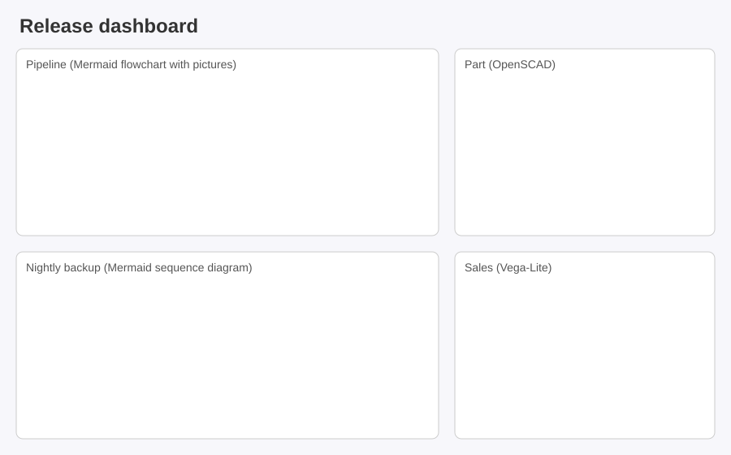

# CanvasNet Mermaid Package

## API Reference

### MermaidDocument

`MermaidDocument` (namespace `DemaConsulting.CanvasNet.Mermaid`) is distributed via the separate
`DemaConsulting.CanvasNet.Mermaid` NuGet package, whose only dependency is the core `DemaConsulting.CanvasNet`
package - see the Installation section of the project README. It reads diagrams written in the Mermaid v11 text
language and draws them as **static pictures** with Mermaid's own layout: a flowchart, a class diagram, a state
diagram, and an entity relationship diagram are laid out by a port of the dagre layout that Mermaid uses, a sequence
diagram by a port of Mermaid's sequence renderer, and a pie chart and a gantt chart by ports of Mermaid's pie and gantt
renderers, so the nodes, edges, classes, states, entities, participants, messages, slices, tasks, and labels land where
Mermaid 11 puts them. This version draws **flowcharts** (the `flowchart` and `graph` keywords), **sequence diagrams**
(the `sequenceDiagram` keyword), **class diagrams** (the `classDiagram` keyword), **state diagrams** (the
`stateDiagram-v2` and `stateDiagram` keywords), **entity relationship diagrams** (the `erDiagram` keyword), **pie
charts** (the `pie` keyword), and **gantt charts** (the `gantt` keyword). Every other diagram type that Mermaid knows
is recognized and reported, never drawn wrongly: mindmap diagrams are planned later. The
package is derived with attribution from the Mermaid project and the libraries it uses,
and it is **not affiliated with or endorsed by** the Mermaid project (see *Mermaid Third-Party Attribution*). A document
is **immutable and thread-safe**: it is read and validated once and can then be measured and rendered any number of
times, from several threads at once, each call giving the same result for the same options.

```csharp
public sealed partial class MermaidDocument
{
    public static MermaidDocument Parse(string text, MermaidOpenOptions? options = null);
    public static MermaidDocument Open(string path, MermaidOpenOptions? options = null);
    public static MermaidDocument Open(Stream stream, MermaidOpenOptions? options = null);

    public string? SourceName { get; }
    public string DiagramType { get; }      // "flowchart" (also graph), "sequence", "er", "pie", "gantt", ...
    public bool IsSupported { get; }        // true when this version draws the type
    public string? Title { get; }           // the title statement, else the frontmatter title
    public string? AccTitle { get; }        // accTitle, metadata only
    public string? Direction { get; }       // TB, TD, BT, LR, or RL; null for a sequence, pie, or gantt chart
    public int NodeCount { get; }           // the participants, classes, states, entities, slices, or tasks
    public int EdgeCount { get; }           // the messages, relations, transitions, or relationships
    public int SubgraphCount { get; }       // the boxes, namespaces, composite states, subgraphs, or gantt sections

    public MermaidSize Measure(
        MermaidRenderOptions? options = null,
        CancellationToken cancellationToken = default);

    public Surface Render(
        MermaidRenderOptions? options = null,
        CancellationToken cancellationToken = default);

    public Surface Render(
        int width,
        int height,
        MermaidRenderOptions? options = null,
        CancellationToken cancellationToken = default);
}
```

- `Parse` and the two `Open` overloads read the text as Mermaid reads it: the YAML frontmatter, the `%%{init: ...}%%`
  directives, and the `%%` comments are taken out, the diagram type is detected with Mermaid's own detectors, and a
  supported diagram is parsed with a port of its grammar. A file or stream is read as strict UTF-8 (a byte order mark
  is removed, invalid UTF-8 is rejected). Reading fails fast with a located `MermaidSyntaxException` and never opens
  another file or uses the network. `Open(Stream)` reads from the current position and leaves the stream open.
- The descriptive properties come from the text only. For a sequence diagram, `NodeCount` is the number of
  participants, `EdgeCount` the number of messages, and `SubgraphCount` the number of boxes. For a class diagram,
  `NodeCount` is the number of classes (notes and lollipop interfaces are not counted), `EdgeCount` the number of
  relations (the links of notes are not counted), `SubgraphCount` the number of namespaces drawn (with
  `class.hierarchicalNamespaces: false` in the text, only the declared ones), and `Direction` the
  `direction` statement, else `TB`. For a state diagram, `NodeCount` is the number of states (the start, end, fork,
  join, and choice states included; notes are not counted), `EdgeCount` the number of transitions (the links of notes
  are not counted), and `SubgraphCount` the number of composite states (their concurrent regions are not counted). For
  an entity relationship diagram, `NodeCount` is the number of entities drawn, `EdgeCount` the number of
  relationships, and `SubgraphCount` the number of subgraphs. For both, `Direction` is the direction the diagram is
  laid out in: the last top-level `direction` statement, else `TB`. For a pie chart, `NodeCount` is the number of
  slices (the legend entries, a label seen before not counted), and `EdgeCount` and `SubgraphCount` are zero. For a
  gantt chart, `NodeCount` is the number of tasks (vertical markers included), `SubgraphCount` the number of sections
  drawn (a section without tasks is not drawn), and `EdgeCount` is zero. A pie or gantt chart has no `Direction`. For a
  type that is not drawn, `IsSupported` is `false`, the counts are zero, and `Direction` and `AccTitle` are `null`.
- `Measure` lays the diagram out and returns the size that `Render` produces for the same options, without drawing. It
  delivers the same reports as `Render`.
- `Render()` draws the diagram onto a new `Surface` at its **natural size** (the view box of Mermaid's SVG, rounded up
  to whole pixels as `mmdc` does) multiplied by `MermaidRenderOptions.Scale`. The diagram is drawn sharply at the final
  size, not enlarged afterwards. The caller owns, and must dispose, the returned surface.
- `Render(width, height)` draws onto a surface of exactly that size: the diagram is scaled uniformly to fit and
  centered, and the margins take the background. `Scale` is not used.
- A known type that this version does not draw (`mindmap`, `journey`, ...) opens without error.
  Measuring or rendering it reports the unsupported feature `mermaid-diagram-unsupported` and gives an empty,
  transparent picture of 16 by 16 pixels (twice Mermaid's diagram padding), or throws in strict mode.

**Exceptions** (`Measure` and both `Render` overloads):

- `ArgumentOutOfRangeException`: the explicit size or the scaled natural size is outside 1 to `Surface.MaxDimension`
  (8192) on a side. A diagram larger than that needs a smaller `Scale` or the sized overload.
- `MermaidRenderException`: a limit of `MermaidLimits` was met while the diagram was laid out or painted
  (`mermaid-limit-exceeded`), or the diagram cannot be laid out (`mermaid-render-failed`, for example a subgraph that
  contains itself, an empty sequence block, two composite states that contain each other, or a gantt task whose date
  is invalid or whose `after` and `until` references go in a circle). An unexpected internal
  error of the layout is reported the same way (`mermaid-render-failed` at the diagram keyword, with the original
  exception as the inner exception); an exception of your image resolver reaches you unchanged.
- `MermaidUnsupportedFeatureException`: the first unsupported feature when `ThrowOnUnsupportedFeature` is set.
- `OperationCanceledException`: the token was canceled before or during the work.

`Parse` and `Open` throw `MermaidSyntaxException` (a `FormatException`) for text that is not a Mermaid diagram, invalid
frontmatter or shape data, a grammar error, or a structural limit (`MaxEdges`, `MaxNodes`, `MaxNestingDepth`,
`MaxLabelLength`, `MaxYamlDepth`), and `InvalidDataException` for text longer than `MaxTextSize`.

Every exception and report carries a stable **code** (the constants of `MermaidDiagnosticCodes`), a **location**, and,
where one helps, a **hint**. A `MermaidLocation` is the `File` (the source name), and the one-based `Line` and `Column`
in the original text, frontmatter and directive lines included, so an editor can go straight to the character.
`ToString()` gives `file:line:column`. A syntax error also lists the `Expected` tokens, as Mermaid's parser does:

```text
bad.mmd:2:9: mermaid-syntax-error: expected 'SQE', 'DOUBLECIRCLEEND', 'PE', ... or 'TAGSTART', found 'SQS' ('[')
Hint: close the label with the bracket that matches its opening bracket, or quote text that contains brackets:
A["a [b] c"]
```

### MermaidOpenOptions and MermaidRenderOptions

Both classes are immutable; every property is init-only and validated when it is set, so one instance can be shared
between threads and calls.

| `MermaidOpenOptions` property | Default | Meaning |
| ----------------------------- | ------- | ------- |
| `SourceName` | `null` (the path for `Open(string)`) | The name shown in locations and messages |
| `Limits` | `null` (`MermaidLimits.Default`) | The limits checked while the text is read |

<!-- markdownlint-disable MD013 -->
| `MermaidRenderOptions` property | Default | Meaning |
| ------------------------------- | ------- | ------- |
| `Scale` | 1 | The factor by which the natural size is multiplied, text included; finite, greater than zero |
| `Background` | `null` | The color under the diagram; `null` is transparent, as Mermaid's SVG is |
| `Now` | `null` | The time a gantt chart takes as now (its UTC date and time), for the today line and the dates that need today; `null` draws no today line and takes 1970-01-01 as today (see *Fonts, Determinism, and Known Differences*) |
| `Config` | `null` | A Mermaid site configuration as JSON object text, like the argument of `mermaid.initialize` or the file of `mmdc -c` |
| `Theme` | `null` (`default`) | The site theme, one of `MermaidRenderOptions.ThemeNames` (`default`, `base`, `dark`, `forest`, `neutral`), like `mmdc -t` |
| `ImageResolver` | `null` | A core `IImageResolver` that loads the pictures of the nodes (see *Pictures in Nodes*); `null` draws none |
| `Limits` | `MermaidLimits.Default` | The resource limits of the call |
| `WarningHandler` | `null` | Receives each `MermaidDiagnostic` (a warning); `null` drops them |
| `UnsupportedFeatureHandler` | `null` | Receives each `MermaidUnsupportedFeature`; `null` drops them |
| `ThrowOnUnsupportedFeature` | `false` | Turns the first unsupported feature into a `MermaidUnsupportedFeatureException` (strict mode) |
<!-- markdownlint-enable MD013 -->

Reports are delivered once, in the order they were found, on the calling thread, after the work and before the method
returns or throws. A warning that is reported several times at the same place is delivered once.

### MermaidLimits

Mermaid text is untrusted input, so every resource a call can use is limited, and exceeding a limit fails closed with a
message that names the property. The limits bound the work, not the clock: the cancellation token is the only
wall-clock bound.

<!-- markdownlint-disable MD013 -->
| Property | Default | What it bounds | When it is exceeded |
| -------- | ------- | -------------- | ------------------- |
| `MaxTextSize` | 50,000 | The diagram text without frontmatter, directives, and comments (Mermaid's `maxTextSize`); the whole text may be four times as long | `InvalidDataException` |
| `MaxEdges` | 500 | The links of a flowchart (Mermaid's `maxEdges`, which Mermaid checks for a flowchart only), the relations of a class diagram, the transitions of a state diagram, or the relationships of an entity relationship diagram | `MermaidSyntaxException` |
| `MaxNodes` | 2,000 | The nodes, subgraphs included, the participants and boxes of a sequence diagram, the classes, notes, lollipop interfaces, and namespaces (implicit dotted parents included) of a class diagram, the states, composite states, concurrent regions, notes, and note groups of a state diagram, the entities (those named after a subgraph included) and subgraphs of an entity relationship diagram, the slices of a pie chart (every slice statement), or the task and section statements of a gantt chart | `MermaidSyntaxException` |
| `MaxLabelLength` | 4,096 | One label or member, in UTF-16 characters (a sequence participant's metadata type and alias once converted to text, a class label with its generic type, the dotted name of a nested class namespace, the CSS classes and styles a class, a state, an entity, or a style class collects, joined, the descriptions of a state joined with line breaks, the legend text of a pie slice with its value, and every text of a gantt chart included; an axis label of a gantt chart, which is only known when it is laid out, is checked then) | `MermaidSyntaxException` (`MermaidRenderException` for a gantt axis label) |
| `MaxNestingDepth` | 32 | Subgraphs inside subgraphs, namespaces inside namespaces (each dotted part of a namespace name, such as `a.b.c`, counts as a level), composite states inside composite states (a concurrent region counts as a level too), subgraphs of an entity relationship diagram, or the blocks and boxes of a sequence diagram (at most 256) | `MermaidSyntaxException` (`MermaidRenderException` for namespaces, composite states, or entity relationship subgraphs nested through their names, found when laid out) |
| `MaxYamlDepth` | 32 | Nested YAML collections of the frontmatter and the shape data (at most 256) | `MermaidSyntaxException` |
| `MaxLayoutWork` | 50,000,000 | The metered steps of the layout (ranking, ordering, positioning; the text measurement of a class box; the text measurement and placement of a sequence diagram and a pie chart; the date passes, the days of the excluded-day loops, and the ticks of a gantt chart) | `MermaidRenderException` |
| `MaxImages` | 256 | The pictures one render loads through the resolver | `MermaidRenderException` |
| `MaxPaintedPixels` | 250,000,000 | The device pixels one render paints (after `Scale`) | `MermaidRenderException` |
| `MaxDiagnostics` | 1,000 | The reports kept per call; the rest become one `mermaid-diagnostics-suppressed` warning | (rendering continues) |
<!-- markdownlint-enable MD013 -->

`MaxTextSize` and `MaxEdges` are Mermaid's own limits with Mermaid's defaults. The others are CanvasNet additions, so
a very large but valid diagram that Mermaid draws can fail here; raise the limit when you trust the text. The open
limits come from `MermaidOpenOptions.Limits` and the render limits from `MermaidRenderOptions.Limits`.

### Configuration and Themes

The effective configuration is built as Mermaid builds it, from lowest to highest precedence:

1. the built-in defaults of Mermaid 11;
2. the site configuration: `MermaidRenderOptions.Theme`, then `MermaidRenderOptions.Config` (a `theme` in `Config`
   wins over `Theme`);
3. the `config:` of the YAML frontmatter;
4. the `%%{init: ...}%%` directives of the text.

So a theme that the diagram sets itself always wins over the caller's theme, exactly as with `mmdc -t`. The text can
never change a **secure** key (`securityLevel`, `maxTextSize`, `maxEdges`, and so on): such a change is ignored with
the warning `mermaid-config-secure-key`. A key that Mermaid does not define is the warning `mermaid-config-unknown-key`
(its hint names the nearest key when one is close), and a value of the wrong type or range is `mermaid-config-invalid`,
which keeps the value of the lower layer.

The five built-in themes are `default`, `base`, `dark`, `forest`, and `neutral`. Each is derived as Mermaid derives
it, so `themeVariables` (such as `primaryColor`, `primaryTextColor`, `primaryBorderColor`, `lineColor`,
`secondaryColor`, `tertiaryColor`, `fontFamily`, and `fontSize`) change the colors that depend on them too. Use the
`base` theme to start from your own colors. The newer `neo`, `neo-dark`, and `redux` themes are not available; they are
reported as `mermaid-config-invalid` and the theme stays as it was.

```text
---
title: Release
config:
  theme: forest
  flowchart:
    curve: linear
    nodeSpacing: 40
---
flowchart LR
    build --> test --> ship
```

The flowchart settings follow Mermaid: `nodeSpacing`, `rankSpacing`, `curve` (`basis` by default; `linear`,
`natural`, `step`, `stepBefore`, `stepAfter`, `monotoneX`, `monotoneY`, `cardinal`, `catmullRom`, `bumpX`, `bumpY`, and
`rounded`), `padding`, `diagramPadding`, `wrappingWidth`, `htmlLabels`, `titleTopMargin`, `subGraphTitleMargin`, and
`inheritDir`, with the global `fontFamily`, `fontSize`, and `markdownAutoWrap`. The sequence settings are listed under
*Supported Sequence Syntax*, the class settings under *Supported Class Syntax*, the state settings under *Supported
State Syntax*, the entity relationship settings under *Supported Entity Relationship Syntax*, the pie settings under
*Supported Pie Syntax*, and the gantt settings under *Supported Gantt Syntax*.

### Supported Flowchart Syntax

<!-- markdownlint-disable MD013 -->
| Area | Supported |
| ---- | --------- |
| Header | `flowchart` and `graph` with the directions `TB`, `TD`, `BT`, `LR`, and `RL` |
| Node shapes | Every bracket form (`[ ]`, `( )`, `([ ])`, `[[ ]]`, `[( )]`, `(( ))`, `((( )))`, `> ]`, `{ }`, `{{ }}`, `[/ /]`, `[\ \]`, `[/ \]`, `[\ /]`) and the `@{ shape: ... }` syntax with all of Mermaid's named shapes (`rect`, `rounded`, `stadium`, `cyl`, `diam`, `hex`, `doc`, `docs`, `fork`, `delay`, and so on) |
| Links | Arrows, open links, dotted (`-.->`) and thick (`==>`) links, circle (`--o`) and cross (`--x`) heads, two-headed links, longer links (`--->`), labels (`-- text -->` and `-->\|text\|`), chains and `&` groups, invisible links (`~~~`), self-loops, and edge ids (`e1@-->`) with `curve` and `animate` shape data |
| Subgraphs | Titles, nesting, their own `direction`, and links to and from a subgraph |
| Labels | Quoted text, Markdown strings (`` "`**bold** and *italic*`" ``), `<br>` and the common inline tags (`b`, `strong`, `i`, `em`, `span` with a style, `img`), entity codes (`#quot;`, `#35;`), and wrapping at `wrappingWidth` |
| Styles | `style`, `classDef` (including `classDef default`), `class`, `:::`, and `linkStyle` (including `default` and `interpolate`), with `fill`, `stroke`, `stroke-width`, `stroke-dasharray`, `color`, `font-weight`, `font-style`, `font-size`, `font-family`, and `opacity` |
| Configuration | YAML frontmatter (`title`, `config`), `%%{init: ...}%%` directives, the five themes (`default`, `base`, `dark`, `forest`, `neutral`), `themeVariables`, and the flowchart settings (`nodeSpacing`, `rankSpacing`, `curve`, `padding`, `wrappingWidth`, and so on), with Mermaid's precedence |
| Pictures | `@{ img: "part.png", label, pos, w, h, constraint }` nodes and `` in labels, through the caller's resolver |
| Titles | The frontmatter `title` is drawn above the diagram; `accTitle` and `accDescr` are read as metadata |
<!-- markdownlint-enable MD013 -->

### Supported Sequence Syntax

A sequence diagram starts with `sequenceDiagram`. It is laid out by a port of Mermaid's sequence renderer: the
participants stand in a row in the order they appear, and every message, note, activation, and block is placed below
the one before it, where Mermaid 11 puts it.

<!-- markdownlint-disable MD013 -->
| Area | Supported |
| ---- | --------- |
| Header | `sequenceDiagram` |
| Participants | `participant` and `actor`, aliases (`participant Bank as Payment provider`), and participants named only by a message |
| Participant types | The eight types of `@{ type: ... }`: `participant`, `actor`, `boundary`, `control`, `entity`, `database`, `collections`, and `queue`, with the `alias` key |
| Boxes | `box` with a color and a title (`box LightBlue Front end` ... `end`), with a color only, or with a title only |
| Create and destroy | `create participant` and `create actor` just before the first message of the participant, and `destroy` just before its last message |
| Messages | The arrows `->`, `-->`, `->>`, `-->>`, `<<->>`, `<<-->>`, `-x`, `--x`, `-)`, and `--)`, the half-arrow heads, self messages, and central connections (`A->>()B`, `A()->>B`, `A()->>()B`) |
| Activations | `activate` and `deactivate`, and the `+` and `-` shorthands on a message, nested |
| Notes | `Note left of`, `right of`, and `over` one or two participants |
| Blocks | `loop`, `alt` and `else`, `opt`, `par` and `and`, `par_over`, `critical` and `option`, and `break`, nested; `rect` backgrounds with a CSS color |
| Numbers | `autonumber`, with a start and a step, and `autonumber off`; the `showSequenceNumbers` setting |
| Text | `<br>` line breaks, the `wrap:` and `nowrap:` prefixes, wrapping when `wrap` is on (a word wider than the line is hyphenated), and entity codes |
| Menus and properties | `link`, `links`, and `properties`; a menu is drawn only with `forceMenus`, and a `class` in `properties` changes the paint of the participant |
| Titles | The `title` statement, else the frontmatter `title`, is drawn above the diagram; `accTitle` and `accDescr` are read as metadata |
| Configuration | YAML frontmatter, `%%{init: ...}%%` directives, the five themes, `themeVariables`, and the sequence settings (`actorMargin`, `mirrorActors`, `rightAngles`, `messageAlign`, `noteAlign`, `wrap`, and so on), with Mermaid's precedence |
<!-- markdownlint-enable MD013 -->

| Arrow | Line | End |
| ----- | ---- | --- |
| `->` | Solid | None |
| `-->` | Dotted | None |
| `->>` | Solid | Arrowhead |
| `-->>` | Dotted | Arrowhead |
| `<<->>` | Solid | Arrowheads at both ends |
| `<<-->>` | Dotted | Arrowheads at both ends |
| `-x` | Solid | Cross |
| `--x` | Dotted | Cross |
| `-)` | Solid | Open arrowhead (asynchronous) |
| `--)` | Dotted | Open arrowhead (asynchronous) |

The half-arrow heads draw one side of a head: `-|\` and `-|/` draw a solid half head at the top or at the bottom, and
`-\\` and `-//` a stick half head; with `--` the line is dotted (`--|\`, `--//`, and so on). Written before the line,
they point back at the sender: `/|-`, `\|-`, `//-`, and `\\-`, and the dotted `/|--`, `\|--`, `//--`, and `\\--`.

The sequence settings follow Mermaid (`config.sequence` in the frontmatter, a directive, or
`MermaidRenderOptions.Config`):

<!-- markdownlint-disable MD013 -->
| Key | Default | Meaning |
| --- | ------- | ------- |
| `mirrorActors` | `true` | Draws the participants again below the diagram |
| `actorMargin` | 50 | The least space between two participants |
| `width`, `height` | 150, 65 | The size of a participant box |
| `boxMargin`, `boxTextMargin` | 10, 5 | The margins around blocks and boxes, and around their text |
| `noteMargin` | 10 | The margin around a note |
| `activationWidth` | 10 | The width of an activation |
| `diagramMarginX`, `diagramMarginY` | 50, 10 | The margins around the diagram |
| `bottomMarginAdj` | 1 | The extra space below the diagram |
| `messageAlign` | `center` | The alignment of message text: `left`, `center`, or `right` (also `start`, `middle`, and `end`) |
| `noteAlign` | `center` | The alignment of note text, with the same values |
| `rightAngles` | `false` | Draws a self message with right angles |
| `showSequenceNumbers` | `false` | Numbers the messages without `autonumber` |
| `hideUnusedParticipants` | `false` | Leaves out the participants that no message, note, or activation names |
| `forceMenus` | `false` | Draws the menus of `link` and `links` |
| `wrap` | `false` | Wraps every text without a `nowrap:` prefix; a top-level `wrap: true` does the same |
| `wrapPadding` | 10 | The padding of wrapped text |
| `labelBoxWidth`, `labelBoxHeight` | 50, 20 | The size of the label box of a block |
| `textPlacement` | (none) | `old` draws the participant labels with Mermaid's older text placement; `fo` is reported and drawn with the default placement |
| `actorFontWeight`, `noteFontWeight`, `messageFontWeight` | 400 | The weight of the participant, note, and message text |
| `actorFontSize`, `noteFontSize`, `messageFontSize`, and the three font families | 14, 14, 16 | Replaced by the top-level `fontSize` and `fontFamily`, as in Mermaid |
| `useMaxWidth`, `arrowMarkerAbsolute` | | No meaning for a picture |
<!-- markdownlint-enable MD013 -->

As in Mermaid, the top-level `fontFamily` and `fontSize` replace the font families and sizes of the sequence settings,
so every sequence text is 16 pixels in the theme's font by default; set the top-level `fontSize` to change it. A
top-level `fontWeight` replaces the three weights in the same way. Other behaviors that follow Mermaid:

- A hidden menu still takes its room: the diagram is as large as if the menu panel below the participant (20 pixels
  plus 30 per link, and as wide as its widest label) were drawn.
- The lines of a menu link label are drawn on one baseline when the participant font size has a unit, such as an
  `actorFontSize` of `18px` with the top-level `fontSize` set to 0, because Mermaid spaces them by the size as a number.
- A participant with a `class` in `properties` is filled `#EDF2AE` and stroked `#666`, unless the class names a rule of
  the style sheet, such as `note`.
- The color of a `rect` or a `box` can be a CSS color, a color keyword, or a system color. A box gets the theme's
  `nodeBorder` stroke and `dropShadow`; a `rect` background gets neither.
- The `boundary`, `entity`, and `database` participants are `labelBoxHeight` taller than their figure, and `control`
  twice that.
- A participant type that Mermaid does not define draws nothing, and is reported as `mermaid-participant-type-unknown`.
- Note text is drawn in normal weight whatever `noteFontWeight` says, while the note is sized for that weight.

### Supported Class Syntax

A class diagram starts with `classDiagram`. It is laid out with the same port of Mermaid's dagre layout as a
flowchart, so the class boxes, relations, namespaces, and notes land where Mermaid 11 puts them.

<!-- markdownlint-disable MD013 -->
| Area | Supported |
| ---- | --------- |
| Header | `classDiagram` and `classDiagram-v2`, and `direction` with `TB`, `BT`, `LR`, or `RL` |
| Classes | `class Name`, a body in braces (`class Name { ... }`), member lines (`Name : +int id`), a label (`class Order["Purchase order"]`), names written in backticks, and classes named only by a relation |
| Members | Attributes and methods with the visibility `+`, `-`, `#`, or `~`, parameters, return types, and the classifiers `$` (static, underlined) and `*` (abstract, italic) |
| Generics | `~T~` in class names, members, and methods, drawn as `<T>`, also nested (`List~List~int~~`) |
| Annotations | `<<interface>>`, `<<enumeration>>`, and any other annotation, in a body, after the class name, or as a statement (`<<service>> Service`); only the first annotation of a class is drawn, as in Mermaid |
| Relations | The eight kinds of relation in both directions, two-way relations, lollipop interfaces, labels (`A --> B : uses`), and cardinalities (`A "1" --> "*" B`) |
| Namespaces | `namespace Name { ... }`, nested, dotted names (`namespace Geo.Plane`), and a label (`namespace Utils["Utility types"]`) |
| Notes | `note "text"` and `note for Name "text"`, with `\n` and `<br>` line breaks |
| Styles | `classDef` (including `classDef default`), `cssClass "A,B" name`, `:::`, and `style`, with the declarations of a flowchart style; as in Mermaid, a style cannot start with a key that holds a dash, so write `fill:#f9f,stroke-width:2px`, not `stroke-width:2px,fill:#f9f` |
| Interaction | `click`, `link`, and `callback` are read and ignored, because a picture is static |
| Titles | The frontmatter `title` is drawn above the diagram; `accTitle` and `accDescr` are read as metadata |
| Configuration | YAML frontmatter, `%%{init: ...}%%` directives, the five themes, `themeVariables`, and the class settings below, with Mermaid's precedence |
<!-- markdownlint-enable MD013 -->

The relations name their ends with markers. Each kind can be written in both directions, the marker standing at the
end that the arrow points to:

<!-- markdownlint-disable MD013 -->
| Relation | Drawn as |
| -------- | -------- |
| `<\|--` and `--\|>` | Inheritance: a solid line with a hollow triangle |
| `*--` and `--*` | Composition: a solid line with a filled diamond |
| `o--` and `--o` | Aggregation: a solid line with a hollow diamond |
| `<--` and `-->` | Association: a solid line with an arrowhead |
| `--` | Link: a solid line without markers |
| `<..` and `..>` | Dependency: a dashed line with an arrowhead |
| `<\|..` and `..\|>` | Realization: a dashed line with a hollow triangle |
| `..` | Dashed link: a dashed line without markers |
| `()--` and `--()` | Lollipop interface: a solid line to a small circle labeled with the name of the interface (`Engine --() Runnable`) |
| `<\|--\|>`, `*--*`, `o--o`, `<-->`, `<..>`, `*--o` | Two-way: a marker at both ends; any two ends combine, on a solid (`--`) or a dashed (`..`) line |
| `A "1" --> "*" B` | Cardinality: a quoted text before or after the line (`"1"`, `"0..1"`, `"1..*"`, `"many"`) is drawn small next to that end |
| `A --> B : text` | Label: the text after the colon is drawn at the middle of the line |
<!-- markdownlint-enable MD013 -->

The class settings follow Mermaid. As in Mermaid, the class renderer takes its spacing and its title margin from the
`state` section, so `class.nodeSpacing` changes nothing and `state.nodeSpacing` spaces the classes:

<!-- markdownlint-disable MD013 -->
| Key | Default | Meaning |
| --- | ------- | ------- |
| `class.hideEmptyMembersBox` | `false` | Leaves out the empty member compartment of a class that has no members and no methods |
| `class.hierarchicalNamespaces` | `true` | Makes a dotted namespace name (`Geo.Plane`) a namespace inside another; `false` draws one namespace of that name |
| `class.padding` | 12 | The padding of a class box, and when it is set, of the namespaces and the notes too, which otherwise pad by 16 and 6 |
| `class.defaultRenderer` | `dagre-wrapper` | Another value selects Mermaid's legacy `class` diagram, which is drawn the same way |
| `state.nodeSpacing` | 50 | The space between the classes of a rank |
| `state.rankSpacing` | 50 | The space between the ranks |
| `state.titleTopMargin` | 25 | The margin above the title |
| `htmlLabels` | unset | `false` draws the texts of the class boxes as SVG text instead of HTML labels; such a box is within a pixel of Mermaid's |
| `flowchart.curve` | `basis` | The curve of the relation lines |
| `class.nodeSpacing`, `class.rankSpacing`, `class.titleTopMargin` | unset | Accepted, and without effect as in Mermaid; the `state` keys above apply instead |
| `class.htmlLabels`, `class.diagramPadding`, `class.useMaxWidth` | unset | Accepted, and without effect as in Mermaid |
<!-- markdownlint-enable MD013 -->

Other behaviors that follow Mermaid:

- A class box has three compartments: the annotation and the name, the attributes, and the methods. A class without
  members has an empty member compartment unless `hideEmptyMembersBox` is set.
- A member that holds `)` is a method; any other member is an attribute.
- Notes are drawn in the theme's note colors, and a note for a class is linked to it by a dotted line.
- A class named `o` cannot stand next to a relation (`o --> Order`), because Mermaid's grammar reads it as an
  aggregation end; write the name in backticks.

### Supported State Syntax

A state diagram starts with `stateDiagram-v2` or `stateDiagram`. It is laid out with the same port of Mermaid's dagre
layout as a flowchart, so the states, transitions, composite states, and notes land where Mermaid 11 puts them.

<!-- markdownlint-disable MD013 -->
| Area | Supported |
| ---- | --------- |
| Header | `stateDiagram-v2` and `stateDiagram`, and `direction` with `TB`, `BT`, `LR`, or `RL`; the last top-level `direction` lays the diagram out |
| States | An id (`Idle`), a description after a colon (`Idle : waiting for input`), several descriptions, `state "Waiting for input" as Waiting`, and states named only by a transition |
| Transitions | `A --> B`, a label after a colon (`A --> B : start`), self transitions, and `[*]` as the start or the end state |
| Composite states | `state Name { ... }`, nested, with their own `direction` and their own `[*]`, and transitions to and from a composite state or a state inside it |
| Concurrency | `--` inside a composite state divides it into concurrent regions, drawn with dashed borders |
| Pseudo-states | `<<fork>>`, `<<join>>`, and `<<choice>>`, and the forms `[[fork]]`, `[[join]]`, and `[[choice]]` (`state split <<fork>>`) |
| Notes | `note left of` and `note right of` a state, with the text after a colon or on the lines up to `end note`, and `<br>` line breaks; a floating note (`note "text" as N`) is read and not drawn, as in Mermaid |
| Styles | `classDef` (but not `classDef default`, which Mermaid's grammar refuses), `class A,B name`, `:::`, and `style`, with the declarations of a flowchart style |
| Interaction | `click` and `click ... href` are read and ignored, because a picture is static |
| Titles | The frontmatter `title` is drawn above the diagram; `accTitle` and `accDescr` are read as metadata; `hide empty description` and `scale` are read and ignored, as in Mermaid's renderer |
| Configuration | YAML frontmatter, `%%{init: ...}%%` directives, the five themes, `themeVariables`, and the state settings below, with Mermaid's precedence |
<!-- markdownlint-enable MD013 -->

The state settings follow Mermaid (`config.state` in the frontmatter, a directive, or `MermaidRenderOptions.Config`):

<!-- markdownlint-disable MD013 -->
| Key | Default | Meaning |
| --- | ------- | ------- |
| `state.nodeSpacing` | 50 | The space between the states of a rank |
| `state.rankSpacing` | 50 | The space between the ranks |
| `state.titleTopMargin` | 25 | The margin above the title |
| `state.defaultRenderer` | `dagre-wrapper` | Another value selects Mermaid's legacy renderer for a `stateDiagram`; it is reported as `mermaid-layout-unsupported` and drawn the same way |
| `htmlLabels` | unset | `false` draws the texts of the states as SVG text instead of HTML labels |
| `flowchart.curve` | `basis` | The curve of the transition lines |
| `flowchart.padding` | 15 | The padding of a note |
| `state.padding`, `state.radius`, and the other legacy keys | as in Mermaid | Accepted, and without effect as in Mermaid's renderer |
| `state.useMaxWidth` | `true` | No meaning for a picture |
<!-- markdownlint-enable MD013 -->

Other behaviors that follow Mermaid:

- A state with one description is a rounded box with that text. A state with more descriptions, or with a description
  given by `state "text" as Id` and another after a colon, is drawn with the first as its title above a line and the
  others below it.
- A composite state is drawn with its name in a title band. The levels of nested composite states and concurrent
  regions are filled in turn with the theme's background and its alternate background. A composite state's own
  `direction` applies when no transition links a state inside it to a state outside it.
- A note is drawn in the theme's note colors next to its state, and linked to it by a dashed line.
- A state id cannot hold a dash (`first-state` is a syntax error); write `state "first-state" as first`.

### Supported Entity Relationship Syntax

An entity relationship diagram starts with `erDiagram`. It is laid out with the same port of Mermaid's dagre layout as
a flowchart, so the entities, relationships, and subgraphs land where Mermaid 11 puts them.

<!-- markdownlint-disable MD013 -->
| Area | Supported |
| ---- | --------- |
| Header | `erDiagram`, and `direction` with `TB`, `BT`, `LR`, or `RL`; the last top-level `direction` lays the diagram out |
| Entities | Names, quoted names with spaces (`"Entry Log"`), an alias in brackets (`p["Person"]` or `p[Person]`; the first alias is kept), and entities named only by a relationship |
| Relationships | `A \|\|--o{ B : places`: an entity, a cardinality, a line, a cardinality, an entity, and after the colon a role of one word or a quoted text; the cardinalities and lines are listed below |
| Attributes | A block in braces after the entity (`CUSTOMER { ... }`), one attribute per line: a type, a name, keys (`PK`, `FK`, `UK`, several with commas, such as `PK, FK`), and a quoted comment; types such as `varchar(255)`, `string[]`, and `decimal?`; names and types in backticks; repeated blocks add to the attributes |
| Generics | `~T~` in an attribute type, drawn as `<T>` (`List~int~` is `List<int>`) |
| Subgraphs | `subgraph Id["Title"] ... end`, nested, with their own `direction`; the subgraphs are laid out in Mermaid's order, the last one first |
| Styles | `classDef` (including `classDef default`), `class A,B name`, `:::` on an entity or a relationship end, and `style`, with the declarations of a flowchart style |
| Titles | The frontmatter `title` is drawn above the diagram; `accTitle` and `accDescr` are read as metadata |
| Configuration | YAML frontmatter, `%%{init: ...}%%` directives, the five themes, `themeVariables`, and the entity relationship settings below, with Mermaid's precedence |
<!-- markdownlint-enable MD013 -->

A relationship names the cardinality of each end with a marker. A symbol pair is written against the line, the first
of the pair before it and the second after it (`A |o--o{ B`); the words are written with spaces around them and can
stand on either side (`A one or more to zero or many B`):

<!-- markdownlint-disable MD013 -->
| Relation | Drawn as |
| -------- | -------- |
| `\|o` and `o\|`, or the words `zero or one` and `one or zero` | Zero or one: a circle and a bar |
| `\|\|`, or the words `only one`, `one`, and `1` | Exactly one: two bars |
| `}o` and `o{`, or the words `zero or more`, `zero or many`, `many(0)`, `0+`, and `many` | Zero or more: a circle and a crow's foot |
| `}\|` and `\|{`, or the words `one or more`, `one or many`, `many(1)`, and `1+` | One or more: a bar and a crow's foot |
| `u`, before the line only (`A u--o{ B`) | Parent: no marker at that end, as in Mermaid |
| `--` and `to` | Identifying: a solid line |
| `..`, `.-`, `-.`, and `optionally to` | Non-identifying: a dashed line |
| `A \|\|--o{ B : places` | Role: the word or the quoted text after the colon is drawn at the middle of the line |
<!-- markdownlint-enable MD013 -->

The entity relationship settings follow Mermaid (`config.er` in the frontmatter, a directive, or
`MermaidRenderOptions.Config`). As in Mermaid, a top-level `nodeSpacing` or `rankSpacing` wins over the `er` key:

<!-- markdownlint-disable MD013 -->
| Key | Default | Meaning |
| --- | ------- | ------- |
| `er.nodeSpacing` | 140 | The space between the entities of a rank |
| `er.rankSpacing` | 80 | The space between the ranks |
| `er.titleTopMargin` | 25 | The margin above the title |
| `er.diagramPadding` | 20 | The padding added to the width of each column of a table, and around the name of an entity without attributes |
| `er.entityPadding` | 15 | The padding added to the height of each row of a table |
| `er.minEntityWidth` | 100 | The least width of an entity without attributes |
| `htmlLabels` | unset | `false` draws the texts of the entities as SVG text instead of HTML labels; `true` leaves out the quarter that Mermaid adds to the paddings of a table otherwise |
| `er.minEntityHeight`, `er.layoutDirection`, `er.fill`, `er.stroke`, `er.fontSize` | as in Mermaid | Accepted, and without effect as in Mermaid's renderer |
| `er.useMaxWidth` | `true` | No meaning for a picture |
<!-- markdownlint-enable MD013 -->

Other behaviors that follow Mermaid:

- An entity without attributes is a rectangle around its name (or its alias). An entity with attributes is a table: the
  name in the top row, then one row per attribute with its type, name, keys, and comment in columns, the rows filled in
  turn with the theme's two row colors. A keys or comment column that no attribute uses is left out.
- The words `one`, `many`, and `to` are keywords, so a role that holds one of them must be quoted
  (`A ||--o{ B : "one each"`).

### Supported Pie Syntax

A pie chart starts with `pie`. It is drawn by a port of Mermaid's pie renderer, so the slices, the percentage labels,
the legend, and the title land where Mermaid 11 puts them.

<!-- markdownlint-disable MD013 -->
| Area | Supported |
| ---- | --------- |
| Header | `pie`, optionally followed by `showData` (the legend shows each value after its label) and a `title` on the same line |
| Slices | `"label" : value`, one per line: a label in double or single quotes, with backslash escapes, and a value that is a whole or a decimal number (`42`, `42.96`); a label seen before is ignored, and a negative value is a `mermaid-syntax-error`, as in Mermaid |
| Drawing | The slices in the order of the text, clockwise from the top, each labeled with its percentage rounded to a whole number; a slice under 1% of the total is left out of the pie and kept in the legend; the theme colors `pie1` to `pie12` repeat after twelve slices |
| Legend | A colored square and the label of each slice, at the right of the pie unless `pie.legendPosition` says otherwise |
| Titles | `title` (on its own line or after `pie`), else the frontmatter `title`, is drawn above the pie; `accTitle` and `accDescr` (on one line, or in braces over several lines) are read as metadata |
| Comments | `%%` comments, on their own line or after a slice |
| Colors | The theme variables `pie1` to `pie12`, `pieTitleTextSize`, `pieTitleTextColor`, `pieSectionTextSize`, `pieSectionTextColor`, `pieLegendTextSize`, `pieLegendTextColor`, `pieStrokeColor`, `pieStrokeWidth`, `pieOuterStrokeColor`, `pieOuterStrokeWidth`, and `pieOpacity` |
| Configuration | YAML frontmatter, `%%{init: ...}%%` directives, the five themes, `themeVariables`, and the pie settings below, with Mermaid's precedence |
<!-- markdownlint-enable MD013 -->

The pie settings follow Mermaid (`config.pie` in the frontmatter, a directive, or `MermaidRenderOptions.Config`):

<!-- markdownlint-disable MD013 -->
| Key | Default | Meaning |
| --- | ------- | ------- |
| `pie.textPosition` | 0.75 | Where the percentage labels are, as a part of the radius (0 is the center, 1 the edge) |
| `pie.donutHole` | 0 | The size of a hole in the middle, as a part of the radius; a value above 0 and at most 0.9 draws a donut |
| `pie.legendPosition` | `right` | Where the legend is: `right`, `left`, `top`, `bottom`, or `center` (over the pie); any other value is `right` |
| `pie.highlightSlice` | empty | The label of a slice that is drawn enlarged and opaque; `hover`, which enlarges the slice under the pointer in Mermaid, enlarges none in a picture |
| `pie.useMaxWidth` | `true` | No meaning for a picture |
<!-- markdownlint-enable MD013 -->

Other behaviors that follow Mermaid:

- The chart is 450 pixels high and the pie 450 pixels wide, with a radius of 185; the legend widens or heightens the
  chart, and a title wider than the chart widens it on both sides.
- A total of zero draws the outer circle and the legend without slices.

### Supported Gantt Syntax

A gantt chart starts with `gantt`. It is drawn by a port of Mermaid's gantt renderer, with the time scale and the axis
of d3, so the bars, the texts, the section rows, and the ticks land where Mermaid 11 puts them. The dates are in UTC
(see *Fonts, Determinism, and Known Differences*).

<!-- markdownlint-disable MD013 -->
| Area | Supported |
| ---- | --------- |
| Header | `gantt`; the keywords of the statements are case-insensitive |
| Tasks | `Name : data`, one per line; after the tags, the data is up to three fields separated by commas: an id, a start, and an end (`Design :des, 2024-06-03, 5d`); with two fields, a start and an end; with one field, an end, the task starting where the task before it ends |
| Tags | `done`, `active`, `crit`, `milestone`, and `vert` before the fields, in any combination; they are listed below |
| Starts | A date, or `after id1 id2` (the latest end of the named tasks, which may come later in the text) |
| Ends | A date, a duration (a number, with a fraction if needed, and one of the units `ms`, `s`, `m`, `h`, `d`, `w`, `M`, and `y`, such as `1.5d`), or `until id1 id2` (the earliest start of the named tasks) |
| Dates | `dateFormat` with the dayjs tokens Mermaid loads (`YYYY`, `MM`, `DD`, `HH`, `mm`, `X`, `x`, and so on), read strictly; a start that does not match it, or any start without a `dateFormat` (Mermaid's default is empty), is read in the ISO forms (`2024-06-03`, `2024-06-03T09:30`), and with `dateFormat x` or `X` a start of digits only is milliseconds; an end that does not match the `dateFormat` and is no duration ends the task at its start, as in Mermaid (ends have no ISO forms), and an end in `X` is seconds; `inclusiveEndDates` makes an end date part of its task |
| Sections | `section Name` groups the tasks that follow it; the sections take the theme's section colors in turn, and `<br>` breaks a section name into lines |
| Excluded days | `excludes` with `weekends`, day names (`monday`), and dates; `includes` with dates that are worked anyway; `weekend friday` or `weekend saturday` (the default) for the first day of the weekend; a task whose end is a duration grows over the excluded days, which are shaded |
| Axis | `axisFormat` with the d3 time format directives (`%b %e`, `%H:%M`, and so on), `tickInterval` (a number and one of `millisecond`, `second`, `minute`, `hour`, `day`, `week`, and `month`, such as `1week`), and `weekday` (the first day of the week for weekly ticks); `gantt.topAxis` draws a second axis at the top (the `topAxis` statement fails in Mermaid, and is a `mermaid-syntax-error` here) |
| Compact mode | `displayMode: compact` in the frontmatter, or `gantt.displayMode`, puts the tasks of a section on as few rows as keep them apart |
| Today | `todayMarker off`, or `todayMarker` with a style (`stroke-width:5px,stroke:#0f0`); the today line is drawn only when the caller gives the time (`MermaidRenderOptions.Now`) |
| Interaction | `click id href "url"` and `click id call fn(args)` are read and never drawn as links, because a picture is static; the text of a task with a click is drawn bold, as in Mermaid |
| Titles | `title`, else the frontmatter `title`, is drawn above the chart; `accTitle` and `accDescr` are read as metadata |
| Colors | The theme variables `taskBkgColor`, `taskBorderColor`, `taskTextColor`, `taskTextDarkColor`, `taskTextOutsideColor`, `taskTextClickableColor`, `activeTaskBkgColor`, `activeTaskBorderColor`, `doneTaskBkgColor`, `doneTaskBorderColor`, `critBkgColor`, `critBorderColor`, `sectionBkgColor`, `sectionBkgColor2`, `altSectionBkgColor`, `excludeBkgColor`, `gridColor`, `todayLineColor`, `vertLineColor`, and `titleColor` |
| Configuration | YAML frontmatter, `%%{init: ...}%%` directives, the five themes, `themeVariables`, and the gantt settings below, with Mermaid's precedence |
<!-- markdownlint-enable MD013 -->

The tags of a task change how it is drawn; `crit` combines with `done` or `active`:

<!-- markdownlint-disable MD013 -->
| Tag | Drawn as |
| --- | -------- |
| `done` | A finished task: a bar in the theme's `doneTaskBkgColor` |
| `active` | A task in progress: a bar in `activeTaskBkgColor` |
| `crit` | A critical task: a bar in `critBkgColor` with a `critBorderColor` border, or with `done` or `active`, in their color with that border |
| `milestone` | A diamond the height of a bar at the middle of the task, so a milestone of `0d` is at its start |
| `vert` | A vertical line over every row at the start of the task, with its name below the rows |
<!-- markdownlint-enable MD013 -->

The gantt settings follow Mermaid (`config.gantt` in the frontmatter, a directive, or `MermaidRenderOptions.Config`):

<!-- markdownlint-disable MD013 -->
| Key | Default | Meaning |
| --- | ------- | ------- |
| `gantt.barHeight` | 20 | The height of a bar |
| `gantt.barGap` | 4 | The space between two rows |
| `gantt.topPadding` | 50 | The space above the first row and below the last |
| `gantt.leftPadding` | 75 | The space left of the time axis, where the section names are |
| `gantt.rightPadding` | 75 | The space right of the time axis |
| `gantt.gridLineStartPadding` | 35 | The top of the grid lines and of a vertical marker |
| `gantt.titleTopMargin` | 25 | The baseline of the title |
| `gantt.fontSize` | 11 | The font size of the task texts |
| `gantt.sectionFontSize` | 11 | The font size of the section names |
| `gantt.numberSectionStyles` | 4 | The number of section colors that repeat |
| `gantt.axisFormat` | `%Y-%m-%d` | The format of the axis labels of a chart without `axisFormat` |
| `gantt.tickInterval` | unset | The interval of the ticks of a chart without `tickInterval` |
| `gantt.topAxis` | `false` | `true` draws a second axis at the top |
| `gantt.displayMode` | empty | `compact` puts the tasks of a section on as few rows as keep them apart |
| `gantt.useWidth` | unset | The width of the chart; unset is 784, the width Mermaid takes in the page of `mmdc` |
| `gantt.weekday` | `sunday` | Accepted, and without effect as in Mermaid; the `weekday` statement applies |
| `gantt.useMaxWidth` | `true` | No meaning for a picture |
<!-- markdownlint-enable MD013 -->

Other behaviors that follow Mermaid:

- The chart is as high as its rows (a bar and a gap each) between two top paddings. The time scale runs from the
  earliest start to the latest end, rounded to whole pixels, and the ticks are chosen by d3 unless `tickInterval` sets
  them.
- The text of a task is drawn inside its bar when it fits, else to the right of the bar, or to its left when it would
  leave the chart.
- A task without an id gets the id `taskN`; a task `after` an id that no task has starts today at midnight.

### Supported Mindmap Syntax

A mindmap starts with `mindmap`. It is drawn by a port of Mermaid's mindmap renderer and laid out with a port of
cose-bilkent, the force-directed layout Mermaid uses for a mindmap, so the nodes and the branches land where Mermaid 11
puts them.

<!-- markdownlint-disable MD013 -->
| Area | Supported |
| ---- | --------- |
| Header | `mindmap` on its own line |
| Nodes | One node per line; the first node is the root, and each other node is a child of the nearest node above it that is indented less; a node that no node can take as its parent (a second root) is a `mermaid-syntax-error`, as in Mermaid |
| Shapes | `id[text]` a rectangle, `id(text)` a rounded rectangle, `id((text))` a circle, `id)text(` a cloud, `id))text((` a bang, the text between two braces on each side a hexagon, and a node without brackets the default shape, a box with a line under it |
| Texts | A node's text is its id when it has no brackets; in brackets it can be quoted (`id["text"]`), also as a Markdown string (a backtick inside each quote); every text is Markdown (`**bold**`, `*italic*`) and wraps at `mindmap.maxNodeWidth` |
| Icons | `::icon(fa fa-book)` on the line after a node is read and reported (`mermaid-icon-unsupported`), and the node keeps its shape and text; Mermaid 11 does not draw it either |
| Classes | `:::urgent large` on the line after a node gives it classes, which only `themeCSS` can style |
| Sections | Each child of the root starts a section that its whole branch shares; the sections take the theme's section colors in turn, eleven before they repeat, and the root has a color of its own |
| Edges | A curve from each node to each of its children, in the color of the section, thinner the further its node is indented, as in Mermaid |
| Layout | cose-bilkent, Mermaid's default for a mindmap: the root's children around it, and each branch pushed away from the others; a `layout` other than `cose-bilkent` is reported (`mermaid-layout-unsupported`), and the mindmap is laid out with cose-bilkent |
| Comments | `%%` comments on their own line |
| Colors | The theme variables `cScale0` to `cScale11` (the section fills and edges), `cScaleLabel0` to `cScaleLabel11` (the section texts), `cScaleInv0` to `cScaleInv11` (the line under a default node, which the base, dark, forest, and neutral themes leave out), `git0` (the root's fill), and `gitBranchLabel0` (the root's text) |
| Configuration | YAML frontmatter, `%%{init: ...}%%` directives, the five themes, `themeVariables`, `themeCSS`, and the mindmap settings below, with Mermaid's precedence |
<!-- markdownlint-enable MD013 -->

The mindmap settings follow Mermaid (`config.mindmap` in the frontmatter, a directive, or `MermaidRenderOptions.Config`):

<!-- markdownlint-disable MD013 -->
| Key | Default | Meaning |
| --- | ------- | ------- |
| `mindmap.padding` | 10 | The space between a node's text and its outline (twice as much in a hexagon; a rectangle and a rounded rectangle keep Mermaid's own space), and the margin around the mindmap |
| `mindmap.maxNodeWidth` | 200 | The width at which a node's text wraps (a rectangle, a rounded rectangle, and a hexagon wrap at `flowchart.wrappingWidth`, as in Mermaid) |
| `mindmap.layoutAlgorithm` | `cose-bilkent` | Accepted, and without effect as in Mermaid; the top-level `layout` selects the layout |
| `mindmap.useMaxWidth` | `true` | No meaning for a picture |
<!-- markdownlint-enable MD013 -->

Other behaviors that follow Mermaid:

- A mindmap draws no title: a frontmatter `title` is only the document's title.
- The layout makes no random choice, so a mindmap is laid out the same way on every machine and in every render.
- A mindmap of the keyword alone draws nothing.

### Mermaid Unsupported Features and Strict Mode

A construct that Mermaid defines but this package does not draw is reported as a `MermaidUnsupportedFeature` with a
stable `Feature` code, a message, a location, and a hint, and the rest of the diagram is still drawn.
`ThrowOnUnsupportedFeature` turns the first one into a `MermaidUnsupportedFeatureException`. A **warning**
(`MermaidDiagnostic`) is a questionable construct that still renders as Mermaid would render it; strict mode does not
fail on a warning.

<!-- markdownlint-disable MD013 -->
| Code | Kind | Reported when |
| ---- | ---- | ------------- |
| `mermaid-diagram-unsupported` | Unsupported | The diagram type is not drawn by this version (every type but `flowchart`, `graph`, `sequenceDiagram`, `classDiagram`, `stateDiagram`, `erDiagram`, `pie`, `gantt`, and `mindmap`); the picture is empty |
| `mermaid-icon-unsupported` | Unsupported | An icon (`fa:fa-car` in a label, an `@{ icon: ... }` node, an `icon` in the `properties` of a sequence participant, an `::icon(...)` of a mindmap node); the node or participant keeps its shape and label without the icon |
| `mermaid-math-unsupported` | Unsupported | Math (`$$...$$`, drawn by KaTeX in Mermaid) in a sequence diagram; the text is drawn as written |
| `mermaid-look-unsupported` | Unsupported | A `look` other than `classic` (`handDrawn`, `neo`); the diagram is drawn classic |
| `mermaid-layout-unsupported` | Unsupported | A `layout` other than `dagre` (`elk`, also the `flowchart-elk` keyword) or, for a mindmap, other than `cose-bilkent`, or a `state.defaultRenderer` that selects Mermaid's legacy state renderer; the diagram is laid out with dagre (a mindmap with cose-bilkent), and a legacy state diagram is drawn as a `stateDiagram-v2` |
| `mermaid-theme-css-unsupported` | Unsupported | A `themeCSS` rule whose selector is not one of the diagram's own (such as `.node rect` in a flowchart), an at-rule, or a nested rule; the rule is not applied |
| `mermaid-config-unknown-key` | Warning | A configuration key Mermaid does not define; it is ignored |
| `mermaid-config-invalid` | Warning | A configuration value of the wrong type or range, or a theme that is not available; it is ignored (`sequence.textPlacement: fo` is drawn with the default placement) |
| `mermaid-participant-type-unknown` | Warning | A sequence participant has a type Mermaid does not define; it is not drawn, as in Mermaid, and the hint names the nearest type |
| `mermaid-config-secure-key` | Warning | The text tried to change a secure key (`securityLevel`, `maxTextSize`, `maxEdges`, and so on); the change is ignored |
| `mermaid-style-ignored` | Warning | A style declaration outside the supported subset; it is ignored |
| `mermaid-html-tag-ignored` | Warning | An HTML tag outside the supported label subset; the tag is dropped and its text is kept |
| `mermaid-image-unresolved` | Warning | A picture the resolver did not give; the node keeps its frame |
| `mermaid-text-missing-glyph` | Warning | A character that no bundled font has (for example CJK); it is drawn as the missing-glyph box |
| `mermaid-gantt-today-unavailable` | Warning | A gantt chart needs today (a `todayMarker` style, an `after` or `until` id that no task has, or a date without a year, month, or day) and `MermaidRenderOptions.Now` is not set; the today line is not drawn and 1970-01-01 is taken as today |
| `mermaid-gantt-ticks-skipped` | Warning | The `tickInterval` of a gantt chart spans more than 10,000 of its intervals (Mermaid's estimate of the ticks; exactly 10,000 draws 10,001 ticks, both ends included); the default ticks are drawn, as in Mermaid |
| `mermaid-gantt-excludes-skipped` | Warning | The tasks of a gantt chart with excluded days span more than five years; the excluded days are not shaded, as in Mermaid |
| `mermaid-diagnostics-suppressed` | Warning | More reports than `MaxDiagnostics`; the rest are dropped |
<!-- markdownlint-enable MD013 -->

The codes of the exceptions are `mermaid-syntax-error` (the grammar), `mermaid-unknown-diagram` (no diagram keyword;
the hint names the nearest one), `mermaid-shape-unknown` (a shape name Mermaid does not define; the hint names the
nearest one), `mermaid-yaml-invalid` and `mermaid-yaml-unsupported` (frontmatter or shape data; YAML anchors, aliases,
and tags are refused), `mermaid-limit-exceeded`, and `mermaid-render-failed`. Interaction (`click`, `href`, `call`, and
tooltips) is read and ignored without a report, because a picture is static.

### Pictures in Nodes

A node can show a picture: `@{ img: "part.png", label: "Part", pos: "t", w: 120, h: 120, constraint: "on" }`, or an
`` in a label. The library never opens a file or the network for a picture: the link is handed, as
text, to `MermaidRenderOptions.ImageResolver`, and the resolver decides what it may refer to. Without a resolver no
picture is drawn and the warning `mermaid-image-unresolved` is reported. `CanvasNetViewer.CreateImageResolver(folder)`
of the `DemaConsulting.CanvasNet.Viewer` package confines the links to one folder and draws every CanvasNet format, so a
node can show a raster, an SVG file, an OpenSCAD model, a Vega-Lite chart, a page of a PDF, PPTX, or VSDX document, or
another diagram. `MaxImages` bounds the pictures of one render.

The size of a picture node follows Mermaid: `w` and `h` set the picture size, and with `constraint: "on"` the picture
keeps its aspect ratio. Give a picture node its `w` and `h` so that the layout does not depend on the picture: the
`canvasnet info` command and the Viewer's probe lay a diagram out without loading its pictures. A Viewer load at the
natural size (`CanvasNetViewer.Render` without `Width` and `Height`; a document that embeds the diagram always gives it
a size) reports the size of the diagram it drew, with its pictures, and charges `MaxDecodedPixels` for it.

### Fonts, Determinism, and Known Differences

Rendering is **deterministic**: two renders of one document with the same options give identical pixels, for every
degree of parallelism, on every machine, and in every culture. The package reads no clock, environment variable,
locale, or installed font, runs no script, and never uses the network: the only "now" a gantt chart knows is
`MermaidRenderOptions.Now`, and its dates are in UTC. Text is measured and drawn with the bundled
fonts only: Mermaid's default `"trebuchet ms", verdana, arial, sans-serif` resolves to Liberation Sans, a family that
is not bundled falls back to it, and the bundled Noto fonts draw the characters it lacks. Compare the pixels of two
surfaces, not the bytes of two PNG files, because the PNG encoder of .NET 9 and later writes a different stream for the
same pixels.

The layout is checked against Mermaid itself: a set of reference diagrams is drawn by Mermaid 11.17.2 (with the same
Liberation Sans font) and every node, edge, and subgraph of the CanvasNet layout matches within a hundredth of a pixel,
as does every participant, message, note, activation, block, and box of a sequence diagram (text boxes within two
hundredths), every class box with its compartments, relation, cardinality, namespace, and note of a class diagram
drawn with HTML labels, every state, transition, composite state, concurrent region, and note of a state diagram, and
every entity with its rows and cells, relationship, and subgraph of an entity relationship diagram, with HTML or SVG
labels, every slice, percentage label, legend entry, and title of a pie chart, and every bar, task text, section row
and title, axis tick, excluded day, and today line of a gantt chart (drawn with `Now` set to the clock of the
reference renderer, `tools/visual-diff/`). The known differences from Mermaid are:

- **Fonts.** Mermaid uses the fonts of the browser, so its pictures differ from these where Trebuchet MS is installed.
  Against Mermaid drawn with Liberation Sans the text widths agree to a fraction of a pixel.
- **Labels.** HTML labels are emulated with Mermaid's rules (a line box of 1.5 em, wrapping at `wrappingWidth`). Only
  the tags `b`, `strong`, `i`, `em`, `br`, `img`, and `span` with a style are drawn; other tags are dropped with their
  text kept (`mermaid-html-tag-ignored`). Markdown labels support paragraphs, strong, and emphasis; links, tables, and
  strikethrough are plain text.
- **Icons, looks, and layouts.** Icons are not drawn, the `handDrawn` and `neo` looks are drawn classic, and `elk` is
  laid out with dagre (each is reported, see the table above).
- **Interaction and animation.** `click`, `href`, `call`, tooltips, the `link` and `callback` of a class diagram, and
  the `click` of a state diagram or a gantt chart are ignored (the text of a gantt task with a `click` is still drawn
  bold, as in Mermaid); an animated edge is drawn as its first frame.
- **CSS.** `classDef`, `style`, `linkStyle`, and `themeCSS` honor only the declarations listed under *Styles*; there are
  no CSS animations. A `font-size` that text cannot be drawn at (zero, or more than 32768 pixels) is ignored with a
  `mermaid-style-ignored` warning and the inherited size is kept, and a `stroke-dasharray` with a dash longer than
  32768 pixels is drawn solid. A corner radius (`rx` or `ry`) in a `style`, a `classDef`, or `themeCSS` is ignored with
  a `mermaid-style-ignored` warning; the radii of Mermaid's own style sheet are drawn.
- **Security.** `securityLevel` changes nothing (no script ever runs), and the texts of class and state diagrams are
  always cleaned as at Mermaid's `strict` level. The links a diagram keeps as data (the `link` and `click ... href` of
  a class diagram, the `link` and `links` of a sequence participant, the `click` and `click ... href` of a state
  diagram, the `click ... href` of a gantt chart) are always checked as Mermaid's `strict` level checks them, with
  Mermaid's own link check (sanitize-url),
  even when the configuration asks for `loose`: a
  `javascript:`, `data:`, or `vbscript:` link, however it is encoded (character references, tabs or control characters
  inside the scheme, percent escapes), is kept only as `about:blank`. YAML anchors, aliases, and tags are refused,
  although Mermaid's YAML reader accepts them.
- **Errors.** For invalid text Mermaid draws an error picture; this package throws a located `MermaidSyntaxException`.
  A few graphs on which Mermaid itself fails (a subgraph that contains itself, a link to a subgraph that has no node, a
  subgraph also used as a node of another subgraph, a self-loop on a subgraph next to links into the subgraphs around
  it, two composite states that contain each other, a note on a state that appears nowhere before it, where Mermaid
  fails with "No such shape: undefined", a relationship to an entity named like a subgraph declared after it, and a
  relationship from a subgraph to an entity inside it) are a located `mermaid-render-failed`. The legacy `A(-text-)`
  shape, which Mermaid 11 cannot draw, is drawn as an ellipse.
- **Shapes.** The circles of the newer shapes are true circles where Mermaid draws rough.js curves (a few hundredths
  of a pixel).
- **Sequence diagrams.** Mermaid draws a broken sequence diagram or fails for an empty block (a block with no message
  or note inside), for `link` or `links` on an `actor`, `boundary`, `control`, or `entity` participant, and for a
  `properties` icon that is not text; these are a located `mermaid-render-failed` instead. `$$` math is drawn and
  measured as written (`mermaid-math-unsupported`), and `textPlacement: fo` (HTML labels) is drawn with the default
  placement. The color keywords and system colors of a `box` or a `rect` background take the values of headless Chrome
  in the light scheme (system colors depend on the platform in a browser). The width of a text is the advance of its
  glyphs grown to the pixels its first and last glyphs reach, as Chrome measures it; for fonts or sizes other than those
  of the reference diagrams, a width can differ by a pixel, which can move the margins by up to a pixel.
- **Class diagrams.** With `htmlLabels: false` the texts of a class box are SVG text, measured as Chrome measures
  them; Chrome's box of a few glyphs at the end of a text is a pixel wider, so such a class box can differ from
  Mermaid's by up to a pixel.
  Mermaid's fix-up of an SVG text that holds `&gt` (a generic) is not ported; the entities are decoded instead, which
  gives the same characters for a text of one line. `$$` math in a class text is drawn and measured as written, without
  a report. A `style` declaration outside the supported subset is reported at the first mention of the class, not at
  the `style` statement.
- **State diagrams.** Mermaid's legacy state renderer (`state.defaultRenderer` other than `dagre-wrapper` for a
  `stateDiagram`) is not ported: the diagram is drawn with the current renderer and reported as
  `mermaid-layout-unsupported` at the `state` key of the configuration. `Direction` is the last top-level `direction`
  statement, the one the diagram is laid out in, where Mermaid's `getDirection` gives the first. The last concurrent
  region of a composite state has the id `id-random-N` where Mermaid's id holds a random number; the id is never
  drawn. A `style` declaration outside the supported subset is reported at the first mention of the state.
- **Entity relationship diagrams.** Mermaid's markers clip the line at the edge of their view port, which hides half of
  the stroke at the tip; the clip is not modeled, so a tip can be half a stroke longer. With `htmlLabels: false` the
  texts of a table take the style sheet's label color (`nodeTextColor`, else `textColor`), where Chrome uses
  `textColor`; the two are the same in the built-in themes. The marker shapes of the `neo` look and the entity colors
  of the `redux` themes are not drawn (the look is reported, and the themes are not available). A `style` declaration
  outside the supported subset is reported at the first mention of the entity.
- **Pie charts.** The opacity of a slice (`pieOpacity`) is folded into its colors, so where the stroke of one slice
  overlaps another the colors can differ slightly; the enlargement of a highlighted slice is applied to its outline.
  A character that no bundled font has is drawn as the missing-glyph box without the warning
  `mermaid-text-missing-glyph`.
- **Gantt charts: today.** Mermaid reads the clock of the browser; this package never reads a clock, and today is
  `MermaidRenderOptions.Now`. Without it the today line is not drawn (Mermaid draws it unless the chart says
  `todayMarker off`), and
  1970-01-01 is taken as today where a date needs it (an `after` or `until` id that no task has, a date without a
  year, month, or day); `mermaid-gantt-today-unavailable` reports it where it changes the picture. The `canvasnet`
  tool, the Viewer, and the Pandoc filter never set `Now`, so their gantt charts have no today line; give the dates in
  full to keep the warning away.
- **Gantt charts: dates.** Every date is in UTC, the same as Mermaid in a browser whose time zone is UTC, where
  Mermaid uses the time zone of the browser (with its daylight saving time), so a chart never changes with the
  machine. A start date that matches neither the `dateFormat` nor an ISO form (`2024-1-5` or `Jan 5 2024`, which
  browsers read in their own ways) is a located `mermaid-render-failed` "Invalid date", with a hint to write it as the
  `dateFormat` says; an end date that does not match the `dateFormat` is read as a duration, or else ends the task at
  its start, as in Mermaid, whose `getEndDate` has no ISO fallback. A `dateFormat` with the week (`w`, `ww`, `wo`,
  `gggg`) or zone name (`z`, `zzz`) tokens, whose dayjs plugins Mermaid does not load, fails as it does in Mermaid, as
  a located `mermaid-render-failed`.
- **Gantt charts: errors.** Mermaid fails, or draws a broken chart, for the `topAxis` statement, a task whose data
  holds only tags, a first task without a start, a task with more than three fields, `after` or `until` references
  that go in a circle (Mermaid draws its bars at no place), excluded days that never end (more than 10,000 in a row),
  and a section named like a JavaScript object member (`constructor`, `toString`) in compact mode; these are a
  located `mermaid-syntax-error` or `mermaid-render-failed` instead.
- **Gantt charts: drawing.** The chart is 784 pixels wide, the width Mermaid takes in the page of `mmdc`, unless
  `gantt.useWidth` is set; in a browser Mermaid takes the width of the page. The ticks keep d3's half-pixel offset at
  every scale. The opacity of the section rows and of the grid is folded into their colors, the turn of a milestone is
  applied to its outline, and the crisp edges of the grid are drawn antialiased. Mermaid's console warnings for a
  `tickInterval` that spans more than 10,000 of its intervals (the default ticks are drawn; exactly 10,000 draws
  10,001 ticks) and for excluded days over more
  than five years (they are not shaded) are reported as `mermaid-gantt-ticks-skipped` and
  `mermaid-gantt-excludes-skipped`. A character that no bundled font has is drawn as the missing-glyph box without the
  warning `mermaid-text-missing-glyph`.
- **Pictures.** A picture that cannot be loaded leaves the node's frame (Mermaid fails the whole render).
- **Background and size.** The background is transparent by default (as the SVG is), and `useMaxWidth` has no meaning
  for a picture of a fixed size.
- **Themes.** `neo`, `neo-dark`, and `redux` are not available.
- **Limits.** `MaxNodes`, `MaxNestingDepth`, `MaxLabelLength`, `MaxLayoutWork`, `MaxImages`, and `MaxPaintedPixels`
  have no Mermaid equivalent; a gantt chart's date passes, excluded days, and ticks are charged to `MaxLayoutWork`.
- **Version.** The target is Mermaid 11.17.2; later Mermaid versions are not followed automatically.

### Mermaid Third-Party Attribution

`DemaConsulting.CanvasNet.Mermaid` is **derived with attribution**: to draw diagrams the way Mermaid draws them, its
preprocessing, diagram detection, flowchart, sequence, class, state, entity relationship, pie, and gantt parsers and
models, configuration defaults, themes, shapes, edges, labels, time axes, and layouts are ports of these projects (all
MIT unless stated):

- **mermaid** (Copyright (c) 2014 - 2022 Knut Sveidqvist): the preprocessing, detectors, flowchart grammar and
  database, configuration and the five themes, the shapes, clusters, edges, markers, and label rules of its renderer,
  the sequence grammar, database, renderer, drawing functions, and style sheet, the class grammar, database, class box,
  markers, and style sheet, the state grammar, database, data fetcher, state shapes, and style sheet, the entity
  relationship grammar, database, entity box, markers, and style sheet, the pie database, renderer, and style sheet,
  the gantt grammar, database, renderer, and style sheet, and the text utilities they use;
- **@mermaid-js/parser** (Copyright (c) 2023 Yokozuna59): the pie grammar and its value converters;
- **Langium** (Copyright 2021 TypeFox GmbH): the token order and the string and number conversion of the pie parser;
- **dagre-d3-es**, derived from **dagre** and **graphlib** (Copyright (c) 2012-2014 Chris Pettitt and the dagre-es
  contributors): the graph and the layered layout;
- **js-yaml** (Copyright (C) 2011-2015 by Vitaly Puzrin): the YAML reader of the frontmatter and shape data;
- **khroma** (Copyright (c) 2019-present Fabio Spampinato, Andrew Maney): the color functions of the themes;
- **lodash** (Copyright OpenJS Foundation and other contributors): the sort and extremum rules the layout depends on;
- **marked** (Copyright (c) 2018+, MarkedJS; Copyright (c) 2011-2018, Christopher Jeffrey): the Markdown of labels;
- **dayjs** (Copyright (c) 2018-present, iamkun): the date parsing, formatting, and arithmetic of gantt charts;
- **d3** (ISC, Copyright 2010-2023 Mike Bostock): d3-shape and d3-path for the edge curves and the pie slices,
  d3-scale for the pie colors and the gantt time scale, and d3-time, d3-time-format, d3-array, d3-interpolate, and
  d3-axis for the gantt time axis;
- **sanitize-url** (`@braintree/sanitize-url`, Copyright (c) 2017 Braintree): the check of the links that class,
  sequence, state, and gantt diagrams keep, which are never drawn.

The license texts ship in the NuGet packages under `licenses/` (also for the `canvasnet` tool, which bundles the
assembly), and `src/DemaConsulting.CanvasNet.Mermaid/third-party/README.md` records what was ported, from which
version, and by which unit. The package is **not affiliated with, endorsed by, or promoted by** the Mermaid project or
the authors of these libraries; the names are used only to describe the language that is implemented.

### Using As An Embedded Image

`MermaidImageSource` is the image source of this package for `.mmd` and `.mermaid` files. With it a document that links
to a diagram (an SVG `<image href="flow.mmd">`, a picture of a Markdown document) draws the diagram through a
`FolderImageResolver` of the core package, or `CanvasNetViewer.CreateImageResolver` of the Viewer package, which
includes it. The diagram is laid out afresh at the size of its placement, on a transparent background, and its own
pictures load through the resolver of the diagram's own file, so they share the budgets and the folder rule of the
whole render. Warnings are returned as notes of the source `mermaid` with the code `mermaid-warning` (the specific
`mermaid-*` code is in `Detail`), and unsupported features as notes whose code is the feature.

The source declares one fragment parameter, `theme`: `flow.mmd#theme=dark` sets the site theme like
`MermaidRenderOptions.Theme` (a theme the diagram sets itself still wins). A value that is not a theme refuses the
link with `image-fragment-invalid`, and any other parameter is the warning `image-fragment-unknown-parameter`.

```csharp
// An SVG document that links to diagrams, drawn through the resolver
var resolver = new FolderImageResolver("assets", [new MermaidImageSource()]);
var options = new SvgLoadOptions { ImageResolver = resolver };
using var surface = SvgCodec.Load("assets/diagram.svg", 800, 600, fonts: null, options);
```

## Examples

### Example 52: Rendering a Mermaid Flowchart

```csharp
using DemaConsulting.CanvasNet.Canvas;
using DemaConsulting.CanvasNet.Codecs;
using DemaConsulting.CanvasNet.Mermaid;

// MermaidDocument.Open("order.mmd") would read the same text from a file
var diagram = MermaidDocument.Parse("""
    ---
    title: Order flow
    ---
    flowchart LR
        start([New order]) --> stock{In stock?}
        stock -- yes --> pack[Pack the order]
        stock -- no --> reorder[/Reorder/]
        reorder --> stock
        subgraph ship [Shipping]
            pack --> send((Send))
        end
    """);

// The document describes the text
Console.WriteLine($"{diagram.DiagramType} {diagram.Direction}");     // Output: flowchart LR
Console.WriteLine(diagram.Title);                                     // Output: Order flow
Console.WriteLine($"{diagram.NodeCount} nodes, {diagram.EdgeCount} edges, {diagram.SubgraphCount} subgraph");
                                                                      // Output: 5 nodes, 5 edges, 1 subgraph

// Measure lays the diagram out without drawing; Render draws it sharply at twice the size over white
MermaidSize natural = diagram.Measure();
Console.WriteLine($"{natural.Width}x{natural.Height}");               // Output: 674x286
var white = new Rgba32(255, 255, 255, 255);
using var picture = diagram.Render(new MermaidRenderOptions { Scale = 2, Background = white });
PngCodec.Save(picture, "order-flow.png");                             // 1348x572 pixels

// Fit the diagram into a fixed box: it is scaled uniformly and centered
using var thumbnail = diagram.Render(320, 160, new MermaidRenderOptions { Background = white });
PngCodec.Save(thumbnail, "order-flow-thumbnail.png");
```

### Example 53: Mermaid Errors, Unsupported Features, and Strict Mode

```csharp
using DemaConsulting.CanvasNet.Mermaid;

// A grammar error is located in the original text and carries a hint
try
{
    MermaidDocument.Parse("flowchart LR\n    A[a [b] c] --> B\n", new MermaidOpenOptions { SourceName = "bad.mmd" });
}
catch (MermaidSyntaxException ex)
{
    Console.WriteLine($"{ex.Code} at {ex.Location}");  // Output: mermaid-syntax-error at bad.mmd:2:9
    Console.WriteLine(ex.Hint);                        // Output: close the label with the bracket that matches ...
}

// A known type that this version does not draw opens, is reported, and gives an empty picture
var journey = MermaidDocument.Parse("journey\n    title Ducks\n");
Console.WriteLine($"{journey.DiagramType} {journey.IsSupported}");    // Output: journey False
var reports = new List<MermaidUnsupportedFeature>();
using var empty = journey.Render(new MermaidRenderOptions { UnsupportedFeatureHandler = reports.Add });
Console.WriteLine($"{reports[0].Feature} {empty.Width}x{empty.Height}");
                                                                      // Output: mermaid-diagram-unsupported 16x16

// An icon is left out and reported; strict mode makes it an error
var icons = MermaidDocument.Parse("flowchart LR\n    car[fa:fa-car Car] --> road[Road]\n");
try
{
    using var strict = icons.Render(new MermaidRenderOptions { ThrowOnUnsupportedFeature = true });
}
catch (MermaidUnsupportedFeatureException ex)
{
    Console.WriteLine(ex.Feature);                                    // Output: mermaid-icon-unsupported
}
```

### Example 54: Themes, Configuration, and Limits for a Mermaid Diagram

```csharp
using DemaConsulting.CanvasNet.Canvas;
using DemaConsulting.CanvasNet.Codecs;
using DemaConsulting.CanvasNet.Mermaid;

var diagram = MermaidDocument.Open("pipeline.mmd");
var options = new MermaidRenderOptions
{
    Theme = "dark",                                                    // like mmdc -t dark
    Config = """{ "flowchart": { "curve": "linear", "nodeSpacing": 30 } }""",   // like mmdc -c
    Background = new Rgba32(0x33, 0x33, 0x33, 255),
    Limits = new MermaidLimits { MaxNodes = 200, MaxLayoutWork = 5_000_000 },
    WarningHandler = warning => Console.Error.WriteLine(warning),     // file:line:column: code: message
};
using var picture = diagram.Render(options);
PngCodec.Save(picture, "pipeline-dark.png");
```

A key that Mermaid does not define is a warning (its `Hint` names the nearest key when one is close), and the rest of
the configuration still applies:

```text
flow.mmd:4:5: mermaid-config-unknown-key: 'flowchart.nodeSpace' in the frontmatter is not a configuration key Mermaid
accepts there; it is ignored
```

### Example 55: A Mermaid Diagram with Pictures

A diagram whose nodes show an OpenSCAD model, an SVG picture, and a Vega-Lite chart that lie next to it
(`examples/mermaid-pictures.mmd`, `bracket.scad`, `swatch.svg`, and `stall-sales.vl.json`). The library asks the
resolver for each link; the tool, the Viewer, and the Pandoc filter wire the same resolver rooted at the folder of the
diagram.

```csharp
using DemaConsulting.CanvasNet.Codecs;
using DemaConsulting.CanvasNet.Mermaid;
using DemaConsulting.CanvasNet.Viewer;

var diagram = MermaidDocument.Open("examples/mermaid-pictures.mmd");
var options = new MermaidRenderOptions
{
    ImageResolver = CanvasNetViewer.CreateImageResolver("examples"),  // links stay inside this folder
    WarningHandler = warning => Console.WriteLine(warning),          // a picture that was not drawn is a warning
};
using var picture = diagram.Render(options);
PngCodec.Save(picture, "pictures.png");
```

```markdown
{scale=2 width=80%}
```

{scale=2 width=80%}

### Example 56: Embedding a Mermaid Diagram in an SVG

Example 55 in the other direction: an SVG document shows diagrams next to a model and a chart. Any SVG
`<image href>` can name a `.mmd` or `.mermaid` file, and a fragment such as `#theme=dark` chooses the diagram's theme
(see *Using As An Embedded Image*). The pictures inside a diagram are found relative to the `.mmd` file, not to the
SVG. All the nesting goes through the one resolver of the render: every link stays inside the folder of the outer
document and shares its budgets, nesting is limited in depth, and a file that embeds itself is cut as a cycle.

`examples/composition-dashboard.svg` has four panels: the flowchart of Example 55 (which itself shows `bracket.scad`,
`swatch.svg`, and `stall-sales.vl.json`), the OpenSCAD model `bracket.scad`, the sequence diagram
`mermaid-sequence-blocks.mmd` in the forest theme, and the Vega-Lite chart `stall-sales.vl.json`:

```xml
<image x="30" y="92" width="500" height="190" href="mermaid-pictures.mmd"/>
<image x="570" y="92" width="300" height="190" href="bracket.scad"/>
<image x="30" y="342" width="500" height="190" href="mermaid-sequence-blocks.mmd#theme=forest"/>
<image x="570" y="342" width="300" height="190" href="stall-sales.vl.json"/>
```

The tool and the Viewer draw it through that resolver, with no warning even under `--strict`:

```text
canvasnet render docs/user_guide/examples/composition-dashboard.svg --strict --scale 2 -o dashboard.png
```

In a Pandoc document, link the SVG as a picture. The Pandoc filter sees that it links diagrams, models, and charts that
the writer cannot draw, and runs `canvasnet flatten`: the copy it links replaces only those links with PNG pictures
drawn at the size of their placement in the drawing at its natural size, times `scale` (the width the picture takes on
the page does not change them), so the frame, the panels, and the titles stay vector. An SVG that links no such file is
left to the writer as before.

```markdown
{scale=2 width=100%}
```

{scale=2 width=100%}

### Example 57: Drawing a Mermaid Diagram in a Pandoc Document

The Pandoc filter `docs/filters/canvasnet.lua` draws a picture whose file is a `.mmd` or `.mermaid` diagram, and a
fenced code block of class `mermaid` written in the document itself. The block reads the attributes of a `.mmd` picture
(`size`, `scale`, `background`, and `theme`); `caption` makes it a figure, and every other attribute stays on the
picture:

````markdown
```{.mermaid caption="A deployment, drawn from a code block" theme=forest scale=2 width=60%}
flowchart LR
    commit[Commit] --> ci{CI green?}
    ci -- yes --> deploy([Deploy])
    ci -- no --> fix[Fix] --> commit
```
````

```{.mermaid caption="A deployment, drawn from a code block" theme=forest scale=2 width=60%}
flowchart LR
    commit[Commit] --> ci{CI green?}
    ci -- yes --> deploy([Deploy])
    ci -- no --> fix[Fix] --> commit
```

A plain ` ```mermaid ` block works the same way, without a caption. The text of a block is written to the filter's
cache folder and drawn from there, so a diagram that shows pictures must be a `.mmd` file of its own (as in Example
55). A block or a `.mmd` picture of a type that this version does not draw (`journey`, `timeline`, ...) is
left as written, so the document shows its code, and the tool's message is a Pandoc warning; no other filter draws it.

### Example 58: The Mermaid Gallery

The gallery is a set of small flowcharts, sequence diagrams, class diagrams, state diagrams, entity relationship
diagrams, pie charts, and gantt charts that together use the major features of the package.
Every diagram is **original to this repository**, lies in `docs/user_guide/examples` as `mermaid-*.mmd`, and is drawn
below by the Pandoc filter, so the pictures are always those of the version of the library that built this guide. A
test (`MermaidGalleryTests`) renders every file with `ThrowOnUnsupportedFeature = true` and fails on any warning, so a
diagram of the gallery cannot use a feature that is only reported. The same files can be drawn with the tool, for
example `canvasnet render docs/user_guide/examples/mermaid-shapes.mmd --strict --scale 2 -o shapes.png`.

*Shapes.* The bracket shapes and two named shapes, with a frontmatter title and labeled links:

{scale=2 width=100%}

*Links.* Open, dotted, and thick links, circle and cross heads, two heads, a longer link, a self-loop, and an invisible
link that keeps two nodes in one rank:

{scale=2 width=80%}

*Subgraphs.* Nested subgraphs, one with its own direction, and links to and from a subgraph:

{scale=2 width=60%}

*Styles.* `classDef`, `class`, `:::`, `style`, and `linkStyle` with a color, a width, and a dash pattern:

{scale=2 width=70%}

*Labels.* A Markdown label, a long label wrapped at `wrappingWidth`, a two-line edge label, and entity codes:

{scale=2 width=40%}

*A theme of your own.* The `base` theme with `themeVariables` and a `stepAfter` curve, all from the frontmatter:

{scale=2 width=90%}

*The same diagram in another theme.* The `theme` attribute of the filter (the `--theme` option of the tool) applies
the `dark` theme to the subgraphs diagram, over a dark background:

{theme=dark background=#333333 scale=2 width=60%}

*Sequence blocks.* A frontmatter title, an activation, `loop`, `alt` and `else`, `opt`, `par` and `and`, a `rect`
background inside a loop, an asynchronous message, and a note over two participants:

{scale=2 width=80%}

*Participant types.* The eight participant types, two boxes with a color and a title, a self message, and a
participant that is created and destroyed:

{scale=2 width=100%}

*Sequence arrows.* `autonumber`, solid and dotted arrows, open, cross, and two-headed arrows, a half arrowhead, central
connections, and a note that wraps, in the `forest` theme without the mirrored participants:

{scale=2 width=70%}

*Class relations.* Every kind of relation with a label, a two-way relation, a cardinality at both ends, and a lollipop
interface, from left to right:

{scale=2 width=100%}

*Namespaces, notes, and styles.* A dotted namespace name (two nested namespaces), a namespace with a label, an
annotation, the visibilities, a generic, a static and an abstract method, a note, `classDef` with `:::`, `style`, and
`hideEmptyMembersBox`:

{scale=2 width=70%}

*Composite states.* A choice, a composite state with its own direction and a fork and a join inside, and a composite
state with two concurrent regions:

{scale=2 width=70%}

*Notes, descriptions, and styles.* A state with a title and a description, a self transition, a note on one line and a
note of two lines, `classDef` with `:::` and `class`, and `style`, in the `forest` theme:

{scale=2 width=80%}

*Keys and attributes.* Tables with types, keys (`PK`, `FK`, `UK`, and `PK, FK`), and comments, an alias, a generic
type, `classDef` with `:::`, and `style`:

{scale=2 width=70%}

*Cardinalities.* Every cardinality as symbols on identifying and non-identifying lines, and as words with `to` and
`optionally to`, in two subgraphs, from left to right (Mermaid lays the last subgraph out first):

{scale=2 width=90%}

*A pie chart.* `showData`, a title, accessibility texts, decimal values, and a slice under 1% that only the legend
shows:

{scale=2 width=70%}

*A donut.* The `base` theme with its own slice colors and strokes, a hole in the middle, the labels moved out, the
legend at the bottom, and a highlighted slice, all from the frontmatter:

{scale=2 width=50%}

*A project plan.* Three sections, `done`, `active`, and `crit` tasks, `after` and `until` references, a milestone, a
vertical marker, excluded weekends, and weekly ticks on Mondays with an `axisFormat` of their own:

{scale=2 width=100%}

*Compact mode.* Times of day with a `dateFormat` and an `axisFormat`, durations in minutes and hours, the tasks of
each room on as few rows as keep them apart, a top axis, and a task with a link (drawn bold), in the `forest` theme:

{scale=2 width=100%}

### Example 59: Rendering a Mermaid Sequence Diagram

A sequence diagram is opened, measured, and drawn exactly like a flowchart. Its counts are the participants, the
messages, and the boxes, and it has no direction:

```csharp
using DemaConsulting.CanvasNet.Canvas;
using DemaConsulting.CanvasNet.Codecs;
using DemaConsulting.CanvasNet.Mermaid;

var diagram = MermaidDocument.Parse("""
    ---
    title: Checkout
    ---
    sequenceDiagram
        autonumber
        actor Buyer
        participant Shop
        participant Bank as Payment provider
        Buyer->>+Shop: Place the order
        Shop->>Bank: Charge the card
        alt Card accepted
            Bank-->>Shop: Approved
            Shop-->>Buyer: Order confirmed
        else Card declined
            Bank-->>Shop: Declined
            Shop-->>Buyer: Try another card
        end
        deactivate Shop
        Note over Buyer,Shop: The receipt is sent by email
    """);

Console.WriteLine($"{diagram.DiagramType} {diagram.Direction ?? "-"}");   // Output: sequence -
Console.WriteLine(diagram.Title);                                         // Output: Checkout
Console.WriteLine($"{diagram.NodeCount} participants, {diagram.EdgeCount} messages, {diagram.SubgraphCount} boxes");
                                                                          // Output: 3 participants, 6 messages, 0 boxes

MermaidSize natural = diagram.Measure();
Console.WriteLine($"{natural.Width}x{natural.Height}");                   // Output: 650x622
var white = new Rgba32(255, 255, 255, 255);
using var picture = diagram.Render(new MermaidRenderOptions { Theme = "forest", Scale = 2, Background = white });
PngCodec.Save(picture, "checkout.png");                                   // 1300x1244 pixels
```

The same text in a Pandoc document, drawn by the filter in the `forest` theme:

```{.mermaid caption="A checkout, drawn from a code block" theme=forest scale=2 width=70%}
---
title: Checkout
---
sequenceDiagram
    autonumber
    actor Buyer
    participant Shop
    participant Bank as Payment provider
    Buyer->>+Shop: Place the order
    Shop->>Bank: Charge the card
    alt Card accepted
        Bank-->>Shop: Approved
        Shop-->>Buyer: Order confirmed
    else Card declined
        Bank-->>Shop: Declined
        Shop-->>Buyer: Try another card
    end
    deactivate Shop
    Note over Buyer,Shop: The receipt is sent by email
```

### Example 60: Rendering a Mermaid Class Diagram

A class diagram is opened, measured, and drawn exactly like a flowchart. Its counts are the classes, the relations,
and the namespaces; a note is not counted:

```csharp
using DemaConsulting.CanvasNet.Canvas;
using DemaConsulting.CanvasNet.Codecs;
using DemaConsulting.CanvasNet.Mermaid;

var diagram = MermaidDocument.Parse("""
    ---
    title: Library
    ---
    classDiagram
        class Item {
            <<abstract>>
            +String title
            +int year
            +isAvailable() bool
            +describe()* String
        }
        class Book {
            +String isbn
            +int pages
        }
        class Member {
            +String name
            -List~Loan~ loans
            +borrow(Item item) Loan
        }
        class Loan {
            +Date due
            +renew(int days) bool
            +count()$ int
        }
        Item <|-- Book
        Member "1" --> "*" Loan : holds
        Loan "*" --> "1" Item : lends
        note for Loan "Due in three weeks"
    """);

Console.WriteLine($"{diagram.DiagramType} {diagram.Direction}");          // Output: class TB
Console.WriteLine(diagram.Title);                                         // Output: Library
Console.WriteLine($"{diagram.NodeCount} classes, {diagram.EdgeCount} relations, {diagram.SubgraphCount} namespaces");
                                                                          // Output: 4 classes, 3 relations, 0 namespaces

MermaidSize natural = diagram.Measure();
Console.WriteLine($"{natural.Width}x{natural.Height}");                   // Output: 454x957
var white = new Rgba32(255, 255, 255, 255);
using var picture = diagram.Render(new MermaidRenderOptions { Scale = 2, Background = white });
PngCodec.Save(picture, "library.png");                                    // 908x1914 pixels
```

The same text is the `class` example of the tool's help (`canvasnet help mermaid --example class`), and the Pandoc
filter draws it from a code block:

```{.mermaid caption="A library, drawn from a code block" scale=2 width=50%}
---
title: Library
---
classDiagram
    class Item {
        <<abstract>>
        +String title
        +int year
        +isAvailable() bool
        +describe()* String
    }
    class Book {
        +String isbn
        +int pages
    }
    class Member {
        +String name
        -List~Loan~ loans
        +borrow(Item item) Loan
    }
    class Loan {
        +Date due
        +renew(int days) bool
        +count()$ int
    }
    Item <|-- Book
    Member "1" --> "*" Loan : holds
    Loan "*" --> "1" Item : lends
    note for Loan "Due in three weeks"
```

### Example 61: Rendering a Mermaid State Diagram

A state diagram is opened, measured, and drawn exactly like a flowchart. Its counts are the states (the start and end
states included), the transitions, and the composite states; a note is not counted:

```csharp
using DemaConsulting.CanvasNet.Canvas;
using DemaConsulting.CanvasNet.Codecs;
using DemaConsulting.CanvasNet.Mermaid;

var diagram = MermaidDocument.Parse("""
    ---
    title: Order
    ---
    stateDiagram-v2
        [*] --> Placed
        Placed --> Paid : pay
        Placed --> Cancelled : cancel
        state Shipping {
            [*] --> Packed
            Packed --> Sent
            Sent --> [*]
        }
        Paid --> Shipping : ship
        Shipping --> Delivered
        Delivered --> [*]
        Cancelled --> [*]
        note right of Paid : confirmed by the bank
    """);

Console.WriteLine($"{diagram.DiagramType} {diagram.Direction}");          // Output: state TB
Console.WriteLine(diagram.Title);                                         // Output: Order
Console.WriteLine($"{diagram.NodeCount} states, {diagram.EdgeCount} transitions, {diagram.SubgraphCount} composite");
                                                                          // Output: 10 states, 10 transitions, 1 composite

MermaidSize natural = diagram.Measure();
Console.WriteLine($"{natural.Width}x{natural.Height}");                   // Output: 558x969
var white = new Rgba32(255, 255, 255, 255);
using var picture = diagram.Render(new MermaidRenderOptions { Scale = 2, Background = white });
PngCodec.Save(picture, "order-states.png");                               // 1116x1938 pixels
```

The same text is the `state` example of the tool's help (`canvasnet help mermaid --example state`), and the Pandoc
filter draws it from a code block:

```{.mermaid caption="The states of an order, drawn from a code block" scale=2 width=50%}
---
title: Order
---
stateDiagram-v2
    [*] --> Placed
    Placed --> Paid : pay
    Placed --> Cancelled : cancel
    state Shipping {
        [*] --> Packed
        Packed --> Sent
        Sent --> [*]
    }
    Paid --> Shipping : ship
    Shipping --> Delivered
    Delivered --> [*]
    Cancelled --> [*]
    note right of Paid : confirmed by the bank
```

### Example 62: Rendering a Mermaid Entity Relationship Diagram

An entity relationship diagram is opened, measured, and drawn exactly like a flowchart. Its counts are the entities,
the relationships, and the subgraphs:

```csharp
using DemaConsulting.CanvasNet.Canvas;
using DemaConsulting.CanvasNet.Codecs;
using DemaConsulting.CanvasNet.Mermaid;

var diagram = MermaidDocument.Parse("""
    ---
    title: Lending
    ---
    erDiagram
        MEMBER ||--o{ LOAN : borrows
        BOOK ||--o{ LOAN : "lent in"
        AUTHOR }|--|{ BOOK : writes
        MEMBER {
            int id PK
            string name
            string email UK "for reminders"
        }
        LOAN {
            int member FK
            string isbn FK
            date due
        }
        BOOK {
            string isbn PK "the book number"
            string title
        }
    """);

Console.WriteLine($"{diagram.DiagramType} {diagram.Direction}");          // Output: er TB
Console.WriteLine(diagram.Title);                                         // Output: Lending
Console.WriteLine($"{diagram.NodeCount} entities, {diagram.EdgeCount} relationships, {diagram.SubgraphCount} subgraphs");
                                                                          // Output: 4 entities, 3 relationships, 0 subgraphs

MermaidSize natural = diagram.Measure();
Console.WriteLine($"{natural.Width}x{natural.Height}");                   // Output: 762x691
var white = new Rgba32(255, 255, 255, 255);
using var picture = diagram.Render(new MermaidRenderOptions { Scale = 2, Background = white });
PngCodec.Save(picture, "lending.png");                                    // 1524x1382 pixels
```

The same text is the `er` example of the tool's help (`canvasnet help mermaid --example er`), and the Pandoc filter
draws it from a code block:

```{.mermaid caption="A lending model, drawn from a code block" scale=2 width=70%}
---
title: Lending
---
erDiagram
    MEMBER ||--o{ LOAN : borrows
    BOOK ||--o{ LOAN : "lent in"
    AUTHOR }|--|{ BOOK : writes
    MEMBER {
        int id PK
        string name
        string email UK "for reminders"
    }
    LOAN {
        int member FK
        string isbn FK
        date due
    }
    BOOK {
        string isbn PK "the book number"
        string title
    }
```

### Example 63: Rendering a Mermaid Pie Chart

A pie chart is opened, measured, and drawn exactly like a flowchart. Its node count is the number of slices (the
legend entries), and it has no direction, edges, or subgraphs:

```csharp
using DemaConsulting.CanvasNet.Canvas;
using DemaConsulting.CanvasNet.Codecs;
using DemaConsulting.CanvasNet.Mermaid;

var diagram = MermaidDocument.Parse("""
    pie showData
        title Pets adopted by volunteers
        "Dogs" : 386
        "Cats" : 85.5
        "Rats" : 15
    """);

Console.WriteLine($"{diagram.DiagramType} {diagram.Direction ?? "-"}");   // Output: pie -
Console.WriteLine(diagram.Title);                                         // Output: Pets adopted by volunteers
Console.WriteLine($"{diagram.NodeCount} slices");                         // Output: 3 slices

MermaidSize natural = diagram.Measure();
Console.WriteLine($"{natural.Width}x{natural.Height}");                   // Output: 595x450
var white = new Rgba32(255, 255, 255, 255);
using var picture = diagram.Render(new MermaidRenderOptions { Scale = 2, Background = white });
PngCodec.Save(picture, "pets.png");                                       // 1190x900 pixels
```

The same text is the `pie` example of the tool's help (`canvasnet help mermaid --example pie`), and the Pandoc filter
draws it from a code block:

```{.mermaid caption="Pets adopted by volunteers, drawn from a code block" scale=2 width=60%}
pie showData
    title Pets adopted by volunteers
    "Dogs" : 386
    "Cats" : 85.5
    "Rats" : 15
```

### Example 64: Rendering a Mermaid Gantt Chart

A gantt chart is opened, measured, and drawn exactly like a flowchart. Its counts are the tasks (a milestone
included) and the sections. The library never reads the clock: give `Now` to draw the today line
(a render without it draws none, as the tool, the Viewer, and the Pandoc filter do):

```csharp
using DemaConsulting.CanvasNet.Canvas;
using DemaConsulting.CanvasNet.Codecs;
using DemaConsulting.CanvasNet.Mermaid;

var diagram = MermaidDocument.Parse("""
    gantt
        title Release plan
        dateFormat YYYY-MM-DD
        axisFormat %b %e
        excludes weekends
        section Build
        Design          :done, des, 2024-06-03, 5d
        Implement       :active, imp, after des, 8d
        Code freeze     :milestone, frz, after imp, 0d
        section Test
        System test     :crit, tst, after imp, 5d
        Release         :rel, after tst, 2d
    """);

Console.WriteLine(diagram.DiagramType);                                   // Output: gantt
Console.WriteLine($"{diagram.NodeCount} tasks, {diagram.SubgraphCount} sections");
                                                                          // Output: 5 tasks, 2 sections

MermaidSize natural = diagram.Measure();
Console.WriteLine($"{natural.Width}x{natural.Height}");                   // Output: 784x220
var options = new MermaidRenderOptions
{
    Scale = 2,
    Background = new Rgba32(255, 255, 255, 255),
    Now = new DateTimeOffset(2024, 6, 14, 9, 0, 0, TimeSpan.Zero),     // the today line on June 14
};
using var picture = diagram.Render(options);
PngCodec.Save(picture, "release-plan.png");                               // 1568x440 pixels
```

The same text is the `gantt` example of the tool's help (`canvasnet help mermaid --example gantt`), and the Pandoc
filter draws it from a code block, without a today line:

```{.mermaid caption="A release plan, drawn from a code block" scale=2 width=100%}
gantt
    title Release plan
    dateFormat YYYY-MM-DD
    axisFormat %b %e
    excludes weekends
    section Build
    Design          :done, des, 2024-06-03, 5d
    Implement       :active, imp, after des, 8d
    Code freeze     :milestone, frz, after imp, 0d
    section Test
    System test     :crit, tst, after imp, 5d
    Release         :rel, after tst, 2d
```
