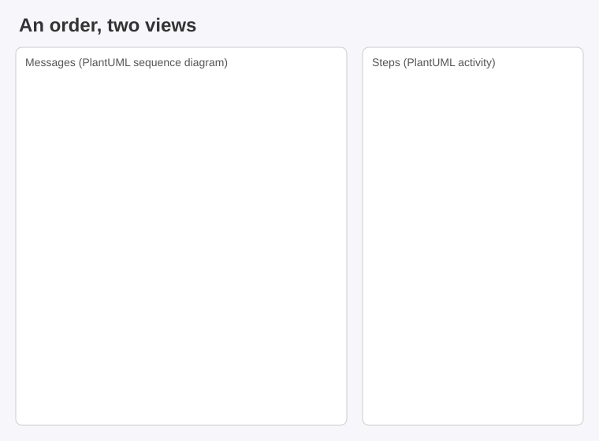

# CanvasNet PlantUML Package

## API Reference

### PlantUmlDocument

`PlantUmlDocument` (namespace `DemaConsulting.CanvasNet.PlantUml`) is distributed via the separate
`DemaConsulting.CanvasNet.PlantUml` NuGet package, whose only dependency is the core `DemaConsulting.CanvasNet` package.
It reads diagrams written in the PlantUML text language and draws **sequence diagrams** and **activity diagrams** (the
new syntax) as static pictures with PlantUML's default look and layout, using only managed code and the fonts bundled
with the libraries: no Java, no Graphviz, and no network. Every other PlantUML diagram type is recognized and reported,
never drawn wrongly. The package is derived with attribution from the MIT-licensed PlantUML sources and is **not
affiliated with or endorsed by** the PlantUML project (see *PlantUML Third-Party Attribution*).

Install it next to the core package (see also the Installation section of the project README); the `canvasnet` tool and
the `DemaConsulting.CanvasNet.Viewer` package already include it:

```bash
dotnet add package DemaConsulting.CanvasNet.PlantUml
```

A sequence diagram is laid out as PlantUML 1.2026.10 lays it out with its teoz engine, and an activity diagram as
PlantUML lays out the new activity syntax with its tile ("ftile") composition, so the participants, messages, actions,
decisions, and lanes land where PlantUML puts them. Neither needs Graphviz, in PlantUML or here. A document is
**immutable and thread-safe**: it is read and validated once and can then be measured and rendered any number of
times, from several threads at once, each call giving the same result for the same options.

```csharp
public sealed partial class PlantUmlDocument
{
    public static PlantUmlDocument Parse(string text, PlantUmlOpenOptions? options = null);
    public static PlantUmlDocument Open(string path, PlantUmlOpenOptions? options = null);
    public static PlantUmlDocument Open(Stream stream, PlantUmlOpenOptions? options = null);

    public string? SourceName { get; }
    public string DiagramType { get; }      // "sequence", "activity", or a type that is not drawn ("class", ...)
    public bool IsSupported { get; }        // true when this version draws the type
    public string? Title { get; }           // the title statement
    public int NodeCount { get; }           // participants, or actions, start, stop, end, connector, and decisions
    public int EdgeCount { get; }           // messages, or arrows
    public int SubgraphCount { get; }       // boxes, or swimlanes and partitions

    public PlantUmlSize Measure(
        PlantUmlRenderOptions? options = null,
        CancellationToken cancellationToken = default);

    public Surface Render(
        PlantUmlRenderOptions? options = null,
        CancellationToken cancellationToken = default);

    public Surface Render(
        int width,
        int height,
        PlantUmlRenderOptions? options = null,
        CancellationToken cancellationToken = default);
}
```

- `Parse` and the two `Open` overloads read the text as PlantUML reads it: the first `@startuml` ... `@enduml` block is
  the diagram (text before it is ignored, and a text without any `@start` tag, such as a Pandoc code block, is one
  diagram), the comments and the supported preprocessor directives are applied (see *Preprocessor and Includes*), the
  diagram type is detected in the order PlantUML tries its diagram factories, and a supported diagram is parsed. A file
  or stream is read as strict UTF-8 (a byte order mark is removed, invalid UTF-8 is rejected). `Open(Stream)` reads
  from the current position and leaves the stream open. Reading never uses the network; it reads only the local files
  that `!include` directives name, under `PlantUmlOpenOptions.FileAccess`.
- The descriptive properties come from the text only. For a sequence diagram, `NodeCount` is the number of
  participants (a participant named only by a message counts), `EdgeCount` the number of messages, and
  `SubgraphCount` the number of boxes. For an activity diagram, `NodeCount` is the number of actions, start, stop, end,
  and connector circles, and decisions, `EdgeCount` the number of arrows, and `SubgraphCount` the number of swimlanes
  and partitions (and groups). For a type that is not drawn, `IsSupported` is `false`, `Title` is `null`, and the
  counts are zero. `DiagramType` is `sequence`, `activity`, or the name of the type that is not drawn: `class`,
  `object`, `usecase`, `component`, `deployment`, `state`, `timing`, `activity-legacy` (the old `(*) --> ...` syntax),
  or the type of another `@start` tag, such as `mindmap`, `gantt`, `wbs`, `json`, `yaml`, or `salt`.
- `Measure` lays the diagram out and returns the size that `Render` produces for the same options, without drawing. It
  delivers the same reports as `Render`.
- `Render()` draws the diagram onto a new `Surface` at its **natural size** (the size of PlantUML's SVG, rounded up to
  whole pixels) multiplied by `PlantUmlRenderOptions.Scale` and by the diagram's own `scale` statement. The diagram is
  drawn sharply at the final size, not enlarged afterwards. The caller owns, and must dispose, the returned surface.
- `Render(width, height)` draws onto a surface of exactly that size: the diagram is scaled uniformly to fit and
  centered, and the margins take the background. `Scale` and the diagram's `scale` are not used.
- A known type that this version does not draw opens without error. Measuring or rendering it reports the unsupported
  feature `plantuml-diagram-unsupported` and gives an empty, transparent picture of 20 by 20 pixels (twice PlantUML's
  document margin), or throws in strict mode.

**Exceptions** (`Measure` and both `Render` overloads):

- `ArgumentOutOfRangeException`: the explicit size or the scaled natural size is outside 1 to `Surface.MaxDimension`
  (8192) on a side. A diagram larger than that needs a smaller `Scale` or the sized overload.
- `PlantUmlRenderException`: a limit of `PlantUmlLimits` was met while the diagram was laid out or painted
  (`plantuml-limit-exceeded`), or the diagram cannot be laid out (`plantuml-render-failed`). An unexpected internal
  error of the layout is reported the same way, at the start of the diagram, with the original exception as the inner
  exception, so a defect never escapes as another exception type.
- `PlantUmlUnsupportedFeatureException` (an `IOException`): the first unsupported feature when
  `ThrowOnUnsupportedFeature` is set.
- `OperationCanceledException`: the token was canceled before or during the work.

`Parse` and `Open` throw `PlantUmlSyntaxException` (a `FormatException`) for text that holds no diagram, an unknown
`@start` tag (`plantuml-unknown-diagram`), a statement that the diagram type does not accept (`plantuml-syntax-error`),
an `!include` file that cannot be read (`plantuml-include-failed`), or a structural limit (`plantuml-limit-exceeded`),
and `InvalidDataException` for text longer than `MaxTextSize` allows. `Open(string)` also throws
`FileNotFoundException` and `DirectoryNotFoundException` for a missing file.

Every exception and report carries a stable **code** (the constants of `PlantUmlDiagnosticCodes`), a **location**, and,
where one helps, a **hint**. A `PlantUmlLocation` is the `File` (the source name, or the path of an included file
relative to the base folder), and the one-based `Line` and `Column` in that file, comments and directives included, so
an editor can go straight to the line. `ToString()` gives `file:line:column`:

```text
bad.puml:3:1: plantuml-syntax-error: 'Alice ~~ Bob' is not a statement of a sequence diagram
Hint: write a message as 'A -> B : text' and declare participants with 'participant', 'actor', ...
```

### PlantUmlOpenOptions and PlantUmlRenderOptions

Both classes are immutable; every property is init-only and validated when it is set, so one instance can be shared
between threads and calls.

The `PlantUmlOpenOptions` properties:

- `SourceName` (default `null`, the path for `Open(string)`): the name shown in locations and messages.
- `BaseDirectory` (default `null`, the folder of the file for `Open(string)`): the folder against which the relative
  paths of `!include` directives are resolved. It is a base, not a boundary. A file included by another file is looked
  up in the folder of that file first. A text from `Parse` or `Open(Stream)` has no folder, so an `!include` in it fails
  with `plantuml-include-failed` unless a base folder is given; the current directory is never used.
- `FileAccess` (default `FileAccessPolicy.AllowAll`): the core file-access policy that decides which included files may
  be read. The default reads every regular local file, as Pandoc does; `FileAccessPolicy.UnderRoots(...)` and
  `FileAccessPolicy.NoSymlinks` confine it (see the core user guide, *Migrating from the Folder Sandbox*). A denied
  file is a `PlantUmlSyntaxException` with the code `plantuml-include-failed` at the directive, whose `InnerException`
  is the `FileReferenceException` of the denial.
- `Limits` (default `null`, `PlantUmlLimits.Default`): the limits checked while the text is read.

The `PlantUmlRenderOptions` properties:

- `Scale` (default 1): the factor by which the natural size is multiplied, text included; finite, greater than zero.
- `Background` (default `null`): the color under the diagram. `null` draws the diagram's own background: white, as
  PlantUML draws it, or the color of `skinparam backgroundColor` (`transparent` gives a transparent picture). An image
  source that composes the diagram into another document passes a transparent color.
- `Limits` (default `PlantUmlLimits.Default`): the resource limits of the call.
- `WarningHandler` (default `null`): receives each `PlantUmlDiagnostic` (a warning); `null` drops them.
- `UnsupportedFeatureHandler` (default `null`): receives each `PlantUmlUnsupportedFeature`; `null` drops them.
- `ThrowOnUnsupportedFeature` (default `false`): turns the first unsupported feature into a
  `PlantUmlUnsupportedFeatureException` (strict mode).

Reports are delivered once, in the order they were found, on the calling thread, after the work and before the method
returns or throws. There is no theme option and no position handler: a PlantUML diagram is drawn in its default look
(see *Themes*) and reports no feature positions.

### PlantUmlLimits

PlantUML text is untrusted input, so every resource a call can use is limited, and exceeding a limit fails closed with
a message that names the property. The default values are those of the Mermaid package, so the two diagram languages
are bounded alike. PlantUML itself has no such limits, so a very large but valid diagram that PlantUML draws can fail
here; raise the limit when you trust the text. The limits bound the work, not the clock: the cancellation token is the
only wall-clock bound.

The limits, with their defaults and what they bound:

- `MaxTextSize` (default 50,000): the statements of the diagram after the preprocessor, in UTF-16 characters, so
  comments do not count but text that a macro or an include produces does. The whole text as supplied may be four times
  as long. Exceeding it throws `InvalidDataException`.
- `MaxNodes` (default 2,000): the participants of a sequence diagram, or the instructions and swimlanes of an activity
  diagram.
- `MaxEdges` (default 500): the messages of a sequence diagram, or the arrows of an activity diagram.
- `MaxLabelLength` (default 4,096): one text (a participant name, a message, an action, a condition, an arrow label, a
  note, a group header, a divider, a title, or a legend), in UTF-16 characters.
- `MaxNestingDepth` (default 32, at most 256): groups inside groups, or ifs, loops, forks, splits, and partitions inside
  each other.
- `MaxIncludeDepth` (default 16, at most 64): an included file that includes another file, and so on.
- `MaxIncludes` (default 64): the include directives followed for one diagram; every followed directive counts.
- `MaxLayoutWork` (default 50,000,000): the metered steps of the layout.
- `MaxPaintedPixels` (default 250,000,000): the device pixels one render paints (after `Scale`).
- `MaxDiagnostics` (default 1,000): the reports kept per call; the rest become one `plantuml-diagnostics-suppressed`
  warning, and rendering continues.

A limit met while the text is read is a located `PlantUmlSyntaxException`, and one met while the diagram is laid out or
painted a located `PlantUmlRenderException`; the code of both is `plantuml-limit-exceeded`. The open limits come from
`PlantUmlOpenOptions.Limits` and the render limits from `PlantUmlRenderOptions.Limits`.

### Preprocessor and Includes

The preprocessor runs before the diagram is parsed, and every location it reports is in the original text (or in the
included file):

- Framing: the first `@startuml` ... `@enduml` block is the diagram, and text before it is ignored. A text without any
  `@start` tag is one diagram, as PlantUML reads a piped text. A second block is the unsupported feature
  `plantuml-multiple-diagrams`, and only the first one is drawn.
- Comments: a line that starts with `'`, and a `/' ... '/` block. A line that ends with `\` continues on the next one.
- Definitions: `!define NAME value` (without parameters) and `!undef NAME`; the name is replaced on word boundaries.
- Variables: `!$name = "text"` or a number, and `!$name ?= value` (set only when it is not set yet); `$name` is replaced
  by its value.
- Includes: `!include`, `!include_once`, and `!include_many` of a **local file**, relative to the file that names it,
  then to the base folder. An `.iuml` fragment is read whole, and a file with `@startuml` blocks gives its first block.
  As in PlantUML, a second `!include` of the same file is skipped, a second `!include_once` of it is an error, and
  `!include_many` includes it again; the diagram's own file counts as included.

An included file is read under the file-access policy of the call, through the same core `FileReferenceResolver` that
reads the files of every other CanvasNet format, so a denied file, a file that is not a regular file, a network path,
and a device path are refused. **An include never uses the network**: a URL (`!include https://...`), the standard
library (`!include <C4/C4_Container>`), a part of a file (`file.puml!2`, `[name]`), `!includeurl`, `!includesub`,
`!includedef`, and `!import` are reported as `plantuml-include-unsupported` and skipped, and the rest of the diagram is
drawn. A missing file is the error `plantuml-include-failed` at the directive, where PlantUML silently ignores it.

The other directives, `!if`, `!ifdef`, `!while`, `!foreach`, `!function`, `!procedure`, `!assert`, `!log`, built-in
`%functions`, and `!define` with parameters, are reported as `plantuml-preprocessor-unsupported` and dropped with the
block they open. `!pragma` lines are the warning `plantuml-pragma-ignored` (every sequence diagram is laid out with
teoz, so `!pragma teoz true` changes nothing), and `!theme` is described under *Themes*.

### Skin Parameters and the Default Look

A diagram is drawn with PlantUML's modern default look (the `plantuml.skin` of PlantUML 1.2026.10, not the old yellow
"rose" look): a white background, light purple participants (`#E2E2F0`) with a dark border (`#181818`), light gray
actions (`#F1F1F1`), pale yellow notes (`#FEFFDD`), dark lines and arrows, dashed life lines, and the sans-serif font
at PlantUML's sizes (participants 14 pixels, messages 13, activity texts 12, titles 14 bold).

`skinparam` changes that look, one setting per line (`skinparam arrowColor #2F6DB3`) or in a block
(`skinparam participant { BackgroundColor #DDEEFF }`). The supported subset:

- Elements: the eight participant kinds (`participant`, `actor`, `boundary`, `control`, `entity`, `database`,
  `collections`, `queue`), `note`, `sequenceGroup` and `sequenceGroupHeader`, `sequenceBox`, `sequenceDivider`,
  `sequenceDelay`, `sequenceLifeLine`, `arrow`, `activity`, `activityDiamond`, `swimlane` and `swimlaneTitle`,
  `partition`, `title`, `header`, `footer`, `legend`, and `caption`.
- Properties of each element: `BackgroundColor`, `BorderColor`, `FontColor`, `FontSize`, `FontName`, `FontStyle`, and
  `BorderThickness`.
- Document settings: `backgroundColor` (`transparent` keeps the page clear), `defaultFontName`, `defaultFontSize`,
  `defaultFontColor`, `roundCorner`, `shadowing false`, `sequenceArrowThickness`, `sequenceMessageAlign`,
  `responseMessageBelowArrow`, `maxMessageSize`, and `footbox`.
- Colors: HTML color names, `#RRGGBB`, `#RRGGBBAA`, `#RGB`, one hexadecimal digit for a gray (`#8`), and `transparent`.
  A gradient (`#red/blue`) uses its first color.

A setting outside the subset, or one whose value cannot be used, is the warning `plantuml-skinparam-ignored` and the
default stays. A `<style>` block is the unsupported feature `plantuml-style-unsupported` and is skipped. Creole markup
styles part of a text: `**bold**`, `//italic//`, `""monospaced""`, `__underlined__`, `--struck--`, `<b>`, `<i>`,
`<u>`, `<color:red>`, `<size:16>`, and `<font:Courier>`; other markup (images, sprites, icons, tables, lists, headings)
is the unsupported feature `plantuml-markup-unsupported` and is drawn as text.

### Themes

Themes are **not supported**. A `!theme` line is the unsupported feature `plantuml-theme-unsupported` and the default
look is drawn; with `ThrowOnUnsupportedFeature` (the tool's `--strict`) it fails. There is no `Theme` option, no
`#theme=` fragment on a `.puml` link (it is reported as `image-fragment-unknown-parameter`, as on a raster), and no
`--theme` for a `.puml` input (a `usage-error`). PlantUML's themes are written in its preprocessor language with `!if`,
`%variable_exists`, and `<style>` blocks, which this version does not implement, and the theme files carry no license
of their own, so none is bundled. Restyle a diagram with the supported `skinparam` settings instead.

### Supported Sequence Syntax

This list is also the *Supported* section of the help card `plantuml/sequence` (of the Viewer's `HelpCatalog`, and
`canvasnet help plantuml sequence`); a test keeps the two the same.

- **Sequence diagrams**: a diagram whose statements are all sequence statements is a sequence diagram. It is laid out
  like PlantUML's teoz engine: the participants stand in a row, and every message, note, and group is placed below the
  one before it.
- **Participants**: `participant`, `actor`, `boundary`, `control`, `entity`, `database`, `collections`, and `queue`,
  with a quoted display name, `as` for an alias, a `#color`, and `order N`; a participant named only by a message is a
  participant too.
- **Messages**: the arrows `->`, `-->`, `->>`, `-->>`, `<-`, `<--`, `<->`, `-\`, `-/`, `->x`, `->o`, and `-[#color]>`
  (two dashes are dotted), self messages, and a label after a colon with `\n` line breaks.
- **Activations**: `activate` and `deactivate` (with a color), `destroy`, `return`, and the `++`, `--`, `**`, and `!!`
  shorthands of a message.
- **Notes**: `note`, `hnote`, and `rnote` `left`, `right`, or `over` one or two participants, on one line or up to `end
  note`, with a color.
- **Groups**: `alt` and `else`, `opt`, `loop`, `par`, `break`, `critical`, and `group`, nested, with a color and a
  condition, closed by `end`.
- **Separators**: `== divider ==`, `...` delays (with a text), and `|||` or `||N||` space.
- **Boxes**: `box "title" #color` ... `end box` around participants.
- **Numbers**: `autonumber` with a start, a step, and a format, `autonumber stop`, and `autonumber resume`.
- **Page texts**: `title`, `header`, `footer`, `caption`, and `legend` ... `endlegend`, and `hide footbox`.
- **Scale**: `scale N` and `scale N/M` multiply the natural size.

### Supported Activity Syntax

This list is also the *Supported* section of the help card `plantuml/activity` (of the Viewer's `HelpCatalog`, and
`canvasnet help plantuml activity`); a test keeps the two the same.

- **Activity diagrams**: a diagram in the new activity syntax (`start`, `:action;`, `if`, `while`, ...) is an activity
  diagram. It is laid out like PlantUML's ftile composition, with no Graphviz.
- **Start and end**: `start`, `stop`, `end`, `kill`, and `detach`.
- **Actions**: `:text;` on one or more lines, with a `#color` before the colon and creole markup in the text.
- **Decisions**: `if (condition) then (label)`, `elseif`, `else`, and `endif` (or `end if`), with the `is` and `equals`
  forms, nested.
- **Loops**: `while (condition) is (label)` ... `endwhile (label)`, and `repeat` ... `repeat while (condition) is
  (label) not (label)`, with `backward:`.
- **Parallel branches**: `fork`, `fork again`, `end fork`, and `end merge`; `split`, `split again`, and `end split`.
- **Swimlanes**: `|Lane|` and `|#color|Lane|`; the lanes are columns in the order they appear.
- **Partitions**: `partition Name { ... }` and `group` frames around instructions.
- **Notes**: `note left` or `note right`, on one line or up to `end note`, floating notes, and a color.
- **Arrows**: `-> label;` before an instruction, and the `-[#color]->`, `-[dashed]->`, `-[dotted]->`, `-[bold]->`, and
  `-[hidden]->` styles.
- **Connectors**: `(A)` circles that join two parts of a flow.
- **Page texts**: `title`, `header`, `footer`, `caption`, and `legend` ... `endlegend`, and `scale N`.

### PlantUML Unsupported Features and Strict Mode

A construct that PlantUML defines but this package does not draw is reported as a `PlantUmlUnsupportedFeature` with a
stable `Feature` code, a message, a location, and a hint, and the rest of the diagram is still drawn.
`ThrowOnUnsupportedFeature` turns the first one into a `PlantUmlUnsupportedFeatureException`. A **warning**
(`PlantUmlDiagnostic`) is a questionable construct that still renders; strict mode does not fail on a warning.

The codes, with their kind and when each is reported:

- **`plantuml-diagram-unsupported`**: Unsupported: The diagram type is not drawn by this version (every type but
  sequence and activity diagrams); the picture is empty.
- **`plantuml-multiple-diagrams`**: Unsupported: The text has more than one `@start` block; only the first one is drawn.
- **`plantuml-preprocessor-unsupported`**: Unsupported: A preprocessor directive outside the subset (`!if`, `!function`,
  `!procedure`, `!foreach`, built-in `%functions`, `!define` with parameters); it is dropped with the block it opens.
- **`plantuml-include-unsupported`**: Unsupported: An include that is never followed: a URL, the standard library
  (`<name>`), a part of a file (`file!part`), `!includeurl`, `!includesub`, `!includedef`, or `!import`.
- **`plantuml-theme-unsupported`**: Unsupported: A `!theme` line; the default look is drawn.
- **`plantuml-style-unsupported`**: Unsupported: A `<style>` block; it is skipped.
- **`plantuml-statement-unsupported`**: Unsupported: A statement PlantUML defines that this version does not draw (`ref
  over`, `newpage`, `switch`, `goto`, a specification and description language box style, ...); the rest of the diagram
  is drawn.
- **`plantuml-markup-unsupported`**: Unsupported: Creole markup outside the subset (images, sprites, icons, tables,
  lists, headings); the markup is drawn as text.
- **`plantuml-syntax-error`**: Error (plantuml-error): a statement no parser of the diagram type accepts, an empty
  diagram, or text that is not valid UTF-8; the message gives the file, the line, and the column, and the hint suggests
  the fix.
- **`plantuml-unknown-diagram`**: Error (plantuml-error): an `@start` tag PlantUML does not define; the hint names the
  nearest one.
- **`plantuml-include-failed`**: Error (plantuml-error): an `!include` file that is missing or cannot be read; a file
  the file-access mode denies is file-access-denied instead.
- **`plantuml-limit-exceeded`**: Error (budget-exceeded): a limit of the library (nodes, edges, includes, nesting, label
  length, layout work, painted pixels); see the card `limits`.
- **`plantuml-render-failed`**: Error (plantuml-error): the diagram cannot be laid out; please report it.
- **`plantuml-skinparam-ignored`**: Warning: a `skinparam` setting outside the supported subset, or with a value that
  cannot be used; the message says why.
- **`plantuml-pragma-ignored`**: Warning: a `!pragma` line, which has no effect.
- **`plantuml-text-missing-glyph`**: Warning: a character that the font of its text does not have; it is drawn with a
  bundled fallback font, or as a box when no bundled font has it.
- **`plantuml-diagnostics-suppressed`**: Warning: more reports than the diagnostics limit; the rest are not listed.

The codes of this list are also the bullets of the help cards `plantuml/unsupported` and `plantuml/diagnostics` (of the
Viewer's `HelpCatalog`, and `canvasnet help plantuml unsupported` and `diagnostics`); a test keeps them the same. In the
`canvasnet` tool and the Viewer, the errors are `plantuml-error` (with the file, the line, the column, and the specific
code), a limit is `budget-exceeded`, an include the file-access mode denies is `file-access-denied`, and a warning is a
note with the source `plantuml` and the code `plantuml-warning`, the specific code being in its `detail`.

**Unsupported diagram types.** Every diagram type that PlantUML knows is recognized, so a diagram that this version
cannot draw is named, not misread:

- inside `@startuml`: class (`class`, `interface`, `abstract`, `enum`, `annotation`), object (`object`, `map`), use
  case (`usecase`, `(name)`), component (`component`, `[name]`), deployment (`node`, `artifact`, `cloud`, ...), state
  (`state`, `[*]`), timing (`robust`, `concise`), and the legacy activity syntax (`(*) --> ...`, reported as
  `activity-legacy`);
- the other `@start` tags: `@startmindmap`, `@startgantt`, `@startwbs`, `@startjson`, `@startyaml`, `@startsalt`,
  `@startditaa`, `@startdot`, `@startmath`, `@startlatex`, `@startregex`, `@startebnf`, `@startchen`, `@startfiles`,
  `@startchronology`, `@startboard`, `@startcreole`, `@startwire`, and `@startnwdiag`.

Such a diagram opens, `DiagramType` names it, `IsSupported` is `false`, and rendering it reports
`plantuml-diagram-unsupported` with an empty 20 by 20 picture, or fails in strict mode. A tag that PlantUML does not
define is the error `plantuml-unknown-diagram`, whose hint names the nearest tag. The tool's `info`
reports such a diagram with `"supported": false`, and the Pandoc filter leaves a block or a picture of it as written,
with a warning, so the document shows its code.

### Fonts, Determinism, and Known Differences

Rendering is **deterministic**: two renders of one document with the same options give identical pixels, for every
degree of parallelism, on every machine, and in every culture. The package reads no clock, environment variable,
locale, or installed font, runs no script, starts no process (no Java, no Graphviz), and never uses the network. Text
is measured and drawn with the bundled fonts only: PlantUML's default `SansSerif` (Arial on Windows), `sans-serif`,
`Arial`, and any font name that is not bundled resolve to Liberation Sans, which has Arial's advances; `Serif` and
`Times` to Liberation Serif; and `Monospaced` and `Courier` to Liberation Mono. The bundled fallback fonts draw the
characters these lack, with the warning `plantuml-text-missing-glyph`.

The layout is checked against PlantUML itself: a set of original reference diagrams is drawn by the MIT distribution of
PlantUML 1.2026.10 (`tools/visual-diff/update-plantuml-goldens.ps1` draws them again; it is never run by the build),
and the size of each picture, the place of every text, and the boxes of the participants, messages, life lines,
actions, circles, diamonds, and hexagons agree with PlantUML's SVG within 1.5 pixels (the size within 3%). The known
differences from PlantUML are:

- **Fonts.** PlantUML uses the fonts of the Java runtime, so its pictures differ from these where Arial is not the
  sans-serif font. The glyph shapes differ slightly from Arial; the positions do not.
- **Framing.** A text with no `@start` tag is read as one diagram, as PlantUML reads a piped text; PlantUML refuses such
  a file.
- **Includes.** A missing `!include` file is an error, where PlantUML ignores it, and a URL or the standard library is
  never fetched.
- **Look.** Only the default look and the supported `skinparam` settings are drawn: no themes, `<style>` blocks,
  shadows, gradients (the first color is used), or hand-written mode.
- **Sequence diagrams.** `ref over`, `newpage`, `create`, `mainframe`, `autoactivate`, messages to or from the border
  (`[->`, `->]`, `?->`), parallel messages (`&`), and stereotypes of participants are reported as
  `plantuml-statement-unsupported` and not drawn.
- **Activity diagrams.** `switch` blocks, `goto` and `label`, `break`, the specification and description language box
  styles (`:text|`, `:text<`, `:text>`, `:text/`, `:text]`, `:text}`, drawn as a plain box), and the frames of
  `package`, `rectangle`, and `card` groups are reported as `plantuml-statement-unsupported`. An arrow with several
  colors is drawn with its first color, a repeat loop whose back arrow crosses swimlanes is drawn with the simple back
  arrow, and a diagram with swimlanes can be up to 3 pixels narrower than PlantUML's.
- **Detection.** Statements are recognized by their leading keywords and arrows, in the order PlantUML tries its
  diagram types (sequence first). In rare ambiguous cases a diagram of a type that is not drawn is named differently;
  that never changes whether it is drawn.
- **Errors.** For invalid text PlantUML draws an error picture; this package throws a located
  `PlantUmlSyntaxException`.
- **Interaction.** The picture is static and has no links.
- **Version.** The target is PlantUML 1.2026.10; later PlantUML versions are not followed automatically.

### PlantUML Third-Party Attribution

`DemaConsulting.CanvasNet.PlantUml` is **derived with attribution** from **PlantUML** (MIT, Copyright (C) 2009-2024
Arnaud Roques), read from its MIT-licensed distribution `net.sourceforge.plantuml:plantuml-mit` 1.2026.10. To draw
diagrams the way PlantUML draws them, the values of its default look (`skin/plantuml.skin`: colors, fonts, sizes, line
widths, corners, and paddings), the framing and the supported preprocessor directives, the order of its diagram
detection, the sequence statements and the geometry of its teoz engine and its element shapes, the statements of the
new activity syntax and the geometry of its tile composition, and the way Java measures text with its logical
`SansSerif` font are reimplemented in C#. No source text, comment, test, example, or image of PlantUML is copied, no
Java runs, and no PlantUML package is a dependency.

The license text ships in the NuGet package under `licenses/LICENSE-plantuml.txt` (also in the `canvasnet` tool, which
bundles the assembly), and `src/DemaConsulting.CanvasNet.PlantUml/third-party/README.md` records what was ported, from
which file, and by which unit; every source file with ported logic starts with the comment
`// Portions derived from PlantUML (MIT); see third-party/README.md`. The diagrams of this guide and of the tests are
original, and the reference pictures they are compared with are drawn by the jar from those original diagrams. The
package is **not affiliated with, endorsed by, or promoted by** the PlantUML project or its authors; the name is used
only to describe the language that is implemented.

### Using As An Embedded Image

`PlantUmlImageSource` is the image source of this package for `.puml`, `.plantuml`, and `.pu` files (`.iuml` is an
include fragment by convention and is not claimed). With it a document that links to a diagram (an SVG
`<image href="seq.puml">`, the picture of a Mermaid node, a picture of a Markdown document) draws the diagram through a
`FolderImageResolver` of the core package, or `CanvasNetViewer.CreateImageResolver` of the Viewer package, which
includes it. The diagram is laid out afresh at the size of its placement, on a transparent background, and its
`!include` files are read from the folder of the diagram under the file-access policy of the whole render. Warnings are
returned as notes of the source `plantuml` with the code `plantuml-warning` (the specific `plantuml-*` code is in
`Detail`), and unsupported features as notes whose code is the feature; a type that is not drawn is an empty picture
with a `plantuml-diagram-unsupported` note.

The source declares **no fragment parameter**: a link such as `seq.puml#theme=dark` draws the diagram and reports the
parameter as `image-fragment-unknown-parameter`. A PlantUML diagram reports no feature positions, so an SVG position
binding cannot point at its participants or actions.

```csharp
// An SVG document that links to diagrams, drawn through the resolver
var resolver = new FolderImageResolver("assets", [new PlantUmlImageSource()]);
var options = new SvgLoadOptions { ImageResolver = resolver };
using var surface = SvgCodec.Load("assets/figure.svg", 800, 600, fonts: null, options);
```

## Examples

### Example 68: Rendering a PlantUML Sequence Diagram

```csharp
using DemaConsulting.CanvasNet.Canvas;
using DemaConsulting.CanvasNet.Codecs;
using DemaConsulting.CanvasNet.PlantUml;

// PlantUmlDocument.Open("checkout.puml") would read the same text from a file
var diagram = PlantUmlDocument.Parse("""
    @startuml
    title Checkout
    actor Customer
    participant Shop
    database Stock
    Customer -> Shop ++ : place order
    Shop -> Stock : reserve
    Stock --> Shop : reserved
    Shop --> Customer -- : confirmation
    @enduml
    """);

// The document describes the text
Console.WriteLine($"{diagram.DiagramType} {diagram.IsSupported}");   // Output: sequence True
Console.WriteLine(diagram.Title);                                     // Output: Checkout
Console.WriteLine($"{diagram.NodeCount} participants, {diagram.EdgeCount} messages, {diagram.SubgraphCount} boxes");
                                                                      // Output: 3 participants, 4 messages, 0 boxes

// Measure lays the diagram out without drawing; Render draws it sharply at twice the size
PlantUmlSize natural = diagram.Measure();
Console.WriteLine($"{natural.Width}x{natural.Height}");               // Output: 254x354
using var picture = diagram.Render(new PlantUmlRenderOptions { Scale = 2 });
PngCodec.Save(picture, "checkout.png");                               // 508x708 pixels, white background

// Fit the diagram into a fixed box over a transparent background: it is scaled uniformly and centered
using var thumbnail = diagram.Render(200, 200, new PlantUmlRenderOptions { Background = new Rgba32(0, 0, 0, 0) });
PngCodec.Save(thumbnail, "checkout-thumbnail.png");
```

An activity diagram is read the same way; this one has 6 nodes (start, three actions, the decision, and stop) and 7
arrows:

```csharp
using DemaConsulting.CanvasNet.PlantUml;

var activity = PlantUmlDocument.Parse("""
    start
    :Read the ticket;
    if (Is it a bug?) then (yes)
      :Fix it;
    else (no)
      :Answer it;
    endif
    stop
    """);
Console.WriteLine($"{activity.DiagramType}: {activity.NodeCount} nodes, {activity.EdgeCount} edges");
                                                                      // Output: activity: 6 nodes, 7 edges
```

### Example 69: PlantUML Errors, Unsupported Features, and Strict Mode

```csharp
using DemaConsulting.CanvasNet.PlantUml;

// A statement the diagram does not accept is located in the original text and carries a hint
try
{
    PlantUmlDocument.Parse("@startuml\nAlice -> Bob : hello\nAlice ~~ Bob\n@enduml\n",
        new PlantUmlOpenOptions { SourceName = "bad.puml" });
}
catch (PlantUmlSyntaxException ex)
{
    Console.WriteLine($"{ex.Code} at {ex.Location}");  // Output: plantuml-syntax-error at bad.puml:3:1
    Console.WriteLine(ex.Hint);                        // Output: write a message as 'A -> B : text' and declare ...
}

// A known type that this version does not draw opens, is reported, and gives an empty picture
var classes = PlantUmlDocument.Parse("@startuml\nclass Order\nclass Line\nOrder *-- Line\n@enduml\n");
Console.WriteLine($"{classes.DiagramType} {classes.IsSupported}");    // Output: class False
var reports = new List<PlantUmlUnsupportedFeature>();
using var empty = classes.Render(new PlantUmlRenderOptions { UnsupportedFeatureHandler = reports.Add });
Console.WriteLine($"{reports[0].Feature} {empty.Width}x{empty.Height}");
                                                                      // Output: plantuml-diagram-unsupported 20x20

// A theme is left out and reported; strict mode makes it an error
var themed = PlantUmlDocument.Parse("@startuml\n!theme cerulean\nAlice -> Bob : hello\n@enduml\n");
try
{
    using var strict = themed.Render(new PlantUmlRenderOptions { ThrowOnUnsupportedFeature = true });
}
catch (PlantUmlUnsupportedFeatureException ex)
{
    Console.WriteLine(ex.Feature);                                    // Output: plantuml-theme-unsupported
}

// A setting outside the skinparam subset is a warning; the diagram is still drawn
var warnings = new List<PlantUmlDiagnostic>();
var styled = PlantUmlDocument.Parse(
    "@startuml\nskinparam participantBackgroundColor #DDEEFF\nskinparam handwritten true\nAlice -> Bob : hello\n@enduml\n",
    new PlantUmlOpenOptions { SourceName = "styled.puml" });
using var drawn = styled.Render(new PlantUmlRenderOptions { WarningHandler = warnings.Add });
Console.WriteLine(warnings[0]);
// Output: styled.puml:3:1: plantuml-skinparam-ignored: skinparam 'handwritten' is ignored: it is not supported by ...
```

### Example 70: Includes and File Access for a PlantUML Diagram

`docs/order.puml` includes a shared fragment that sets a color and a variable:

```text
' shared/style.iuml
skinparam participantBackgroundColor #DDEEFF
!$service = "Order service"

' docs/order.puml
@startuml
!include ../shared/style.iuml
participant "$service" as S
Client -> S : order
@enduml
```

```csharp
using DemaConsulting.CanvasNet.Files;
using DemaConsulting.CanvasNet.PlantUml;

// Open reads the includes from the folder of the file, under the default policy (every regular local file)
var order = PlantUmlDocument.Open("docs/order.puml");
Console.WriteLine(order.NodeCount);                                   // Output: 2

// Confine the includes to the docs folder: the shared fragment is now denied
try
{
    PlantUmlDocument.Open("docs/order.puml",
        new PlantUmlOpenOptions { FileAccess = FileAccessPolicy.UnderRoots("docs") });
}
catch (PlantUmlSyntaxException ex) when (ex.InnerException is FileReferenceException denial)
{
    Console.WriteLine($"{ex.Code} at {ex.Location}");  // Output: plantuml-include-failed at docs/order.puml:2:1
    Console.WriteLine(denial.Message);                 // Output: The file '../shared/style.iuml' was denied by ...
}

// A text without a folder needs a base folder for its includes
var text = File.ReadAllText("docs/order.puml");
var parsed = PlantUmlDocument.Parse(text, new PlantUmlOpenOptions { BaseDirectory = "docs" });
```

The tool reads the includes under `--file-access` and `--allow-root` in the same way:
`canvasnet render docs/order.puml -o order.png --file-access roots --allow-root docs` fails with `file-access-denied`,
and without the options it draws the diagram. An `!include https://...` line is never fetched: it is reported as
`plantuml-include-unsupported`, and the rest of the diagram is drawn.

### Example 71: Embedding a PlantUML Diagram in an SVG or a Mermaid Node

Any SVG `<image href>` can name a `.puml`, `.plantuml`, or `.pu` file, and the diagram is drawn sharply at the size of
the element. `examples/plantuml-figure.svg` places two diagrams of the gallery side by side, each in a panel with a
caption:

```xml
<image x="32" y="92" width="396" height="440" href="plantuml-sequence-basics.puml"/>
<image x="472" y="100" width="256" height="420" href="plantuml-activity-basics.puml"/>
```

Read the natural size with `canvasnet info plantuml-sequence-basics.puml --json` (396 by 445 pixels) and keep that
aspect ratio. The tool and the Viewer draw it with no warning, even under `--strict`:

```text
canvasnet render docs/user_guide/examples/plantuml-figure.svg --strict --scale 2 -o figure.png
```

In a Pandoc document, link the SVG as a picture: the filter sees that it links diagrams that the writer cannot draw and
runs `canvasnet flatten`, so the frame and the captions stay vector and only the diagrams become PNG pictures.

```markdown
{scale=2 width=100%}
```

{scale=2 width=100%}

A node of a Mermaid flowchart can show a PlantUML diagram that lies next to it in the same way, through the resolver of
the Mermaid diagram: `login@{ img: "login.puml", label: "Login", w: 240, h: 200 }`. The `canvasnet montage` command
takes `.puml` inputs, and `canvasnet flatten` replaces a linked `.puml` with a PNG picture for SVG readers that cannot
draw it.

### Example 72: Drawing a PlantUML Diagram in a Pandoc Document

The Pandoc filter `docs/filters/canvasnet.lua` draws a picture whose file is a `.puml`, `.plantuml`, or `.pu` diagram,
and a fenced code block of class `plantuml` written in the document itself (`@startuml` and `@enduml` are optional in
a block). The block reads the attributes of a `.puml` picture (`size`, `scale`, and `background`; there is no
`theme`); `caption` makes it a figure, and every other attribute stays on the picture:

````markdown
```{.plantuml caption="A release, drawn from a code block" scale=2 width=40%}
start
:Build;
if (Tests pass?) then (yes)
  :Publish;
else (no)
  :Fix the build;
endif
stop
```
````

```{.plantuml caption="A release, drawn from a code block" scale=2 width=40%}
start
:Build;
if (Tests pass?) then (yes)
  :Publish;
else (no)
  :Fix the build;
endif
stop
```

A plain ` ```plantuml ` block works the same way, without a caption. The text of a block is written to the filter's
cache folder and drawn from there, so a diagram that includes files must be a `.puml` file of its own, used as a
picture; the filter then hashes its `!include` files too, so a changed include draws the picture again. A block or a
picture of a type that this version does not draw (a class diagram, a mindmap, ...) is left as written, so the
document shows its code, and the tool's message is a Pandoc warning.

### Example 73: The PlantUML Gallery

The gallery is a set of small sequence and activity diagrams that together use the major features of the package.
Every diagram is **original to this repository**, lies in `docs/user_guide/examples` as `plantuml-*.puml`, and is
drawn below by the Pandoc filter, so the pictures are always those of the version of the library that built this
guide. A test (`PlantUmlGalleryTests`) renders every file with `ThrowOnUnsupportedFeature = true` and fails on any
warning, so a diagram of the gallery cannot use a feature that is only reported. The same files can be drawn with the
tool, for example
`canvasnet render docs/user_guide/examples/plantuml-sequence-basics.puml --strict --scale 2 -o basics.png`.

*Participants and arrows.* A title, five participant kinds, a display name with an alias, solid, dotted, and open
arrows:

{scale=2 width=70%}

*Groups and activations.* An activation with `++` and `--`, an `alt` group with `else`, a note, a self message, a
divider, a delay, and a `loop`:

{scale=2 width=60%}

*Boxes and page texts.* Two colored boxes around participants, `autonumber`, a header, a title, a legend, and a
footer:

{scale=2 width=60%}

*A decision.* `start`, actions, `if` with `then` and `else` labels, and `stop`:

{scale=2 width=45%}

*Loops.* A `repeat` loop with a start action, a `backward` action, and `is` and `not` labels, and a `while` loop:

{scale=2 width=45%}

*Parallel branches.* A `fork` with `end fork`, a `fork` with `end merge`, and a `split`:

{scale=2 width=50%}

*Swimlanes.* Two lanes, one of them colored, a note, a decision, and an arrow label on the way back to the first lane:

{scale=2 width=70%}

*Partitions and styles.* Two partitions, a colored and a dashed arrow, an arrow label, a connector, `end`, and
`skinparam` colors for the actions:

{scale=2 width=35%}
