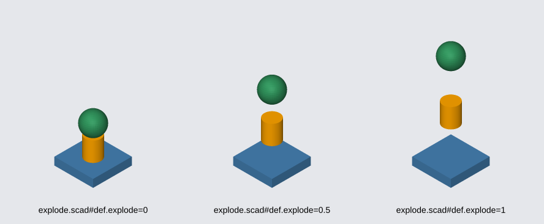

# The canvasnet Command-Line Tool

<!-- cspell:ignore canvasnet Visio RRGGBBAA psnr rmse ssim midtones deskew deskewed deskewing Otsu luma grayscale -->
<!-- cspell:ignore bilinear percentile percentiles gamma -->

The `DemaConsulting.CanvasNet.Tool` package is a .NET tool whose command, `canvasnet`, exposes the CanvasNet
libraries on the command line. It inspects, renders, converts, transforms, compares, and composes images, drawings,
document pages, OpenSCAD models, and Vega-Lite charts, cleans up photographs of sketches (contrast, tilt, borders,
and a coordinate
grid), and measures their colors and pixels. It is built to be driven by programs as well as by people: a command's
standard
output holds only
its own result, every result can be written as one JSON document, a failure is reported with a stable error code, and
the exit code is always 0 or 1. This chapter describes the whole contract, so that a script or an AI agent can use the
tool without reading its source.

The tool is a thin command-line shell over the `DemaConsulting.CanvasNet.Viewer` library: it parses a command line into
the requests of the library's `Imaging` operations (`SourceLoader`, `ImageRenderer`, `ImageInspector`, `ImageComparer`,
and `MontageBuilder`) and prints their results. Every command in this chapter is therefore also available as a library
call, with the same behavior and the same stable error codes - see the Viewer chapter of this guide, *Doing what the
canvasnet commands do, from code*.

## Installing the Tool

The tool needs the .NET 8, 9, or 10 runtime (the `dotnet tool` commands need the SDK). It bundles every CanvasNet
library it uses, so no other CanvasNet package has to be installed.

```bash
# Install for the current user (the canvasnet command is then on the PATH)
dotnet tool install --global DemaConsulting.CanvasNet.Tool

# Or install in a folder, or in the tool manifest of a repository
dotnet tool install DemaConsulting.CanvasNet.Tool --tool-path ./tools
dotnet new tool-manifest
dotnet tool install DemaConsulting.CanvasNet.Tool

# Check the installation
canvasnet --version
canvasnet --help
canvasnet --validate
```

Use `dotnet tool update --global DemaConsulting.CanvasNet.Tool` to update the tool and
`dotnet tool uninstall --global DemaConsulting.CanvasNet.Tool` to remove it. In a repository that uses a tool
manifest, run it as `dotnet tool run canvasnet ...`.

## Command Line Conventions

A command line has the form `canvasnet [global options] <command> [arguments and options]`. The first word that is
not an option (or the value of an option) is the command name.

- **Option forms.** A value may follow its option after a space (`--width 800`) or an equals sign (`--width=800`).
  A short alias is written the same way (`-o out.png`). Options may be placed before or after the positional
  arguments, and an option marked repeatable may be given more than once.
- **Global options** are accepted in any position, before or after the command.
- **Mistakes.** An unknown option or command is an error that names the closest valid one (`Did you mean '--fit'?`).
- **Help.** `canvasnet --help` lists the commands and the help topics, `canvasnet help <command>` and
  `canvasnet <command> --help` show the usage, examples, and every option of a command, and
  `canvasnet help <topic>` explains an input format or a cross-cutting subject (see *Help Topics*).
- **Files.** Paths are relative to the current directory. Wildcards are not expanded by the tool.

### Global Options

| Option | Meaning |
| --- | --- |
| `-v`, `--version` | Print the version (only the version) and exit |
| `-?`, `-h`, `--help` | Print the help of the tool or of the named command (with `--json`, as a JSON document) |
| `--json` | Write the result of the command as one JSON document on standard output |
| `--silent` | Suppress all console output, errors included (files are still written; `--log` still records) |
| `--log <file>` | Also write everything that is printed, errors included, to this file (replaced if it exists) |
| `--validate` | Run the self-validation (see *Self-Validation*) |
| `--results <file>` | With `--validate`: write the results as a `.trx` (TRX) or `.xml` (JUnit) file; alias `--result` |
| `--depth <1-6>` | With `--validate`: the markdown heading depth of the report (default 1) |

### Fragments on Input Paths

An input path of `render` (and its verbs), `inspect`, `info`, `compare`, and `montage` may end in a **URL fragment**,
the same syntax as the `href` of an `<image>` in an SVG file: a `#`, then `name=value` parameters joined by `&`. It
chooses what to draw from the file, for that input only, so one file can be several inputs:

```bash
canvasnet render "report.pdf#page=3" -o page3.png
canvasnet render "chart.vl.json#param.t=5" -o chart.png
canvasnet render "part.scad#view=top&def.width=20" -o part-top.png
canvasnet compare "a.scad#view=top" "b.scad#view=top" --diff diff.png
canvasnet montage "assembly.scad#def.explode=0" "assembly.scad#def.explode=0.5" "assembly.scad#def.explode=1" \
  -D '$vpd=360' -D '$vpt=[0,0,50]' --labels -o explode.png
```

| Parameter | Applies to | Meaning |
| --- | --- | --- |
| `page=N` (`slide=N` for `.pptx`) | `.pdf`, `.pptx`, `.vsdx` | The page or slide, counted from 1; replaces `--page` |
| `view=NAME` | `.scad` | `iso`, `front`, `back`, `left`, `right`, `top`, or `bottom`; replaces `--view` |
| `def.NAME=VALUE` | `.scad` | Sets the variable `NAME` like `-D`; a vector is a JSON array (`def.$vpt=[0,0,2]`) |
| `param.NAME=VALUE` | `.vl.json`, `.vl` | Sets the chart parameter `NAME` like `--param` |

The grammar of the values is the one of the options (`-D` and `--param`) and of a link in an SVG file (see *Embedding
Images, Charts, and Models in an SVG*): the names of the parameters are not case sensitive (the name after `def.` or
`param.` is), a value is percent-decoded after the fragment is split (`%26` is an `&` inside a value, `%22` a double
quote), and a name that is given twice keeps its last value. The fragment is at most 2,048 characters and 32 parameters.

**When is a `#` a fragment?** Only when no file has the name as written. A real file called `chart#2.png` keeps working
(and wins over a file `chart` with the fragment `2.png`); otherwise the longest start of the text, up to a `#`, that
names an existing file is the file, and the rest after that `#` is the fragment. When no such file exists the
error names the file before the first `#`, and says that a file of the whole name does not exist either.

**The fragment overrides the options of the command** for its input: its page replaces `--page` (and `--all-pages`: the
input then gives that one page), its view replaces `--view`, and its variables and chart parameters are merged with
`-D` and `--param` by name, the fragment winning. `--azimuth`, `--elevation`, and `--projection` still refine the
view. For `compare` it wins over the options of one side (`--a-page`, `--a-view`, `--a-define`) too. Other inputs are
not affected: `canvasnet montage "a.scad#view=top" b.scad --view front` draws `a.scad` from the top and `b.scad` from
the front.

**Quote the input in a shell.** An `&` ends a command in `bash` and `zsh` and is reserved in PowerShell, so put an
input with more than one parameter in quotes (`"part.scad#view=top&def.width=20"`); and a `$` (as in `$vpd`) in single
quotes, as in `-D '$vpd=300'`. A `#` in the middle of a word is not a comment, but one at the start of a word is.

**Mistakes and warnings.** They have the codes of an SVG link. A value that cannot be used (a vector or a JSON value that
is cut short, a `def.` name that is not an identifier, an unknown `view`, a page that is not a whole number, a fragment
over its limits) is an **error** with the code `image-fragment-invalid`, and a page the file does not have is
`page-out-of-range`; nothing is written. A parameter that the kind of the file does not use (`pag=2`, `page=2` on a
PNG, `def.x=1` on a chart) is the **warning** `image-fragment-unknown-parameter`, a parameter given twice with different
values is `image-fragment-duplicate-parameter`, and a `param.` name that the chart does not declare is
`vl-param-unknown` (the chart is drawn without it): they are warnings, never errors, **also with `--strict`**, so a
typo does not lose the picture, and they are in `diagnostics` of the JSON result and on standard error as
`Warning: <code>: <message>`. (`--param nope=1` on the command line is still a `vega-lite-error`, because a typo in an
option should be loud.)

**What the result says.** The text result names the input with its fragment (`wrote out.png (...) from
part.scad#def.width=20`), the `input` object of the JSON result of `render`, `inspect`, `info`, and `compare` (and the cell
of `montage`) has a `fragment` member (`path` stays the file), and `montage --labels` writes the file name, a `#`, and the
fragment under each cell (`assembly.scad#def.explode=0.5`; a page of a document that the fragment names has no `p2`
after it), so the cells of one file can be told apart. A label wider than the cell is cut with `...`.

**A fixed camera for a montage.** The camera of a model is fitted to the geometry of each picture, so a model that grows
(an assembly that is pulled apart) is drawn smaller as it grows. To compare several versions at one scale, fix the
camera with the viewport variables: `$vpd` is the distance of the camera (for an orthographic picture the visible
height is about 0.4 times the distance, so a larger distance is a smaller picture), `$vpt` the point it looks at (the
origin by default), `$vpr` its rotation, and `$vpf` its field of view. They are variables like any other, so
`-D '$vpd=360' -D '$vpt=[0,0,50]'` (for every input of the command) or `def.$vpd=360&def.$vpt=[0,0,50]` (in a fragment)
set them. With `--view`, `--azimuth`, or `--elevation` the angles still come from the view. The picture below is the
`montage` command above, for the assembly `docs/images/showcase/explode.scad` of this repository (the plate is as large
in all three cells because the camera is fixed).

{width=80%}

## Output, Errors, and Exit Codes

- **Standard output** carries only the result: the lines a command prints, or, with `--json`, one JSON document on one
  line. The banner (`CanvasNet Tool version ...`) is printed only for `--help` (and not with `--json`), `--validate`,
  and an empty command line, so a command's output can be piped and parsed.
- **Standard error** carries diagnostics: `Error: <code>: <message>` and an optional `Hint: <advice>` line for an
  expected failure. There is never a stack trace for an expected failure. A mistake in the global options that is
  found before the command is known (for example `canvasnet --nope`) is reported without a code, as
  `Error: <message>`; its `--json` failure document uses the code `usage-error`. With `--silent` the report is not
  printed (the exit code 1 still tells that the command failed), and with `--log` it is also written to the log
  file. The exceptions are a failure of the global options themselves, such as a malformed option or a log file that
  cannot be opened: no log or silent setting is in force yet, so it is always printed.
- **Diagnostics of a successful command** are also written to standard error, one line each, when the command is
  not run with `--json`. A feature the picture was drawn without is `Unsupported: <code>: <message>`, a questionable
  construct is `Warning: <code>: <message>`, and a line a SCAD model printed with `echo` is written as OpenSCAD prints
  it, `ECHO: <text>`. A note ends with where it came from in parentheses: the input, and the page of a document, such
  as `(chart.vl.json)` or `(deck.pptx, page 2)`, or for `compare` the side, `(input b)`. At most 20 notes, and 20 echo
  lines, are written;
  the rest are counted in one line, `... and N more diagnostics (use --json for all)`. Control characters (such as ESC
  or NUL) in a line are written escaped (`\u001b`), so a model cannot inject terminal sequences; the `--json` values
  are unchanged. They do not change the exit code, which stays 0 (`--strict` turns an unsupported feature into an
  error instead), and standard output keeps only
  the result. `--silent` suppresses them like all other console output (`--log` still records them). With
  `--json` none are written to standard error, because the same notes are in the `diagnostics` and `echo` of the JSON
  document, and standard output stays that one document.
- **Exit codes** are the same for every command: **0** for success and **1** for any failure. The finer distinction
  is the stable error code, which is available only in the `Error:` line on standard error and in the `--json`
  failure document (see *Error Codes*); there is no other exit code to interpret.
- **Unexpected exceptions** are bugs, not user errors: a failure the tool did not anticipate (for example a defect in
  a library) is reported as `Unexpected error: <message>` on standard error and then re-thrown. The process then ends
  with the .NET unhandled-exception output (and an event log entry on Windows) and the runtime's own non-zero exit
  code. No JSON document is written for it. Please report it as a bug at
  <https://github.com/demaconsulting/CanvasNet/issues> with the command line and, if you can share it, the input file.

An example of an expected failure, in text and with `--json`:

```text
$ canvasnet render missing.png -o out.png
Error: input-not-found: 'missing.png' does not exist.
Hint: Check the path.
$ echo $?
1
```

With `--json` (and without `--silent`) the same failure is also written to standard output, so that a program can
parse standard output alone in both cases; the text report on standard error is unchanged:

<!-- markdownlint-disable MD013 -->

```json
{"schemaVersion":1,"ok":false,"command":"render","error":{"code":"input-not-found","message":"'missing.png' does not exist.","hint":"Check the path."}}
```

<!-- markdownlint-enable MD013 -->

## Commands

| Command | Purpose |
| --- | --- |
| `formats` | List the formats the tool reads and writes, and its limits |
| `info` | Show the format, size, and properties of a file without rendering it |
| `render` (alias `convert`) | Render or convert a file to PNG, JPEG, BMP, or TIFF, with optional transformations |
| `crop` | Cut a rectangle out of an image |
| `resize` | Resample an image to an exact size |
| `rotate` | Rotate an image clockwise by any angle |
| `flip` | Mirror an image |
| `pad` | Add a border around an image |
| `compare` | Measure how much two images differ, write pictures of the differences, and check thresholds |
| `montage` | Compose images and document pages into one contact sheet |
| `inspect` | Report the dominant colors and luma statistics (`colors`), or the value of a pixel (`pixel`) |

`crop`, `resize`, `rotate`, `flip`, and `pad` are `render` with one transformation placed first, so each of them
takes every option of `render` and works on every input that `render` reads (an SVG, a PDF page, an OpenSCAD model, a
Vega-Lite chart, and so on, not only rasters). The photo operations (`--grayscale`, `--deskew`, `--trim`, `--grid`,
and so on; see *Photos
and Sketches*) are options of `render`, so they are available to all of these commands too, and `inspect` accepts them
as well.

### Formats Read and Written

| Input | Extensions | Notes |
| --- | --- | --- |
| PNG | `.png` | Non-interlaced (Adam7 is refused as `unsupported-feature`) |
| JPEG | `.jpg`, `.jpeg` | Baseline and progressive, gray and YCbCr; CMYK and arithmetic-coded files are refused |
| BMP | `.bmp` | Uncompressed 24-bit and 32-bit |
| TIFF | `.tif`, `.tiff` | 8-bit RGB, RGBA, and gray; tiled files, palettes, and CMYK are refused |
| GIF | `.gif` | The first frame only (`info` reports the frame count) |
| JPEG 2000 | `.jp2`, `.j2k`, `.j2c` | Decoding only |
| SVG | `.svg` | A common subset of SVG; the size is the intrinsic size of the drawing; `image` can embed files |
| PDF | `.pdf` | Multi-page; text uses the embedded font or a substituted font |
| PowerPoint | `.pptx` | Multi-page (slides) |
| Visio | `.vsdx` | Multi-page (drawing pages) |
| OpenSCAD | `.scad` | A model, drawn from one viewpoint |
| Vega-Lite | `.vl.json`, `.vl` | A chart, drawn at its laid-out size (also a `.json` file with a Vega-Lite `$schema`) |

| Output | Extensions | Notes |
| --- | --- | --- |
| PNG | `.png` | 8-bit RGBA |
| JPEG | `.jpg`, `.jpeg` | Baseline, no alpha (flattened), quality 1-100 (default 90) |
| BMP | `.bmp` | 32-bit with alpha |
| TIFF | `.tif`, `.tiff` | Uncompressed, with alpha |

The format of an input is recognized from its content (signature bytes, or the document structure inside a ZIP
package), and the extension is used only when the content is not conclusive. A model and a chart are text without a
signature: a model is recognized by `.scad`, and a chart by the file name suffix `.vl.json` or `.vl`, or, for a `.json`
file, by a top-level Vega-Lite `$schema` property (an address under `vega.github.io/schema/vega-lite/`) in the first
4 KiB of the file; the address in any other property does not count. A
`.json` file with the schema of plain Vega is refused as `unsupported-format` (Vega is not supported), and so is any
other `.json` file; name a chart `chart.vl.json` to have it recognized without a schema. The output format is
selected by the
output extension, or by `--format png|jpeg|jpg|bmp|tiff|tif`, which overrides the extension. An output with neither a
known extension nor `--format` is a `usage-error`. The largest image side the tool reads or writes is **8192
pixels**; a larger size is refused with `size-limit` before any pixels are allocated.

### formats

```text
canvasnet formats [--json]
```

Lists the input formats (with their kind, extensions, whether they have several pages, whether they are
scalable, and the help topic that describes each), the output formats, the limits, and the versions of the tool and
of the library. Use it to discover what the installed version supports; the last line points to the help topics
(`canvasnet help <topic>`), which say what each format supports, with examples and known differences.

<!-- markdownlint-disable MD013 -->
```text
$ canvasnet formats
Input formats:
  Format    Kind      Extensions      Pages     Scalable  Help
  png       raster    .png            single    no        help raster
  ...
  scad      model     .scad           single    yes       help scad
  vega-lite chart     .vl.json .vl    single    yes       help vega-lite

Output formats:
  Format  Extensions  Alpha  Quality
  png     .png        yes    no
  jpeg    .jpg .jpeg  no     yes
  ...

Limits:
  Maximum image dimension: 8192 pixels
  JPEG quality: 1-100 (default 90)

Versions:
  canvasnet tool: <version>
  CanvasNet library: <version>

Run 'canvasnet help <topic>' for supported features, examples, and known differences (for example 'canvasnet help vega-lite'). An SVG drawing can embed files of these formats with <image href>; see 'canvasnet help svg'.
```
<!-- markdownlint-enable MD013 -->

The `--help` of every command (for example `canvasnet render --help` and `canvasnet formats --help`) ends with a
*See also* line that names `canvasnet help <topic>`, the topics, and `canvasnet help topics`.

### info

```text
canvasnet info <input> [--page N | --all-pages] [--json]
```

Reads only the header of a file (a model is parsed but not evaluated, and a chart is parsed and laid out but not
drawn) and reports its properties without rendering
it, which is cheap even for a large file. The input may end in a fragment (`report.pdf#page=2`): only its page is used
(it replaces `--page` and `--all-pages`), the other parameters are checked and ignored, and the `input` object of the
result has a `fragment` member (see *Fragments on Input Paths*).

- A **raster image or SVG** reports its format, size in pixels (the intrinsic size for an SVG), number of channels,
  whether it has transparency, whether the tool can decode it, the frame count of a GIF, and the EXIF orientation of a
  JPEG.
- A **PDF, PPTX, or VSDX document** reports its page count and the size of a page: in pixels at 96 dpi and in points,
  plus the rotation of a PDF page and the name of a VSDX page. `--page N` selects the page (default 1, counted from 1)
  and `--all-pages` lists every page.
- An **OpenSCAD model** reports the modules and functions it defines and its `include` and `use` directives.
- A **Vega-Lite chart** reports the size it is laid out at (its natural size, the size it is drawn at by default), 4
  channels with transparency, and what its specification declares: the mark types, the data sources (inline, a URL, a
  named data set, or a generated sequence, with the row count when the text gives it), the names of its parameters, its
  title, and its schema version. To report the laid-out size the chart is measured, which reads its local data files
  from
  the folder of the specification (see *Vega-Lite Charts* below; a missing file is a `vega-lite-error`) and uses no
  network.

<!-- markdownlint-disable MD013 -->
```text
$ canvasnet info shapes.svg
shapes.svg: svg, 100x80 px (intrinsic size), 4 channels with alpha, 303 bytes
$ canvasnet info report.pdf --all-pages
report.pdf: pdf, 2 pages, 675 bytes
  page 1: 96x64 px at 96 dpi (72x48 pt), rotation 0
  page 2: 96x64 px at 96 dpi (72x48 pt), rotation 0
$ canvasnet info part.scad
part.scad: scad, 1 module, 1 function, 0 include/use directives, 376 bytes
  module block
  function half
$ canvasnet info chart.vl.json
chart.vl.json: vega-lite, 289x264 px (laid out), 1 mark, 1 data reference, 0 parameters, title "Crates sold per stall", schema v5, 562 bytes
```
<!-- markdownlint-enable MD013 -->

### render and convert

```text
canvasnet render <input> -o <output> [options]
canvasnet convert <input> -o <output> [options]
```

`render` loads one input, optionally sizes it, applies the transformations in the order written, and writes one
output file (or one per page). `convert` is another name for the same command. The input path may end in a fragment
that chooses the page, view, variables, or chart parameters for it (`"report.pdf#page=3"`,
`"part.scad#view=top&def.width=20"`, `"chart.vl.json#param.t=5"`), which overrides the matching options; see *Fragments
on Input Paths*. The processing order is always:

1. **Load and size the source**: decode or draw it at its natural size, at the size set by `--dpi`, `--scale`,
   `--width`, `--height`, or `--size`, turn a JPEG upright by its EXIF orientation, and flatten a drawing over the
   background.
2. **Apply the pipeline operations** `--crop`, `--resize`, `--fit`, `--rotate`, `--flip`, `--pad`, and the photo
   operations `--grayscale`, `--invert`, `--threshold`, `--levels`, `--brightness`, `--contrast`, `--auto-levels`,
   `--deskew`, `--trim`, and `--grid`, in the order they are written on the command line. The same operation may be
   repeated.
3. **Write** the output atomically (through a temporary file in the same folder).

The options of `render` are listed in the following tables.

| Source option | Meaning |
| --- | --- |
| `--page <N>` | The page or slide of a document to draw, counted from 1 (default 1) |
| `--all-pages` | Draw every page or slide (see *Several Pages*) |
| `--dpi <D>` | Resolution of a PDF, PPTX, or VSDX page (default 96, above 0 and at most 2400; whole numbers for VSDX) |
| `--scale <factor>` | Multiply the natural size by a factor (0.001 to 8192), for example `2` or `0.5` |
| `--width <px>`, `--height <px>` | Target width or height; the other side keeps the aspect ratio unless both given |
| `--size <WxH>` | Exact target size, for example `800x600` (shorthand for both `--width` and `--height`) |
| `--background <color>` | The color that transparency is flattened over (see *Colors* and *Defaults*) |
| `--no-auto-orient` | Do not turn a JPEG upright by its EXIF orientation |
| `--strict` | Fail with `unsupported-feature` instead of skipping a picture or shape that cannot be drawn |

`--scale`, `--width`, `--height`, and `--size` conflict with one another where they overlap (`--scale` with any other,
`--size` with `--width` or `--height`); a conflict is a `usage-error`. For a vector source (SVG, document page,
model) the size is applied when drawing, so the drawing is sharp, never enlarged afterwards. For a raster source it
is a resampling, using `--filter`. When `--width` and `--height` are both given for an SVG, a document page, or a
model, the drawing is fitted inside that box, centered, and never stretched; the rest of the box is filled with the
background. With both `--width` and `--height` (or `--size`) a raster is resampled to exactly that size, so a picture
with another aspect ratio is stretched; use `--fit` to keep the aspect ratio.

| Pipeline option | Meaning |
| --- | --- |
| `--crop <geometry>` | Cut out a rectangle (see *Geometry*); repeatable |
| `--resize <WxH>` | Resample to exactly this size; repeatable |
| `--fit <WxH>` | Shrink to fit inside the box, keeping the aspect ratio; an image that already fits is unchanged |
| `--allow-upscale` | Let `--fit` also enlarge an image that is smaller than the box |
| `--rotate <degrees>` | Rotate clockwise by any angle (-90 is 270); other than a multiple of 90 grows the canvas |
| `--rotate-fill <color>` | The color of the corners that `--rotate` or `--deskew` exposes (see *Photos and Sketches*) |
| `--flip <h\|v\|both>` | Mirror left to right (`h`), top to bottom (`v`), or both |
| `--pad <N\|l,t,r,b>` | Add a border of N pixels on every side, or `l,t,r,b` pixels on the left, top, right, bottom |
| `--pad-color <color>` | The color of the border added by `--pad` (see *Defaults*) |
| `--filter <name>` | Resampling filter: `auto` (default), `nearest`, `bilinear`, `bicubic`, `lanczos3`, or `area` |

`--filter`, `--pad-color`, `--rotate-fill`, and `--allow-upscale` are settings of the whole command (the last one
wins), not steps. `--allow-upscale` without `--fit`, `--pad-color` without `--pad`, and `--rotate-fill` without
`--rotate` or `--deskew` are a `usage-error`, because they would do nothing. `--filter` also chooses how a rotation by
an oblique angle samples the image: `nearest` copies the nearest pixel, and every other value (including the
default) uses bilinear interpolation. A result larger than 8192 pixels on a side (for example by padding) is refused
with `size-limit`.

The photo operations have options of their own:

<!-- markdownlint-disable MD013 -->

| Photo option | Meaning |
| --- | --- |
| `--grayscale` | Turn every pixel gray (its luma); transparency is kept |
| `--invert` | Invert the colors; transparency is kept |
| `--threshold <0-255\|auto>` | Turn the image black and white: a pixel whose luma is above the level becomes white, the others black; `auto` chooses the level with Otsu's method |
| `--levels <black,white[,gamma]>` | Map the levels `black`..`white` to 0..255, with an optional gamma (0.1 to 10; above 1 brightens the midtones), for example `20,230` or `20,230,1.2` |
| `--brightness <-255..255>` | Add an amount to every color level |
| `--contrast <-100..100>` | Change the contrast around mid-gray by a percentage |
| `--auto-levels` | Stretch the levels so that the darkest and lightest pixels become black and white (ignoring 1% of the pixels at each end) |
| `--auto-levels-clip <percent>` | The percentage of the pixels `--auto-levels` ignores at each end, 0 to 20 (default 1); needs `--auto-levels` |
| `--deskew` | Find the tilt of the near-horizontal lines (within 15 degrees) and rotate the image level |
| `--trim` | Crop away the uniform border around the content |
| `--trim-tolerance <0-255>` | How far a pixel may differ from the border color and still count as border (default 8); needs `--trim` |
| `--grid <N[,color]>` | Draw a labeled coordinate grid with a line every N pixels (8 to 4096) in a color (default `#FF00FFA0`) |

<!-- markdownlint-enable MD013 -->

These options are explained in *Photos and Sketches*. `--threshold` and `--grid` of `render` are unrelated to the
`--threshold` and `--grid` of `compare` (a metric limit and a number of cells): each command has its own.

| Output option | Meaning |
| --- | --- |
| `-o`, `--output <file>` | The output file (required); its extension selects the format |
| `--format <format>` | Output format `png`, `jpeg` (or `jpg`), `bmp`, `tiff` (or `tif`); overrides the extension |
| `--quality <1-100>` | JPEG quality (default 90) |
| `--no-clobber` | Fail with `output-exists` instead of replacing an existing output file |

An existing output file is replaced unless `--no-clobber` is given. The output may never be the input file
(`same-input-output`). The folder of the output is created when it does not exist.

On success `render` prints one line per output, for example
`wrote shapes.png (100x80 png, 309 bytes) from shapes.svg`, or the JSON document described in *JSON Output*.

```bash
# Rasterize a drawing (an SVG is drawn at its intrinsic size by default)
canvasnet render drawing.svg -o drawing.png
canvasnet render drawing.svg --width 1200 -o drawing.png

# Convert between raster formats (the JPEG is flattened over white)
canvasnet convert scan.tif -o scan.png --no-clobber
canvasnet render shot.png -o shot.jpg --quality 85

# Crop a region by percent, then shrink the result to at most 800x600
canvasnet render photo.jpg --crop 10%,10%,80%,80% --fit 800x600 -o small.png

# A transparent icon: shrink into 256x256, then add an 8 pixel white border
canvasnet render logo.png --fit 256x256 --pad 8 --pad-color white -o icon.png

# A photo of a sketch: shrink, stretch the contrast, level it, crop to the drawing
canvasnet render napkin.jpg --fit 2048x2048 --auto-levels --deskew --trim -o sketch.png --json
```

#### Several Pages

A PDF, PPTX, or VSDX document draws one page at a time: the page selected with `--page` (default 1). `--all-pages`
draws every page; the output must then either contain `{page}`, which is replaced by the page number (1, 2, ...,
without zero padding), or be a directory (an existing folder, or a path that ends with `/`), in which case the files
are named `<input name>-<page>.<extension>`. Any other output name is a `usage-error`, because every page would be
written to the same file. `{page}` is also replaced when a single `--page` is given. All the outputs are checked
before the first page is drawn, so a mistake in one of them is reported before any file is written. The pages are
drawn and encoded to temporary files first, and no output is touched until every page has been drawn and encoded: if a
page fails to draw or encode (for example an unsupported feature with `--strict`), no new output is written and
existing outputs are left untouched. The outputs are then published all or nothing: each existing output is first
renamed to a temporary backup and then replaced, and if any move fails (for example an output is no longer
writable), the outputs already published are removed, every previous output is restored, and the error is reported.
The backups are deleted once all the outputs are published. In the rare case that restoring a previous output itself
fails, the error names the backup file that still holds its content. The JSON result lists one entry per
page in `outputs`. An input that is not a document accepts `--all-pages` and writes its one output as given.

```bash
canvasnet render report.pdf --page 2 --dpi 150 -o page2.png
canvasnet render slides.pptx --all-pages -o 'out/slide-{page}.png'
canvasnet render slides.pptx --all-pages -o out/
```

The quotes around `{page}` keep a shell from expanding the braces. The size of a document page is its size in points
times the resolution divided by 72 (a 72 by 48 point PDF page is 96 by 64 pixels at 96 dpi and 192 by 128 at 192 dpi).

#### OpenSCAD Models

An OpenSCAD model (`.scad`) is evaluated and drawn from one viewpoint as a still image, at **800 by 800 pixels**
unless `--scale`, `--width`, `--height`, or `--size` is given (the picture is never stretched: the camera fits the
aspect ratio). Only a single view is drawn per command; run the command once per view to get several. A model can also
be drawn inside an SVG diagram with `<image href="part.scad" .../>` (see *Embedding Images, Charts, and Models in an
SVG* and `canvasnet help svg`).

| Model option | Meaning |
| --- | --- |
| `--view <name>` | `iso`, `front`, `back`, `left`, `right`, `top`, or `bottom` (see below for the default) |
| `--azimuth <degrees>` | Replace the azimuth of the view: degrees about the Z axis, 0 from the front |
| `--elevation <degrees>` | Replace the elevation of the view: degrees above the XY plane, -90 to 90 |
| `--projection <type>` | `ortho` (default) or `perspective`; it changes only the projection, not the view |
| `-D <name=value>`, `--define` | Set a variable of the model, as `-D width=20`; repeatable (see below) |
| `--time <T>` | The value of `$t`, the animation time (default 0) |
| `--default-color <color>` | The color of surfaces the model does not color (default gray) |
| `--max-triangles <N>` | The most triangles the model may produce (default 5,000,000) |

The named views are orthographic and look at the model from the stated side with Z pointing up:

| View | Azimuth | Elevation | Looks at the model from |
| --- | --- | --- | --- |
| `iso` | 45 | 35.264 | A front corner, above (isometric) |
| `front` | 0 | 0 | The front |
| `back` | 180 | 0 | The back |
| `right` | 90 | 0 | The right |
| `left` | 270 | 0 | The left |
| `top` | 0 | 90 | Above |
| `bottom` | 0 | -90 | Below |

`--azimuth` and `--elevation` replace the angles of the selected view (or of `iso`), so `--azimuth 30 --elevation 20`
gives a free viewpoint. Model options given for an input that is not a model are a `usage-error`.

**Who chooses the view.** Without `--view`, `--azimuth`, and `--elevation`, the library chooses: the isometric view
(`iso`) for a 3D model, a flat top-down picture for a model that is entirely 2D (for example a drawing sheet made of
`projection()` shapes: orthographic, fitted with a margin, one flat gray unless the model uses `color()`), or the
view that the model itself sets with its own `$vpr`, `$vpt`, `$vpd`, or `$vpf` assignment. Any of the three options
(also `--view iso`) makes the view explicit, and then it wins over the model and over the flat default.
`--projection` alone does not make the view explicit. The `render` entry of the `operations` in the JSON result
reports what was used (see *JSON Output*).

**Viewport variables.** A model sees the camera of its picture in `$vpt` (target), `$vpr` (rotation in degrees),
`$vpd` (distance), and `$vpf` (vertical field of view in degrees), so `translate($vpt) rotate($vpr)` places an object
facing the camera. An explicit `--view`, `--azimuth`, or `--elevation` sets `$vpr` for the model; otherwise the
model's own assignment at the top level of the file wins over the default. `-D` can define vectors, so `$vpr` and
`$vpt` can be set from the command line too (`-D '$vpt=[0,0,20]'`, see *Fragments on Input Paths* for a fixed
camera), and so can a scalar such as `-D '$vpd=200'`. The camera is chosen after
the model is built, so the model sees the defaults of the variables it does not assign.

The value of `-D name=value` is a **number** (`-D width=20`, `-D ratio=0.5`), a **boolean** (`-D debug=true`),
**text** (`-D label=hello`; the text may be put in quotes), or a **vector** written as a JSON array of numbers,
booleans, `null`, double-quoted text, and vectors (`-D 'origin=[0,0,20]'`; an object is refused). Other expressions are
not accepted. If a name
is given twice, the later definition wins. A name that is not a valid variable name is a `usage-error`. A model that an
SVG
diagram embeds takes its variables from the link instead, with the same grammar: `<image href="part.scad#def.width=20"
.../>`
(see *Embedding Images, Charts, and Models in an SVG*), and so does a model on the command line:
`canvasnet render "part.scad#def.width=20" -o part.png` (see *Fragments on Input Paths*).

The `include <file>` and `use <file>` directives of a model are read relative to the file that names them, and only
inside the folder of the model and below it; symbolic links are not followed. An include that names a missing file, a
file outside the model's folder, or a circular include is an error (`scad-error`) rather than being skipped, because
a picture drawn without a file it asked for would be silently wrong. The same holds for a model that an SVG file embeds
with an `<image>` element: its missing include fails the render naming the link, where earlier versions only warned
and drew the model without the file (a deliberate change). A syntax error is also a `scad-error`, with the
file, line, and column of the mistake. A model that would produce more triangles than `--max-triangles` fails with
`budget-exceeded`.

A construct the model uses but the renderer does not support (for example `import`, `surface`, or `offset`) is left
out and reported in the `diagnostics` of the JSON result (and, without `--json`, as an `Unsupported:` line on standard
error). With `--strict` it is a failure instead
(`unsupported-feature`). The `echo` output of a model is returned in the `echo` list of the JSON result (and, without
`--json`, written to standard error as `ECHO: <text>`).

A model's `text()` is drawn with the Liberation Sans font that is bundled with the library, so lettering looks the same
on every machine; a model that names another font with `font = "..."` finds it among the fonts installed on the
machine that runs the tool (then among the bundled Liberation families; a family that is nowhere gives a warning), so
such a drawing can differ from machine to machine. The tool has no option for font folders. A character that the font
lacks (`∝`, `≫`, arrows, math signs) is taken from the bundled Noto fonts, so it does not depend on the machine; a
character that no bundled font covers draws the missing-glyph box and gives one warning for that `text()` (and, in a
Vega-Lite
chart, the warning `vl-text-missing-glyph`, which never fails the render).

```bash
canvasnet render part.scad --view top -D width=30 -o part-top.png --json
canvasnet render part.scad --azimuth 30 --elevation 20 --projection perspective -o part.png
canvasnet render part.scad --view front --size 400x400 --background transparent -o front.png
```

A drawing sheet that a model builds from `projection()` shapes is entirely 2D, so it needs no view option: the
library draws it flat from above.

```bash
canvasnet render sheet.scad -o sheet.png
```

**Contrast of a drawing.** The shapes of a flat drawing are a neutral gray on a white background unless the model
colors them. There are three ways to get a stronger drawing, and they can be combined:

- `--default-color <color>` colors every shape the model does not color, for example `--default-color black`. Its alpha
  is ignored.
- `color("black")` in the model colors a shape itself and wins over `--default-color`; the alpha of a `color()` is
  honored. Put it **outside** the projection, as in `color("black") projection() block();`, because `projection()`
  drops the colors that are inside it (and warns).
- `--background <color>` chooses the color the picture is flattened over: white by default for a model, `black`,
  `#RRGGBB`, `#RRGGBBAA`, or `transparent`, which keeps the alpha channel (use a format that has one, such as PNG).

```bash
canvasnet render sheet.scad --default-color black --background white -o sheet.png
canvasnet render sheet.scad --default-color black --background transparent -o sheet.png
```

**Anchors: where are the named points in the picture?** A model can name points with
`echo("anchor", "name", [x, y, z]);` (see the Scad user guide for the rules). With `--json`, the result of rendering a
model has an `anchors` array (no other kind of input has one, and the text output is unchanged: the declarations are
ordinary `ECHO:` lines on standard error):

```json
"anchors": [
  { "name": "corner", "point": [0, 0, 5], "pixel": [96.5, 304], "inside": true },
  { "name": "hole-center", "point": [15, 10, 5], "pixel": [300, 200.25], "inside": true }
]
```

`point` is the world point (the enclosing transforms of the model applied). `pixel` is the position in the **written**
image in pixels from its top-left corner, projected with the camera that drew the picture (perspective included),
rounded to three decimals; it is continuous: pixel `i` spans `[i, i + 1)`, so the center of the first pixel is
`[0.5, 0.5]` and the lower right corner of a 600 by 400 image is `[600, 400]`. `inside` is true when `pixel` lies in the
written image. The anchors are in echo order and duplicate names are kept; a malformed declaration is not in the array
but a `scad-warning` diagnostic whose message starts with `scad-anchor-invalid`.

The pixel follows the pixel steps of the command line, so it stays on the same spot of the processed picture:
`--crop`, `--trim`, `--resize`, `--fit`, `--pad`, `--flip`, and `--rotate` (an angle that is not a multiple of 90
rotates about the center onto the larger canvas), and `--scale`, `--size`, `--width`, and `--height` change the size
of the render itself. A crop can leave an anchor outside the picture: its `pixel` is still given, with `inside` false.
`pixel` is `null` (and `inside` false) for a point behind a perspective camera, and after a `--deskew` that corrected
the
image, because the correction moved the pixels in a way that is not followed. `pixel` says where a point projects, not
whether it is visible: a point behind other geometry still has one.

A callout workflow: render the model with `--json`, read the `anchors`, and draw leader lines and labels in an SVG that
embeds the PNG (or draw them with the pixel positions in any drawing tool), for example a text at `pixel + [20, -20]`
connected to `pixel` with a line.

```bash
canvasnet render part.scad --view top --size 600x400 -o part.png --json
```

#### Vega-Lite Charts

A Vega-Lite chart (`.vl.json` or `.vl`, or a `.json` file with a Vega-Lite `$schema`) is drawn as a still image at the
size the specification lays out (its `width` and `height` plus its axes, title, and padding; `info` reports it), or at
the
size the size options ask for: `--scale` multiplies the layout, `--width` or `--height` fits the chart (keeping its
aspect
ratio), and `--size WxH` fits it inside that box and centers it. The chart is always drawn sharply at the final size,
not
enlarged afterwards, so text and lines stay crisp. The one option of a chart is `--param` (below): there is no option to
set
data or configuration, and the model options (`-D`, `--view`, ...) given with a chart are a `usage-error`. A
chart has one page, so `--page` beyond 1 is `page-out-of-range`. A chart can also be drawn inside an SVG diagram with
`<image href="chart.vl.json" .../>` (see *Embedding Images, Charts, and Models in an SVG* and `canvasnet help svg`).

**Parameters.** `--param <name=value>` replaces the default value of a parameter (`params`) of the specification; it is
repeatable and the later value of a name wins. The value is read as follows: a **number** (`--param cutoff=50`),
`true`, `false`, or `null`, **text** (`--param region=EU`, in single quotes when it has spaces), or **JSON** when it
starts with
`{`, `[`, or `"` - a JSON array or object is how a **selection** parameter takes its initial state, exactly as in the
specification (`--param brush={"x":[2,6]}` for an interval selection; quote it for your shell, for example
`--param 'brush={"x":[2,6]}'` in bash, zsh, and PowerShell 7). The value replaces the
whole definition of the parameter (its `value` and its `expr`). A name the specification does not declare is a
`vega-lite-error`
that names it and lists the declared ones, a value that starts like JSON and is not valid JSON is a `usage-error`, and
the
option on an input that is not a chart is a `usage-error`. The chart is laid out again with the values, so its natural
size
(the `natural` of the JSON result, and the base of `--scale`, `--width`, and `--height`) is that of the parameterized
chart, and
the `render` operation of the JSON result lists them as `params` (`["brush={\"x\":[2,6]}","cutoff=50"]`, in name order).
`render`, its verbs (`resize`, ...), and `inspect` take the option; `compare` and `montage` do not.

```bash
canvasnet render chart.vl.json --param cutoff=50 -o chart.png
canvasnet render chart.vl.json --param 'brush={"x":[2,6]}' --param region=EU -o brushed.png --json
```

The background is the one the chart declares (white when it declares none); `--background <color>` replaces it, and
`--background transparent` gives a transparent picture. The picture is static and the same on every machine: dates are
in
UTC, only the fonts bundled with the tool are used (so the lettering does not depend on the installed fonts), and
nothing
is read from the network.

**Data files.** A chart's rows can be inline (`data.values`), generated (`data.sequence`), or in a file next to the
specification. A `data.url` that is a **relative path** (`"data": {"url": "stalls.csv"}`) is read from the **folder of
the
specification and below it**, whatever the current directory is, so a chart and its data can be moved together. The
format
is chosen by `format.type` (`json`, `csv`, `tsv`, or `dsv`, a DSV naming its one-character `format.delimiter`) or else
by
the extension (`.csv`, `.tsv`; anything else is JSON), as in Vega-Lite, and the
files are read as UTF-8 text. As in Vega, delimited text is **not type-inferred**: every cell stays a string unless the
chart's `format.parse` is `"auto"` or names fields (quantitative encodings still read numeric text as numbers when they
draw it). The tool has **no option to name another data folder** (there is no `--data-dir`; such an
option is a `usage-error`), and the library's extra data paths and named datasets are not available from the command
line: keep the data in or below the folder of the specification. A path that leaves that folder (`../secret.csv`),
an absolute path, and a file reached through a symbolic link or junction inside that folder are refused. A local data
file that is missing, refused, unreadable, not valid UTF-8, or not valid JSON or delimited text is a `vega-lite-error`
that names the file, line,
and column of the `url` (also with `--strict`), never an empty chart. A `url` with a scheme (`https:`), a drive letter,
or an absolute path is **never fetched or opened**: it is reported as the diagnostic `vl-data-remote-url` and the
chart is
drawn with an empty dataset (`--strict` makes it an `unsupported-feature` failure). `info` measures the chart, so it
reads
the same data files. See *Vega-Lite Data* in the CanvasNet User Guide for the CSV, TSV, DSV, and JSON rules, the
`format.parse` rules, and the limits (at most 64 files, 64 MiB per file, and 1,000,000 rows).

**Pictures.** The `image` mark draws pictures that lie **next to the specification**: `"url": "icon.png"` (a field, a
datum, or a value of the `url` channel, or the `url` of the mark). The tool wires the same sandboxed folder resolver
that
draws the pictures of an SVG, rooted at the folder of the specification, so the link can name a PNG or JPEG, an SVG
file, an
OpenSCAD model (`"url": "part.scad"`), a page of a document (`"url": "report.pdf#page=2"`), or another chart, and
nothing
outside that folder is read. A link that leaves the folder, an absolute path, a symbolic link, and a network URL are
**never read or fetched**: the picture is not drawn and the diagnostic `svg-image-unresolved` names the link (`--strict`
makes it an `unsupported-feature` failure). A picture that is found but is broken is the error of its own format, naming
the chart and the picture; more than 256 different pictures (`MaxImages`) in one chart is `budget-exceeded`. The
pictures that were
drawn are listed as operations and notes (`(chart.vl.json)`), as for an SVG. `info` measures the chart without loading
any picture.
See *Vega-Lite Image Marks* in the CanvasNet User Guide.

The library draws a defined subset of Vega-Lite. A construct it recognizes but cannot draw yet (for example a mark or
channel it has not implemented) is left out and reported in the `diagnostics` of the JSON result (without `--json`, as a
line on standard error such as `Unsupported: vl-channel-shape: <message>`), with the stable `vl-*`
identifier of the feature as the `code` and the file, line, column, and JSON pointer of the construct in the message;
`--strict` makes the first such construct a failure (`unsupported-feature`) instead. Questionable but harmless input (a
property Vega-Lite does not define, a `$schema` of another version) is a `vega-lite-warning` diagnostic.

A specification that is not valid JSON, has a property of the wrong type, is nested deeper than the parser allows, has
a string longer than the parser allows, or is plain Vega named like a chart is a
`vega-lite-error` that names the file, line, and column; so is a chart that cannot be laid out or drawn (for example
data
that does not fit the encoding). A chart that exceeds a limit of the library while it is laid out or drawn (too many
data rows, data files, or data bytes, scene items, painted pixels, or ticks) fails with `budget-exceeded`; a
specification file
longer than the library reads
(4,194,304 characters) is `corrupt-input`, as an overlong OpenSCAD model is; and a chart that lays out larger
than 8192 pixels on a side is `size-limit` (nothing else is).

```bash
canvasnet info chart.vl.json --json
canvasnet render chart.vl.json -o chart.png
canvasnet render charts/stalls.vl.json -o stalls.png   # reads charts/stalls.csv (the url "stalls.csv") beside the specification
canvasnet render chart.vl.json --scale 2 --background "#f4f4f4" -o chart-large.png --json
canvasnet render chart.vl.json --strict -o chart.png
```

#### Embedding Images, Charts, and Models in an SVG

An `<image>` element of an SVG file can name another file by a **relative `href`**, and the tool draws that file in the
element's rectangle. This turns an SVG into a diagram that puts a 3D part and a chart beside boxes and arrows. The
shortest form is `<image href="part.scad" x="10" y="10" width="120" height="120"/>`; `canvasnet help svg` lists the
rules below in its *Linking files with image href* section, and `canvasnet help svg --example embed` prints a whole
diagram. The file types an `href` may link (the list in the help is checked by a test against the extensions the tool
accepts):

| File type | Extensions |
| --- | --- |
| Raster picture | `.png`, `.jpg`, `.jpeg`, `.bmp`, `.tif`, `.tiff`, `.gif`, `.jp2`, `.j2k`, `.j2c` |
| Another SVG file | `.svg` |
| OpenSCAD model | `.scad` |
| Vega-Lite chart | `.vl.json`, `.vl` |
| A document page (page 1, or `#page=N`; PDF, PowerPoint, Visio) | `.pdf`, `.pptx`, `.vsdx` |

The format is decided by the **file name** (its extension), not by the content: a Vega-Lite chart must be named
`.vl.json`
or `.vl` (a chart in a plain `.json` file is not linked), and a file with another name is not drawn (the warning
`svg-image-unresolved`, below). A raster file is still decoded by its content, so a PNG named `.jpg` loads. (The tool's
own commands, which are given a file to read, still recognize its format from the content first and its name second.)
The embedding is done by the `CanvasNetViewer` package of the library, so a program that uses the library gets the same
behavior; the tool itself has no way to add file types. For example, with these three files in one folder:

```xml
<!-- diagram.svg -->
<svg xmlns="http://www.w3.org/2000/svg" viewBox="0 0 400 160" width="400" height="160">
  <rect x="0" y="0" width="400" height="160" fill="#f4f7fb"/>
  <rect x="10" y="10" width="170" height="140" rx="8" fill="#fff3cd" stroke="#1d3557" stroke-width="2"/>
  <image href="part.scad" x="15" y="15" width="160" height="130"/>
  <path d="M180 80 L220 80" stroke="#1d3557" stroke-width="2"/>
  <image href="sales.vl.json" x="220" y="20" width="170" height="120"/>
</svg>
```

```text
// part.scad
difference() { cylinder(h = 20, r = 10, $fn = 48); translate([0, 0, -1]) cylinder(h = 22, r = 5, $fn = 32); }
```

```json
{
  "$schema": "https://vega.github.io/schema/vega-lite/v5.json",
  "width": 120, "height": 70,
  "data": { "values": [ { "q": "Q1", "n": 12 }, { "q": "Q2", "n": 19 }, { "q": "Q3", "n": 15 } ] },
  "mark": "bar",
  "encoding": { "x": { "field": "q", "type": "nominal" }, "y": { "field": "n", "type": "quantitative" } }
}
```

(save the chart as `sales.vl.json`), the command

```bash
canvasnet render diagram.svg -o diagram.png
```

draws the model and the chart into their rectangles. The result lists each embedded file as an `embed` operation.

- **Only this folder.** The files are read from the **folder of the SVG file you named, and below it**, like the
  `include` files of a model and the data files of a chart; there is no option for another folder. An absolute path, a
  drive letter, a `..` that leaves the folder, a symbolic link, and a network URL (`http:`, `https:`, `ftp:`, ...) are
  **never** read or fetched. A `file:` URI that points inside the folder, and a percent-encoded path such as
  `my%20picture.png`, are accepted, and a query after the file name (`logo.png?v=2`) is ignored (an encoded `%23` or
  `%3F` is a literal `#` or `?` in the name). A fragment after the file name chooses a page, slide, or view (see
  **Choosing a page** below). An embedded SVG file looks for its own images beside itself, so a diagram can be
  split into folders. (Files that an embedded SVG file embeds are not listed as `embed` operations of the result; the
  `embed` list names the files the SVG file you named embeds itself.)
- **Size and background.** A model, chart, SVG file, or document page is drawn at the **device size of its rectangle**
  (after `--scale`, `--width`, and any transform in the SVG), so it is sharp; the rectangle is filled by a model, and a
  chart, page, or SVG file is fitted inside it by the `preserveAspectRatio` of the element. A raster is decoded at its
  own size and resampled once. A model and an SVG file are drawn over a **transparent** background, so the diagram shows
  through; a chart keeps **its own background** (white unless it declares another), because a chart is meant to carry
  its own paper. An embedded model is drawn with the view the library chooses for it (isometric for a 3D model,
  top-down for a flat 2D model, or the view of its own `$vpr`, `$vpt`, `$vpd`, and `$vpf` variables; `#view=front` in
  the link chooses a named view) and default
  settings: the options of the command (`--view`,
  `-D`, `--param`, `--page`, `--dpi`, ...) apply to the SVG file only; the link sets the variables of an embedded model
  and the parameters of an embedded chart (see *Variables and parameters in the link*).
- **Choosing a page.** A link to a document draws **page 1 unless its fragment says otherwise**:
  `<image href="report.pdf#page=3" .../>` draws page 3 of a PDF, `deck.pptx#slide=2` (or `#page=2`) slide 2 of a
  presentation, `drawing.vsdx#page=2` page 2 of a Visio drawing, and `part.scad#view=front` draws a model from a named
  view (`iso`, `front`, `back`, `left`, `right`, `top`, `bottom`). The fragment is a list of `name=value` parameters
  separated by `&` (written `&amp;` inside an XML attribute); `%XX` escapes are decoded after the split; names are not
  case sensitive; a page counts from 1. A fragment is at most 2048 characters and 32 parameters. An embedded file never
  takes the options of the command: `--page` chooses the page of the SVG file only, and the page of an embedded document
  is the one in its link. `canvasnet help svg` prints the grammar and `canvasnet help svg --example embed-pages` a
  diagram that places pages side by side. **Behavior change:** a fragment on a file that takes no parameter
  (`logo.png#anything`, `other.svg#top`) used to be ignored and is now the warning `image-fragment-unknown-parameter`
  (the picture is still drawn); `part.scad#view` without a value is `image-fragment-invalid`.
- **Variables and parameters in the link.** The variables of a model and the parameters of a chart are set from the
  fragment of
  the link, with a prefix so that they never collide with `view=` or `page=`: `def.<name>=<value>` sets the variable
  `<name>` of a model exactly like `-D name=value` (the same value grammar, and the same precedence: the assignment in
  the
  file is replaced, and a name the model does not assign is created), and `param.<name>=<value>` sets the parameter
  `<name>` of a chart exactly like `--param name=value` (a number, `true`, `false`, `null`, text, or JSON, so a
  selection takes
  its initial state). For example
  `<image href="part.scad#view=front&amp;def.width=20&amp;def.label=%22A%22" .../>` and
  `<image href="chart.vl.json#param.threshold=5&amp;param.brush={%22x%22:[2,6]}" .../>` (`%22` is a double quote; the
  value is decoded after the fragment is split, so an encoded `%26` or `%3D` stays inside the value). The prefix is not
  case
  sensitive, the name after it is, and the last value of a name wins. A value that is not usable (a vector for `def.`, a
  name
  that is not an identifier, malformed JSON for `param.`) is `image-fragment-invalid` and the picture is not drawn; a
  `param.` name that the chart does not declare is the warning **`vl-param-unknown`** (the chart is drawn without it;
  `--strict` does not fail on it, unlike `--param`, which is a `vega-lite-error`); `def.` on anything but a model and
  `param.`
  on anything but a chart is `image-fragment-unknown-parameter`. An embedded file never takes `-D` or `--param` of the
  command.
- **A reference that is not drawn** (the file is missing, outside the folder, behind a link, of an unknown format, a
  network URL, or over a limit) is the warning **`svg-image-unresolved`** in `diagnostics` (and on standard error); the
  rest of the diagram is drawn. With `--strict` it is an `unsupported-feature` failure instead. A picture that would
  take
  more pixels than the render may use (**`svg-image-too-large`**: the pictures of one render may use 64 million pixels
  in
  all, counted before anything is decoded, so a huge raster in a small rectangle is refused and not decoded) is a
  warning in the same way, and with `--strict` the same failure. The same holds for a link whose fragment has a value
  that is not allowed (**`image-fragment-invalid`**, for example `#page=0`, or a fragment over its limits) and for a
  page or slide that does not exist (**`image-page-out-of-range`**, `#page=9` of a 2-page PDF): a warning-level
  `unsupported` report and nothing drawn, and with `--strict` the failure. The warnings
  **`image-fragment-unknown-parameter`** and **`image-fragment-duplicate-parameter`** (the last value wins) do not fail
  `--strict`, because the picture was drawn (and so does **`vl-param-unknown`**). The notes of an embedded
  model or chart, and the lines a model prints with `echo`, are reported too, with the file in front of each message.
- **A file that is found but broken** (a corrupt picture, a model with a syntax error, a chart with an invalid
  specification) fails the render with its own error code (`corrupt-input`, `scad-error`, `vega-lite-error`, ...), and
  the message names both the embedding file (the SVG file you named, or the embedded SVG file that contains the link)
  and
  the embedded file.
- **Limits.** At most 64 files are embedded in one render, the pictures of one render may use at most 64 million
  pixels in all, SVG files nest at most 4 levels deep, and an SVG file that
  embeds itself (or two that embed each other) stops with a warning.
- **`feImage` and `data:`.** A `data:` URI is drawn as always (an SVG given as a `data:` URI is not drawn). The
  `feImage`
  filter primitive still reads only a `data:` URI, never a file.

An SVG file that has no such reference renders exactly as before.

#### Diagnostics and --strict

PPTX and VSDX documents, OpenSCAD models, Vega-Lite charts, and SVG files that embed other files report every picture,
shape, or feature the library recognizes but cannot
draw. By default the page is drawn without it and the report is returned in `diagnostics` in the JSON result and,
without
`--json`, written to standard error as `Unsupported: <code>: <message>` and `Warning: <code>: <message>` lines (see
*Output, Errors, and Exit Codes*), so a feature that was left out is never silent.
`--strict` turns the report into a failure (`unsupported-feature`) and writes no output. PDF and raster images have no
such
report: whatever the library cannot draw is simply not drawn, and `--strict` has no effect on them. An SVG file
reports only
its `image` references that were not drawn (`svg-image-unresolved`, `svg-image-too-large` for a picture over the pixel
budget, `image-fragment-invalid` for a fragment that cannot be used, or `image-page-out-of-range` for a page that does
not exist, which `--strict` fails on; the fragment warnings do not) and the notes of the files it embeds; what the SVG
library cannot draw in the file itself (animation, an unknown filter primitive) is simply not drawn.

A PPTX shape that the library does not implement at all (for example an unknown preset shape) is always a failure
(`unsupported-feature`), with or without `--strict`; `--strict` additionally upgrades the skipped EMF and WMF
pictures of a PPTX and the approximated constructs of a VSDX.

### crop, resize, rotate, flip, and pad

```text
canvasnet crop   <input> <geometry>      -o <output> [options]
canvasnet resize <input> <WxH>           -o <output> [options]
canvasnet rotate <input> <degrees>       -o <output> [options]
canvasnet flip   <input> <h|v|both>      -o <output> [options]
canvasnet pad    <input> <N|l,t,r,b>     -o <output> [options]
```

The input comes first, then the operand of the command. Each command is `render` with its operation placed first,
followed by any operations written as options, so `canvasnet crop in.png 10,10,100,100 -o out.png` and
`canvasnet render in.png --crop 10,10,100,100 -o out.png` write identical files. The JSON `command` of the result is
the name of the command that was used.

```bash
canvasnet crop photo.png 10,10,200,100 -o part.png
canvasnet crop photo.png 200x100+10+10 -o part.png
canvasnet crop slide.pdf 0,0,50%,100% --page 2 --dpi 150 -o left-half.png
canvasnet resize photo.png 800x600 --filter lanczos3 -o photo-small.png
canvasnet rotate scan.png 90 -o scan-upright.png
canvasnet rotate scan.png 3.5 --rotate-fill white -o scan-level.png
canvasnet flip logo.png h -o logo-mirrored.png
canvasnet pad icon.png 16 --pad-color '#336699' -o icon-framed.png
canvasnet pad icon.png 0,0,32,32 -o icon-padded.png
```

The semantics of the operations are:

- **crop** keeps the rectangle. The edges (x, y, x+w, y+h) are rounded to whole pixels (halves away from zero). A part
  of the rectangle outside the image is cut off, which is reported by `"clamped":true` in the JSON result; a rectangle
  that starts at or beyond the right or bottom edge, or is smaller than one pixel, is a `usage-error`. A percentage
  is a percentage of the image at that point of the pipeline.
- **resize** produces exactly the given size (the aspect ratio is not kept). Use `--fit` on `render` to keep it.
- **rotate** turns the image clockwise by the angle in degrees; a negative angle turns it counterclockwise (`-90` is
  `270`). A multiple of 90 degrees is an exact move of the pixels (and 0 or 360 changes nothing). Any other angle grows
  the canvas to the bounding box of the turned image, so that no corner is cut off, and fills the new corners with
  `--rotate-fill` (see *Photos and Sketches* for the rule); a 160x100 image turned by 30 degrees becomes 189x167. An
  angle that is not a number, or a result larger than 8192 pixels on a side (`size-limit`), is refused.
- **flip** mirrors the image: `h` left to right, `v` top to bottom, `both` is a rotation by 180 degrees.
- **pad** adds a border of the given widths, in pixels. The color is `--pad-color`, which defaults as described in
  *Defaults*.

### Photos and Sketches

The photo operations prepare a photograph or a scan of a drawing for reading and measuring. They are options of
`render` (and of the verb commands and `inspect`), they run in the order written like every other operation, and they
work on every input that `render` reads. They never change the input file.

```bash
canvasnet render napkin.jpg --fit 2048x2048 --auto-levels --deskew --trim -o sketch.png --json
canvasnet render sketch.png --grayscale --threshold auto -o sketch-bw.png --json
canvasnet render sketch.png --grid 100 -o sketch-grid.png
```

**Order.** Put `--fit` first: shrinking a 12-megapixel photo before the other steps makes every step faster and keeps a
rotation within the 8192-pixel limit. Then adjust the tone (`--auto-levels`, `--levels`, `--contrast`), straighten
(`--deskew`), crop (`--trim`), make it black and white (`--threshold`, `--invert`), and put `--grid` **last**, because
the
grid labels are the coordinates of the picture at the point where the grid is drawn.

**Tone: `--grayscale`, `--invert`, `--levels`, `--brightness`, `--contrast`.** These change the color channels and keep
the alpha channel.

- `--grayscale` sets red, green, and blue to the luma of the pixel, `(77 R + 150 G + 29 B + 128) >> 8` (integer
  arithmetic).
- `--invert` replaces each channel `c` by `255 - c`.
- `--levels black,white[,gamma]` maps `black` (0 to 254) to 0 and `white` (1 to 255, above `black`) to 255, with levels
  outside the range clamped. The result is `255 * t^(1/gamma)` where `t = (v - black) / (white - black)` clamped to
  0..1;
  a gamma above 1 brightens the midtones, and the default gamma is 1.
- `--brightness n` adds `n` (an integer from -255 to 255) to every channel, clamped to 0..255.
- `--contrast c` (-100 to 100) scales the distance from mid-gray: with `C = c * 255 / 100` the factor is
  `259 (C + 255) / (255 (259 - C))`, and a channel `v` becomes `factor * (v - 128) + 128`, clamped. 0 changes nothing.

**`--threshold <0-255|auto>`.** Every pixel becomes opaque white when its luma is above the level and opaque black
otherwise (transparent pixels count as their color over white). With `auto` the level is chosen by Otsu's method over
the
histogram of the whole image: the level that best separates dark ink from light paper. When several levels separate
equally well, the one in the middle of the gap is used. The method is global: a photo with strongly uneven lighting may
need `--auto-levels` or `--contrast` first, or a manual level taken from `inspect colors`. The JSON result reports
`{"op":"threshold","auto":true,"level":109,...}`.

**`--auto-levels`.** It looks at the histogram of the luma and finds the black point (the level below which
`--auto-levels-clip` percent of the pixels, 1 by default, lie) and the white point (the same from the top), then applies
`--levels black,white` to the color channels. Because the points come from the luma, hue is kept; a color cast (a yellow
cast from lamp light) is **not** removed. A flat image, one whose points are less than one level apart, is left
unchanged. The JSON result reports `{"op":"auto-levels","clip":1,"black":42,"white":233,"applied":true,...}` (`black`
and
`white` are omitted when `applied` is false). A sparse line drawing can have less ink than the clip (a thin pen on a big
sheet is often under 1% of the pixels): then the black point is the paper level and the image is not stretched
(`"applied":false`); lower the clip, for example `--auto-levels-clip 0.1`, or `0` to use the darkest pixel.

**`--deskew`.** It estimates the tilt of the dominant near-horizontal structure (text lines, ruled lines, the baseline
of
a sketch, a table edge) and turns the image by the opposite angle, so that those lines become level.

- The search covers -15 to +15 degrees. A positive tilt means the lines descend to the right; the image is rotated by
  the negative of the tilt.
- It assumes **dark marks on a lighter ground**; use `--invert` before `--deskew` for light marks on a dark ground.
  Marks are the pixels that are clearly darker than their surroundings, so uneven lighting does not matter. An image
  larger than 1024 pixels is analyzed at reduced size.
- It corrects the tilt only when the tilt is at least 0.05 degrees and the confidence is at least 0.4. When the image
  has
  no clear structure (a blank picture, noise, a photo of a landscape) the confidence is low and the image is **copied
  unchanged**: check `applied` in the JSON result instead of assuming the picture was straightened.
- The corners that the rotation exposes are filled with the color described under *Rotation by any angle*, and the
  canvas
  grows to hold the whole image. Tell the tool to use the paper color with `--rotate-fill` when the border should not
  show.
- Deskew is best effort. If the automatic correction would make either side larger than 8192 pixels, the image is
  left unchanged, the JSON operation reports `applied:false` and `reason:"rotated image would exceed the maximum size"`,
  and normal output prints a non-fatal warning. An explicit `--rotate` of the same image still fails with `size-limit`.
- The JSON result reports the tilt, the correction, and the confidence:
  `{"op":"deskew","skewDegrees":3.95,"rotateDegrees":-3.95,"confidence":0.915,"applied":true,"fill":"#FFFFFF","filter":"bilinear","width":334,"height":222}`
  (`fill` and `filter` only when it was applied; `rotateDegrees` is 0 when it was not). `confidence` runs from 0 to 1;
  a result below 0.4 is never applied, so report it to the user rather than trusting it.

**`--trim` and `--trim-tolerance`.** The border color is the most common color of the four corner pixels. `--trim` crops
the image to the smallest rectangle that holds every pixel that differs from the border color by more than the tolerance
(the largest difference of any channel, alpha included; default 8, and all fully transparent pixels count as equal).
This removes the table around a sheet of paper (after `--deskew`, whose corners are filled with the paper color) or a
white margin. If nothing differs from the border color, the image is left as it is and the JSON result reports
`"empty":true`; if the content reaches all four edges nothing is cut and it reports `"trimmed":false`. The JSON
result also gives the box that was kept (`x`, `y`, `width`, `height`). There is no margin option: add one afterwards
with `--pad`.

**`--grid <N[,color]>`.** It draws one-pixel lines at every multiple of N pixels (8 to 4096) from the left and top
edges, blended over the picture in the color (default `#FF00FFA0`, a translucent magenta), and writes the pixel
coordinate of each vertical line along the top and of each horizontal line along the left edge, in the bundled font and
on a small backing box so that the numbers can be read on any picture. Labels that would overlap are drawn only on
every second or third line. Use it to read positions and sizes off a picture in pixels. The JSON result reports the
spacing, the color, the numbers of `verticalLines`, `horizontalLines`, and `labels`, and the size.

**Rotation by any angle.** `--rotate` and the `rotate` command take any angle in degrees, clockwise. The canvas grows to
the bounding box of the turned image. The pixels are sampled with bilinear interpolation (an edge between the image and
the fill is smoothed), or by copying the nearest pixel with `--filter nearest`. The corners are filled with, in this
order: `--rotate-fill`; the `--background` when it is given; opaque white when every pixel of the image is opaque (a
photo, a scan, or a flattened drawing, so that the corners look like paper); otherwise transparent. A result larger than
8192 pixels on a side is a `size-limit` error, with the advice to shrink the image first (`--fit 4096x4096` before
`--rotate` or `--deskew`).

The JSON result of an oblique `rotate` has `degrees` (the angle normalized to 0 to 360), `fill`, and `filter` besides
the size; a right-angle `rotate` reports `degrees` and the size only.

### inspect

```text
canvasnet inspect colors <input> [--count N] [options]
canvasnet inspect pixel  <input> <x,y> [--radius R] [options]
```

`inspect` reads what the pixels of an image contain, without writing a file. It loads the input like `render` and
accepts every source and pipeline option of `render` (`--page`, `--dpi`, `--background`, `--crop`, `--fit`, `--deskew`,
`--auto-levels`, and so on; not the output options or `--all-pages`), so the numbers are those of the picture after the
pipeline: `inspect colors photo.jpg --crop 100,100,50,50` answers "what color is this region", and the point of
`inspect pixel` is a coordinate of the processed picture. The subcommand comes first; a missing or misspelled one is a
`usage-error` that names the closest (`Did you mean 'colors'?`), and an option of the other subcommand is a
`usage-error` too. The input may end in a fragment (`"report.pdf#page=2"`, `"part.scad#view=top"`) like the input of
`render` (see *Fragments on Input Paths*).

| Option | Meaning |
| --- | --- |
| `--count <N>` | `colors`: the number of dominant colors to report, 1 to 32 (default 8) |
| `--radius <R>` | `pixel`: also report the pixels within R of the point and their mean, 0 to 8 (default 0) |

**`inspect colors`.** Every pixel is flattened over the background (white unless `--background` says otherwise) and
sorted into a color bucket of 16 levels per channel; buckets whose colors lie within about 32 levels of a more common
one are merged, so the shades of a paper in uneven light are one color. For each reported color the tool gives the
color, the number of pixels, and the fraction of the image, most common first. It also reports the luma statistics: the
mean, the lowest and highest level, the 1st, 50th, and 99th percentile, the level `--threshold auto` would choose
(`otsu`),
and a histogram of 16 counts (levels 0 to 15, 16 to 31, ...). Use them to choose `--levels` and `--threshold` values.

```text
$ canvasnet inspect colors napkin.jpg --count 3
colors of napkin.jpg (4032x3024): #F2EFE6 71.23%, #2B2A2A 9.10%, #8A7F6B 4.00%
luma: mean 201.31, min 3, max 255, p1 24, p50 232, p99 255, otsu 118
```

**`inspect pixel`.** The point is `x,y` in pixels, counted from 0,0 at the top left of the processed image; a point
outside it is a `usage-error`. The result is the color as hex, as red, green, blue, and alpha, and its luma. With
`--radius R` the window of `(2R+1)` by `(2R+1)` pixels around the point (cut off at the image edge) is reported as well,
with its mean color.

```text
$ canvasnet inspect pixel sketch.png 412,230 --radius 2
pixel 412,230 of sketch.png (1204x802): #1B1B1B rgb(27,27,27) alpha 255 luma 27
mean of 5x5 at 410,228: #4A4A4A
```

With `--json`, `inspect` writes one document (`command` is `inspect` and `subcommand` is `colors` or `pixel`) that has
the envelope of `render` (`tool`, `input`, `operations`, `image`, `diagnostics`, `echo`) followed by, for `colors`,
`background`, `colors` (a list of `{"hex","r","g","b","pixels","fraction"}`), and `luma`
(`{"mean","min","max","p1","p50","p99","otsu","histogram"}`), and for `pixel`, `point` (`{"x","y"}`), `pixel`
(`{"r","g","b","a","hex","luma"}`), and, only with `--radius` above 0, `neighborhood`
(`{"x","y","width","height","mean",
"pixels"}`, the pixels as rows of hex colors).

### compare

<!-- markdownlint-disable MD013 -->

```text
canvasnet compare <a> <b> [options]
```

`compare` loads two inputs, measures how much they differ, and reports the measures, a grid of per-cell errors, and
optionally pictures of the differences. Either input may be anything `render` reads: a raster, an SVG, a page of a
PDF, PPTX, or VSDX document, or an OpenSCAD model. `a` is the **reference** (by convention) and `b` the candidate;
the measures are symmetric, but `--resize-to a` and `--resize-to b` treat the two differently. Both inputs are
flattened over an opaque background (white by default) before they are compared, so the measures are defined on RGB
and the alpha channel is ignored. Either input path may end in a fragment (`"a.scad#view=top"`, `"report.pdf#page=2"`),
which wins over `--page` and the options of its side (`--a-page`, `--a-view`, `--a-define`, and the rest) for that
input, so two versions of one file are compared by naming it twice (see *Fragments on Input Paths*).

```bash
# How close is the redraw to the reference? Draw the SVG at the size of the reference and show where they differ
canvasnet compare ref.png redraw.svg --resize-to a --grid 4x4 --side-by-side cmp.png --json

# A gate for a script or an agent: exit code 1 (threshold-failed) unless the redraw is at least 90% similar
canvasnet compare ref.png redraw.svg --resize-to a --threshold ssim=0.9 --threshold rmse=25 --diff diff.png

# Page 2 of one document against page 1 of another, at 150 dpi
canvasnet compare old.pdf new.pdf --a-page 2 --b-page 1 --dpi 150 --diff changes.png
```

#### Sizes: --resize-to and --fit

The two inputs must have the same size in pixels. When they do not, the command fails with `size-mismatch` (and the
hint `Use --resize-to a (or b, or WxH) to bring them to one size`), because silently resampling would hide a mistake
of aspect ratio. Choose the size with `--resize-to`:

| `--resize-to` | The size that is compared |
| --- | --- |
| `a` | The size of input `a` as it loads; `b` is loaded into that size |
| `b` | The size of input `b` as it loads; `a` is loaded into that size |
| `WxH` | Exactly this size (each side 1 to 8192, else `size-limit`); both inputs are loaded into it |

"Loaded into a size" depends on the kind of input. A **vector** input (an SVG, a page of a document, an OpenSCAD
model) is drawn directly at that size, so it is sharp and is never resampled: a drawing is fitted inside the box and
centered over the background without stretching (an SVG follows its own `preserveAspectRatio`, and a model fills the
box with its fit-to-model camera). A **raster** input is loaded at its natural size and then fitted by `--fit`:

| `--fit` | Raster input that is not the target size |
| --- | --- |
| `contain` (default) | Scaled, keeping its aspect ratio, so that it fits inside the size (enlarging or shrinking), and centered over the background |
| `stretch` | Resampled to exactly the size, whatever its aspect ratio |

Note that `--fit contain|stretch` of `compare` is not the `--fit WxH` of `render`. The resampling filter is
`--filter` (default `auto`). The JSON result reports what was done to each input in its `operations`.

#### Options

Options that are shared by both inputs, with the grammar of the same options of `render`:

| Option | Meaning |
| --- | --- |
| `--page <N>`, `--dpi <D>` | The page and the resolution of a document input (defaults 1 and 96) |
| `--view`, `--azimuth`, `--elevation`, `--projection`, `-D`/`--define`, `--time`, `--default-color`, `--max-triangles` | The view and variables of an OpenSCAD model input (see *OpenSCAD Models*); given when no input is a model they are a `usage-error` |
| `--background <color>` | The **opaque** color that transparency is flattened over (default white); `transparent` or a color with alpha below 255 is a `usage-error` |
| `--no-auto-orient`, `--strict`, `--filter` | As for `render` |
| `--quality <1-100>`, `--no-clobber` | For the pictures that are written (a JPEG picture is flattened over the background) |

A shared option that does not concern an input is skipped silently for that input (`--page` is ignored for a PNG).
Per-side options override the shared ones for one input, and are a `usage-error` when that input is of the wrong kind
(they state an intent):

| Option | Meaning |
| --- | --- |
| `--a-page`, `--b-page` | The page of input `a` or `b` (a document) |
| `--a-dpi`, `--b-dpi` | The resolution of input `a` or `b` (a document) |
| `--a-view`, `--b-view` | The named view of input `a` or `b` (a model) |
| `--a-define`, `--b-define` | A variable (`name=value`, repeatable) of input `a` or `b` (a model); a per-side definition replaces a shared one of the same name |

`--all-pages`, `--scale`, `--width`, `--height`, and `--size` are not options of `compare` (`--resize-to` sets the
size).

| Measure option | Meaning |
| --- | --- |
| `--tolerance <0-255>` | A pixel counts as differing when its largest channel difference is **above** this (default 8; 0 counts any change) |
| `--grid <CxR>` | The grid of cells for the per-cell errors: columns by rows, each 1 to 64 and not more than the pixels of the image (default `4x4`) |
| `--threshold <metric>=<value>` | A limit to check; repeatable (see *Thresholds*) |

| Picture option | Meaning |
| --- | --- |
| `--diff <file>` | Write the difference picture |
| `--diff-style <heat\|abs>` | `heat` (default): a color ramp of the largest channel difference; `abs`: the difference of each channel |
| `--gain <factor>` | Amplification of the differences in `--diff` and in the third panel of `--side-by-side` (0.1 to 255, default 4) |
| `--side-by-side <file>` | Write the two images and the `heat` picture of the differences side by side |
| `--overlay <file>` | Write a blend of the two images |
| `--overlay-weight <0-1>` | The weight of `b` in the blend (default 0.5) |

The format of each picture comes from its extension (PNG, JPEG, BMP, TIFF). A picture may not be one of the inputs
(`same-input-output`), two pictures may not be the same file (`usage-error`), an existing picture is replaced unless
`--no-clobber` is given, and every picture is created and encoded before any is moved into place: if any picture
cannot be created or encoded, none is written, and the pictures are published all or nothing (if one cannot be
moved into place, the others are rolled back and every previous picture is restored).

#### The Measures

Both images are `W`x`H` pixels, `N = W*H`. For every pixel and every channel `c` of R, G, and B, `d = |a_c - b_c|`
(whole numbers 0 to 255). All sums are exact integers; the only floating-point steps are single divisions, a square
root, and a logarithm at the end, so the same inputs give the same numbers on every run.

| JSON key | Definition |
| --- | --- |
| `mae` | Mean absolute error: `sum(d) / (3N)` (0 to 255) |
| `rmse` | Root mean square error: `sqrt( sum(d^2) / (3N) )` (0 to 255); `rmseNormalized = rmse / 255` |
| `psnrDb` | Peak signal-to-noise ratio: `20 * log10(255 / rmse)`; `null` when `rmse` is 0 (the text form prints `inf`) |
| `maxChannelDiff` | The largest `d` over all pixels and channels (0 to 255) |
| `diffPixels`, `diffPixelRatio` | The number of pixels whose largest channel difference is above `--tolerance`, and that number divided by `N` |
| `identical` | `maxChannelDiff == 0` (it does not depend on the tolerance) |
| `ssim` | The structural similarity, defined below (-1 to 1; 1 for identical images) |

**SSIM.** The luma of a pixel is `Y = (77*R + 150*G + 29*B + 128) >> 8` (integer arithmetic). The image is covered
by windows of `min(8, W)` by `min(8, H)` pixels whose origins are every 4 pixels in x and in y (`0, 4, 8, ...` while
the window fits), plus a final window flush with the right and the bottom edge when the stride does not reach it, so
that every pixel is in at least one window. For a window of `n` pixels with the exact sums `sA = sum(Ya)`,
`sB = sum(Yb)`, `sAA = sum(Ya^2)`, `sBB = sum(Yb^2)`, and `sAB = sum(Ya*Yb)`:

```text
SSIM_window = ( (2*sA*sB + C1*n^2) * (2*(n*sAB - sA*sB) + C2*n^2) )
            / ( (sA^2 + sB^2 + C1*n^2) * (n*(sAA + sBB) - sA^2 - sB^2 + C2*n^2) )

C1 = (0.01 * 255)^2 = 6.5025        C2 = (0.03 * 255)^2 = 58.5225
```

This is the usual `(2*ma*mb + C1)(2*cov + C2) / ((ma^2 + mb^2 + C1)(va + vb + C2))` with uniform windows and
population variance, multiplied through by `n^2`. `ssim` is the arithmetic mean of the window values in row-major
window order. It is a deliberately simple "SSIM-lite": it does not use the Gaussian window of the original paper, so
compare it with other tools' values only roughly, but use it to compare two runs of this tool.

**Grid.** With `--grid CxR` the cell boundaries are `x_i = floor(i*W/C)` and `y_j = floor(j*H/R)` (integer division),
so the cells partition the image exactly. Each cell reports `mae`, `rmse`, and `diffPixelRatio` with the formulas
above restricted to the cell, and its 0-based `column` and `row` and `x`, `y`, `width`, `height`. `worstCells` lists up
to the three cells with the largest `rmse` (only cells whose `rmse` is above 0; ties in row-major order).

**Pictures.** For `--diff`, `delta = max_c d` per pixel and `v = min(255, round(delta * gain))`. In the `heat` style
(integer arithmetic) `R = min(255, 3v)`, `G = min(255, max(0, 3v - 255))`, and `B = min(255, max(0, 3v - 510))`, a
ramp from black through red and yellow to white, so identical pixels are pure black. In the `abs` style each channel
is `min(255, round(d_c * gain))`. `--side-by-side` is `a | b | heat difference` from left to right, with 8 pixel
gaps of `#808080` and no labels; when `3W + 16` exceeds 8192 (or `H` does) the three panels are scaled down uniformly
(the `area` filter) so that the picture fits, and the reported picture size says so. `--overlay` is the blend
`out = (a*(255 - bw) + b*bw + 127) / 255` per channel in integer arithmetic, with `bw = round(weight*255)`.

#### Thresholds

`--threshold <metric>=<value>` checks one measure against a limit; give the option once per metric (a metric given twice
is a `usage-error`). All checks are evaluated with the unrounded values.

| Metric | Passes when | Allowed values |
| --- | --- | --- |
| `mae`, `rmse`, `max-diff` (`maxChannelDiff`), `cell-rmse` (the largest cell `rmse`) | measure `<=` value | 0 to 255 |
| `diff-ratio` (`diffPixelRatio`) | measure `<=` value | 0 to 1 |
| `psnr` | measure `>=` value (identical images, with an infinite PSNR, pass) | 0 to 1000 |
| `ssim` | measure `>=` value | -1 to 1 |

Whether or not a check fails, the command writes the whole result and every picture that was asked for. When a check
fails it then **fails with exit code 1** and the error code `threshold-failed`: standard error has
`Error: threshold-failed: rmse 23.91 is above the limit 10; ssim 0.8123 is below the limit 0.9` and a hint, and with
`--json` the failure document carries the measures too (see below), so that one parse gives the failure and the
numbers. There is no extra exit code: a script that needs to tell a failed gate from another failure checks the
`error.code`.

#### Result

The text result (invariant culture; MAE, RMSE, and PSNR with two decimals, SSIM with four, the ratio as a percentage
with two) is one block on standard output:

```text
compared ref.png with redraw.svg (900x600): MAE 11.20, RMSE 23.91, PSNR 20.55 dB, SSIM 0.8123, 7.04% of pixels differ (tolerance 8)
RMSE per cell (4x4):
   3.1   9.8  61.3   4.0
   ...
wrote cmp.png (2716x600 png, 88211 bytes) [side-by-side]
threshold rmse <= 10: failed (23.91)
```

Identical inputs print only `compared a with b (WxH): identical` (and, with thresholds, their lines); a document
input is named `report.pdf page 2`. One line `wrote ... [diff|side-by-side|overlay]` follows for each picture and
one `threshold ...` line for each threshold.

With `--json` the document is below (shown wrapped here; it is one line). `a` and `b` add `page` and `pageCount` for a
document; `resize` is present only when `--resize-to` was given; `psnrDb` is `null` for identical images; MAE, RMSE,
and PSNR are rounded to 4 decimals and the other fractions to 6.

```json
{"schemaVersion":1,"ok":true,"command":"compare","tool":{"name":"canvasnet","version":"<version>"},
 "a":{"path":"ref.png","format":"png","loadedWidth":900,"loadedHeight":600,"width":900,"height":600,"operations":[]},
 "b":{"path":"redraw.svg","format":"svg","loadedWidth":900,"loadedHeight":600,"width":900,"height":600,"operations":[{"op":"render","width":900,"height":600,"background":"#FFFFFF"}]},
 "size":{"width":900,"height":600},
 "resize":{"to":"a","fit":"contain"},
 "options":{"tolerance":8,"background":"#FFFFFF","gridColumns":4,"gridRows":4},
 "metrics":{"identical":false,"mae":11.2,"rmse":23.9,"rmseNormalized":0.0937,"psnrDb":20.6,"ssim":0.8123,"maxChannelDiff":255,"diffPixels":38016,"diffPixelRatio":0.0704},
 "grid":{"columns":4,"rows":4,"cells":[{"column":0,"row":0,"x":0,"y":0,"width":225,"height":150,"mae":2.1,"rmse":3.1,"diffPixelRatio":0.01}]},
 "worstCells":[{"column":2,"row":1,"rmse":61.3}],
 "thresholds":{"passed":true,"checks":[{"metric":"rmse","comparison":"<=","limit":30,"value":23.9,"passed":true}]},
 "outputs":[{"kind":"sideBySide","path":"cmp.png","format":"png","width":2716,"height":600,"bytes":88211}],
 "diagnostics":[],"echo":[]}
```

`outputs[].kind` is `diff`, `sideBySide`, or `overlay`; `diagnostics` entries are the loader's notes with the `side`
(`a` or `b`) they concern. When a threshold fails, the document is the failure envelope followed by the same fields:
`{"schemaVersion":1,"ok":false,"command":"compare","error":{"code":"threshold-failed",...},"tool":...,"a":...,
"metrics":...,"grid":...,"thresholds":{"passed":false,...},"outputs":[...]}`. A value of `null` in a check is an
infinite PSNR.

### montage

```text
canvasnet montage <inputs...> -o <output> [options]
```

`montage` composes one cell for each input into a contact sheet, in the order given, row by row. A document input
contributes its `--page` (default 1) or, with `--all-pages`, **every page** in ascending order; a model contributes one
view. The tool does not expand wildcards, so name the files (or let the shell expand them).

```bash
canvasnet montage a.png b.svg c.jpg -o sheet.png --labels
canvasnet montage deck.pptx --all-pages --columns 4 --cell 320x180 --labels -o deck-overview.png
```

| Option | Meaning |
| --- | --- |
| `-o`, `--output <file>` | The output (required); its extension selects the format (`--quality` applies to a JPEG) |
| `--columns <N>` | The number of columns, 1 to 64 (default: the square root of the number of cells, rounded up) |
| `--cell <WxH>` | The image area of each cell (default `256x256`; each side at least 16) |
| `--fit <contain\|stretch>` | How an image is fitted into its cell (default `contain`: scaled to fill the limiting side, keeping the aspect ratio, centered; `stretch`: resampled to the exact cell) |
| `--spacing <N>` | Pixels between cells (default 8) |
| `--padding <N>` | Pixels around the sheet (default 8) |
| `--background <color>` | The opaque color of the sheet (default white) |
| `--labels` | Draw the name of each input under its cell |
| `--page <N>`, `--all-pages` | The page of each document, or every page (together they are a `usage-error`) |
| `--dpi`, the model options, `--no-auto-orient`, `--strict`, `--filter`, `--quality`, `--no-clobber` | As for `render`; options that do not concern an input are skipped for it |

A vector input (SVG, document page, model) is drawn directly at the cell size, so it is sharp; a raster is fitted with
`--fit`. A cell is always scaled to fill the limiting side, because a contact sheet is a preview (there is no
`--allow-upscale`). An input path may end in a fragment (`"assembly.scad#def.explode=0.5"`, `"report.pdf#page=3"`) that
overrides the shared options for that input, so one file named several times is several cells; see *Fragments on Input
Paths*, which also shows how to fix the camera of a model so that its cells share a scale.

**Layout.** With `count` cells and `columns` columns, `rows = ceil(count / columns)`, the label strip is
`labelHeight = 22` pixels with `--labels` and 0 without, and

```text
width  = 2*padding + columns*cellW + (columns - 1)*spacing
height = 2*padding + rows*(cellH + labelHeight) + (rows - 1)*spacing
```

Cell `i` is in column `i % columns` and row `i / columns`, and its image area starts at
`x = padding + column*(cellW + spacing)`, `y = padding + row*(cellH + labelHeight + spacing)`. A sheet larger than 8192
pixels on a side is refused with `size-limit` (hint: a smaller `--cell` or more `--columns`) before any input is loaded
(with `--all-pages`, after the page counts were read from the file headers).

**Labels.** The label is the file name of the input (`report.pdf`), then `#` and the fragment when the input path has one
(`assembly.scad#def.explode=0.5`), then `p<N>` for a page of a document that the fragment does not name
(`report.pdf p2`), centered in the 22-pixel strip under the cell, 14 pixels high, in the bundled font (never an
installed font, so a sheet is the same on every machine). The text is black on a light background and white on a dark
one, and a name wider than the cell is cut with `...`.

The text result is `wrote sheet.png (1048x552 png, 52000 bytes): 6 images in 3 columns`. With `--json`:

```json
{"schemaVersion":1,"ok":true,"command":"montage","tool":{"name":"canvasnet","version":"<version>"},
 "sheet":{"width":1048,"height":552,"columns":3,"rows":2,"cellWidth":256,"cellHeight":256,"labelHeight":22,"spacing":8,"padding":8,"fit":"contain","labels":true,"background":"#FFFFFF"},
 "cells":[{"index":0,"column":0,"row":0,"x":8,"y":8,"input":"a.png","format":"png","loadedWidth":900,"loadedHeight":600,"label":"a.png"},
          {"index":1,"column":1,"row":0,"x":272,"y":8,"input":"deck.pptx","format":"pptx","page":2,"pageCount":6,"loadedWidth":960,"loadedHeight":540,"label":"deck.pptx p2"}],
 "outputs":[{"path":"sheet.png","format":"png","width":1048,"height":552,"bytes":52000}],
 "diagnostics":[{"input":"deck.pptx","page":2,"source":"pptx","severity":"unsupported","code":"...","message":"..."}],"echo":[]}
```

`x` and `y` are the top-left corner of the image area of the cell (the label strip is below it); `page` and
`pageCount` are present only for a document, and `label` only with `--labels`.

<!-- markdownlint-enable MD013 -->

### Values: Sizes, Geometry, and Colors

<!-- markdownlint-disable MD013 -->

| Value | Grammar | Examples |
| --- | --- | --- |
| Size | `WxH`, both whole pixels, 1 to 8192 | `800x600` |
| Geometry | `x,y,w,h` or `WxH+X+Y`; each value in pixels (`10`, `10px`) or percent (`10%`); `WxH` alone is at 0,0 | `10,10,200,100`, `200x100+10+10`, `10%,10%,80%,80%` |
| Color | `#RGB`, `#RGBA`, `#RRGGBB`, `#RRGGBBAA` (alpha **last**), the same without `#`, a CSS color name, or `transparent` | `#336699`, `#33669980`, `white`, `steelblue`, `transparent` |
| Border | One number for every side, or `l,t,r,b` | `8`, `0,0,32,32` |
| Degrees | A number, clockwise; negative turns counterclockwise | `90`, `-90`, `3.5` |

<!-- markdownlint-enable MD013 -->

Any of the 148 CSS color names is accepted in any letter case (for example `black`, `white`, `gray` or `grey`, `red`,
`orange`, `steelblue`, `rebeccapurple`). The `rgb()` and `hsl()` function forms are not accepted. In a shell,
quote
a color that starts with `#` (`'#336699'`) or use the form without `#`, because many shells treat `#` as a comment.
A value that does not match its grammar is a `usage-error` that quotes the value and shows an example.

## Help Topics

`canvasnet help <subject>` explains the tool from the tool itself, offline and for the installed version. The subject
is a command (see *Commands*) or one of ten help topics, which cover the input formats and the subjects that apply to
every command. A subject is matched in any letter case, and a topic may be named by an alias.

| Topic | Aliases | What it covers |
| --- | --- | --- |
| `scad` | `openscad` | OpenSCAD models, drawn as one still picture from a named viewpoint |
| `vega-lite` | `vegalite`, `vl` | Vega-Lite charts: the supported subset of Vega-Lite 5 and 6 |
| `svg` | | SVG drawings: the supported subset, drawn sharply at the target size |
| `pdf` | | PDF documents: a page is drawn as an image |
| `pptx` | `powerpoint` | PowerPoint presentations: each slide is a page |
| `vsdx` | `visio` | Visio drawings: each drawing page is a page |
| `raster` | `png`, `jpeg`, `jpg`, `bmp`, `tiff`, `tif`, `gif`, `jpeg2000`, `jp2` | The pixel images read and written |
| `json` | | The `--json` result documents |
| `errors` | | Failures, the stable error codes, exit codes, and what `--strict` changes |
| `limits` | | The largest sizes and budgets accepted, and the error each one produces |

`canvasnet help topics` lists the commands and the topics with their aliases and one-line summaries. The topic of a
format has the same parts every time: what is **supported**, what is **unsupported**, the **options** that apply, the
**diagnostics** it reports and how `--strict` treats them, and the **known differences** from the original program,
followed by its examples. The topics are embedded in the tool, so they work offline and always describe the version
that is installed. This guide stays the narrative; the topics are the quick reference, they carry the same format notes
in a machine-readable form, and they are tested against the code (the options, the error codes, the diagnostic
identifiers, the limits, and every example).

The topics ship tiny examples. The source examples of `scad`, `vega-lite`, and `svg` are files that render with
`--strict` without a diagnostic; the other examples are command lines:

```bash
# Read the topic, list its examples, and print one: the output is only the source, so it can be saved as it is
canvasnet help scad
canvasnet help scad --examples
canvasnet help scad --example plate > plate.scad
canvasnet render plate.scad --view top --size 400x400 -o plate-top.png --json
```

- `--example <name>` prints only the example: the source of a file (an `.scad`, `.vl.json`, or `.svg` file) or, for a
  topic whose example is a command, the command line. Nothing else is written to standard output.
- `--examples` lists the names, kinds (`source`, `command`, or `snippet`), and descriptions of the examples of the
  topic. A `snippet` is shown but not rendered alone, because it refers to other files (the `embed` example of `svg` is
  a diagram that links a model, a chart, and an SVG file beside it).
- `--json` writes any help output as one JSON document, without a banner or color codes (see *Help Documents*).
- An unknown subject is a `usage-error` that names the closest subject (`Did you mean 'scad'?`) when there is one and
  lists the valid subjects. `--example` and `--examples` need a topic, and an unknown example name lists the names.
- A topic name used as a command (`canvasnet scad`) is an unknown command whose hint says that it is a help topic and
  to run `canvasnet help scad`.

## JSON Output

With `--json` a command writes one JSON document on one line to standard output (and nothing else there). The
document is deterministic: fixed key order, invariant culture numbers, ASCII only (other characters are written as
`\uXXXX`), and a `schemaVersion` that is `1` and changes only when a document changes incompatibly. Every document
starts with the same envelope.

| Key | Meaning |
| --- | --- |
| `schemaVersion` | The version of the document layout (1) |
| `ok` | `true` for a result, `false` for a failure |
| `command` | The command that ran (`null` in a failure when no command was selected) |

### Success Documents

`formats --json` adds `tool` and `library` (`{"name","version"}`), `inputs` (one `{"format","kind","extensions",
"multiPage","vector","helpTopic"}` per input format; `helpTopic` is the topic of `canvasnet help <topic>` that
describes the format), `outputs` (`{"format","extensions","alpha","lossy"}`), `quality`
(`{"min","max","default"}`), and `maxDimension`.

<!-- markdownlint-disable MD013 -->

`info --json` adds `input` (`{"path","format","bytes"}`, and `fragment` when the input path had one, see *Fragments on
Input Paths*; the same `fragment` member is in the `input` object of `render`, the verbs, and `inspect`, in the `a` and
`b` objects of `compare`, and in each cell of `montage`, where `path` or `input` is always the file) and one of these
objects:

```json
{"schemaVersion":1,"ok":true,"command":"info","input":{"path":"shapes.svg","format":"svg","bytes":303},"image":{"width":100,"height":80,"channels":4,"hasAlpha":true,"canDecode":true,"frameCount":1}}
```

```json
{"schemaVersion":1,"ok":true,"command":"info","input":{"path":"report.pdf","format":"pdf","bytes":675},"document":{"pageCount":2,"pages":[{"page":1,"width":96,"height":64,"widthPt":72,"heightPt":48,"rotation":0},{"page":2,"width":96,"height":64,"widthPt":72,"heightPt":48,"rotation":0}]}}
```

```json
{"schemaVersion":1,"ok":true,"command":"info","input":{"path":"inc.scad","format":"scad","bytes":63},"model":{"modules":[],"functions":[],"directives":[{"kind":"include","path":"lib.scad","line":1}]}}
```

- `image` (raster, SVG): `width`, `height` in pixels, `channels`, `hasAlpha`, `canDecode`, `frameCount`, and
  `exifOrientation` (a JPEG that has one, 1-8).
- `document` (PDF, PPTX, VSDX): `pageCount` and `pages`, each with `page` (from 1), `width` and `height` in pixels at
  96 dpi, `widthPt` and `heightPt` in points, and, when there is one, `rotation` (PDF) and `name` (VSDX). Without
  `--page` or `--all-pages` only the first page is listed.
- `model` (SCAD): `modules` and `functions` (names) and `directives` (`kind` `include` or `use`, `path`, `line`).
- `chart` (Vega-Lite), after an `image` object that gives the laid-out `width` and `height`: `title` and
  `schemaMajorVersion` when the specification has them, `marks` (the mark types as written), `dataReferences` (each with
  `kind` `inline`, `url`, `name`, or `sequence`, `url` and `rows` when known, and the `line`), and `parameters` (names).

`render`, `convert`, and the transformation commands add:

```json
{"schemaVersion":1,"ok":true,"command":"crop","tool":{"name":"canvasnet","version":"<version>"},"input":{"path":"shapes.png","format":"png","natural":{"width":100,"height":80}},"operations":[{"op":"crop","x":0,"y":0,"width":50,"height":80,"clamped":false}],"outputs":[{"path":"left.png","format":"png","width":50,"height":80,"bytes":205}],"diagnostics":[],"echo":[]}
```

- `tool`: the name and version of the tool.
- `input`: `path`, `format`, and `natural` (the size of what was loaded: the size of the file, or of the first page
  drawn). For a document, `pageCount`, and `page` (the page drawn; omitted with `--all-pages`).
- `operations`: every step that was applied, in order (see the following table).
- `outputs`: one entry per file written: `path` (as given), `format`, `width`, `height`, `bytes`, and `page` for a
  document.
- `diagnostics`: the features that were skipped, each `{"source","severity","code","message"}`, `page` for a
  document, and, only when there is something to say, `detail`, `location`, and `origin` after them (`source` is `scad`,
  `pptx`, `vsdx`, `vega-lite`, or `svg`; `code` is the library's stable feature token, such as
  `scad-module-surface` or `vl-mark-geoshape`, `vega-lite-warning` for a warning of the chart library, or
  `svg-image-unresolved`, `svg-image-too-large`, `image-fragment-invalid`, `image-page-out-of-range`,
  `image-fragment-unknown-parameter`, or `image-fragment-duplicate-parameter` for an SVG `image` link). `detail` is the
  finer identifier when `code` is a generic one (`scad-anchor-invalid` for a `scad-warning`, `vl-unknown-property` for a
  `vega-lite-warning`); `location` is `{"file","line","column"}` (a chart adds `"pointer"`, and a member that is
  not known is left out) where the file gave a position; `origin` lists the files, outermost first, that lead to an
  embedded file's note (a link of the SVG file you named has none). The `code`s and the other members are unchanged; a
  note without the extras has exactly the shape it always had. The same members are in the `diagnostics` of `inspect`,
  `compare`, and `montage`.
- `echo`: the text a SCAD model printed with `echo`.
- `anchors`: only for a SCAD model, after `echo`: the points it declared with `echo("anchor", "name", [x, y, z])`, in
  echo order, each `{"name","point":[x,y,z],"pixel":[x,y] or null,"inside"}` (see *Anchors* under *OpenSCAD Models*).

| `op` | Fields besides `op` |
| --- | --- |
| `auto-orient` | `orientation` (the EXIF orientation, 2-8, that was applied) |
| `render` | `width`, `height`; a document adds `page`, `dpi`, `background`; a model adds `view`, `azimuth`, `elevation`, `projection`, `width`, `height`, `background`, and when given `defines`, `time`, `maxTriangles`, `defaultColor`; a chart adds `width`, `height`, `timeZone` (always `UTC`), and `background` when one was given. For a model, `view`, `azimuth`, `elevation`, and `projection` report the view that was **used**: `view` is `iso`, `top`, another named view whose angles match, or `custom` (for example a view set by the model's `$vpr`) |
| `resize` | `width`, `height`, and `filter` when one was chosen (a raster sized by `--scale`, `--width`, `--height`, or `--size`, or `--resize`) |
| `embed` | A file an SVG embedded and drew: `href` (as written), `format`, `width`, `height` (the size it was loaded at); listed after the `render` and `flatten` of the SVG |
| `fit` | The loader's fit of a drawing into a `--width` by `--height` box has `width`, `height` (the box); the `--fit` operation has `width`, `height` (the result), `boxWidth`, `boxHeight`, `filter`, `allowUpscale`, `scaled` |
| `flatten` | `background` (transparency flattened over a color: a drawing over its background, or the JPEG encoder) |
| `crop` | `x`, `y`, `width`, `height`, `clamped` |
| `rotate` | `degrees`, `width`, `height` (the size after rotating); an angle that is not a multiple of 90 also has `fill` (the corner color) and `filter` (`nearest` or `bilinear`), and `degrees` is then the angle normalized to 0 up to 360 |
| `flip` | `axis` (`horizontal`, `vertical`, or `both`), `width`, `height` |
| `pad` | `left`, `top`, `right`, `bottom`, `color`, `width`, `height` |
| `grayscale`, `invert` | `width`, `height` |
| `threshold` | `auto` (whether the level was chosen by Otsu's method), `level`, `width`, `height` |
| `levels` | `black`, `white`, `gamma`, `width`, `height` |
| `brightness`, `contrast` | `amount`, `width`, `height` |
| `auto-levels` | `clip`, `applied`, and when applied `black` and `white`; `width`, `height` |
| `deskew` | `skewDegrees` (the tilt that was found; positive when lines descend to the right), `rotateDegrees` (the correction, 0 when none), `confidence` (0 to 1), `applied`, and when applied `fill` and `filter`; `width`, `height` |
| `trim` | `tolerance`, `x`, `y`, `width`, `height` (the box that was kept), `trimmed`, `empty` |
| `grid` | `spacing`, `color`, `verticalLines`, `horizontalLines`, `labels`, `width`, `height` |

The order of `operations` is: the steps of loading and sizing, the pipeline steps in the order written, and finally
the `flatten` of a JPEG output. With `--all-pages` every operation also carries its `page`. The set of operations may
grow in later versions of the tool; a program should ignore an `op` or a key it does not know.

`compare --json` adds `a`, `b`, `size`, `options`, `metrics`, `grid`, `worstCells`, `thresholds`, and `outputs`, and
`montage --json` adds `sheet`, `cells`, and `outputs`; both documents are described in the sections of the commands
(*compare* and *montage*). `inspect --json` adds `subcommand` and the fields described in *inspect*.

### Help Documents

`help --json` (also `--help --json` and `help topics --json`), `help <command> --json` (also `<command> --help --json`),
and `help <topic> --json` write the help as one document in the same envelope, with no banner and no color codes, and a
`kind` that tells which document it is:

| `kind` | Written for | Fields after `kind` |
| --- | --- | --- |
| `index` | The tool, or the subject `topics` | `topic` (`topics`), `usage`, `commands`, `topics` (each `{"name","aliases","summary"}`), `globalOptions` |
| `command` | A command | `topic` (the command), `aliases`, `summary`, `usage`, `options`, `globalOptions` |
| `topic` | A help topic | `topic`, `aliases`, `title`, `summary`, `sections` (`{"id","title","items"}`), `examples` |
| `examples` | `help <topic> --examples` | `topic`, `examples` (each `{"name","kind","language","fileName","description"}`) |
| `example` | `help <topic> --example <name>` | `topic`, `example` (the same fields and the `content`) |

Each item of a section is `{"term","text"}` (the `term` only when it has one), each option is `{"name","aliases",
"takesValue","valueName","description"}`, and an example of a topic carries its `content`, which is the source of a file
or a command line. A mistake, such as an unknown subject, is the failure document of the `help` command.

### Failure Documents

```json
{"schemaVersion":1,"ok":false,"command":"render","error":{"code":"page-out-of-range","message":"Page 9 does not exist: 'report.pdf' has 2 pages.","hint":"Pages are numbered from 1."}}
```

`error.code` is one of the codes in the next section, `error.message` describes the problem, and `error.hint`
(omitted when there is none) says what to do about it. The document has no exit-code field, because the exit code of
every failure is 1. A failure document is written only when `--json` is on the command line and `--silent` is not.

One failure carries more than the error. When `compare` is given `--threshold` and a limit is not met, the document is
the failure envelope followed by the fields of the comparison, so that a single parse gives the failure and the
numbers:

```json
{"schemaVersion":1,"ok":false,"command":"compare","error":{"code":"threshold-failed","message":"rmse 23.91 is above the limit 10","hint":"The result and the pictures were written. ..."},"tool":{"name":"canvasnet","version":"<version>"},"a":{"path":"ref.png",...},"b":{...},"metrics":{"identical":false,"rmse":23.9,...},"grid":{...},"worstCells":[...],"thresholds":{"passed":false,"checks":[{"metric":"rmse","comparison":"<=","limit":10,"value":23.9,"passed":false}]},"outputs":[...],"diagnostics":[],"echo":[]}
```

A program that reads `ok`, `error.code`, and `metrics` handles both outcomes of a gate in one parse.

## Error Codes

The codes are stable: a code is never renamed once released, so a program may branch on them. The text of a message
and hint may be improved at any time.

| Code | Cause | What to do |
| --- | --- | --- |
| `usage-error` | The command line is wrong: unknown command or option, missing or malformed value, conflicting options, a mistake in the page, geometry, color, angle, or view, or a missing output | Read the hint and `canvasnet <command> --help` |
| `operation-failed` | A command could not complete for a reason that is not one of the others | Read the message |
| `input-not-found` | The input file or folder does not exist | Check the path |
| `input-unreadable` | The input exists but cannot be read (permissions, a folder, a locked file) | Check the permissions |
| `unsupported-format` | The input is not a format the tool reads (for example a DOCX or an unknown extension) | See `canvasnet formats` |
| `corrupt-input` | The content is damaged or is not what its extension says (a truncated or garbage file), or a model or chart file is longer than the library reads | Repair or replace the file |
| `unsupported-feature` | The file is valid but uses a feature the library cannot draw or decode (an interlaced PNG, a PPTX shape the library lacks, or any skipped feature with `--strict`) | Remove the feature, or drop `--strict` if it is only a skipped picture |
| `page-out-of-range` | `--page`, or a `page=` or `slide=` fragment of the input, is beyond the last page of the document | Pages are counted from 1; use `info` for the count |
| `image-fragment-invalid` | The fragment of an input path (`part.scad#def.width=20`) cannot be used: a value that is not valid, a name that is not an identifier, an unknown view, a page that is not a whole number, or a fragment over its limits | Fix the value, and quote the input in a shell; see *Fragments on Input Paths* |
| `size-limit` | A requested, declared, or resulting size exceeds 8192 pixels on a side (for a chart, only its laid-out size) | Use a smaller size, dpi, or border |
| `same-input-output` | The output file is the input file (also reached through a symbolic link) | Name a different output |
| `output-exists` | The output exists and `--no-clobber` was given | Remove `--no-clobber` or choose another output |
| `output-write-failed` | The output could not be written (an invalid path, a file where a folder should be, permissions, a full disk) | Check the output path |
| `scad-error` | A model has a syntax error, an evaluation error, or an include that cannot be read | The message has the file, line, and column |
| `vega-lite-error` | A Vega-Lite chart has an invalid specification (malformed JSON, a property of the wrong type, nesting or a string beyond the parser limits, plain Vega) or cannot be laid out or drawn, including a local data file that is missing, outside the folder of the specification, or not valid | The message has the file, line, column, and JSON pointer |
| `budget-exceeded` | A model exceeds a rendering limit, such as `--max-triangles`, or a chart exceeds a limit of the chart library while it is laid out or drawn (data rows, data files, data bytes, ticks, scene items) | Raise the limit (a model) or simplify the model or chart |
| `size-mismatch` | `compare` was given two inputs of different pixel sizes and no `--resize-to` | Add `--resize-to a`, `b`, or `WxH` |
| `threshold-failed` | `compare` measured a value on the wrong side of a `--threshold` limit (the result and the pictures were still written) | Look at the pictures and the grid, fix the image or relax the limit |

## Defaults

| Topic | Default | How to change it |
| --- | --- | --- |
| Existing output file | Replaced | `--no-clobber` makes it an error |
| Output the same as the input | Refused (`same-input-output`) | Choose another output |
| Output format | From the output extension | `--format` |
| JPEG quality | 90 | `--quality` |
| Transparency in a vector source (SVG, document page, model, chart) | Flattened over white (a chart over its own background) | `--background <color>`; `--background transparent` keeps it |
| Transparency in a raster source | Kept (PNG, BMP, TIFF); a JPEG output flattens over `--background` or white | `--background <color>` flattens a raster too |
| JPEG orientation | Turned upright by its EXIF orientation; `info` reports the raw value | `--no-auto-orient` |
| Resolution of a document page | 96 dpi | `--dpi` (at most 2400) |
| Size of a drawing | Its natural size | `--scale`, `--width`, `--height`, `--size`, `--dpi` |
| Size of an OpenSCAD model | 800 by 800 pixels | The size options |
| Size of a Vega-Lite chart | The size its specification lays out | The size options |
| Time zone and fonts of a chart | UTC, the bundled fonts only | Not adjustable |
| Data files of a chart | Read from the folder of the specification and below it; no network | Not adjustable (no data-folder option) |
| SCAD view and projection | The library chooses: `iso` for a 3D model, a flat `top` view for a model that is entirely 2D (or the model's own `$vpr`); orthographic | `--view`, `--azimuth`, `--elevation` (any of them makes the view explicit), `--projection perspective` |
| SCAD default surface color | Gray | `--default-color` |
| Maximum triangles of a model | 5,000,000 | `--max-triangles` |
| Resampling filter | `auto` | `--filter` |
| `--fit` | Shrinks only | `--allow-upscale` |
| Pad color | `--pad-color`, else `--background`, else white for a drawing or document page and transparent for a raster | `--pad-color` |
| Rotation fill (`--rotate`, `--deskew`) | `--rotate-fill`, else `--background`, else opaque white when every pixel is opaque, else transparent | `--rotate-fill` |
| Rotation sampling | Bilinear | `--filter nearest` |
| Photo options: `--trim-tolerance`, `--auto-levels-clip`, `--levels` gamma, `--grid` color | 8, 1 percent, 1, `#FF00FFA0` | The options |
| Deskew | Searches -15 to +15 degrees; corrects a tilt of at least 0.05 degrees found with a confidence of at least 0.4 | Not adjustable |
| Largest result of a rotation | 8192 pixels on a side (`size-limit`) | Shrink first with `--fit` |
| Inspect: number of colors, radius | 8, 0 | `--count`, `--radius` |
| Page of a document | 1 | `--page`, `--all-pages` |
| Compare: tolerance, grid, gain, overlay weight | 8, `4x4`, 4, 0.5 | `--tolerance`, `--grid`, `--gain`, `--overlay-weight` |
| Compare: inputs of different sizes | Refused (`size-mismatch`) | `--resize-to a\|b\|WxH`, with `--fit contain\|stretch` |
| Compare and montage: background | Opaque white | `--background <opaque color>` |
| Montage: cell, spacing, padding, fit, labels | `256x256`, 8, 8, `contain`, none | `--cell`, `--spacing`, `--padding`, `--fit`, `--labels` |
| Montage: columns | The square root of the number of cells, rounded up | `--columns` |
| Largest side of an image | 8192 pixels | Not adjustable |
| Banner | Only for `--help` (not with `--json`), `--validate`, and an empty command line | Not adjustable |

<!-- markdownlint-enable MD013 -->

The size and EXIF steps always run before the first pipeline operation: for example `canvasnet render photo.jpg
--rotate 90 -o out.png` rotates the already upright photo, and `render drawing.svg --width 800 --crop 0,0,50%,100%`
crops the 800-pixel drawing, not the natural-size one.

## Using the Tool in Pandoc Documents

The repository's `docs/filters/canvasnet.lua` is a self-contained Pandoc Lua filter that draws models, charts, and
document pages with the tool when a document is built, so a Markdown file can refer to the source of a picture
instead of a rendered copy. Copy the file into a documentation repository (it needs Pandoc 3 and no other
library), pin the tool, and add the filter to the Pandoc defaults file of each document:

```bash
dotnet new tool-manifest
dotnet tool install DemaConsulting.CanvasNet.Tool
```

```yaml
filters:
  - docs/filters/canvasnet.lua
```

A picture whose file name ends in `.scad`, `.vl.json`, `.vl`, `.vsdx`, `.pptx`, or `.pdf` is then drawn as a PNG,
and the attributes written after it choose how. Any other picture (a PNG, a JPEG, an SVG, an address on the
internet) is left alone, and the tool is not started for it.

```markdown
{view=top define-hole_radius=4 width=60%}
{scale=2}
{page=2 dpi=150}
```

| Attribute | Applies to | Meaning |
| --- | --- | --- |
| `size` | all | The picture in pixels, `WIDTHxHEIGHT` (a model is 1600x1200 unless `scale` is given) |
| `scale` | all | Multiplies the natural size by a number from 0.001 to 8192 (not with `size`) |
| `background` | all | `#RRGGBB`, `#RRGGBBAA`, a color name, or `transparent` (a model is drawn over white) |
| `page` | `.vsdx`, `.pptx`, `.pdf` | The page or slide, counted from 1 (default 1) |
| `dpi` | `.vsdx`, `.pptx`, `.pdf` | The resolution in dots per inch, above 0 up to 2400 (whole number for `.vsdx`) |
| `view` | `.scad` | `iso`, `front`, `back`, `left`, `right`, `top`, or `bottom` (see the model options) |
| `azimuth`, `elevation` | `.scad` | The viewpoint in degrees (elevation from -90 to 90) |
| `projection` | `.scad` | `ortho` (default) or `perspective` |
| `define-NAME` | `.scad` | Sets the model variable `NAME`, for example `define-wall_height=44` |
| `param-NAME` | `.vl.json`, `.vl` | Sets the chart parameter `NAME` like `--param`, for example `param-cutoff=50` |

Every value is checked: an attribute that belongs to another input type, a malformed number, or a source that cannot be
found stops the build with a message that names the picture. All other attributes
(`width`, `height`, an identifier, a class) stay on the picture. The source is found the way Pandoc finds any picture:
an absolute name is used if the file opens, and a relative name is tried in each folder of the document's resource
path, taking the first file that opens. The filter is not a security boundary: it runs your own documents with your own
permissions, and Pandoc itself embeds pictures from any path, so it applies no containment rule. What a model or a
chart may read is decided by the tool's own sandbox when the picture is drawn, and a dependency the tool refuses still
stops the build with the tool's message.

The filter writes each PNG to `docs/generated/canvasnet/`, a build-output folder that is ignored by Git: draw the
pictures when you build, and never commit them. The file name is made from a hash of everything that decides the
picture, so an unchanged source is not drawn again and a changed one always is. The hash covers the source file,
the files a model pulls in with `include` and `use`, the local data files a chart names with `data.url` (each one
that exists, wherever it lies; a remote URL is skipped, since the tool never reads it) and the pictures its image marks
name (a
fragment such as `#def.width=20` of such a link is part of the specification, so changing it draws the chart again), the
attributes, the tool's version, and the filter's own version. A picture is written under a temporary name and then
renamed, so builds that run at the same time are safe. The `src` of the picture is written relative to the output
HTML file, so a PDF made from that HTML by WeasyPrint finds it. The tool's failures stop the build with the tool's own
message, and what the tool leaves out of a picture, and a model's `echo()` lines, are shown as Pandoc warnings.
A Markdown viewer that does not run Pandoc, such as GitHub, shows these pictures as broken images, so keep the images
of a README as committed PNG files (see `docs/images/render-images.ps1` in this repository).

The filter runs `dotnet canvasnet`, the tool a repository pins in its `.config/dotnet-tools.json`. The environment
variable `CANVASNET_TOOL` replaces that command, for local development only, for example to try a build of the tool
that is not installed: its value is a program and optional leading arguments, separated by spaces, with double
quotes around a part that contains spaces and no backslash escapes.

```bash
CANVASNET_TOOL="dotnet src/DemaConsulting.CanvasNet.Tool/bin/Release/net10.0/DemaConsulting.CanvasNet.Tool.dll" \
  dotnet pandoc --defaults docs/user_guide/definition.yaml --output docs/user_guide/generated/user_guide.html
```

The CanvasNet repository does not pin the tool in its manifest. Its build installs the package it has just built as a
local tool before the documents are built, and uses `CANVASNET_TOOL` only on a developer's machine. The header of
`canvasnet.lua` is the full reference, and the examples in the chapters on the Scad, Vega-Lite, VSDX, PPTX, and PDF
packages are drawn this way.

## Using the Tool from an AI Agent

The tool is meant to be used by an agent that can look at images: it turns anything the agent cannot see directly (a
PDF page, a PowerPoint slide, a Visio drawing, an OpenSCAD model, a Vega-Lite chart) into a PNG the agent can
inspect, and writes
the agent's own drawings (an SVG or a SCAD model) as pictures it can compare with a reference. A few conventions make
this reliable:

- Start with `canvasnet help topics`, then `canvasnet help <format>` for what a format supports and what it does not
  (`scad`, `vega-lite`, `svg`, `pdf`, `pptx`, `vsdx`, `raster`) and `canvasnet help <format> --example <name>` for a
  tiny example that is known to render. Add `--json` to parse any of them. To put a model, a chart, or a picture inside
  a diagram, link it from an SVG with `<image href="part.scad" .../>`; `canvasnet help svg` lists the file types, the
  folder rule, and the `svg-image-unresolved` warning, and `canvasnet help svg --example embed` prints a diagram.
- Always pass `--json` and parse the one line on standard output. Check `ok`, and on a failure branch on
  `error.code`. Read `diagnostics` even on success: they list what was left out of the picture.
- Ask before you render: `canvasnet info <file> --json` gives the size, the page count, or the modules of a model
  cheaply, so the agent can plan the sizes and the pages.
- Keep intermediate pictures at moderate sizes (an image the agent looks at rarely needs more than 1600 pixels on a
  side), and use `--crop` with `--resize` to zoom into a detail.
- Treat exit code 1 and a failure document as expected feedback to act on. An `Unexpected error` is a defect to report.
- Use `compare` to measure a redraw against its reference instead of judging by eye alone: `--threshold` turns it
  into a gate (`ok`, `error.code` `threshold-failed`), and the metrics are in the document whether it passed or not.
- The tool replaces an existing output file by default; use new names (or `--no-clobber`) to keep earlier attempts.

### Recipe: Redraw a PDF Page as an SVG

1. Learn the pages and their sizes:

   ```bash
   canvasnet info report.pdf --all-pages --json
   ```

2. Render the page that is to be redrawn at a resolution good enough to read, and look at the PNG:

   ```bash
   canvasnet render report.pdf --page 2 --dpi 150 -o ref-page2.png --json
   ```

3. Write `redraw.svg` with the same aspect ratio as the page (a page of `widthPt` by `heightPt` points can be drawn
   with `viewBox="0 0 widthPt heightPt"`, so that SVG coordinates are points).
4. Render the SVG at the same pixel size as the reference and look at it. The `natural` size of the reference result
   tells the target size:

   ```bash
   canvasnet render redraw.svg --size 1250x1750 -o redraw-page2.png --json
   ```

5. Compare the two pictures, and let the tool say where they differ. `--resize-to a` draws the SVG directly at the size
   of the reference (sharp, not enlarged afterwards), `--side-by-side` writes the reference, the redraw, and the
   differences in one picture to look at, and `worstCells` in the JSON names the grid cells (0-based `column` and
   `row`) with the largest error:

   ```bash
   canvasnet compare ref-page2.png redraw.svg --resize-to a --grid 4x4 --side-by-side cmp.png --json
   ```

   To look closely at a detail, cut the same region out of both, enlarged by the same factor:

   ```bash
   canvasnet render ref-page2.png --crop 200x120+100+80 --resize 1000x600 -o ref-detail.png
   canvasnet render redraw.svg --size 1250x1750 --crop 200x120+100+80 --resize 1000x600 -o redraw-detail.png
   ```

6. Fix what differs in the SVG and repeat from step 4 (or use the loop of *Recipe: Iterate a Redraw Until It
   Matches*). A text-heavy SVG depends on the fonts of the machine, so compare layout rather than exact glyph shapes.

### Recipe: From a Napkin Sketch to an OpenSCAD Model

A photograph of a hand-drawn sketch is tilted, dim, and surrounded by a table. These steps clean it up, measure it, and
turn it into a model that can be checked against it. Every command accepts `--json`; the numbers it reports (the tilt
that
was found, the points of the auto-levels, the crop box) tell an agent what the tool did.

1. Inspect the photo; a phone JPEG is turned upright automatically by its EXIF orientation:

   ```bash
   canvasnet info napkin.jpg --json
   ```

2. Look at the lighting: the dominant colors and the luma statistics say how dark the ink is, how light the paper is,
   and what `--threshold auto` would pick:

   ```bash
   canvasnet inspect colors napkin.jpg --count 5 --json
   ```

3. Clean it up in one command (one decode, one encode). `--fit` goes first, so the following steps are fast and the
   rotation stays within the size limit; `--auto-levels` lifts the paper to white and the ink to black; `--deskew`
   levels the lines (the JSON `deskew` operation reports `skewDegrees`, `confidence`, and `applied`: if `applied` is
   false
   the picture had no clear lines, so level it by hand with `rotate <angle>`); `--trim` crops the picture to the drawing
   (the corners that the rotation exposed are white, like the paper):

   ```bash
   canvasnet render napkin.jpg --fit 2048x2048 --auto-levels --deskew --trim -o sketch.png --json
   ```

4. Make a high-contrast copy to read the ink strokes (and the level that was chosen, in the `threshold` operation of
   the result). Use `--threshold 140` instead of `auto` to set the level yourself, taken from `inspect colors`:

   ```bash
   canvasnet render sketch.png --grayscale --threshold auto -o sketch-bw.png --json
   ```

5. Put a grid over the picture, so that dimensions can be read off it in pixels. The grid is always the last operation,
   because its numbers are the coordinates of the picture at that point:

   ```bash
   canvasnet render sketch.png --grid 100 -o sketch-grid.png
   ```

6. Probe the end of a stroke or of a dimension arrow by its coordinates, with a few pixels around it to see the ink
   color; `inspect pixel` on `sketch.png` uses the same coordinates as the grid of step 5:

   ```bash
   canvasnet inspect pixel sketch.png 412,230 --radius 2 --json
   ```

7. Write `bracket.scad`, with the dimensions read from the sketch as variables (`width = 40;`, ...). A length in the
   model
   is the length in pixels times the scale (a known real dimension divided by its length in pixels).
8. Render named views of the model, and compare a view with the sketch (`--resize-to a` draws the model at the size of
   the sketch; the side-by-side picture shows both and where they differ):

   ```bash
   canvasnet render bracket.scad --view front -o bracket-front.png --json
   canvasnet render bracket.scad --view top -o bracket-top.png
   canvasnet render bracket.scad --view right -o bracket-right.png
   canvasnet render bracket.scad --view iso -o bracket-iso.png
   canvasnet compare sketch.png bracket-front.png --resize-to a --grid 4x4 --side-by-side cmp.png --json
   ```

9. Adjust the model, or try a dimension without editing it by overriding a variable:

   ```bash
   canvasnet render bracket.scad --view top -D width=55 -D hole=6 -o bracket-top-wide.png
   ```

10. Before finishing, render once with `--strict --json`: it fails if the model uses something the renderer cannot
    draw (so that the picture would be missing it), and `diagnostics` shows what.

Things to try when a step does not give the expected picture: a photo with a strong shadow across it needs
`--contrast` or `--levels` before `--threshold auto` (Otsu's method uses one level for the whole picture); a thin pen
line may cover less than 1% of the pixels, so check `applied` of `auto-levels` and lower `--auto-levels-clip` if it is
false; a sketch of
light lines on a dark ground needs `--invert` before `--deskew`; a `--trim` that removes nothing means the border is not
uniform (raise `--trim-tolerance`, or crop by hand with `--crop`).

### Recipe: Check an OpenSCAD Model Against a Sketch

`compare` accepts a model directly, so a view of the model can be measured against the sketch without a separate
render step. A sketch drawn from the front is compared with the front view; `--resize-to a` draws the model at the size
of the (prepared) sketch, and `--overlay` blends the two so that the agent can see where the outline drifts:

```bash
canvasnet render napkin.jpg --fit 1600x1600 --auto-levels --deskew --trim -o napkin-view.png
canvasnet compare napkin-view.png bracket.scad --b-view front --resize-to a --background white \
  --overlay overlay-front.png --side-by-side cmp-front.png --threshold ssim=0.6 --json
```

A sketch and a model rarely agree pixel for pixel, so use a loose threshold as a trend line (it should rise as the
model improves) and look at `overlay-front.png` for the real judgment. Try a dimension without editing the model by
adding `--b-define width=55`, and compare another view of the same model by changing `--b-view`. If `ok` is false and
`error.code` is `threshold-failed`, the numbers and the pictures were still written: read `worstCells` and the
overlay, adjust the model, and run the same command again.

### Recipe: Iterate a Redraw Until It Matches

An agent redrawing an image as an SVG can use `compare` as its loop condition. Each round is one command whose JSON
says whether to stop and where to work next:

```bash
canvasnet compare ref.png redraw.svg --resize-to a --grid 6x4 --threshold ssim=0.92 --threshold rmse=20 \
  --diff diff.png --side-by-side cmp.png --json
```

1. Parse the one line on standard output. If `ok` is true, every threshold is met: stop.
2. If `ok` is false and `error.code` is `threshold-failed`, the document still has `metrics`, `grid`, and `worstCells`
   (and the pictures were written). Look at `cmp.png`, concentrate on the cells in `worstCells` (the cell at column
   `c` and row `r` covers the pixels `x`, `y`, `width`, `height` given in `grid.cells`; zoom into it with
   `render ref.png --crop x,y,w,h`), edit the SVG, and run the command again. A falling `rmse` and a rising `ssim` mean
   the redraw is converging.
3. If `error.code` is `size-mismatch` you forgot `--resize-to`; for any other code (`corrupt-input` for an SVG that does
   not parse, `usage-error`) fix the command or the file, as the `message` and `hint` say.
4. Give the loop a limit (for example ten rounds), and keep the best attempt by writing each round's pictures to new
   names, because the pictures of a round replace the earlier ones of the same name.

### Recipe: Review Every Page at a Glance

To look at a whole document in one picture, compose a labeled contact sheet of its pages, then zoom into the page that
needs attention:

```bash
canvasnet info deck.pptx --json
canvasnet montage deck.pptx --all-pages --columns 4 --cell 320x180 --labels -o overview.png --json
canvasnet render deck.pptx --page 7 --dpi 150 -o slide7.png
```

The `cells` of the JSON result map each cell to its `input`, `page`, and position (`x`, `y`), and `diagnostics` lists
what was left out of a page (with its `page`). Several files can share one sheet (`montage a.pdf b.pdf --all-pages`):
the labels name each file and page. To review what changed between two versions of a document, compare the pages one
by one (`compare old.pdf new.pdf --a-page 3 --b-page 3 --diff changes-p3.png`) and use `montage` to lay the difference
pictures side by side.

## Limitations and Determinism

- **Determinism.** For the same input, command line, tool version, and machine, the output file is identical byte for
  byte, as is a JSON document. Different machines can differ where text is drawn from the host's fonts (text in SVG,
  PDF, PowerPoint, and Visio files that does not embed its font), so compare such pictures by eye rather than by
  checksum. Pictures made of shapes, rasters, and OpenSCAD models do not depend on fonts, and Vega-Lite charts use
  only the
  bundled fonts and UTC dates, so they are the same on every machine. SVG text is always drawn: a
  family that is installed is used, the generic families (`sans-serif`, `serif`, `monospace`, ...) and any family that
  is not installed are drawn with the bundled Liberation Sans, Serif, and Mono fonts.
- **Determinism of `compare` and `montage`.** The measures of `compare` are computed from exact integer sums with a
  single division, square root, or logarithm at the end, so two runs on the same pixels give the same numbers, and
  its pictures and the contact sheets of `montage` are the same bytes on the same machine. The labels of `montage` use
  the bundled font, so they do not depend on installed fonts. What can differ between machines is the input pixels
  themselves where they come from resampling or from decoding (a JPEG, a raster fitted with `--fit`), so do not
  compare metrics of such inputs across machines with exact thresholds.
- **Memory.** `compare` holds both images and one picture at a time (an 8192 by 8192 image is about 256 MB per copy),
  and `montage` holds the sheet and one input at a time.
- **Quality of drawing.** The rendering libraries draw a defined subset of each format. Anything outside it is reported
  where the library can report it (PPTX, VSDX, SCAD, and Vega-Lite: `diagnostics`; SVG: the `image` references it could
  not draw). PDF has no such report, and a
  construct it (or the SVG library, inside an SVG file) cannot draw is simply absent from the picture.
- **SVG embedding.** Only relative references below the folder of the SVG file are followed (never the network, an
  absolute path, or a link), at most 64 files per render and 4 levels of SVG files; an embedded model is drawn with its
  default view; the `feImage` filter primitive reads only a `data:` URI.
- **One frame.** A GIF is read as its first frame.
- **JPEG.** Only gray and YCbCr files can be decoded; CMYK and arithmetic-coded JPEGs are refused. Output JPEG has no
  alpha: transparency is flattened.
- **Charts.** A static picture of one chart: no interaction (selections and bindings are reported as unsupported
  features), no network (a remote `url` is never fetched), data only inline, generated, or in files in or below the
  folder
  of the specification (no option to name another data folder, to supply named datasets, or to change parameters or data
  from the command line),
  and only the part of the Vega-Lite language that the library implements, which grows over releases (what is missing is
  reported). Vega (as opposed to Vega-Lite) specifications are not read.
- **Models.** Only one view per command, and no animation. A model that needs `surface`, `import`, or other unsupported
  constructs is drawn without them.
- **Rotation.** Any angle, clockwise, with nearest or bilinear sampling (the other `--filter` values mean bilinear
  here). Rotating, then rotating back, does not restore the original pixels. The canvas grows to hold the image, and a
  result larger than 8192 pixels on a side is refused (shrink first with `--fit`).
- **Photo tools.** `--deskew` assumes dark marks on a lighter ground and near-horizontal structure within 15 degrees;
  it leaves an image without a clear structure unchanged (`applied` is false). `--threshold auto` is a global method
  (Otsu), so uneven lighting needs a tone step first. `--auto-levels` works on the luma and does not remove a color
  cast. `inspect colors` merges shades within about 32 levels. These operations use whole-number arithmetic wherever a
  number decides a pixel (only the sampling of a rotation uses floating point), and the same input and command line
  give the same file on the same machine and tool version.
- **Size.** 8192 pixels on a side at most; an image that large uses about 256 MB of memory per copy, so large pipelines
  need memory.
- **Concurrency.** Each command is independent, so several may run in parallel as long as they write different files.

## Self-Validation

`canvasnet --validate` runs a set of built-in tests that exercise the installed tool: each test generates its own
input in a temporary folder, runs a command, and checks the output. It proves that the tool and the libraries it
bundles work on this machine and runtime, and it needs no files.

```text
$ canvasnet --validate
CanvasNet Tool version <version>
Copyright (c) DEMA Consulting

# DEMA Consulting CanvasNet Tool

| Information         | Value                                              |
| :------------------ | :------------------------------------------------- |
| Tool Version        | <version>                                          |
...
✓ CanvasNetTool_VersionDisplay - Passed
✓ CanvasNetTool_HelpDisplay - Passed
✓ CanvasNetTool_Formats - Passed
✓ CanvasNetTool_RenderPng - Passed
✓ CanvasNetTool_ConvertFormats - Passed
✓ CanvasNetTool_Info - Passed
✓ CanvasNetTool_RenderSvg - Passed
✓ CanvasNetTool_PdfMinimal - Passed
✓ CanvasNetTool_RenderScad - Passed
✓ CanvasNetTool_RenderVegaLite - Passed
✓ CanvasNetTool_CropResize - Passed
✓ CanvasNetTool_RotateFlipPad - Passed
✓ CanvasNetTool_Compare - Passed
✓ CanvasNetTool_Montage - Passed
✓ CanvasNetTool_Adjustments - Passed
✓ CanvasNetTool_HelpExamples - Passed

Total Tests: 16
Passed: 16
Failed: 0
```

| Self-test | What it proves |
| --- | --- |
| `CanvasNetTool_VersionDisplay` | `--version` prints the version |
| `CanvasNetTool_HelpDisplay` | `--help` prints the usage |
| `CanvasNetTool_Formats` | `formats` lists the formats, as text and as JSON |
| `CanvasNetTool_RenderPng` | An image is rendered to PNG with the right size and pixels |
| `CanvasNetTool_ConvertFormats` | An image converts between PNG, JPEG, BMP, and TIFF |
| `CanvasNetTool_Info` | `info` reports the size and format of an image |
| `CanvasNetTool_RenderSvg` | An SVG drawing is rasterized |
| `CanvasNetTool_PdfMinimal` | A one-page PDF is read and a page is rendered |
| `CanvasNetTool_RenderScad` | An OpenSCAD model is drawn, and `-D` changes the picture |
| `CanvasNetTool_RenderVegaLite` | A Vega-Lite chart is described by `info` and drawn with its bars correctly placed |
| `CanvasNetTool_CropResize` | `crop` and `resize` produce the expected pixels |
| `CanvasNetTool_RotateFlipPad` | `rotate`, `flip`, and `pad` produce the expected pixels |
| `CanvasNetTool_Compare` | `compare` measures identical and different images exactly and exits 1 on a miss |
| `CanvasNetTool_Montage` | `montage` composes a labeled sheet of the expected size and layout |
| `CanvasNetTool_Adjustments` | The photo tools, `--deskew`, `--trim`, `--grid`, and `inspect` work on a tilted sketch |
| `CanvasNetTool_HelpExamples` | Every help example renders with `--strict`, and `help` prints and lists them |

The exit code is 0 when every test passed and 1 when any failed. Add `--results <file>` to record the outcome as a
TRX file (`.trx`) or a JUnit XML file (`.xml`), for example for a quality system that collects test evidence:

```bash
canvasnet --validate --results validation.trx
canvasnet --validate --results validation.xml --silent --log validation.log
```

A results file with any other extension is an error and no file is written. The first two tests,
`CanvasNetTool_VersionDisplay` and `CanvasNetTool_HelpDisplay`, are the evidence that the tool works on each supported
operating system and .NET runtime, which the CanvasNet build collects by installing the packaged tool on Windows,
Linux, and macOS with .NET 8, 9, and 10 and running `canvasnet --validate`.
