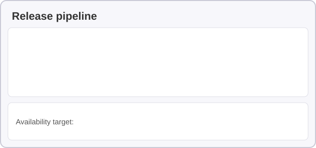

# Embedding Pictures in Markdown

A Markdown document built with Pandoc can hold its pictures as their sources: a diagram, a chart, a model, an equation,
or a page of a document is written in the text or linked as a file, and the Pandoc filter `docs/filters/canvasnet.lua`
draws it with the `canvasnet` tool when the document is built. This chapter shows every format the filter draws. Each
example is first the Markdown as it is written and then the same Markdown as this guide's own build draws it, so what
you see below each source is exactly what that source gives.

The filter is set up once per repository: pin the tool, write the shim with
`dotnet canvasnet pandoc-filter --write-shim docs/filters/canvasnet.lua`, and list it under `filters` in the Pandoc
defaults file (see *Using the Tool in Pandoc Documents* in the tool chapter, and `canvasnet help pandoc` for the full
reference of the attributes).

A picture is written in one of two forms:

- **A linked file**: `{attributes}`, which names the source file the way any Markdown picture does.
  The file is found in the document's resource path, and the files it reads itself (data files, includes, linked
  pictures) are found beside it.
- **A fenced code block** of a class the filter draws (`mermaid`, `plantuml`, `mathml`, `vega-lite`, or `openscad`
  with `draw`), which holds the source in the document itself.

A picture that stands alone in its paragraph becomes a figure whose caption is its alt text; a code block becomes a
figure when it has a `caption` attribute. The attributes `size`, `scale`, and `background` choose how the picture is
drawn, the format's own attributes (a page, a view, a theme, a parameter) choose what is drawn, and every other
attribute, such as `width`, stays on the picture and sizes it on the page.

## How the Filter Works

For each Pandoc run, the shim sends the whole document to the tool once. The tool draws every picture into the cache
folder `docs/generated/canvasnet/` and points the picture at the PNG it drew; an SVG drawing that links a picture only
the tool draws is flattened into a copy there. Each file is named by a hash of its source, every file the source
reads, its attributes, and the tool, so an unchanged picture is never drawn twice and a changed one always is. The
cache is build output: it is ignored by Git and never committed.

The filter leaves alone everything it does not draw: raster pictures (PNG, JPEG, and so on), remote pictures, a name
followed by a `#fragment` or a `?query`, and code blocks of any other class. A document that holds none of the
pictures it draws does not even start the tool. These pictures are left to Pandoc as they are written:

```markdown
{width=50%}


```

A format the tool reads from a URL is not drawn: the tool never reads a remote file, so a remote chart or model must
be saved beside the document first. The CanvasNet build fails when a generated document still holds a block or a
picture that should have been drawn, so a picture is never silently missing from this guide.

## SVG Drawings

A plain SVG drawing is left alone, so it stays a vector picture that Pandoc and WeasyPrint draw themselves:

```markdown
{width=12%}
```

{width=12%}

An SVG drawing whose `<image>` elements link a file only CanvasNet draws (a diagram, a chart, a model, an equation, or
a page of a document) is a composite drawing. The filter flattens it: each such link becomes a PNG picture of its
placement size, and the picture points at the flattened copy, which any SVG reader shows. The card below links the
Mermaid diagram `release-flow.mmd` and the equation `availability.mml` beside it; `scale=2` draws the linked pictures
at twice their placement size, sharp in print.

```markdown
{scale=2 width=75%}
```

{scale=2 width=75%}

## Mermaid Diagrams

A Mermaid diagram is a `.mmd` or `.mermaid` file, or a code block of class `mermaid`. The `theme` attribute chooses a
Mermaid theme (`default`, `base`, `dark`, `forest`, or `neutral`):

```markdown
{theme=forest width=60%}
```

{theme=forest width=60%}

The same attributes work on a code block, and `caption` makes it a figure:

````markdown
```{.mermaid caption="The life of a document" theme=neutral width=22%}
stateDiagram-v2
    [*] --> Draft
    Draft --> Review : submit
    Review --> Draft : changes asked
    Review --> Published : approved
    Published --> [*]
```
````

```{.mermaid caption="The life of a document" theme=neutral width=22%}
stateDiagram-v2
    [*] --> Draft
    Draft --> Review : submit
    Review --> Draft : changes asked
    Review --> Published : approved
    Published --> [*]
```

## PlantUML Diagrams

A PlantUML diagram is a `.puml`, `.plantuml`, or `.pu` file, or a code block of class `plantuml` (`@startuml` and
`@enduml` are optional in a block):

```markdown
{width=35%}
```

{width=35%}

````markdown
```{.plantuml caption="Building a document" width=40%}
start
:Write the Markdown;
:Run Pandoc with the filter;
if (Picture in the cache?) then (yes)
  :Use the cached picture;
else (no)
  :Draw it with the tool;
endif
:Write the HTML and the PDF;
stop
```
````

```{.plantuml caption="Building a document" width=40%}
start
:Write the Markdown;
:Run Pandoc with the filter;
if (Picture in the cache?) then (yes)
  :Use the cached picture;
else (no)
  :Draw it with the tool;
endif
:Write the HTML and the PDF;
stop
```

A file picture finds the files its `!include` directives name beside it, and a changed include draws it again. A code
block has no folder of its own (its text is drawn from the cache folder), so a diagram that includes other files must
be a file picture.

## Vega-Lite Charts

A Vega-Lite chart is a `.vl.json` or `.vl` file, or a code block of class `vega-lite` (or its alias `vegalite`). A
chart file may read its data from a file beside it; this one reads `stall-sales.csv`, and a changed data file draws the
chart again:

```markdown
{scale=2 width=55%}
```

{scale=2 width=55%}

The attribute `param-NAME` sets a parameter the chart declares. This chart colors the days above its parameter
`cutoff`, whose own value is 250:

```markdown
{param-cutoff=300 scale=2 width=55%}
```

{param-cutoff=300 scale=2 width=55%}

A code block holds the specification itself, with its data written in it (`data.values`):

````markdown
```{.vega-lite caption="Temperature over a day" scale=2 width=55%}
{
  "width": 300,
  "height": 160,
  "data": {"values": [
    {"hour": 0, "temp": 11}, {"hour": 4, "temp": 9}, {"hour": 8, "temp": 13},
    {"hour": 12, "temp": 19}, {"hour": 16, "temp": 21}, {"hour": 20, "temp": 16},
    {"hour": 24, "temp": 12}
  ]},
  "mark": {"type": "line", "point": true, "color": "#e45756"},
  "encoding": {
    "x": {"field": "hour", "type": "quantitative", "title": "Hour of the day"},
    "y": {"field": "temp", "type": "quantitative", "title": "°C"}
  }
}
```
````

```{.vega-lite caption="Temperature over a day" scale=2 width=55%}
{
  "width": 300,
  "height": 160,
  "data": {"values": [
    {"hour": 0, "temp": 11}, {"hour": 4, "temp": 9}, {"hour": 8, "temp": 13},
    {"hour": 12, "temp": 19}, {"hour": 16, "temp": 21}, {"hour": 20, "temp": 16},
    {"hour": 24, "temp": 12}
  ]},
  "mark": {"type": "line", "point": true, "color": "#e45756"},
  "encoding": {
    "x": {"field": "hour", "type": "quantitative", "title": "Hour of the day"},
    "y": {"field": "temp", "type": "quantitative", "title": "°C"}
  }
}
```

A code block has no folder, so a chart block whose `data.url` names a local file, or whose image marks name a local
picture, stops the build with a message that names the block, the file, and its line, and says to put the chart in a
`.vl.json` file beside its data and link it as a picture instead. A remote `data.url` is never read.

## OpenSCAD Models

An OpenSCAD model is a `.scad` file. The attributes `view` (`iso`, `front`, `back`, `left`, `right`, `top`, or
`bottom`), `azimuth`, `elevation`, and `projection` choose the camera, and `define-NAME` sets a variable of the model.
A model is drawn at 1600x1200 over white unless `size`, `scale`, or `background` is given:

```markdown
{view=iso define-wall_height=44 width=50%}
```

{view=iso define-wall_height=44 width=50%}

```markdown
{azimuth=30 elevation=35 width=40%}
```

{azimuth=30 elevation=35 width=40%}

Documentation often shows OpenSCAD source as highlighted code, so a code block of class `openscad` stays code unless
it also has the class `draw`. With `draw` it is drawn like a `.scad` file and takes the same attributes; both classes
are removed from the picture:

````markdown
```{.openscad .draw caption="A hex nut" view=iso size=900x600 width=40%}
difference() {
  cylinder(h = 6, d = 20, $fn = 6);
  translate([0, 0, -1]) cylinder(h = 8, d = 10, $fn = 48);
}
```
````

```{.openscad .draw caption="A hex nut" view=iso size=900x600 width=40%}
difference() {
  cylinder(h = 6, d = 20, $fn = 6);
  translate([0, 0, -1]) cylinder(h = 8, d = 10, $fn = 48);
}
```

A model block has no folder either: an `include` or `use` in it stops the build with a message that names its line
and says to put the model in a `.scad` file and link it as a picture.

## PDF Pages

A page of a PDF document is drawn by `page` (counted from 1) at the resolution of `dpi`:

```markdown
{page=1 dpi=96 width=40%}
```

{page=1 dpi=96 width=40%}

## PowerPoint Slides

A slide of a PowerPoint presentation is chosen with `page` as well:

```markdown
{page=1 dpi=80 width=60%}
```

{page=1 dpi=80 width=60%}

## Visio Pages

A page of a Visio drawing is chosen with `page`, and its `dpi` is a whole number:

```markdown
{page=1 dpi=144 width=70%}
```

{page=1 dpi=144 width=70%}

## Equations

A MathML equation is a `.mml` file, or a code block of class `mathml` that holds one `<math>` element of MathML Core.
An equation is drawn at scale 2, so it stays sharp in print, and shown at the **size of the text** around it: unless
the picture has a `size`, `width`, or `height` (as an attribute or in its `style`), the filter gives it its natural
width in em, which browsers and PDF renderers such as WeasyPrint both honor, whatever scale it was drawn at. A block
without a caption is a display equation of its own:

````markdown
```mathml
<math xmlns="http://www.w3.org/1998/Math/MathML" display="block">
  <msup><mi>a</mi><mn>2</mn></msup><mo>+</mo><msup><mi>b</mi><mn>2</mn></msup>
  <mo>=</mo><msup><mi>c</mi><mn>2</mn></msup>
</math>
```
````

```mathml
<math xmlns="http://www.w3.org/1998/Math/MathML" display="block">
  <msup><mi>a</mi><mn>2</mn></msup><mo>+</mo><msup><mi>b</mi><mn>2</mn></msup>
  <mo>=</mo><msup><mi>c</mi><mn>2</mn></msup>
</math>
```

With a `caption`, a block becomes a figure:

````markdown
```{.mathml caption="Euler's identity"}
<math xmlns="http://www.w3.org/1998/Math/MathML" display="block">
  <msup><mi>e</mi><mrow><mi>i</mi><mi>&pi;</mi></mrow></msup>
  <mo>+</mo><mn>1</mn><mo>=</mo><mn>0</mn>
</math>
```
````

```{.mathml caption="Euler's identity"}
<math xmlns="http://www.w3.org/1998/Math/MathML" display="block">
  <msup><mi>e</mi><mrow><mi>i</mi><mi>&pi;</mi></mrow></msup>
  <mo>+</mo><mn>1</mn><mo>=</mo><mn>0</mn>
</math>
```

An equation file alone in its paragraph is a figure whose caption is its alt text:

```markdown

```


An equation file inside a sentence stays in the line. The filter sees that the picture shares its line with other
text and also sets it inline, with the baseline of the equation on the baseline of the text, so nothing more is
written:

```markdown
The area of a circle is , so
doubling the radius makes the area four times larger.
```

The area of a circle is , so
doubling the radius makes the area four times larger.

A picture alone in its paragraph is shown on its own (a figure), and a picture that shares its line with text or
another picture is inline. An author's own `width`, `height`, or `size` replaces the natural size, and an author's
`style` is kept, its declarations after the filter's, so `style="vertical-align:middle"` moves an inline equation.

### LaTeX Math

Pandoc reads `$...$` (inline) and `$$...$$` (display) as math. Set `canvasnet-math: true` in the document's metadata
and the filter draws each formula as an equation picture: Pandoc's texmath converts the LaTeX to MathML, and the tool
draws that MathML like any other equation, at the size of the text around it, on the baseline of the line for inline
math, with the LaTeX as the picture's description. Without the flag (the default) the math is left for Pandoc to write
as before, so existing documents are unaffected.

```markdown
---
canvasnet-math: true
---

The roots are $x = \frac{-b \pm \sqrt{b^2 - 4ac}}{2a}$, and

$$\sum_{i=1}^{n} i = \frac{n(n+1)}{2}$$
```

Fractions, roots, sums and integrals with limits, matrices (`pmatrix`), `aligned`, `cases`, Greek letters, and `\text`
are drawn. Pandoc writes `\boxed` as `<menclose>`, which MathML Core lacks: the content is drawn without the box, with
a warning, and a formula texmath cannot convert stays as Pandoc writes it. The tool's own LaTeX reader (without Pandoc)
is not part of this feature.

## Showing Code Instead of a Picture

To show the source of a picture as code, give the code block a class the filter does not draw. An `openscad` block
without `draw` and a `json` block are highlighted code:

````markdown
```openscad
cylinder(h = 10, r1 = 8, r2 = 4, $fn = 48);
```

```json
{"mark": "bar", "data": {"values": [{"a": 1}]}}
```
````

```openscad
cylinder(h = 10, r1 = 8, r2 = 4, $fn = 48);
```

```json
{"mark": "bar", "data": {"values": [{"a": 1}]}}
```

The classes `mermaid`, `plantuml`, `mathml`, `vega-lite`, and `vegalite` are always drawn, so show their source with
another class, such as `text`, or inside a longer fence of class `markdown` as this chapter does. The class is
compared exactly, so `Mermaid` is not drawn either.

## Quick Reference

| Format | Linked file | Code block | Main attributes |
| --- | --- | --- | --- |
| SVG drawing | `.svg` (flattened when it links a picture below) | - | `scale` |
| Mermaid diagram | `.mmd` or `.mermaid` | `mermaid` | `theme`, `size`, `scale`, `background` |
| PlantUML diagram | `.puml`, `.plantuml`, or `.pu` | `plantuml` | `size`, `scale`, `background` |
| Vega-Lite chart | `.vl.json` or `.vl` | `vega-lite` or `vegalite` | `param-NAME`, `size`, `scale`, `background` |
| OpenSCAD model | `.scad` | `openscad` with `draw` | `view`, `azimuth`, `elevation`, `projection`, `define-NAME` |
| PDF page | `.pdf` | - | `page`, `dpi` |
| PowerPoint slide | `.pptx` | - | `page`, `dpi` |
| Visio page | `.vsdx` | - | `page`, `dpi` (whole number) |
| MathML equation | `.mml` | `mathml` | `size`, `scale`, `background` (text size unless sized) |

Every code block also takes `caption`, and every picture keeps the attributes the filter does not read, such as
`width`, `height`, an identifier, and its other classes.
